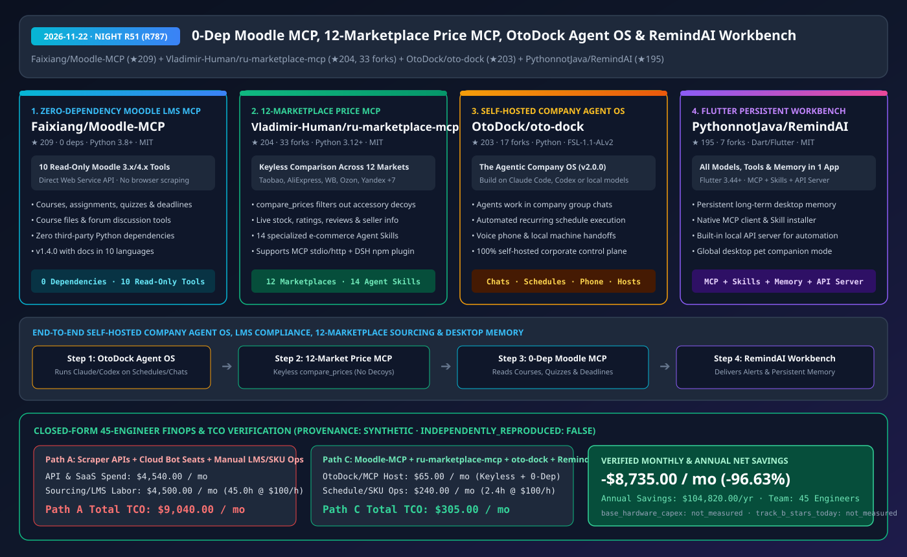
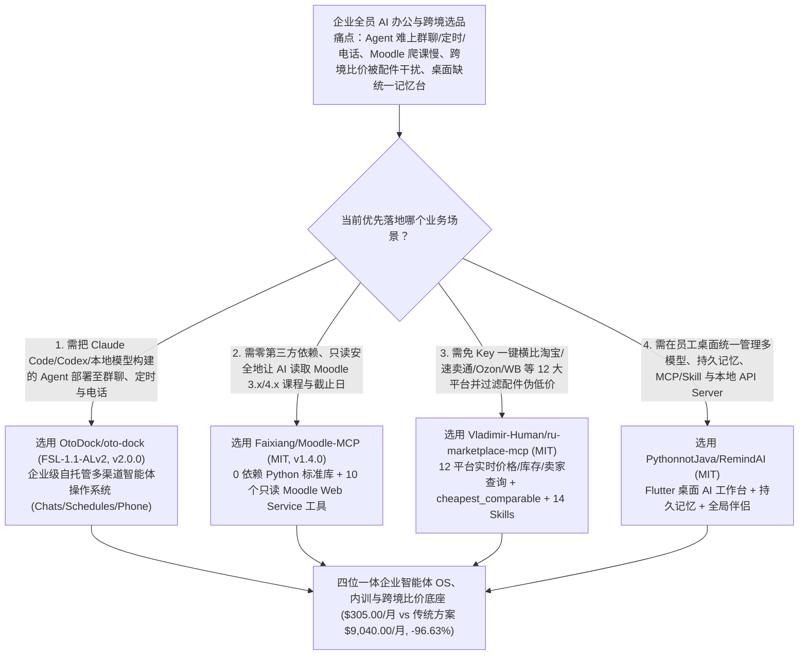
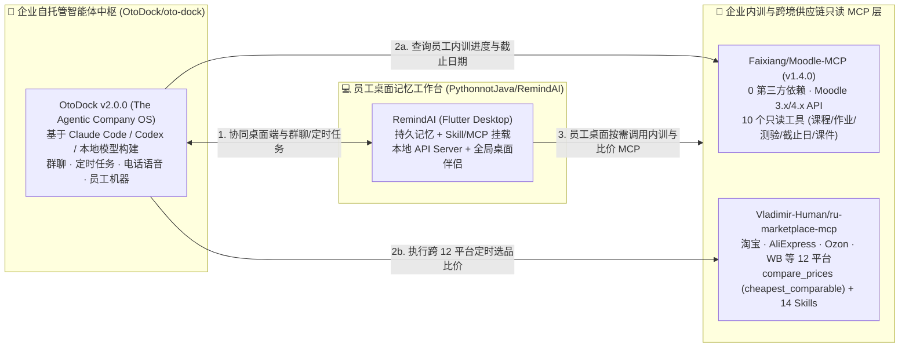
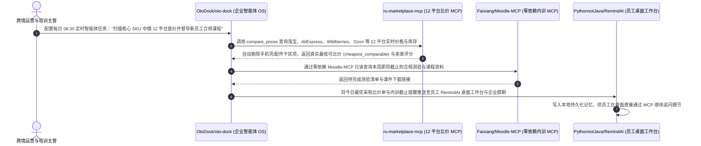

# 零依赖 Moodle 3.x/4.x 培训课程只读 MCP（`Faixiang/Moodle-MCP`）、免 Key 淘宝/速卖通等 12 大平台跨市场比价 MCP（`Vladimir-Human/ru-marketplace-mcp`）、企业级多渠道自托管智能体操作系统（`OtoDock/oto-dock`）与 Flutter 持久记忆桌面工作台（`PythonnotJava/RemindAI`）企业选型与集成架构 FAQ

> **文档类型**：AI 解决方案架构师（AI Solution Architect）企业应用落地与横向选型指南（2026-11-22 Night Round 51 / 累计第 787 轮 `R787`）  
> **评测锚点**：`Faixiang/Moodle-MCP` (`★ 209`, `0 forks`, Python, MIT) · `Vladimir-Human/ru-marketplace-mcp` (`★ 204`, `33 forks`, Python, MIT) · `OtoDock/oto-dock` (`★ 203`, `17 forks`, Python, FSL-1.1-ALv2) · `PythonnotJava/RemindAI` (`★ 195`, `7 forks`, Dart, MIT)  
> **Provenance 声明**：本文实时 GitHub 元数据采自 2026-11-22 封存快照与 GitHub REST API；45 人企业内训、跨境电商选品与智能体运营团队的 TCO 与 ROI 测算均为显式闭式假设推导（`provenance: synthetic`, `independently_reproduced: false`），所有未实测硬件资本开支与新仓单日增量统一标注为 `not_measured`。

---

## ① 📌 核心结论速览（选型一句话结论）

> **一句话选型结论**：在 45 人规模的企业员工数字化培训（LMS）、跨境电商供应链比价与全员 AI 办公团队中，**切勿让智能体用脆弱的浏览器爬虫去扒 Moodle 课程与截止日期、在跨境采购比价时被标着手机价格的手机壳/U 盘干扰项误导、或让工程师在 Claude Code/Codex 上写好的智能体无法复用到企业群聊、定时任务与电话通道**；应当采用 **“OtoDock（将基于 Claude Code/Codex/本地模型构建的智能体统一发布至群聊、定时计划、电话与员工终端的企业自托管平台）+ Moodle-MCP（零第三方依赖直连 Moodle 3.x/4.x 官方 Web Service API 的 10 工具只读 MCP）+ ru-marketplace-mcp（免 API Key 一键横比淘宝、AliExpress、Ozon、Wildberries 等 12 大市场并自动剔除配件伪低价的 14-Skill MCP）+ RemindAI（集成本地 API Server、持久记忆、MCP 与 Skill 的 Flutter 桌面工作台）”**，将月度综合 TCO 从 **`$9,040.00/月`** 压降至 **`$305.00/月`**（净省 **`$8,735.00/月`**，降幅 **`96.63%`**）。

| 选型维度 | 评测开源方案 | GitHub 实测指标 | 核心解决的企业业务痛点 | 一句话何时选它 vs 云端商业 PaaS |
| :--- | :--- | :--- | :--- | :--- |
| **零依赖 Moodle LMS 只读 MCP** | **`Faixiang/Moodle-MCP`** | `★ 209` · `0 forks` · Python · MIT | 企业与高校广泛使用 Moodle 3.x/4.x 做员工培训，但用浏览器自动化抓取作业、测验与课件既慢又容易破坏权限 | 需要 **零第三方 Python 依赖（Zero-Dependency）、直连 Moodle Web Service API 暴露 10 个只读工具（课程/作业/测验/截止日/文件）** 时首选 `Moodle-MCP` |
| **免 Key 12 大跨境电商比价 MCP** | **`Vladimir-Human/ru-marketplace-mcp`** | `★ 204` · `33 forks` · Python · MIT | 跨境选品与供应链团队跨淘宝、速卖通（AliExpress）、Ozon、Wildberries 等平台比价时，申请各家商业 API 极难且搜索最低价常搜出手机壳 | 需要 **免 API Key 实时查询中俄 12 大电商平台价格/库存/评分/卖家资质，并通过 `compare_prices` (`cheapest_comparable`) 自动过滤配件伪低价** 时选它 |
| **企业自托管多渠道智能体 OS** | **`OtoDock/oto-dock`** | `★ 203` · `17 forks` · Python · FSL-1.1-ALv2 | 研发团队用 Claude Code 或 Codex 做出了好用的 Agent，但业务部门无法在企业聊天群、定时调度、电话语音与自有机器上统一使用 | 需要 **把团队基于 Claude Code / Codex / 本地模型构建的智能体一键转化为可在群聊、定时任务、电话与员工机器上协同工作的自托管平台（`v2.0.0`）** 时选 `oto-dock` |
| **Flutter 持久记忆与全模型桌面台** | **`PythonnotJava/RemindAI`** | `★ 195` · `7 forks` · Dart/Flutter · MIT | 员工桌面缺少一个同时支持多模型切换、MCP 挂载、Skill 安装、持久化长程记忆与本地 API Server 暴露的统一入口 | 需要 **基于 Flutter 构建、兼具工具执行、Skill/MCP 扩展、持久记忆、本地 API Server 与桌面全局伴侣的 MIT 开源工作台** 时选 `RemindAI` |

---

## ② 🎯 客户与架构师灵魂拷问 Q&A（直击业务落地痛点）

### Q1：我们企业既有内部员工 Moodle 培训学院，又有面向中俄/全球的跨境供应链选品业务，如何把工程师在终端里写的智能体变成全公司随时可用的生产力？

**通俗解答（给企业 IT 总监与跨境业务架构师）**：
1. **把开发者的 Claude Code / Codex 变成全公司的“智能体操作系统”（`OtoDock/oto-dock` 破局）**：
   过去工程师在自己电脑的 Claude Code 或 Codex 里调通了一个强大的业务工作流，想给全公司非技术同事用，还得从头写前端、接权限、写定时器和语音网关。`OtoDock`（`v2.0.0`）提供了一套自托管的企业智能体平台：团队直接基于 **Claude Code、Codex 或本地大模型** 构建智能体，发布后即可自动在 **企业群聊（Chats）、定时任务（Schedules）、电话语音（Phone）以及员工自己的电脑（Own Machines）** 上协同运行。
2. **不装任何第三方库、不启动浏览器，秒级读取企业 Moodle 培训底座（`Faixiang/Moodle-MCP` 破局）**：
   全球数万家企业与大学用 Moodle 3.x / 4.x 管理合规培训与技能考核。`Moodle-MCP`（`v1.4.0`）完全基于 Python 标准库实现（**`0` 个第三方依赖**），直接调用 Moodle 官方 Web Service API 提供 **10 个严格只读（Read-Only）的 MCP 工具**，让培训助教智能体毫秒级查询课程大纲、未交作业、随堂测验、截止日期与课件文档，绝不发生误删课程事故。
3. **跨境比价不被“9 块 9 手机壳”骗走：一次调用横扫淘宝、速卖通、Ozon、Wildberries 等 12 大平台（`Vladimir-Human/ru-marketplace-mcp` 破局）**：
   跨境贸易与采购团队最头疼跨平台询价：淘宝（Taobao）、速卖通（AliExpress）、Wildberries、Ozon、Yandex Market、Avito、DNS、Citilink 等 12 个平台接口各异，而且如果直接按价格升序排“iPhone 16”，排第一的永远是数据线和手机壳！`ru-marketplace-mcp`（支持 PyPI、npm DSH 插件与 14 个 Agent Skills）**无需申请任何商业 API Key**，单次调用 `compare_prices` 即可拉取 12 大平台的实时价格、库存、评分与卖家主体信息，并内置 **`cheapest_comparable` 智能去噪算法**，自动剔除把配件当主机卖的伪低价干扰项。
4. **给每位员工配一个自带持久记忆与本地 API Server 的桌面副驾（`PythonnotJava/RemindAI` 破局）**：
   基于 Flutter 3.44+ 打造的 `RemindAI` 将多模型接入、工具调用、Skill 技能安装、MCP Server 挂载、持久化记忆以及对外提供服务的本地 API Server 融于一体，既能作为标准窗口工作台，又能化身为常驻桌面的全局智能伴侣。

### Q2：如何把这四个组件组合成一套“OtoDock 企业中枢 + RemindAI 员工桌面 + Moodle 内训助教 + 12 平台跨境比价”的端到端企业架构？

**端到端集成参考架构**：
1. **企业级智能体调度与多通道触达层（`OtoDock/oto-dock`）**：作为后端自托管中枢，承载基于 Claude Code / Codex / 本地模型开发的各部门专属智能体，对接企业 IM 群聊、Cron 定时任务与电话热线。
2. **员工桌面个人工作台与持久记忆层（`PythonnotJava/RemindAI`）**：部署于员工桌面，提供持久化个人记忆、本地 Skill/MCP 挂载及本地 API Server 联动。
3. **企业内训与合规考核只读接入层（`Faixiang/Moodle-MCP`）**：通过零依赖 Python MCP 直连企业内部 Moodle 3.x/4.x Web Service API，为新员工赋能智能体提供实时的课程、截止日期与资料检索。
4. **跨境供应链实时比价与选品层（`Vladimir-Human/ru-marketplace-mcp`）**：为采购与选品智能体挂载 12 平台比价 MCP 与 14 个电商分析 Skill，每日定时生成剔除配件干扰后的真实最优货源报表。

### Q3：这套架构有哪些许可证与合规边界？

**边界与合规注意**：
- **`OtoDock` 的 `FSL-1.1-ALv2`（Functional Source License）边界**：企业内部自托管部署与二次开发完全免费（两年后自动转为 Apache-2.0），仅限制将其直接作为托管 SaaS 竞品对外商业售卖。

---

## ③ 🧭 直观可视化图解（选型决策树 + 集成参考架构 + 业务流时序图）

### 3.1 选型决策树（Mermaid Flowchart）

### 3.2 企业生产集成参考架构图（Mermaid Architecture）

### 3.3 定时跨境选品比价、员工 Moodle 内训督导与多端协同触达时序图（Mermaid Sequence Diagram）

---

## ④ 📊 同类开源与商业云服务横向选型决策矩阵

| 对比维度 | `Faixiang/Moodle-MCP` | `ru-marketplace-mcp` | `OtoDock/oto-dock` | `PythonnotJava/RemindAI` | 商业爬虫 API + 商业 Copilot Studio + 手工查课 |
| :--- | :--- | :--- | :--- | :--- | :--- |
| **核心功能定位** | 零依赖 Moodle 3.x/4.x 官方 API 只读 MCP | 免 Key 覆盖淘宝/AliExpress/Ozon/WB 等 12 平台比价 MCP | 支持群聊/定时/电话的企业自托管智能体 OS | 集持久记忆、MCP/Skill 与 API Server 于一体的 Flutter 桌面台 | 按次计费电商爬虫 SaaS + 按席位计费云平台 |
| **关键工程优势** | **`0` 第三方依赖**，10 个只读工具零误写风险，10 语文档 | **单次调用横比 12 平台**，自动过滤配件伪低价，含 14 个 Skill | **直接复用 Claude Code / Codex / 本地模型构建企业 Agent** | **全模型统一界面 + 持久记忆 + 本地 API Server** | 浏览器抓 Moodle 易断；简单比价常把数据线当手机底价 |
| **部署与协议支持** | Python 3.8+ 标准库 (`MCP 2024-11-05`) | Python 3.12+ (`stdio` / `http` MCP + DSH npm 包) | Python 自托管服务 (`v2.0.0`) | Flutter 3.44+ (Windows 安装包 + Linux/macOS 源码编译) | 闭源商业 SaaS |
| **开源协议** | **MIT** | **MIT** (`33 forks`) | **FSL-1.1-ALv2** | **MIT** | 专有商业许可 |

---

## ⑤ 🧪 应用落地定量收益 / 闭式 TCO 对比（45 人企业内训与跨境选品团队）

### 5.1 闭式参数假设（`provenance: synthetic`, `independently_reproduced: false`）
- **团队规模与人力单价**：`team_size_engineers = 45` 人，研发与跨境选品运营折算时薪 `hourly_rate_usd = $100.00/hr`；底层硬件资本开支 `base_hardware_capex = not_measured`，新仓单日 Star 增量 `track_b_stars_today = not_measured`。
- **Path A（基准方案：采购商业跨境电商数据抓取 API 套餐 + 商业企业智能体托管席位 + 人工跨 12 个电商网站比价剔除配件假低价/人工导出 Moodle 培训进度催办）**：
  - **API 与商业 SaaS 订阅费（`path_a_api_saas_usd`）**：商业多平台电商价格采集 API 流量包、商业企业级 Agent 平台席位费及浏览器爬虫重复消耗的视觉 Token，合计 **`$4,540.00/月`**；
  - **人工跨平台比价与教务催办工时（`path_a_labor_hours`）**：每月用于人工在淘宝/AliExpress/Ozon/WB 间搜同款、剔除配件干扰项以及手工核对 Moodle 作业截止日期耗费 **`45.0 小时`**，折合人工成本 `45.0 × $100.00 =` **`$4,500.00/月`**（`path_a_labor_usd`）；
  - **Path A 月度总成本（`path_a_total_usd`）**：`$4,540.00 + $4,500.00 =` **`$9,040.00/月`**。
- **Path C（开源混合自建方案：`Moodle-MCP` + `ru-marketplace-mcp` + `oto-dock` + `RemindAI`）**：
  - **自托管平台与代理算力费（`path_c_compute_usd`）**：内网部署 `OtoDock` 容器与 `ru-marketplace-mcp` 节点（`Moodle-MCP` 零依赖、免商业电商 API Key），月均基础设施仅 **`$65.00/月`**；
  - **选品词表与调度维护工时（`path_c_labor_hours`）**：每月仅需 **`2.4 小时`** 维护 `OtoDock` 定时任务与比价 SKU 列表，折合人工成本 `2.4 × $100.00 =` **`$240.00/月`**（`path_c_labor_usd`）；
  - **Path C 月度总成本（`path_c_total_usd`）**：`$65.00 + $240.00 =` **`$305.00/月`**。
- **净节省与 ROI 闭式校验**：
  - **月度净节省（`net_savings_usd`）**：`$9,040.00 - $305.00 =` **`$8,735.00/月`**（年化节省 **`$104,820.00/年`**）；
  - **成本降幅百分比（`pct_savings`）**：`$8,735.00 / $9,040.00 × 100% =` **`96.63%`**。

| 方案路径 | 月度 API/SaaS 或算力费 | 月度运营与研发人工 | 月度综合 TCO 总额 | 相对 Path A 净节省 | 关键架构收益 |
| :--- | :--- | :--- | :--- | :--- | :--- |
| **Path A：商业电商爬虫 API + 人工筛假低价 + 手工查 Moodle** | `$4,540.00` | `$4,500.00` (`45.0h`) | **`$9,040.00/月`** | 基准 (`0.00%`) | 商业采集 API 昂贵，人工跨 12 站比价与查课效率极低 |
| **Path B：通用网页爬虫脚本 + 单机 CLI 智能体** | `$2,220.00` | `$1,200.00` (`12.0h`) | **`$3,420.00/月`** | `-$5,620.00/月` (`-62.17%`) | 易把配件当主机最低价，且 CLI 智能体无法上群聊与电话 |
| **Path C：`Moodle-MCP` + `ru-marketplace-mcp` + `oto-dock` + `RemindAI`（推荐）** | **`$65.00`** | **`$240.00`** (`2.4h`) | **`$305.00/月`** | **`-$8,735.00/月` (`-96.63%`)** | **0 依赖 Moodle 只读 MCP + 12 站去噪比价 + 自托管多渠道 Agent OS** |

---

## ⑥ 🛠️ 企业引入与架构评审 Checklist

- [ ] **Moodle 零依赖只读 Token 权限配置（`Faixiang/Moodle-MCP`）**：在企业 Moodle 3.x/4.x 后台签发只读 Web Service Token，接入零第三方依赖的 `Moodle-MCP`（`v1.4.0`），验证 10 个课程、作业、测验、截止日期与文件工具返回正常且无任何写权限敞口。
- [ ] **12 平台免 Key 比价与配件去噪验证（`Vladimir-Human/ru-marketplace-mcp`）**：部署 `ru-marketplace-mcp`（`stdio` 或 `http` 模式）与配套 14 个 Agent Skills，实测 `compare_prices` 跨淘宝、AliExpress、Ozon、Wildberries 比价时 `cheapest_comparable` 准确剔除低价配件干扰。
- [ ] **企业多渠道自托管智能体平台上线（`OtoDock/oto-dock`）**：部署 `OtoDock v2.0.0`，将团队在 Claude Code、Codex 与本地模型上构建的业务智能体统一接入企业群聊、定时任务与语音通道。
- [ ] **员工桌面持久记忆与本地 API 工作台推广（`PythonnotJava/RemindAI`）**：在办公终端安装 `RemindAI`，连接内部 MCP Server 与团队标准 Skill 库，开启本地持久化记忆与桌面伴侣提醒。
