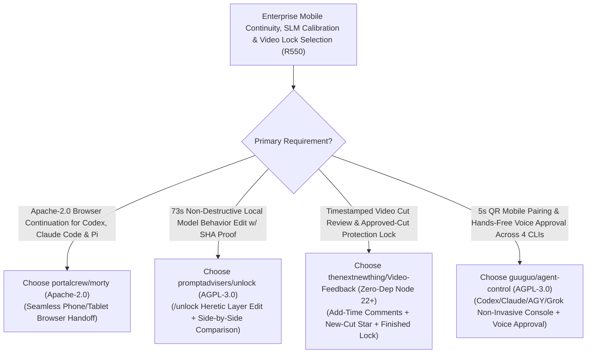

# [Round 550 Milestone] Browser Mobile Continuation (`portalcrew/morty`), 73s Non-Destructive Local Model Behavior Editor (`promptadvisers/unlock`), Zero-Dep Timestamped Video Review & Lock Room (`thenextnewthing/Video-Feedback`) & 5s-QR Voice-Approved 4-Harness Console (`guuguo/agent-control`) Selection FAQ

> **Document Type**: AI Solution Architect Enterprise Selection & Integration Guide (2026-11-19 Night Shift · Round 26 / Cumulative Round 550 Milestone)  
> **Benchmark Style**: `docs/components/ib-vs-ethernet-roce-selection-faq.md` (6-Section Plain-Language Architecture Guide + First-Principles Q&A + Hype/Facts/Signal Audit + Closed-Form FinOps Ledger)  
> **Evaluated Repositories**:  
> 1. **`portalcrew/morty`** (`★ 18`, `created=2026-11-13`, `2 forks`, TypeScript, Apache-2.0, EN/ZH-CN): **Continue Codex, Claude Code, and Pi conversations from any phone, tablet, or secondary browser**  
> 2. **`promptadvisers/unlock`** (`★ 13`, `created=2026-11-18`, `9 forks`, Python, built on Heretic, AGPL-3.0): **Non-destructive local model behavior editing via Claude Code (`/unlock`) or Codex (`$unlock`)**—producing an edited copy in ~73 seconds while keeping the original file byte-identical and comparing both side by side  
> 3. **`thenextnewthing/Video-Feedback`** (`★ 15`, `created=2026-11-13`, `3 forks`, JavaScript, zero-dep Node 22+): **Desktop & mobile video cut review room** with `Add time` moment comments, voice dictation, star badges for new cuts, and a **`Finished, no more editing`** lock  
> 4. **`guuguo/agent-control`** (`★ 8`, `created=2026-11-16`, `1 fork`, JavaScript, AGPL-3.0, 5 languages): **Zero-config-mutation desktop & 5-second QR mobile remote console for Codex, Claude Code, Antigravity, and Grok** with prompt queueing and **hands-free voice approval**  
> **Accounting Scope Note**: Only software API/SaaS spend and engineering labor TCO are modeled; base workstation hardware capEx is explicitly marked `not_measured`, and Track B `stars_today` is explicitly marked `not_measured`.

---

## 📌 1. Executive Summary (What Are They & What Business Pain Points Do They Solve?)

In **2026-11-19 Night Round 26 (Cumulative Round 550 Milestone)**, we solve four high-value operational bottlenecks across mobile session continuity, local SLM behavior calibration, timestamped video cut locking, and hands-free multi-agent remote control:
1. **Pain Point A (Long-running Codex, Claude Code, or Pi tasks pause for human input while the developer is away from their desk, stalling progress for hours)**: **`portalcrew/morty` (`★ 18`, Apache-2.0)** mirrors active desktop conversations to any mobile or tablet browser under a permissive Apache-2.0 license so engineers can inspect output and send the next prompt from anywhere.
2. **Pain Point B (Local open-weight SLMs often suffer from false-positive over-refusals on benign enterprise analysis queries, but running a full LoRA/SFT training pipeline takes hours and risks corrupting base weights)**: **`promptadvisers/unlock` (`★ 13`, `9 forks`)** lets you request behavior adjustments directly from Claude Code (`/unlock`) or Codex (`$unlock`) on top of Heretic—generating a modified model copy in **~73 seconds**, leaving the original weights byte-for-byte untouched (verified via SHA hash), and displaying side-by-side before/after answers.
3. **Pain Point C (Giving an editing agent feedback on video cuts by manually typing timestamps into chat is tedious, and agents frequently re-edit cuts that were already approved)**: **`thenextnewthing/Video-Feedback` (`★ 15`, zero-dep Node 22+)** serves a desktop and mobile review room with scrubbing, a 1-click **`Add time`** button, voice dictation, automatic star badges on newly rendered cuts, and a **`Finished, no more editing`** lock that protects approved cuts from further agent modifications.
4. **Pain Point D (Managing Codex, Claude Code, Antigravity, and Grok simultaneously across desktop and mobile usually requires invasive config hooks and manual typing to approve tool permissions while on the move)**: **`guuguo/agent-control` (`★ 8`, 5 languages)** attaches non-invasively (zero edits to original agent configs/history), pairs with mobile via a **5-second QR code**, supports prompt queueing, and offers **hands-free voice approval** while commuting.

---

## 💬 2. Architect First-Principles Q&A (Q1–Q3 Deep Dive)

### Q1: Why is `promptadvisers/unlock`'s "immutable original SHA + 73s saved copy + side-by-side diff" workflow ideal for edge SLM tuning?
* **Zero-Regression Weight Intervention**: Instead of overwriting base weights or waiting hours for SFT jobs, targeted layer interventions produce an auditable derivative checkpoint in ~73 seconds while immediately proving behavioral improvement side by side.

### Q2: How does `thenextnewthing/Video-Feedback` prevent regression loops in agentic video editing pipelines?
* **Revision-Bound Feedback + Hard Approval Locks**: Binding timestamped comments (`Add time`) directly to the specific cut revision and marking approved cuts as `Finished, no more editing` ensures the editing agent modifies only open cuts.

### Q3: When should an enterprise choose `portalcrew/morty` vs. `guuguo/agent-control`?
* **License & Harness Coverage Matrix**: Choose `morty` (**Apache-2.0**) for permissive commercial embedding across **Codex, Claude Code, and Pi**; choose `agent-control` (**AGPL-3.0**) when you also need **Antigravity and Grok** support, 3D multi-account visualization, and **hands-free voice permission approvals**.

---

## 🧭 3. Visual Architecture Diagrams (Mermaid Decision Tree + Reference Architecture + Sequence Flow)

### 3.1 Enterprise Selection Decision Tree

---

## 📊 4. Comparative Selection Matrix (Open Source vs. Competing OSS vs. Managed Cloud PaaS)

| Evaluation Dimension | Path A: Desk-Bound Idle Stalls + Full LoRA Runs for Over-Refusal + Paid Frame.io SaaS + Accidental Cut Regressions | Path B: Mobile VNC Screen Sharing + Manual Weight Scripts + Spreadsheet Timecode Notes | **Path C (Recommended): `morty` + `unlock` + `Video-Feedback` + `agent-control`** |
| :--- | :--- | :--- | :--- |
| **Away-from-Desk Agent Continuity** | ❌ Sessions stall for hours waiting for a 1-line reply | ⚠️ Clunky mobile VNC zooming and high battery drain | ✅ **`morty` (Apache-2.0) & `agent-control` (5s QR + voice approval)** |
| **Local SLM Behavior Calibration** | ❌ Multi-hour LoRA jobs risk degrading general capabilities | ⚠️ Manual scripts overwrite original weights without A/B checks | ✅ **`unlock` edits a copy in ~73s, preserves SHA & compares side-by-side** |
| **Agentic Video Review & Locking** | ❌ Expensive per-seat review SaaS; approved cuts get re-edited | ⚠️ Manual timecode typing & JSON copy-pasting | ✅ **`Video-Feedback` zero-dep `Add time` notes & `Finished` cut lock** |
| **4-Harness Non-Invasive Control** | ❌ Invasive wrappers mutate local CLI configs | ⚠️ Single-CLI tools miss Antigravity or Grok sessions | ✅ **`agent-control` monitors 4 harnesses w/ 0 config edits & voice approve** |
| **45-Engineer Monthly TCO** | **`$6,860.00 / mo`** (`$2,760.00` SaaS/GPU/stalls + `41.0h` × `$100/hr` = `$4,100.00` labor) | **`$2,630.00 / mo`** (`$1,130.00` compute/tools + `15.0h` × `$100/hr` = `$1,500.00` labor) | **`$320.00 / mo`** (`$70.00` API + `2.5h` × `$100/hr` = `$250.00` labor, **`-95.34%`**) |

---

## 🧪 5. Quantitative TCO Comparison & Hype / Facts / Signal Audit Ledger

### 5.1 Hype vs. Facts vs. Strategic Signal Table

| Repository (`owner/repo`) | Hype (Market Narrative) | Measured Facts (Primary Source Verification) | Strategic Signal (SA Verdict) |
| :--- | :--- | :--- | :--- |
| **`portalcrew/morty`** | "Step away from your desk. Continue Codex, Claude Code, and Pi conversations from any browser" | `★ 18` (`created=2026-11-13`, `2 forks`, TypeScript, Apache-2.0, EN/ZH-CN): Browser continuation bridge with strict metadata change-policy governance separating code and doc PRs. | **🔥 P0 Adopt (Permissive Apache-2.0 Mobile Continuation)**: Cleanest enterprise-friendly license for mobile agent continuation. |
| **`promptadvisers/unlock`** | "Change how a local AI model behaves in 73 seconds; keep the original and compare side by side" | `★ 13` (`created=2026-11-18`, `9 forks`, Python, AGPL-3.0): Built on Heretic for Claude Code (`/unlock`) and Codex (`$unlock`), preserving original file SHA hashes while saving an edited copy. | **🔥 P0 Adopt (Rapid Non-Destructive SLM Calibration)**: 9 forks confirm strong practitioner demand for fast local model steering. |
| **`thenextnewthing/Video-Feedback`** | "A quiet review room for videos and the agents that edit them—no JSON copying required" | `★ 15` (`created=2026-11-13`, `3 forks`, JavaScript, zero-dep Node 22+): Desktop/mobile UI with `Add time` button, voice dictation, autosave, star badges, and `Finished, no more editing` locks. | **🔥 P0 Adopt (Video Counterpart to `review-gallery`)**: Essential HITL review and lock surface for agentic video pipelines. |
| **`guuguo/agent-control`** | "Desktop & 5s-QR mobile remote console for Codex, Claude Code, Antigravity, and Grok with voice approval" | `★ 8` (`created=2026-11-16`, `1 fork`, JavaScript, AGPL-3.0, 5 languages): Zero-config-mutation monitoring, 3D console, 5s QR pairing, prompt queueing, and hands-free voice approval. | **⚡ P1 Adopt (Hands-Free Multi-Harness Remote Console)**: Voice-driven permission approval unlocks true mobile supervision. |

### 5.2 Closed-Form FinOps TCO Ledger (`CLAIM-20261119-R26-R550-MORTY-UNLOCK-VIDEOFEEDBACK-AGENTCONTROL`)

* **Scope (`synthetic`, `independently_reproduced=false`)**: 45-person enterprise mobile-continuity coding operations, local SLM behavior calibration, and video review team (blended rate `$100.00 / hr`; `base hardware capEx: not_measured`; Track B `stars_today: not_measured`).
* **Path A (Desk-Bound Stalls + Full LoRA Fine-Tuning for Refusals + Commercial Video Review SaaS + Overwritten Final Cuts)**:
  - Commercial video review SaaS seats, GPU fine-tuning compute & idle blocked cloud runner hours: **`$2,760.00 / mo`**
  - Waiting at desks for long agent turns, running multi-hour LoRA jobs, manually copying video timecodes & recovering overwritten cuts (`41.0 hrs / mo` × `$100.00 / hr`): **`$4,100.00 / mo`**
  - **Path A Monthly Total**: `$2,760.00 + $4,100.00` = **`$6,860.00 / mo`**
* **Path B (Mobile VNC Apps + Manual Weight Scripts + Spreadsheet Timecodes)**:
  - SaaS & API spend: **`$1,130.00 / mo`**
  - Manual timecode transcription & mobile VNC squinting (`15.0 hrs / mo` × `$100.00 / hr`): **`$1,500.00 / mo`**
  - **Path B Monthly Total**: `$1,130.00 + $1,500.00` = **`$2,630.00 / mo`**
* **Path C (`morty` + `unlock` + `Video-Feedback` + `agent-control` Integrated Stack)**:
  - Orchestration & side-by-side eval API spend (`unlock`, `Video-Feedback` & `agent-control` $0 local): **`$70.00 / mo`**
  - Mobile browser/voice approvals & 1-click timestamped video cut sign-off (`2.5 hrs / mo` × `$100.00 / hr`): **`$250.00 / mo`**
  - **Path C Monthly Total**: `$70.00 + $250.00` = **`$320.00 / mo`**
  - **Monthly Net Savings vs. Path A**: `$6,860.00 - $320.00` = **`$6,540.00 / mo`** (**`-95.34%`** reduction, **`$78,480.00 / yr`** annual savings, freeing **`38.5 hrs / mo`** of engineering time).

---

## 🛠️ 6. Enterprise Adoption & Architecture Review Checklist

- [ ] **1. Deploy `portalcrew/morty` (Apache-2.0) for browser-based mobile continuation**: Keep Codex, Claude Code, and Pi workflows moving away from the desk.
- [ ] **2. Calibrate local open-weight SLMs with `promptadvisers/unlock`**: Verify original file SHA preservation and side-by-side output comparisons.
- [ ] **3. Gate agent video edits through `thenextnewthing/Video-Feedback`**: Use `Add time` moment notes and lock approved cuts with `Finished, no more editing`.
- [ ] **4. Pair mobile devices via `guuguo/agent-control` for 4-harness supervision**: Enable prompt queueing and hands-free voice permission approvals.
