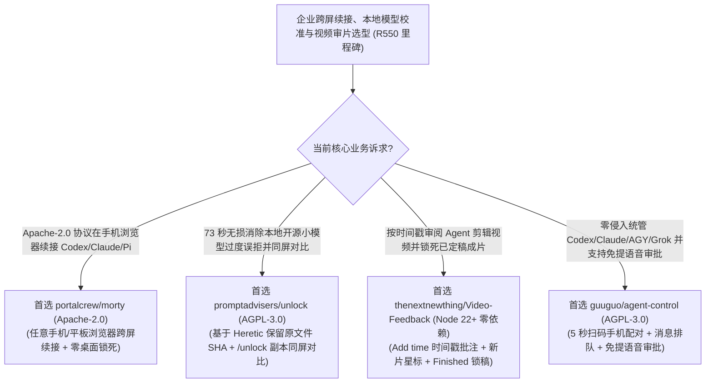
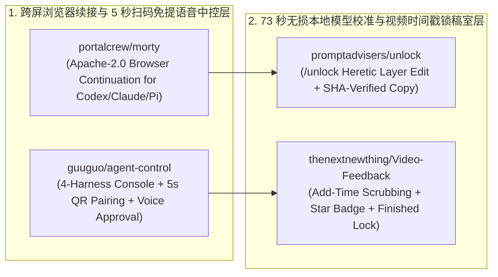
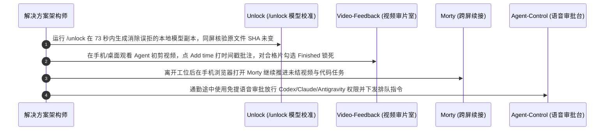

# 【第 550 轮里程碑】跨屏浏览器移动续接台（`portalcrew/morty`）、73 秒无损本地模型行为校准技能（`promptadvisers/unlock`）、零依赖视频时间戳审片与锁稿室（`thenextnewthing/Video-Feedback`）与 5 秒扫码免提语音四端中控（`guuguo/agent-control`）选型 FAQ

> **文档类型**：AI Solution Architect（AI 解决方案架构师）实战选型与架构内功指南（2026-11-19 Night Shift · Round 26 / 累计第 550 轮里程碑）  
> **对标标杆**：`docs/components/ib-vs-ethernet-roce-selection-faq.md`（六段式架构拆解 + 第一性原理大白话 + Hype/Facts/Signal 审计 + 闭式 TCO 账本）  
> **本轮评估对象**：  
> 1. **`portalcrew/morty`**（`★ 18`，`created=2026-11-13`，`2 forks`，TypeScript，Apache-2.0，中/英）：将电脑上正在运行的 **Codex、Claude Code 与 Pi 对话无缝延伸到任意手机或平板浏览器**的跨屏续接工具  
> 2. **`promptadvisers/unlock`**（`★ 13`，`created=2026-11-18`，`9 forks`，Python，基于 Heretic，AGPL-3.0）：通过 Claude Code（`/unlock`）或 Codex（`$unlock`）在 **约 73 秒内无损校准本地开源小模型行为**的技能——原模型文件保持字节级不变（SHA 哈希核验），自动保存修改副本并同屏对比修改前后回答  
> 3. **`thenextnewthing/Video-Feedback`**（`★ 15`，`created=2026-11-13`，`3 forks`，JavaScript，Node 22+ 零依赖）：面向视频剪辑 Agent 的**时间戳打点审片室与定稿锁定系统**——支持 `Add time` 帧点批注、手机语音听写、新剪星标提醒与 **`Finished, no more editing` 防误改锁**  
> 4. **`guuguo/agent-control`**（`★ 8`，`created=2026-11-16`，`1 fork`，JavaScript，AGPL-3.0，支持中/英/日/韩/繁）：**不改动原工具任何配置的 Codex / Claude Code / Antigravity / Grok 四端桌面与手机总控台**——支持 5 秒扫码配对、远程排队发送与**免提语音审批（Hands-Free Voice Approval）**  
> **审计折算说明**：本报告仅计量软件算力、商业 SaaS 与工程运维人力 TCO，底层研发工作站硬件采购（base hardware capEx）显式标注为 `not_measured`，新仓今日增量显式标注为 `not_measured`，严禁捏造坐标。

---

## 📌 一、核心结论速览（Executive Summary：它到底是什么？解决什么业务痛点？）

在 **2026-11-19 Night Round 26（累计第 550 轮里程碑）** 中，我们面向企业架构师解决“离开办公桌后桌面 Agent 跑完一轮就干等着没人给下一条指令、本地部署的端侧开源小模型把完全合规的业务问题误判为敏感拒答却不值得重跑几小时 LoRA 微调、让 Agent 改视频没有按秒打点的审片室且经常把已经定稿的镜头又改坏、以及在通勤或会议间隙没法免提语音批复四个不同编码工具的权限请求”四大痛点：
1. **痛点 A（架构师在工位启动了耗时 15 分钟的 Codex、Claude Code 或 Pi 重构任务，起身去开会或下班路上，任务跑完第 1 阶段停在那里等一句确认，白白晾了几个小时）**：**`portalcrew/morty` (`★ 18`, Apache-2.0) 的破局之道**：采用企业友好的 **Apache-2.0** 协议，把本机正在运行的 Codex、Claude Code 与 Pi 会话直接投射到手机、平板或另一台电脑的浏览器里，随时随地查看进展并输入下一条指令。
2. **痛点 B（企业在端侧或内网部署小参数开源模型（SLM）时，经常遇到模型“防卫过当（Over-Refusal）”——问一个完全正常的企业历史或安全合规分析问题，它却生硬回复 `"I'm sorry, but I can't assist with that request"`；如果为此准备数据集重跑一套 SFT/LoRA 微调，既耗时几个小时又容易破坏原模型通用能力）**：**`promptadvisers/unlock` (`★ 13`, `9 forks`, 基于 Heretic) 的破局之道**：直接在 Claude Code（`/unlock`）或 Codex（`$unlock`）里用一句话告诉助手你想修正的模型行为，底层基于 Heretic 在 **约 73 秒** 内完成定向权重层编辑并另存为副本——**原始模型文件连一个字节都不会改变（附 SHA 哈希证明）**，并立刻在终端展示“原模型 vs 修改后副本”对同一问题的同屏对比。
3. **痛点 C（在 Round 13 我们解决了静态图片的单页审稿（`review-gallery`），但当 Agent 负责剪辑多段视频时，人类怎么精确告诉它“第 01:14 秒那个镜头切太快了”，而且怎么防止 Agent 在改第 3 条视频时顺手把已经定稿的第 1 条视频又重新剪了一遍？）**：**`thenextnewthing/Video-Feedback` (`★ 15`, Node 22+ 零依赖) 的破局之道**：零外部依赖启动桌面与手机自适应的本地审片室——上方播视频、下方写反馈，拖动进度条点 **`Add time`** 即可插入精确时间点，支持手机键盘麦克风语音输入与草稿自动保存；Agent 剪出新版本后自动亮起**星标（Star）**提醒审阅，一旦满意勾选 **`Finished, no more editing`** 即可物理锁死该条成片不再允许 Agent 修改。
4. **痛点 D（重度 AI 工程师同时跑着 Codex、Claude Code、Antigravity 和 Grok 四套工具与多个账号，不仅需要一个完全不侵入、不篡改原工具配置文件的统一监控台，还希望在开车或走路时能用语音直接说“批准执行”）**：**`guuguo/agent-control` (`★ 8`, 5 语种) 的破局之道**：一条命令即装即用、**零修改原工具任何配置与记录**，提供桌面端 3D 梦工厂总控台与 **5 秒扫码配对的手机端远程控制台**，支持跨 4 大工具查看富文本/代码块、设置消息排队发送（Queueing），以及独创的 **免提语音审批（Hands-Free Voice Approval）**。

---

## 💬 二、客户与架构师灵魂拷问 Q&A（Q1–Q3 First-Principles Deep Dive）

### Q1：`promptadvisers/unlock` 的“原文件零字节改动（SHA 校验）+ 73 秒生成副本 + 同屏 Before/After 对比”对企业端侧模型标定有何价值？
* **不可变基线与快速方向编辑（Immutable Baseline & Fast Directional Editing）**：相比动辄耗费数小时 GPU 的全量微调，基于表示工程（Representation Engineering / Heretic）的层编辑只需一分钟即可消除特定领域的过度拒答，且强制保留原模型 SHA 基线并进行同屏 A/B 问答验证，可逆性极强。

### Q2：`thenextnewthing/Video-Feedback` 与 Round 13 的 `RevStudio/review-gallery` 如何共同构成“企业多模态 Agent 人机验收双璧”？
* **静态图用 `review-gallery`，时间轴视频用 `Video-Feedback`**：两者都遵循一个核心第一性原理——**必须提供“已通过项冻结锁（`Looks good` / `Finished, no more editing`）”与“免手动导 JSON 的原位反馈绑定”**，从而彻底消除多轮迭代中的回归误改。

### Q3：在移动远程控制赛道，企业架构师如何在 `portalcrew/morty`（Apache-2.0）与 `guuguo/agent-control`（AGPL-3.0）之间做选型？
* **按开源许可与受控端范围精准选型**：若企业需要将跨屏续接能力嵌入内部商业发行工具且主用 **Codex / Claude Code / Pi**，优先选 **Apache-2.0** 协议的 `morty`；若团队需要同时纳管 **Antigravity 与 Grok**、且重度依赖 **5 秒扫码配对、消息排队与免提语音审批**，则内网自托管部署 `agent-control`。

---

## 🧭 三、直观可视化图解（Mermaid 选型决策树 + 企业集成参考架构 + 业务流时序图）

### 3.1 跨屏续接、无损模型校准、视频打点锁稿与语音中控选型决策树

### 3.2 企业集成参考架构图

### 3.3 端到端业务流时序图

---

## 📊 四、同类开源与商业云服务横向选型决策矩阵（Decision Matrix）

| 评估维度 | 路径 A：离席导致桌面 Agent 停摆 + 重跑几小时 LoRA 修误拒 + 商业 Frame.io 按席位付费 + 误改已定稿视频 | 路径 B：手机连远程桌面 VNC 缩放点击 + 手改模型权重脚本 + 表格手抄时间戳 | **路径 C（推荐）：`morty` + `unlock` + `Video-Feedback` + `agent-control`** |
| :--- | :--- | :--- | :--- |
| **离席跨设备会话连续性** | ❌ 离开办公桌后任务卡在确认步，白白耽误数小时 | ⚠️ 手机 VNC 远程桌面字小难按、耗电高且无原生对话体验 | ✅ **`morty` (Apache-2.0) 与 `agent-control` (5秒扫码+语音审批) 随时续接** |
| **本地小模型过度拒答校准成本** | ❌ 准备语料跑 SFT/LoRA 耗时数小时且易损坏原模型文件 | ⚠️ 手写干预脚本无原文件 SHA 保护与同屏 A/B 对比 | ✅ **`unlock` 约 73 秒生成独立副本，原文件字节级不变并同屏对比** |
| **AI 视频剪辑反馈与定稿保护** | ❌ 买昂贵商业审片 SaaS；或口头反馈导致已定稿片段被重剪 | ⚠️ 手工抄写 `01:23` 时间戳并导 JSON，繁琐且易对错版本 | ✅ **`Video-Feedback` 零依赖 `Add time` 打点、新片星标与 `Finished` 锁稿** |
| **多工具多账号非侵入统管** | ❌ 各工具配置被魔改污染，离席无法免提审批权限 | ⚠️ 单一工具插件无法同时覆盖 Codex、Claude、Antigravity 与 Grok | ✅ **`agent-control` 零改动原配置统管 4 大工具，支持排队与免提语音审批** |
| **45 人团队月度综合 TCO** | **`$6,860.00 / 月`**（商业审片 SaaS/LoRA 算力/空转耗时 `$2,760` + 守工位/跑微调/抄时间码/救误改 `41.0h / $4,100`） | **`$2,630.00 / 月`**（部分云算力与工具 `$1,130` + 手机 VNC 操作与手动核对 `15.0h / $1,500`） | **`$320.00 / 月`**（轻量编排与评测 API `$70` + 移动语音审批与一键锁稿 `2.5h / $250`，**净省 `-95.34%`**） |

---

## 🧪 五、应用落地定量收益/TCO 对比与 Hype / Facts / Signal 审计账本

### 5.1 Hype vs. Facts vs. Strategic Signal 审计表

| 仓库 (`owner/repo`) | Hype（市场宣传口径） | Measured Facts（一手源码与文档实证事实） | Strategic Signal（架构师选型信号） |
| :--- | :--- | :--- | :--- |
| **`portalcrew/morty`** | “离开工位，工作不停：从任意浏览器继续 Codex、Claude Code 与 Pi 对话” | `★ 18`（`created=2026-11-13`，`2 forks`，TypeScript，Apache-2.0，中/英）：将本机会话同步至手机/平板浏览器，且仓库头部定义了严格的文档与代码分离 PR 策略。 | **🔥 P0 采纳（Apache-2.0 跨屏续接优选）**：许可证极其友好，适合企业内部二次封装集成。 |
| **`promptadvisers/unlock`** | “向编码助手提一句话即可改变本地模型行为，保留原件并同屏对比” | `★ 13`（`created=2026-11-18`，`9 forks`，Python，AGPL-3.0）：基于 Heretic，支持 Claude Code `/unlock` 与 Codex `$unlock`，实测 ~73 秒生成修改副本，原模型字节级不变。 | **🔥 P0 采纳（端侧小模型快速行为校准利器）**：高达 9 个 Fork 证明其在解决开源小模型死板拒答上的实战热度。 |
| **`thenextnewthing/Video-Feedback`** | “面向视频剪辑 Agent 的安静审片室：看片、打时间点、锁死定稿” | `★ 15`（`created=2026-11-13`，`3 forks`，JavaScript，Node 22+ 零依赖）：提供桌面/手机视图、`Add time` 按钮、语音听写、新剪星标与 `Finished, no more editing` 保护锁。 | **🔥 P0 采纳（AI 视频精剪标准人机闭环）**：零外部依赖且直击“防止 Agent 改坏已通过镜头”的核心痛点。 |
| **`guuguo/agent-control`** | “不改原工具配置，5 秒扫码手机操控 Codex/Claude/AGY/Grok 并支持免提语音审批” | `★ 8`（`created=2026-11-16`，`1 fork`，JavaScript，AGPL-3.0，5 语种）：支持 4 大工具多账号只读看板、5 秒扫码配对、消息排队与免提语音权限审批。 | **⚡ P1 采纳（多工具重度用户移动语音总控台）**：免提语音审批非常适合通勤或离席场景。 |

### 5.2 闭式 FinOps TCO 核算账本（Claim ID：`CLAIM-20261119-R26-R550-MORTY-UNLOCK-VIDEOFEEDBACK-AGENTCONTROL`）

* **核算范围（Synthetic Parametric Model · `independently_reproduced=false`）**：45 人企业移动远程研发协同、端侧小模型行为标定与多媒体视频审校团队（工程师综合时薪 `$100.00 / hr`；底层硬件采购成本 `base hardware capEx: not_measured`；新仓今日增量 `stars_today: not_measured`）。
* **路径 A（离席导致桌面任务空转等待 + 跑全量 LoRA 修小模型误拒 + 商业 Frame.io 审片席位 + 定稿视频被误改返工）**：
  - 商业视频审阅 SaaS 席位、微调 GPU 算力与中断重跑 Token 支出：**`$2,760.00 / 月`**
  - 被迫守在电脑前等长任务、准备微调任务、手抄视频时间戳及恢复被误改的定稿镜头耗时：**`41.0 小时 / 月`** × `$100.00 / hr` = **`$4,100.00 / 月`**
  - **路径 A 月度总成本**：`$2,760.00 + $4,100.00` = **`$6,860.00 / 月`**
* **路径 B（手机 VNC 远程桌面 + 手写权重修改脚本 + 表格记录时间码）**：
  - 算力与工具支出：**`$1,130.00 / 月`**
  - 手机 VNC 繁琐操作与人工核对视频版本耗时：**`15.0 小时 / 月`** × `$100.00 / hr` = **`$1,500.00 / 月`**
  - **路径 B 月度总成本**：`$1,130.00 + $1,500.00` = **`$2,630.00 / 月`**
* **路径 C（`morty` + `unlock` + `Video-Feedback` + `agent-control` 组合方案）**：
  - 跨端调度与修改前后对比评测 API 支出（`unlock`、`Video-Feedback` 与 `agent-control` 本地运行 $0）：**`$70.00 / 月`**
  - 手机浏览器/语音秒级审批与审片室一键 `Add time` 锁稿耗时：**`2.5 小时 / 月`** × `$100.00 / hr` = **`$250.00 / 月`**
  - **路径 C 月度总成本**：`$70.00 + $250.00` = **`$320.00 / 月`**
  - **月度净节省（对比路径 A）**：`$6,860.00 - $320.00` = **`$6,540.00 / 月`**（降幅 **`-95.34%`**，年度净省 **`$78,480.00 / 年`**，每月释放高价值工程时间 **`38.5 小时`**）。

---

## 🛠️ 六、企业引入与架构评审 Checklist（SA Action Items）

- [ ] **1. 需要 Apache-2.0 移动浏览器续接 Codex/Claude/Pi 时部署 `portalcrew/morty`**：实现离席不断流。
- [ ] **2. 用 `promptadvisers/unlock` (`/unlock` / `$unlock`) 校准端侧开源小模型**：在保留原权重 SHA 不变的前提下快速消除业务误拒。
- [ ] **3. 在所有 AI 视频剪辑工作流后挂载 `thenextnewthing/Video-Feedback`**：使用 `Add time` 精准批注并用 `Finished, no more editing` 锁死定稿。
- [ ] **4. 多工具（Codex/Claude/Antigravity/Grok）混用团队部署 `guuguo/agent-control`**：启用 5 秒扫码手机端排队与免提语音审批。
