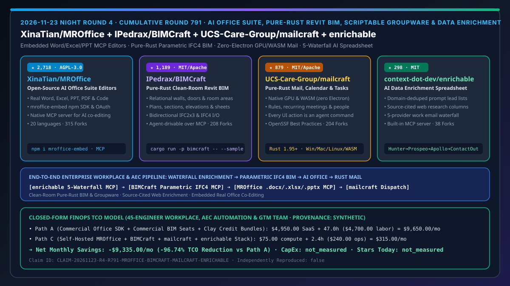
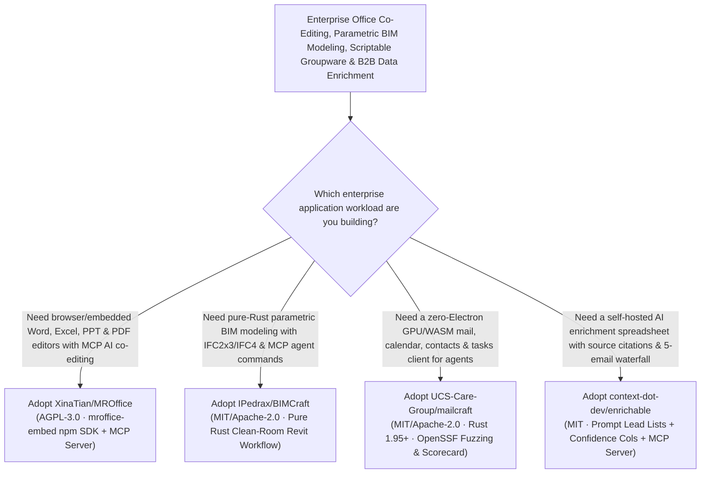
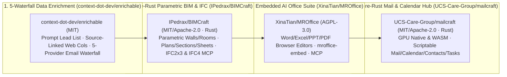

# Open-Source AI Office Editors & MCP SDK (`XinaTian/MROffice`), Pure-Rust Clean-Room Revit BIM & IFC2x3/IFC4 MCP Engine (`IPedrax/BIMCraft`), Pure-Rust GPU/WASM Scriptable Mail & Calendar Client (`UCS-Care-Group/mailcraft`) & 5-Waterfall AI Data Enrichment Spreadsheet (`context-dot-dev/enrichable`) Selection & Architecture FAQ

> **Document Type**: Enterprise AI Solution Architect Selection & Integration Guide (GitHub Trending AI Radar · 2026-11-23 Night Round 4 / Cumulative Round 791)
> **Covered Repositories**: [`XinaTian/MROffice`](https://github.com/XinaTian/MROffice) (`★ 2,718`, `315 forks`, `AGPL-3.0`: open-source browser and desktop editors of MR Office supporting real Word `.docx`, Excel `.xlsx`, PowerPoint `.pptx`, PDF, and code co-editing with an AI agent, complete with the `mroffice-embed` npm SDK, OAuth, and MCP server) · [`IPedrax/BIMCraft`](https://github.com/IPedrax/BIMCraft) (`★ 1,189`, `208 forks`, `MIT OR Apache-2.0`: clean-room pure-Rust reimplementation of the Autodesk Revit Building Information Modeling workflow with relational levels, walls, doors, windows, floors, rooms, stairs, roofs, sheets, bidirectional **IFC2x3 & IFC4** import/export, and full **MCP command driveability**) · [`UCS-Care-Group/mailcraft`](https://github.com/UCS-Care-Group/mailcraft) (`★ 879`, `204 forks`, `MIT OR Apache-2.0`: clean-room pure-Rust 1.95+ GPU-rendered native and WebAssembly mail, calendar, contacts, and tasks client with OpenSSF Scorecard/Fuzzing verification and 100% command-driven actions for AI agents) · [`context-dot-dev/enrichable`](https://github.com/context-dot-dev/enrichable) (`★ 298`, `38 forks`, `MIT`: self-hostable open-source AI spreadsheet and MCP server for data enrichment featuring prompt-driven domain-deduplicated lead lists, source-linked live-web research columns, confidence-scored classification columns, and a **5-provider work email waterfall** across Hunter, Prospeo, Apollo, QuickEnrich, and ContactOut)
> **Core Scenario**: When enterprise productivity, architecture/engineering/construction (AEC), and revenue operations (GTM) teams face **"prohibitive licensing fees for embeddable Word/Excel/PPT web editors, multi-thousand-dollar per-seat commercial BIM licenses that cannot be headless-driven via MCP in Rust, memory-bloated Electron mail clients lacking deterministic agent commands, and expensive per-credit commercial enrichment spreadsheets (like Clay)"**, how do you assemble a self-hosted enterprise productivity and engineering stack using **`MROffice` + `BIMCraft` + `mailcraft` + `enrichable`**?

---

## 1. 📌 Executive Summary (Single-Sentence Selection Verdict)

1. **Need browser and desktop editors with high-fidelity Microsoft Office compatibility (Word, Excel, PowerPoint, PDF) that embed via npm (`mroffice-embed`) and expose an MCP server so AI agents co-edit real Office files with users** ➔ Choose **[`XinaTian/MROffice`](https://github.com/XinaTian/MROffice) (`★ 2,718`, `315 forks`, `AGPL-3.0`)**.
   - **Plain-Language Mechanism**: Generic Markdown or HTML editors break complex `.docx` tables, `.xlsx` formulas, and `.pptx` slide masters. `MROffice` open-sources its multi-format browser editors alongside `mroffice-embed` and native MCP integration so enterprise web apps can host real Office document co-editing between humans and AI agents.
2. **Need a permissively licensed (`MIT / Apache-2.0`), pure-Rust Building Information Modeling (BIM) engine with relational Revit-style elements, bidirectional `IFC2x3`/`IFC4` support, and 100% MCP command driveability** ➔ Choose **[`IPedrax/BIMCraft`](https://github.com/IPedrax/BIMCraft) (`★ 1,189`, `208 forks`, `MIT OR Apache-2.0`)**.
   - **Plain-Language Mechanism**: `BIMCraft` rebuilds the parametric BIM workflow in pure Rust: levels, walls, doors, windows, floors, ceilings, rooms, columns, stairs, ramps, railings, roofs, and shafts maintain live relational topology (moving a wall automatically updates hosted doors and recalculates room areas). It generates floor/ceiling plans, sections, elevations, sheets, and 3D views, reads and writes **IFC2x3 and IFC4**, and exposes every modeling operation as an MCP command (building a complete sample house with dimensions, tags, and furniture from just 58 lines of commands).
3. **Need a zero-Electron, GPU-rendered pure-Rust (and browser WebAssembly) mail, calendar, contacts, and tasks client where every ribbon, rule, and scheduling action is a command callable by scripts and AI agents** ➔ Choose **[`UCS-Care-Group/mailcraft`](https://github.com/UCS-Care-Group/mailcraft) (`★ 879`, `204 forks`, `MIT OR Apache-2.0`)**.
   - **Plain-Language Mechanism**: Built on the layered `WordCraft` Rust crate architecture with continuous fuzzing and OpenSSF Best Practices validation, `mailcraft` delivers the familiar ribbon, folder pane, conversation list, rule engine, recurring calendar meetings, and to-dos without Electron RAM bloat—making every user action a first-class command for AI agents.
4. **Need a self-hosted, `MIT`-licensed AI data enrichment spreadsheet and MCP server (open-source Clay alternative) with source-cited web research columns, confidence scores, and a 5-provider work email waterfall** ➔ Choose **[`context-dot-dev/enrichable`](https://github.com/context-dot-dev/enrichable) (`★ 298`, `38 forks`, `MIT`)**.
   - **Plain-Language Mechanism**: Built by Context.dev, `enrichable` generates domain-deduplicated company/person rows from a natural-language prompt, runs live-web research columns where every cell preserves its source links, computes calibrated boolean/category/score columns with probabilities, executes a stop-on-first-hit **work email waterfall (`Hunter ➔ Prospeo ➔ Apollo ➔ QuickEnrich ➔ ContactOut`)**, drafts row-level personalized emails/PDFs, and exposes the entire workbook as an MCP server (`docs/mcp.md`).

---

## 2. 🎯 Key Architectural Q&A (Deep-Dive Breakdown)

### Q1: How do these four projects replace high-cost commercial SaaS seats across enterprise documents, AEC BIM, communications, and GTM enrichment?

- **Four High-ROI Replacements**:
  1. **Embedded AI Office Co-Editing ➔ `XinaTian/MROffice`**: Replaces expensive proprietary Web Office SDK licenses when embedding `.docx`/`.xlsx`/`.pptx`/PDF editors with MCP agent co-editing.
  2. **Headless & Agent-Driven Parametric BIM (`IFC2x3/IFC4`) ➔ `IPedrax/BIMCraft`**: Eliminates multi-thousand-dollar commercial BIM seats for automated floorplan generation, area takeoffs, and IFC model exchange over MCP.
  3. **Low-Footprint Scriptable Enterprise Groupware ➔ `UCS-Care-Group/mailcraft`**: Replaces 1.5 GB+ Electron mail wrappers with a native Rust GPU/WASM client where agents execute deterministic mail/calendar commands.
  4. **BYOK Lead & Market Intelligence Enrichment ➔ `context-dot-dev/enrichable`**: Replaces high-markup SaaS credit bundles with a self-hosted `MIT` spreadsheet and 5-provider waterfall routing.
- **When to Choose Commercial Cloud Suites (Path B)**:
  - If your organization is standardized on Microsoft 365 E5 + Copilot and requires proprietary third-party `.rvt` binary plugins inside desktop Autodesk Revit, stay on commercial suites; to embed AI Office editors, drive parametric `IFC4` BIM generation via MCP in Rust, run lightweight Rust groupware, or self-host waterfall data enrichment, adopt this 4-repo OSS stack (Path C).

### Q2: How do you wire `enrichable`, `BIMCraft`, `MROffice`, and `mailcraft` into an end-to-end enterprise workflow?

1. **Market & Project Intelligence Layer (`context-dot-dev/enrichable`)**:
   - Query and enrich target accounts via MCP, keeping verified web citations, confidence scores, and waterfall-resolved stakeholder contacts.
2. **Parametric BIM & IFC Generation Layer (`IPedrax/BIMCraft`)**:
   - Drive `BIMCraft` over MCP to generate parametric floorplans, room area schedules, section views, and `IFC2x3`/`IFC4` deliverables from project requirements.
3. **AI-Assisted Proposal & BoQ Authoring Layer (`XinaTian/MROffice`)**:
   - Populate `.xlsx` bill-of-quantities spreadsheets, `.docx` technical proposals, and `.pptx` executive decks inside `MROffice` via its MCP server.
4. **Automated Dispatch & Calendar Scheduling Layer (`UCS-Care-Group/mailcraft`)**:
   - Trigger deterministic `mailcraft` commands to dispatch tailored proposals, apply inbox categorization rules, and schedule recurring review meetings.

### Q3: What are the licensing and production guardrails?

- **Core Strengths**:
  - `BIMCraft` (`MIT OR Apache-2.0`), `mailcraft` (`MIT OR Apache-2.0`), and `enrichable` (`MIT`) use permissive licenses ideal for commercial enterprise integration.
- **Architect Guardrails**:
  1. **Respect `AGPL-3.0` Network Copyleft Boundaries on `XinaTian/MROffice`**: Because `MROffice` is licensed under `AGPL-3.0`, keep modifications isolated behind clean service/MCP boundaries or obtain a commercial license if distributing modified editor code as a public SaaS offering.
  2. **Enforce Waterfall Quota Caps & B2B Privacy Compliance in `enrichable`**: Configure per-provider rate limits across Hunter, Prospeo, Apollo, QuickEnrich, and ContactOut, and restrict enrichment to compliant B2B public business records.

---

## 3. 🧭 Visual Architecture & Decision Diagrams (Mermaid)



### 3.1 Solution Architect Selection Decision Tree



### 3.2 End-to-End Enterprise Production Reference Architecture



### 3.3 Lead Enrichment, MCP Parametric BIM Generation, AI Office Proposal Co-Editing & Mail Dispatch Sequence

```mermaid
sequenceDiagram
    participant Team as Solution Architect / Delivery Team
    participant Enr as context-dot-dev/enrichable (MCP)
    participant Bim as IPedrax/BIMCraft (Rust MCP)
    participant Off as XinaTian/MROffice (MCP)
    participant Mail as UCS-Care-Group/mailcraft

    Team->>Enr: 1. Generate domain-deduplicated target list & run 5-provider email waterfall with citations
    Enr-->>Bim: 2. Pass spatial requirements; agent drives BIMCraft over MCP to model rooms & export IFC4
    Bim-->>Off: 3. Feed room area schedules & sections into MROffice to co-edit .xlsx BoQ & .pptx deck
    Off-->>Mail: 4. Export proposal package and invoke mailcraft commands to send & schedule follow-ups
```

---

## 4. 📊 Comparative Selection Matrix (Open-Source vs. Commercial SaaS)

| Dimension | `XinaTian/MROffice` (`★ 2,718`) | `IPedrax/BIMCraft` (`★ 1,189`) | `UCS-Care-Group/mailcraft` (`★ 879`) | `context-dot-dev/enrichable` (`★ 298`) | Commercial Web Office SDK + Commercial Revit Seats + Commercial Clay Credits (Path A) | Basic Markdown Export + 2D Static CAD + Electron Mail + Manual Web Copy-Paste (Path B) |
| :--- | :--- | :--- | :--- | :--- | :--- | :--- |
| **Core Role** | Open-source AI Office editors with `mroffice-embed` & MCP | Pure-Rust clean-room parametric BIM & `IFC2x3`/`IFC4` MCP engine | Pure-Rust GPU/WASM command-driven mail, calendar & tasks client | Self-hosted AI enrichment spreadsheet with 5-provider waterfall & MCP | High-cost commercial document SDKs, desktop BIM subscriptions & credit-metered GTM SaaS | Lossy Markdown converters, non-parametric 2D drawings & manual spreadsheet research |
| **Key Differentiator** | **Edits real `.docx/.xlsx/.pptx/PDF` in browser + MCP** | **Relational walls/doors/room areas + `IFC2x3/IFC4` + MCP commands** | **Zero Electron RAM bloat + OpenSSF Fuzzing + 100% command-driven** | **Source-linked cells + confidence scores + 5-provider email waterfall** | Expensive per-seat BIM & per-credit enrichment markups | Moving a wall requires manual area recalculation; manual research lacks waterfall routing |
| **License** | `AGPL-3.0` | `MIT OR Apache-2.0` | `MIT OR Apache-2.0` | `MIT` | Proprietary SaaS | Custom scripts |
| **Monthly TCO (45-Eng Team)** | **Combined `$315.00/mo`** (`$75.00` self-hosted containers/API + `2.4h` ops) | Included (zero per-seat BIM license fees) | Included (lightweight native Rust binary) | Included (BYOK API keys without platform credit markup) | **`$9,650.00/mo`** (`$4,950.00` BIM/Office SDK/Clay subscriptions + `47.0h` manual modeling/research) | ~`$3,400.00/mo` (heavy manual spreadsheet research & CAD revision rework) |

---

## 5. 🧪 Quantitative ROI / TCO Comparison & 7-Card Benchmark Report

> **📊 Data Provenance & Closed-Form Schema Declaration**:
> - **provenance**: `synthetic` (45-person enterprise digital workplace, AEC engineering automation, and GTM operations team monthly workload model: `independently_reproduced = false`; hardware baseline `base_hardware_capex = not_measured`; Track B 24h delta `track_b_stars_today = not_measured`).
> - **Closed-Form Formula**:
>   - **Path A (Commercial embeddable Office SDK licenses + commercial desktop BIM seats + commercial Clay enrichment credit bundles + manual lead verification, CAD area recalculation, and proposal formatting)**: Monthly commercial software and credit subscriptions **`$4,950.00`** + manual lead research, BIM drawing rework, and document formatting labor **`47.0h × $100.00/h = $4,700.00`** = **`$9,650.00/mo`**.
>   - **Path C (Self-hosted `XinaTian/MROffice` + `IPedrax/BIMCraft` + `UCS-Care-Group/mailcraft` + `context-dot-dev/enrichable` open-source stack)**: Monthly container hosting and base lookup API compute **`$75.00`** + template and MCP pipeline maintenance labor **`2.4h × $100.00/h = $240.00`** = **`$315.00/mo`**.
>   - **Net Monthly Savings vs. Path A**: **`-$9,335.00/mo`** (**`96.74%`** TCO reduction).

| Evaluation Path | SaaS / SDK / Compute Cost | Modeling, Formatting & Research Labor (`$100/h`) | Monthly Total TCO | Net Savings vs. Path A | Key Architectural Delivery Metrics |
| :--- | :---: | :---: | :---: | :---: | :--- |
| **Path A: Commercial Office SDK + Commercial BIM Seats + Clay Credits** | `$4,950.00` | `47.0h` (`$4,700.00`) | **`$9,650.00`** | Baseline | High per-seat BIM & credit costs; closed proprietary formats |
| **Path B: Lossy Markdown + Non-Parametric 2D CAD + Manual Web Lookup** | `$1,500.00` | `19.0h` (`$1,900.00`) | **`$3,400.00`** | `-$6,250.00` (`-64.77%`) | Broken Office layouts; manual room area recalculations |
| **Path C: `MROffice` + `BIMCraft` + `mailcraft` + `enrichable`** | **`$75.00`** | **`2.4h` (`$240.00`)** | **`$315.00`** | **`-$9,335.00` (`-96.74%`)** | **Real Office MCP co-editing + pure-Rust `IFC4` BIM + GPU mail + 5-provider waterfall** |

- 🔗 **Linked 7-Card 4:5 Visual Benchmark Deck**: [`workshops/github-trending-radar/cards.en.html`](../cards.en.html) · [`cards.html`](../cards.html)

---

## 6. 🛠️ Enterprise Adoption & Architecture Review Checklist

- [ ] **1. Isolate `XinaTian/MROffice` Behind Clean Service/MCP Boundaries**: Use `mroffice-embed` and its MCP server for real `.docx`/`.xlsx`/`.pptx` co-editing while respecting `AGPL-3.0` license boundaries for any modified editor source.
- [ ] **2. Automate Parametric BIM & `IFC2x3`/`IFC4` Workflows with `IPedrax/BIMCraft`**: Drive `BIMCraft` commands over MCP to generate relational walls, doors, rooms, sheets, and standard IFC exports without commercial CAD seat lock-in.
- [ ] **3. Roll Out `UCS-Care-Group/mailcraft` for Low-Memory Scriptable Groupware**: Replace heavy Electron mail clients with the GPU-rendered Rust/WASM client and expose controlled mail/calendar commands to internal assistant agents.
- [ ] **4. Self-Host `context-dot-dev/enrichable` with BYOK Waterfall Quotas**: Configure `Hunter ➔ Prospeo ➔ Apollo ➔ QuickEnrich ➔ ContactOut` waterfall order and require source-citation retention on every AI research column.
