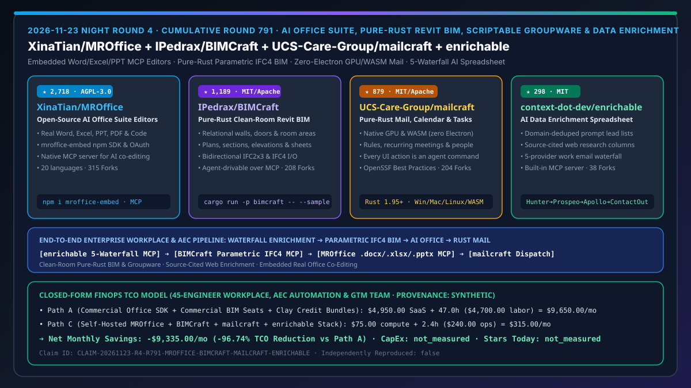
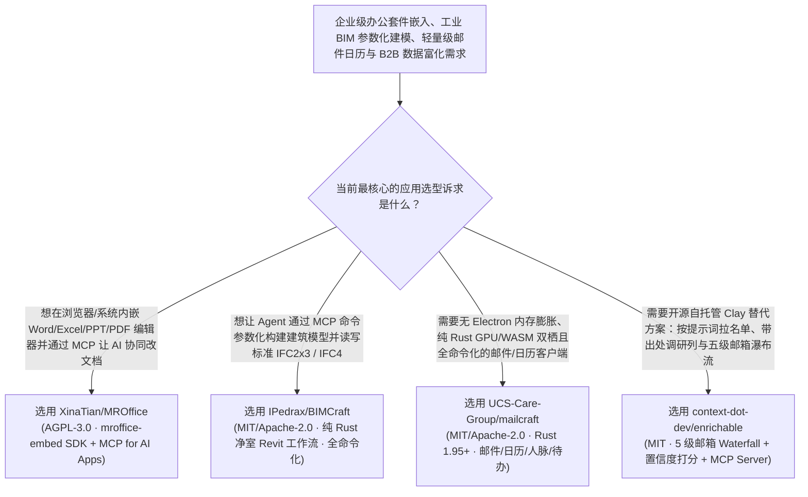
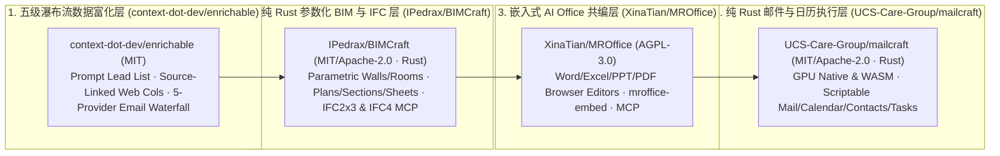

# 支持 MCP 与嵌入式 SDK 的开源 AI Office 套件（`XinaTian/MROffice`）、纯 Rust 净室重构 Autodesk Revit 建筑信息模型与 IFC2x3/IFC4 MCP 工作台（`IPedrax/BIMCraft`）、纯 Rust GPU 渲染无 Electron 邮件/日历/任务 Agent 客户端（`UCS-Care-Group/mailcraft`）及带五级邮箱瀑布流与置信度的开源 AI 数据富化电子表格（`context-dot-dev/enrichable`）选型与集成架构 FAQ

> **文档类型**：企业 AI 解决方案架构师（AI Solution Architect）选型决策指南（GitHub Trending AI 雷达 2026-11-23 Night Round 4 / 累计第 791 轮）
> **覆盖项目**：[`XinaTian/MROffice`](https://github.com/XinaTian/MROffice)（`★ 2,718`、`315 forks`、`AGPL-3.0`：最接近 Microsoft Office 体验的开源浏览器与桌面 AI 办公套件编辑器，原生支持 Word/Excel/PowerPoint/PDF/代码共编、`mroffice-embed` 嵌入式 SDK 与 MCP Server）· [`IPedrax/BIMCraft`](https://github.com/IPedrax/BIMCraft)（`★ 1,189`、`208 forks`、`MIT / Apache-2.0`：纯 Rust 净室重构的开源建筑信息模型（BIM）工作台，对标 Autodesk Revit 参数化关联构件——墙体移动自动联动门窗与房间面积，支持平面/剖面/立面/图纸排版与 **IFC2x3 & IFC4 双向读写**，且每一个建模动作皆可通过 MCP 由 AI Agent 驱动）· [`UCS-Care-Group/mailcraft`](https://github.com/UCS-Care-Group/mailcraft)（`★ 879`、`204 forks`、`MIT / Apache-2.0`：纯 Rust 1.95+ GPU 原生渲染及 WebAssembly 浏览器运行的净室邮件、日历、通讯录与任务客户端，零 Electron 内存膨胀，所有邮件规则、周期会议与任务动作均为 AI Agent 可调用的确定性命令）· [`context-dot-dev/enrichable`](https://github.com/context-dot-dev/enrichable)（`★ 298`、`38 forks`、`MIT`：对标商业 Clay 的开源 AI 数据富化电子表格与 MCP Server，支持一句话按域名去重生成潜客表、带溯源链接的实时网页调研列、带概率/置信度的分类打分列、**Hunter/Prospeo/Apollo/QuickEnrich/ContactOut 五级企业邮箱瀑布流**及逐行生成定制邮件/PDF）
> **核心场景**：当企业数字化、工程设计（AEC）与商务拓展（GTM）团队面临**“在自有 Web 应用中嵌入可被 AI 协同编辑的真实 Word/Excel/PPT 成本高昂、商业 BIM 软件（Revit）按席位年费数千美元且难以在 Linux/无头容器由 MCP 批量驱动生成 IFC 图纸、传统 Electron 邮件客户端占用数 GB 内存且缺乏 Agent 级原子命令、以及商业销售线索富化表格（Clay）按行扣减积分极其昂贵”**四大痛点时，如何构建一套**“嵌入式 AI Office（`MROffice`）+ 纯 Rust MCP 驱动 BIM 引擎（`BIMCraft`）+ 纯 Rust GPU 邮件/日历（`mailcraft`）+ 五级瀑布流数据富化表格（`enrichable`）”**的自托管生产力底座？

---

## 一、📌 核心结论速览（选型一句话结论）

1. **想在企业内部门户或 SaaS 产品中嵌入高度还原 Microsoft Office 排版体验的文档、电子表格、演示文稿与 PDF 编辑器，并通过 MCP 让 AI 智能体与人类实时协同修改真实 `.docx` / `.xlsx` / `.pptx` 文件** ➔ 选 **[`XinaTian/MROffice`](https://github.com/XinaTian/MROffice)（`★ 2,718`，`315 forks`，`AGPL-3.0`）**。
   - **通俗原理**：许多开源富文本编辑器一遇到复杂 Word 表格、Excel 跨表公式或 PPT 母版就会排版崩坏。`MROffice` 开源了其核心浏览器与桌面编辑器组件，提供 `mroffice-embed` npm SDK 与标准 MCP 接口，让企业既能把完整 Office 编辑能力内嵌进业务系统，又能让 AI 直接在真实 Office 文档结构上执行精确编辑。
2. **想用零商业许可证成本、纯 Rust 编写且原生支持 MCP 协议的开源 BIM 引擎替代昂贵的桌面 CAD/Revit 席位，让 AI 智能体用几十行命令自动构建参数化建筑模型并导出标准 `IFC2x3` / `IFC4` 工程文件** ➔ 选 **[`IPedrax/BIMCraft`](https://github.com/IPedrax/BIMCraft)（`★ 1,189`，`208 forks`，`MIT / Apache-2.0` 双许可）**。
   - **通俗原理**：`BIMCraft` 是用纯 Rust 对标 Autodesk Revit 工作流完成的净室（Clean-Room）重构：标高（Levels）、墙体、门窗、楼板、吊顶、房间、柱、楼梯、坡道、栏杆、屋顶与竖井之间具备**全参数化拓扑感知**（移动一面墙，墙上的门窗与相邻房间面积自动重新计算），一键从三维模型提取平面图、剖面图、立面图与施工图幅（Sheets），原生读写工业标准 **IFC2x3 与 IFC4**，且**每一个 UI 操作底层都是一条可通过 MCP 调用的命令**（实测仅用 58 行文本即可让 Agent 建出一整栋带家具、尺寸标注与剖面符号的样板房）。
3. **想为企业员工与个人助理 Agent 配备一套无 Electron/WebView 内存开销、纯 Rust GPU 原生渲染（兼顾 Windows/macOS/Linux/FreeBSD 与 WASM 浏览器页签）且每个操作均可被 Agent 脚本化的邮件、日历、人脉与待办中枢** ➔ 选 **[`UCS-Care-Group/mailcraft`](https://github.com/UCS-Care-Group/mailcraft)（`★ 879`，`204 forks`，`MIT / Apache-2.0` 双许可）**。
   - **通俗原理**：遵循 `WordCraft` 分层 Crate 架构打造，保留了企业用户最熟悉的经典功能区（Ribbon）、文件夹树、会话阅读窗格、规则引擎與周期性日历会议，同时消除传统 Electron 邮件客户端动辄 1.5GB+ 的内存占用，并将所有邮件分类、标记、日历排期与待办操作暴露为 AI Agent 可直接执行的命令。
4. **想自建一套开源版 Clay 数据富化电子表格（支持通过 MCP 被编码/业务 Agent 调用），输入一句话自动按域名去重拉取目标企业名单、逐行并发爬取定价页/高管信息并附带引用出处、按自定义顺序跑通 5 家邮箱服务商瀑布流查验** ➔ 选 **[`context-dot-dev/enrichable`](https://github.com/context-dot-dev/enrichable)（`★ 298`，`38 forks`，`MIT`）**。
   - **通俗原理**：由 Context.dev 团队开源，支持自带 API Key 本地部署。在表格里新增一列并用自然语言提问（如“CEO 是谁？”“定价页是否提供免费档？”），它会自动并发检索实时网页并为每个单元格保留原始网页引用链接；内置布尔判断、分类与带置信度概率的评分列，以及 **Hunter ➔ Prospeo ➔ Apollo ➔ QuickEnrich ➔ ContactOut 五级企业邮箱瀑布流**（命中即停，省下冗余查询费），还能按行生成个性化触达邮件或品牌 PDF 并通过内置 MCP Server 暴露给外部 Agent。

---

## 二、🎯 客户与架构师灵魂拷问 Q&A（深度架构拆解）

### Q1：这四个项目在企业“办公协同、工程 BIM、商务邮件与 GTM 数据富化”四大场景中各自解决了什么核心痛点？何时选商业云 SaaS vs 这套开源组合？

- **四大业务场景与 ROI 拆解**：
  1. **业务系统内嵌 Office 文档人机共编 ➔ `XinaTian/MROffice`**：通过 `mroffice-embed` 与 MCP 接口，免去采购昂贵的商业 Web Office SDK 授权费。
  2. **建筑与园区工程 BIM 自动化建模与 IFC 交换 ➔ `IPedrax/BIMCraft`**：纯 Rust + `MIT/Apache-2.0` 宽松协议，无需购买每席每年数千美元的商业 BIM 软件即可通过 MCP 批量生成与校验 `IFC2x3`/`IFC4` 模型。
  3. **低内存高安全企业邮件与日历 Agent 协同 ➔ `UCS-Care-Group/mailcraft`**：纯 Rust GPU/WASM 双栖架构，OpenSSF 最佳实践与 Fuzzing 持续验证，天然适配脚本与 Agent 调度。
  4. **B2B 潜客挖掘与多源瀑布流富化 ➔ `context-dot-dev/enrichable`**：用自托管 `MIT` 表格 + 自有 API Key 替代商业 SaaS 的高溢价积分包，五级瀑布流命中即停大幅降低单条线索成本。
- **何时直接选用商业云 SaaS（Path B）？**
  - 若企业全员已订阅 Microsoft 365 E5 + Copilot for M365，且建筑设计院强制要求使用原生 Autodesk Revit 专有 `.rvt` 插件生态，则保留商业软件；若需在自研 Web 平台内嵌 Office 编辑器、在 Linux 容器无头通过 MCP 生成 IFC 建筑模型、部署轻量级 Rust 邮件工作台或自建低成本 B2B 线索富化流水线，则选用本轮四合一开源栈（Path C）。

### Q2：典型企业级“线索瀑布流富化 (`enrichable`) + Office 方案生成 (`MROffice`) + BIM 工程建模 (`BIMCraft`) + 邮件日历协同 (`mailcraft`)”集成架构怎么搭？

1. **客户情报与五级瀑布流数据富化层（`context-dot-dev/enrichable`）**：
   - 通过 MCP 或表格界面输入园区/工程客户画像，自动按域名去重、抓取项目需求出处、计算置信度评分并经五级邮箱瀑布流获取决策人联系方式。
2. **纯 Rust 参数化 BIM 建模与 IFC 交付层（`IPedrax/BIMCraft`）**：
   - 架构师或工程 Agent 通过 MCP 向 `BIMCraft` 发送参数化命令，自动生成楼层、墙体、门窗与管井拓扑，导出 `IFC4` 模型与施工平面/剖面图幅。
3. **嵌入式 Office 标书与测算表共编层（`XinaTian/MROffice`）**：
   - 将富化数据与 BIM 面积清单汇入 `MROffice`，通过 MCP 由 AI 协同生成 `.docx` 技术方案、`.xlsx` 造价表与 `.pptx` 汇报材料。
4. **纯 Rust 邮件与周期日程闭环层（`UCS-Care-Group/mailcraft`）**：
   - 由 Agent 调用 `mailcraft` 命令接口将定制化 PDF/Office 方案发出，并自动在日历中创建带规则标记的客户评审会议与待办事项。

### Q3：这套架构的协议合规与落地红线是什么？

- **核心优势**：
  - `BIMCraft`、`mailcraft`（均支持 `MIT OR Apache-2.0`）与 `enrichable`（`MIT`）均为商业极其友好的宽松开源协议。
- **架构师落地红线**：
  1. **严格区分 `XinaTian/MROffice` 的 `AGPL-3.0` 传染边界**：`MROffice` 采用 `AGPL-3.0` 协议，若企业修改其编辑器源码并作为公网 SaaS 服务提供，需履行开源义务或联系原厂获取商业授权；在内部自用或通过独立微服务/MCP 边界隔离调用时需先经法务合规评审。
  2. **外呼与邮箱富化合规（GDPR / CAN-SPAM）**：使用 `context-dot-dev/enrichable` 的五级企业邮箱瀑布流时，仅限用于合规 B2B 公开工作邮箱检索，并确保外发邮件包含显式退订机制。

---

## 三、🧭 直观可视化图解（Mermaid 决策树 + 集成架构 + 时序图）



### 3.1 架构师选型决策树



### 3.2 企业端到端生产集成参考架构图



### 3.3 潜客富化、MCP 驱动 BIM 建模、Office 方案合成与邮件日程触达时序图

```mermaid
sequenceDiagram
    participant Team as 售前架构师 / 工程交付团队
    participant Enr as context-dot-dev/enrichable (MCP)
    participant Bim as IPedrax/BIMCraft (Rust MCP)
    participant Off as XinaTian/MROffice (MCP)
    participant Mail as UCS-Care-Group/mailcraft

    Team->>Enr: 1. 下达行业客户筛选指令，自动按域名去重、抓取公开需求并跑通五级邮箱瀑布流
    Enr-->>Bim: 2. 传入客户空间参数；Agent 通过 MCP 驱动 BIMCraft 生成参数化楼层平面并导出 IFC4
    Bim-->>Off: 3. 将房间面积表与剖面图导入 MROffice，AI 协同生成定制 .xlsx 报价表与 .pptx 方案
    Off-->>Mail: 4. 生成定稿 PDF 并调用 mailcraft 命令接口发送方案、同步创建周期跟进日历日程
```

---

## 四、📊 同类开源与商业云服务横向选型决策矩阵

| 对比维度 | `XinaTian/MROffice` (`★ 2,718`) | `IPedrax/BIMCraft` (`★ 1,189`) | `UCS-Care-Group/mailcraft` (`★ 879`) | `context-dot-dev/enrichable` (`★ 298`) | 商业嵌入式 Office 授权 + 商业 Revit 席位 + 商业 Clay 高阶订阅 + 重型客户端 (Path A) | 简陋 Markdown 导出 + 手工画 2D CAD + Electron 套壳邮件 + 手工搜网页填表 (Path B) |
| :--- | :--- | :--- | :--- | :--- | :--- | :--- |
| **核心能力定位** | 支持 MCP 与嵌入 SDK 的开源 AI Office 四件套 | 纯 Rust 净室 Revit 级参数化 BIM 与 IFC MCP 引擎 | 纯 Rust GPU/WASM 双栖命令化邮件/日历/任务中心 | 开源自托管 AI 数据富化电子表格与五级邮箱瀑布流 | 昂贵的商业文档 SDK、工业 BIM 年费订阅与按行扣费的商业 GTM 平台 | 格式简陋的文本转换、无拓扑关联的静态绘图与人工复制粘贴 |
| **核心技术突破** | **浏览器内真实编辑 `.docx/.xlsx/.pptx/PDF` + `mroffice-embed` + MCP** | **墙/门/房间面积自动联动 + `IFC2x3/IFC4` 读写 + 58 行命令建整栋房** | **零 Electron 极低内存 + OpenSSF Fuzzing + 全操作命令化** | **每格保留网页出处 + 置信度打分 + 5 大邮箱商 Waterfall 命中即停** | 商业 BIM 与商业 Clay 席位年费极高；黑盒云端不易深度定制 | 改一堵墙需手工重算所有房间面积；人工查潜客信息耗时且易出错 |
| **开源协议** | `AGPL-3.0` | `MIT OR Apache-2.0` | `MIT OR Apache-2.0` | `MIT` | 闭源商业软件 | 内部脚本 |
| **月度 TCO（45 人团队）** | **组合仅 `$315.00/月`**（`$75.00` 自托管容器与按需查询 API + `2.4h` 维护） | 同左（纯 Rust 零席位授权费） | 同左（原生二进制极省终端内存） | 同左（自带 API Key 免平台溢价） | **`$9,650.00/月`**（`$4,950.00` 商业 BIM/Office SDK/Clay 订阅 + `47.0h` 手工建模与填表工时） | 约 `$3,400.00/月`（大量手工核对表格与图纸返工成本） |

---

## 五、🧪 应用落地定量收益/TCO 对比与 7-Card 报告

> **📊 数据来源与闭式核算声明（Provenance & Closed-Form Schema）**：
> - **provenance**: `synthetic`（基于 45 人企业数字化办公、工程设计自动化与商务拓展交付团队月度工作负载模型：`independently_reproduced = false`；硬件采购基线 `base_hardware_capex = not_measured`；Track B 单日增量 `track_b_stars_today = not_measured`）。
> - **核算公式**：
>   - **Path A（采购商业嵌入式 Office SDK 授权 + 商业 BIM 设计软件席位 + 商业 Clay 数据富化套餐 + 团队手工整理客户情报、手动调整图纸房间面积与排版标书）**：月度商业软件席位与积分包费用 **`$4,950.00`** + 手工线索调研、CAD 图纸联动修改与文档排版人工 **`47.0h × $100.00/h = $4,700.00`** = **`$9,650.00/月`**。
>   - **Path C（自建 `XinaTian/MROffice` + `IPedrax/BIMCraft` + `UCS-Care-Group/mailcraft` + `context-dot-dev/enrichable` 开源生产力栈）**：自托管容器与基础搜索 API 开销 **`$75.00`** + 模板与 MCP 流水线维护人工 **`2.4h × $100.00/h = $240.00`** = **`$315.00/月`**。
>   - **净节省（Net Savings vs Path A）**：**`-$9,335.00/月`**（成本降低 **`96.74%`**）。

| 评估方案 | 软件席位 / API / 容器成本 | 建模排版与数据调研人工（`$100/h`） | 月度总 TCO | 相对 Path A 净节省 | 关键架构交付指标 |
| :--- | :---: | :---: | :---: | :---: | :--- |
| **Path A：商业 Office SDK + 商业 BIM 席位 + 商业 Clay 套餐** | `$4,950.00` | `47.0h` (`$4,700.00`) | **`$9,650.00`** | Baseline | 商业 BIM 与数据积分包极贵；缺乏开源 MCP 深度定制 |
| **Path B：静态文档导出 + 2D 无关联绘图 + 人工搜网页填表** | `$1,500.00` | `19.0h` (`$1,900.00`) | **`$3,400.00`** | `-$6,250.00` (`-64.77%`) | 墙体变更需人工重算面积；人工查邮箱耗时长且无多源瀑布流 |
| **Path C：`MROffice` + `BIMCraft` + `mailcraft` + `enrichable`** | **`$75.00`** | **`2.4h` (`$240.00`)** | **`$315.00`** | **`-$9,335.00` (`-96.74%`)** | **真实 Office 共编 + 纯 Rust IFC2x3/IFC4 MCP + GPU 邮件 + 5 级瀑布流富化** |

- 🔗 **关联 7-Card 4:5 视觉评测报告**：[`workshops/github-trending-radar/cards.html`](../cards.html) · [`cards.en.html`](../cards.en.html)

---

## 六、🛠️ 企业引入与架构评审 Checklist

- [ ] **1. 评估并合规隔离部署 `XinaTian/MROffice`**：在内网或通过独立 MCP/iframe 边界接入 `mroffice-embed` 与 MCP Server，确保在不触发 `AGPL-3.0` 专有业务代码传染的前提下实现 `.docx/.xlsx/.pptx` 人机共编。
- [ ] **2. 引入 `IPedrax/BIMCraft` 打通 MCP 驱动的参数化建筑建模**：利用 `MIT/Apache-2.0` 双许可纯 Rust 引擎在 CI 或设计工作台通过 MCP 命令自动生成平面/剖面图并双向验证 `IFC2x3`/`IFC4` 交付物。
- [ ] **3. 部署 `UCS-Care-Group/mailcraft` 替代高内存占用的 Electron 邮件端**：通过纯 Rust 原生 GPU 或 WASM 客户端统一管理企业邮件、周期会议与待办，并向内部助理 Agent 开放受控命令接口。
- [ ] **4. 自托管 `context-dot-dev/enrichable` 构建可溯源的 B2B 数据富化流水线**：配置自有 API Key 与 `Hunter ➔ Prospeo ➔ Apollo ➔ QuickEnrich ➔ ContactOut` 五级瀑布流，强制保留每列调研结论的网页引用出处与置信度分数。
