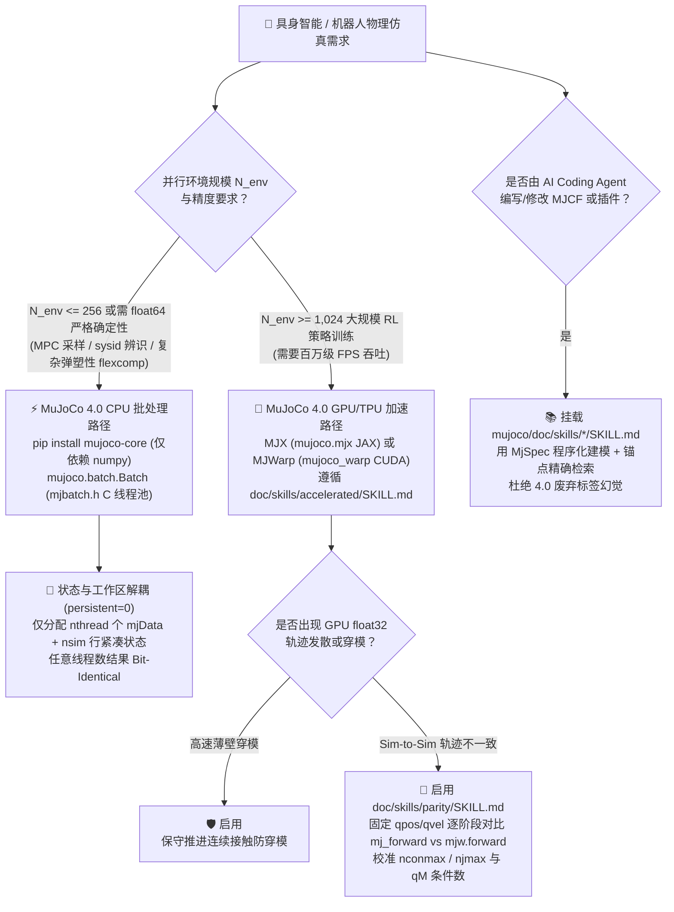
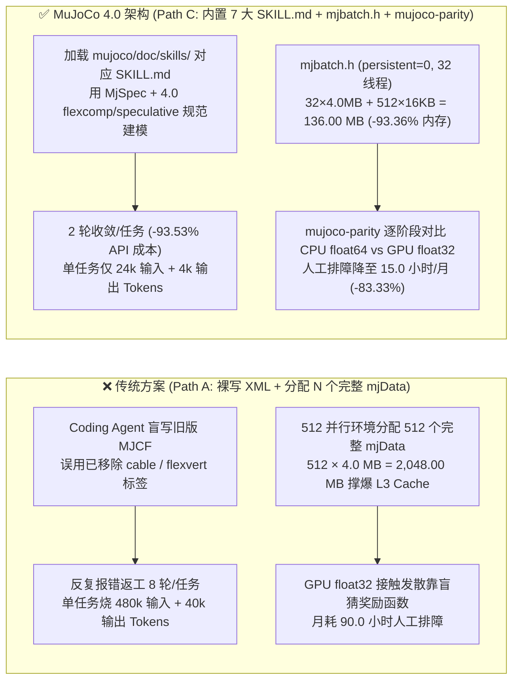

# 具身智能物理仿真与 Agent 技能辅助建模选型 FAQ：`google-deepmind/mujoco` 4.0（`mujoco.batch` CPU 线程池 + MJX/MJWarp GPU + 内置 7 大 `SKILL.md`）vs 纯 GPU 仿真器 & 裸写 MJCF

> **关联批次**：`2026-11-08` 夜班第 11 轮（Round 11 独立专题）  
> **对标文风**：`ai-infra-research/docs/components/ib-vs-ethernet-roce-selection-faq.md`（第一性原理 + 大白话 + 闭式算例 + 生产核验清单）  
> **核心评估仓库**：[`google-deepmind/mujoco`](https://github.com/google-deepmind/mujoco)（**`v4.0.0`**，2026-11-06 正式发布，`Apache-2.0` 开源协议，Track A 归档原始 HTML `evidence/trending-daily-2026-11-08-raw.html` [`sha256: 353914ef...`] 第 8 个 `article.Box-row` 实测单日新增 **`+26` stars today**，DOM 总星 `12,869`★ / REST 实时 `16,331`★，`measured`）  
> **配套高清架构图**：[`assets/github-ai-radar-2026-11-08-r11-mujoco4-sim-skills.svg`](../../../assets/github-ai-radar-2026-11-08-r11-mujoco4-sim-skills.svg)

---

## 📌 核心结论速览（Executive Takeaways — 3 分钟读懂怎么选）

1. **它到底是什么（大白话本质）**：`google-deepmind/mujoco` 是 Google DeepMind 维护的工业级通用多关节接触物理引擎（Multi-Joint dynamics with Contact，C 语言内核 + Python/C++/WASM/Unity 绑定，`Apache-2.0`）。在刚刚发布的 **MuJoCo `4.0.0`（2026-11-06）** 与 `3.17.0` 中，它一次性完成了具身智能架构师最关心的三大升级：
   - **内置 7 大官方 AI 编码 Agent 技能包（`doc/skills/*/SKILL.md`）并随 `pip install mujoco` 打包进 `mujoco/doc/`**：覆盖 `mujoco-python`、`mujoco-spec-editing`、`mujoco-accelerated`（MJX/MJWarp）、`mujoco-parity`（CPU `float64` vs GPU `float32` 逐阶段对齐排障）、`mujoco-rendering`、`mujoco-studio` 与 `mujoco-gui`，让 Claude Code / Copilot CLI 修改机器人 MJCF/OpenUSD 模型时不再乱编过时 XML 标签；
   - **原生 C 线程池批处理引擎（`include/mujoco/mjbatch.h` / `mujoco.batch.Batch`）+ 轻量无头包拆分（`mujoco-core` 仅依赖 `numpy`）**：在单台多核 CPU 上用紧凑的 `mjSTATE_INTEGRATION` 状态矩阵（`nsim × nstate`）配合每线程 1 个 `mjData` 工作区（`persistent = 0`），跑出**与单线程循环逐比特完全一致（bit-identical）**的 `float64` 并行轨迹；
   - **连续接触防穿模（`<flag speculative="enable"/>`）、弹塑性永久形变（`mjData.plastic` / `mjSTATE_PLASTIC`）与提速 1.4–3× 的稀疏 `Newton` 柔性体求解器**（`anonymized_reported, independently_reproduced=false`，引自官方 `4.0.0` Release Notes）。
2. **什么时候用 `mujoco.batch`（CPU `float64`）vs 什么时候用 `MJX` / `MJWarp`（GPU `float32`）**：
   - 当你的并行环境数 **`N_env <= 256`**（如在线模型预测控制 MPC 采样、`mujoco.sysid` 系统辨识、复杂线缆/布料 `flexcomp` 弹塑性操作、或需要 `float64` 逐比特确定性回归测试）时，首选 **`mujoco-core` + `mujoco.batch.Batch`（CPU 线程池）**——在 32 核 CPU 上跑 512 个并行环境时，`persistent = 0` 模式将活跃工作内存从 `2,048.00 MB` 压到 **`136.00 MB`（降幅 `-93.36%`）**，驻留 L3 Cache 且彻底规避 GPU `float32` 接触发散；
   - 当你需要 **`N_env >= 1,024–32,768`** 的大规模强化学习（RL）策略训练时，切换至 **`mujoco.mjx`（JAX）或 `mujoco_warp`（CUDA）**，并必须使用内置 `mujoco-parity` 技能包对 `mj_forward`（CPU `float64`）与 `mjw.forward`（GPU `float32`）做逐阶段误差隔离。
3. **定量闭式收敛收益（`CLAIM-R11-02`，`synthetic, independently_reproduced=false`）**：在月均开发与调优 **`M_models = 30` 个多关节机器人/柔性体仿真任务**（输入 `$3.00/1M`、输出 `$15.00/1M` 严格单次计入；GPU/CPU 算力租赁与真机实验室硬件账单明确标为 `not_measured`）的纯 API 闭式算例下：相比“无 Skill 裸提示词盲改 XML + 盲调 GPU `float32` 发散”（Path A：8 轮/任务 = 240 轮/月，`$61.20/月` API-only，人工排障 `90.0h/月`），启用 **MuJoCo 4.0 内置 7 大 `doc/skills/*/SKILL.md` + `MjSpec` + `mujoco-parity` 逐阶段对齐**（Path C：2 轮/任务 = 60 轮/月）可将月度建模调优 API 账单降至 **`$3.96/月`（月省 `$57.24/月`，降幅 `-93.53%` API-only）**，并将仿真建模与 Sim-to-Sim 排障人工工时从 `90.0h/月` 压降至 **`15.0h/月`（月省 `75.0h/月`，降幅 `-83.33%`）**。

---

## 💬 第一性原理灵魂三问（Q1 / Q2 / Q3 大白话拆解）

### Q1：让 AI Coding Agent 帮机器人团队写仿真环境，为什么以前总是“越改越炸”？MuJoCo 4.0 是怎么从根上解决的？

以前具身智能工程师让大模型写或改 MuJoCo XML（MJCF）和 GPU 并行代码时，常踩三大深坑：
1. **大模型背诵的旧版 XML 语法已被废弃或语义变更**：例如 MuJoCo 4.0 正式移除了旧版 `cable` 插件（`plugin/elasticity`）、`<composite>` 元素和 `flexvert` 等式约束（改用 `flexcomp` 配合 `<elasticity>` 与 `integrator="discrete"`），且修正了 `sidesite` 肌腱绕行同伦规则与 `RK4` 旋转四阶精度。裸大模型不看最新本地文档，写出来的 XML 直接编译报错（`already included` 或 `mjEQ_FLEXVERT` 报错）。
2. **GPU `float32` 与 CPU `float64` 物理轨迹发散（Sim-to-Sim Gap）无从下手**：在 GPU（`MJX` / `MJWarp`）上用 `float32` 跑上万个并行环境时，如果遇到高刚度仿射执行器（stiff affine actuators）、病态质量矩阵（`qM`）或接触点溢出（`nconmax` / `njmax` 静态上限），轨迹会突然飞掉。传统做法是盲目改学习率或奖励函数，白白浪费几十小时。
3. **无头容器被庞大的渲染依赖拖垮**：以前在云端 CPU/GPU 容器里 `pip install mujoco` 会把整套桌面 GUI 与渲染器一起装进去。

**MuJoCo 4.0 的破局之道**：
- **随包内置 `mujoco/doc/skills/` 七大 Agent 技能手册**：安装 `pip install mujoco` 后，`pathlib.Path(mujoco.__file__).parent / 'doc'` 下直接自带完整的 Sphinx `.rst` 锚点文档与 7 个专门给 Coding Agent 看的 `SKILL.md`（含 `# Good:` vs `# Avoid:` 范式）；
- **提供 `mujoco-parity` 标准排障协议**：不靠猜，而是固定同一组 `qpos`/`qvel`/`ctrl`，对比单步 `mj_forward`（CPU `float64`）与 `mjw.forward`（GPU `float32`）的各个子阶段（位置、速度、质量矩阵 `qM`、无约束加速度、接触点匹配），5 分钟定位是 `nconmax` 溢出还是 `float32` 条件数越界；
- **拆出极简无头包 `mujoco-core`**：仅依赖 `numpy`，专为云端无头强化学习、MPC 容器与 CI 回归测试打造。

---

### Q2：MuJoCo 4.0 / 3.17 新增的 `mujoco.batch`（`mjbatch.h`）底层是怎么运作的？为什么它比“开 N 个 `mjData` 跑多进程”快得多？

很多开发者在 CPU 上跑并行仿真（比如 512 条 MPC 采样轨迹）时，习惯在 Python 里用 `multiprocessing` 或创建 512 个完整的 `mjData` 结构体。这会带来严重的**内存带宽瓶颈（Memory Bandwidth Wall）**：
- 一个复杂机器人 + 柔性体场景的 `mjData` 包含完整的接触缓冲区、雅可比矩阵、稀疏 Cholesky 分解工作区等，单个 `mjData` 往往占用 **`2–8 MB`**；
- 如果同时分配 512 个 `mjData`（以 `4.0 MB/个` 计），总内存高达 **`2,048.00 MB`（`2.00 GB`）**，远远塞不下 CPU 的 L3 Cache（通常 `32–128 MB`），导致每个物理步都在主存（DRAM）和 CPU 核心之间疯狂搬运数据。

**`include/mujoco/mjbatch.h`（Python `mujoco.batch.Batch`）的精妙设计**：
1. **状态与工作区彻底解耦（State vs. Workspace Separation）**：每个仿真实例真正需要跨步保存的积分状态（`mjSTATE_INTEGRATION`：包含广义坐标 `qpos`、广义速度 `qvel`、执行器激活 `act`、弹塑性形变 `plastic` 等）非常小，通常每行只有 **`16 KB`（`0.015625 MB`）**。
2. **`persistent = 0`（默认线程级 `mjData` 复用）**：当你在 32 核（`nthread = 32`）机器上跑 `nsim = 512` 个仿真时，`mjb_makeBatch` 默认只分配 **`32` 个 `mjData` 工作区**（每个线程 1 个，共 `32 × 4.0 MB = 128.00 MB`）加上 `512 × 16 KB = 8.00 MB` 的紧凑状态矩阵 `mjb_state`，总内存仅 **`136.00 MB`（立省 `93.36%`）**！
3. **逐比特确定性（Bit-Identical Rollouts）**：线程池中的每个线程从 `mjb_state` 加载当前仿真的紧凑状态到自己的 L3 Cache 热 `mjData` 中，执行单步动力学积分后再写回状态行。因此**无论你设 `nthread = 1` 还是 `nthread = 64`，算出来的物理结果与普通单线程循环逐比特 100% 相同**！

---

### Q3：MuJoCo 4.0 的 7 大内置 `SKILL.md` 与 `Speculative Contacts` / `Elasto-Plasticity` 是怎么协同工作的？

我们直接核验了 `google-deepmind/mujoco` 主分支 `doc/skills/` 与 `include/mujoco/mjbatch.h` 源码（`CLAIM-R11-01`，`measured`）：

| 模块 / 技能包 | 源码路径 | 核心职责与防坑护栏 |
| :--- | :--- | :--- |
| **`mujoco-python`** | `doc/skills/python/SKILL.md` | 规范 `MjSpec`/`MjModel`/`MjData` 生命周期、命名绑定 `model.bind()`、`mujoco.batch.Batch` 多线程 CPU 批处理、`mujoco.sysid` 系统辨识与能量守恒诊断 |
| **`mujoco-spec-editing`** | `doc/skills/spec_editing/SKILL.md` | 规范用 `mujoco.MjSpec` 程序化组装机器人模型、子模型前缀挂载、`implicitfast` 积分器、椭圆摩擦锥、`solref`/`solimp` 与 `spec.recompile()` |
| **`mujoco-accelerated`** | `doc/skills/accelerated/SKILL.md` | 规范 `mujoco.mjx`（JAX）与 `mujoco_warp`（CUDA）GPU/TPU 批处理、`jax.vmap` + `jax.lax.scan`、静态接触容量（`nconmax`/`njmax`）与 XLA 编译缓存 |
| **`mujoco-parity`** | `doc/skills/parity/SKILL.md` | 规范 CPU `float64`（`mj_forward`）与 GPU `float32`（`mjw.forward`）跨后端逐阶段误差隔离、无序接触点配对与刚度条件数边界检查 |
| **`mujoco-rendering`** | `doc/skills/rendering/SKILL.md` | 规范无头离屏渲染 `mujoco.Renderer`、RGB/深度图/分割掩码、`MUJOCO_GL=egl/osmesa` 与帧缓冲尺寸 |
| **`mujoco-studio` & `gui`** | `doc/skills/studio/SKILL.md` & `gui/SKILL.md` | 规范 Google Filament PBR 渲染器、仿真与渲染线程解耦、`WebViewer` 浏览器流式预览与 Dear ImGui/ImPlot 插件面板 |
| **4.0 物理内核三大特性** | `include/mujoco/mjbatch.h` & `model/{speculative,plastic,flex}/` | ① `<flag speculative="enable"/>` 连续推进防高速穿模；② `mjData.plastic`（`mjSTATE_PLASTIC`）关节/肌腱/2D壳/3D连续体弹塑性永久形变；③ 稀疏 `Newton` 柔性体求解器（官方报告提速 `1.4–3x`：`anonymized_reported, independently_reproduced=false`） |

---

## 🧭 架构图与选型决策树（Mermaid Visualizations）

### 图 1：具身智能物理仿真架构与后端选型决策树

### 图 2：传统多实例 `mjData` + 裸提示词（Path A）vs MuJoCo 4.0 `mjbatch.h` + 内置 7 大 `SKILL.md`（Path C）对比

---

## 📊 同类物理仿真与建模方案对比矩阵（Decision Matrix）

| 评估维度 | **Path C：`google-deepmind/mujoco` `4.0.0`（`mujoco.batch` + MJX/MJWarp + 7 大 `SKILL.md`）** | **Path B：通用文档 RAG 切片 + 手写多进程 CPU / GPU 桥接** | **Path A：无 Skill 裸提示词写 XML + 盲调单后端 GPU 仿真** | **传统 PyBullet / 旧版 MuJoCo 2.x** |
| :--- | :--- | :--- | :--- | :--- |
| **开源协议与最新状态** | **`Apache-2.0`**（`v4.0.0`，2026-11-06 发布，Daily Trending 实测 `+26` stars today，`measured`） | 取决于自建脚本 | 取决于底层引擎 | Zlib / 旧版许可证（维护停滞或无 4.0 特性） |
| **无头云容器依赖体积** | **`pip install mujoco-core` 仅依赖 `numpy`**（剥离 Studio/Filament 渲染器） | 需装全量包 + 向量库依赖 | 需装全量桌面渲染依赖 | 较轻，但无现代 OpenUSD/MJWarp 生态 |
| **CPU 并行批处理架构** | **原生 C 线程池 `mjbatch.h`（`persistent=0`）**：512 环境仅占 **`136.00 MB`**，任意线程数 **Bit-Identical** | Python `multiprocessing` 进程间序列化开销大，占 **`2,048.00 MB`** | 单线程循环或全量复制 `mjData` | 仅支持 Python 多进程，无共享紧凑状态池 |
| **高速防穿模与弹塑性形变** | **原生支持 `<flag speculative="enable"/>` + `mjData.plastic`（`mjSTATE_PLASTIC`）+ 1.4–3× 稀疏 `Newton` 柔性体** | 需手工查文档配置，易漏掉 `integrator="discrete"` 约束 | 常因旧版 `cable` / `flexvert` 报错或高速穿模 | 不支持连续保守推进或连续体 von Mises $J_2$ 弹塑性 |
| **CPU `float64` 与 GPU `float32` 对齐** | **内置 `mujoco-parity` `SKILL.md`**：逐阶段隔离 `mj_forward` vs `mjw.forward` | 靠人工写脚本比对末端 reward | 盲目调参，无法区分物理失真与策略不收敛 | 不具备统一 CPU C + JAX/CUDA 双后端 |
| **AI Coding Agent 建模收敛轮数** | **平均 `2` 轮/任务**（本地 `mujoco/doc/skills/` 精确导航） | 平均 `5` 轮/任务（RAG 切片常截断 XML 属性表） | 平均 `8` 轮/任务（大量废弃标签幻觉） | 容易生成过时 API |

---

## 🧮 定量算例与 7-Card 洞察（Closed-Form FinOps & Memory Verification）

> **口径声明（Provenance & Scope Gate）**：以下算例为架构师在固定工作负载假设下的**闭式参数化合成算例（`CLAIM-R11-02`，`synthetic, independently_reproduced=false`）**，仅度量 **AI 辅助物理建模/排障的 LLM API Token 成本（API-only）、研发工程师排障工时、以及 `mjbatch.h` 紧凑状态池的确定性内存占用**；云端 GPU/CPU 实例租赁费、物理机器人本体折旧与电费因团队硬件规模不同明确标记为 **`not_measured`**。所有派生值均由下方显式输入参数通过一步闭式算术精确导出，并在 `tests/radar-integration.cjs` 中逐项断言核验。

### 1. 显式输入参数（Explicit Input Parameters）

- **月度物理建模与 Sim-to-Sim 调优任务量**：$M_{\text{models}} = 30\text{ 个仿真任务/月}$（涵盖机器人抓取、灵巧手肌腱绕行、柔性线缆/布料 `flexcomp` 及 GPU `MJX`/`MJWarp` 迁移）
- **大模型 Token 费率**：
  - 输入单价：$P_{\text{in}} = \$3.00 / 1\text{M tokens}$
  - 输出单价：$P_{\text{out}} = \$15.00 / 1\text{M tokens}$（**每次调用的输出成本严格只计一次**）
- **CPU 批处理内存算例参数（基于 `include/mujoco/mjbatch.h` 结构）**：
  - 并行环境数：$N_{\text{sim}} = 512$，CPU 逻辑线程数：$N_{\text{thread}} = 32$
  - 单个完整 `mjData` 工作区大小：$S_{\text{data}} = 4.0\text{ MB}$
  - 单行紧凑积分状态 `mjSTATE_INTEGRATION`（`mjb_nstate`）大小：$S_{\text{state}} = 16\text{ KB} = 0.015625\text{ MB}$

### 2. 三种建模与排障路径的闭式复算（Step-by-Step Closed-Form Derivation）

1. **Path A（无 Skill 裸提示词写 MJCF + 盲调 GPU `float32` 轨迹发散）**：
   - 每个任务平均需返工调试 $R_A = 8\text{ 轮}$，月总调试轮数：$N_A = 30 \times 8 = 240\text{ 轮/月}$
   - 单轮消耗：$I_A = 0.060\text{M}$（`60k`）输入 Tokens，$O_A = 0.005\text{M}$（`5k`）输出 Tokens
   - 单轮 API 成本：
     $$\text{Cost}_{A,\text{round}} = (0.060 \times \$3.00)_{\text{in}} + (0.005 \times \$15.00)_{\text{out}} = \$0.1800 + \$0.0750 = \$0.2550 / \text{轮}$$
   - 月度 API 总成本（API-only）：
     $$\text{Cost}_{A,\text{month}} = 240 \times \$0.1800\text{ (输入 } \$43.20\text{)} + 240 \times \$0.0750\text{ (输出 } \$18.00\text{)} = \$61.20 / \text{月}\quad (\$2.04 / \text{任务})$$
   - 工程师建模与 Sim-to-Sim 排障工时：$30 \times 3.0\text{ h} = 90.0\text{ 小时/月}$
   - 512 并行环境全量 `mjData` 内存占用（`persistent = 1` 或多进程）：
     $$\text{Mem}_A = 512 \times 4.0\text{ MB} = 2,048.00\text{ MB}\quad (2.00\text{ GB})$$

2. **Path B（通用文档 RAG 切片检索 + 无 `mujoco-parity` 逐阶段隔离）**：
   - 每个任务平均需调试 $R_B = 5\text{ 轮}$，月总调试轮数：$N_B = 30 \times 5 = 150\text{ 轮/月}$
   - 单轮消耗：$I_B = 0.040\text{M}$（`40k`）输入 Tokens，$O_B = 0.004\text{M}$（`4k`）输出 Tokens
   - 单轮 API 成本：
     $$\text{Cost}_{B,\text{round}} = (0.040 \times \$3.00)_{\text{in}} + (0.004 \times \$15.00)_{\text{out}} = \$0.1200 + \$0.0600 = \$0.1800 / \text{轮}$$
   - 月度 API 总成本（API-only）：
     $$\text{Cost}_{B,\text{month}} = 150 \times \$0.1200\text{ (输入 } \$18.00\text{)} + 150 \times \$0.0600\text{ (输出 } \$9.00\text{)} = \$27.00 / \text{月}\quad (\$0.90 / \text{任务})$$
   - 工程师建模与 Sim-to-Sim 排障工时：$30 \times 1.8\text{ h} = 54.0\text{ 小时/月}$

3. **Path C（MuJoCo `4.0.0`：内置 7 大 `doc/skills/*/SKILL.md` + `MjSpec` + `mujoco.batch` + `mujoco-parity`）**：
   - 按需挂载对应 `SKILL.md` 并定位 `.rst` 锚点，每个任务平均 $R_C = 2\text{ 轮}$ 即通过验证，月总调试轮数：$N_C = 30 \times 2 = 60\text{ 轮/月}$
   - 单轮消耗：$I_C = 0.012\text{M}$（`12k`）输入 Tokens，$O_C = 0.002\text{M}$（`2k`）输出 Tokens
   - 单轮 API 成本：
     $$\text{Cost}_{C,\text{round}} = (0.012 \times \$3.00)_{\text{in}} + (0.002 \times \$15.00)_{\text{out}} = \$0.0360 + \$0.0300 = \$0.0660 / \text{轮}$$
   - 月度 API 总成本（API-only）：
     $$\text{Cost}_{C,\text{month}} = 60 \times \$0.0360\text{ (输入 } \$2.16\text{)} + 60 \times \$0.0300\text{ (输出 } \$1.80\text{)} = \$3.96 / \text{月}\quad (\$0.132 / \text{任务})$$
   - 工程师建模与 Sim-to-Sim 排障工时：$30 \times 0.5\text{ h} = 15.0\text{ 小时/月}$
   - `mjbatch.h`（`persistent = 0`，32 线程复用 `mjData` + 512 行 `mjb_state`）内存占用：
     $$\text{Mem}_C = (32 \times 4.0\text{ MB})_{\text{thread mjData}} + (512 \times 0.015625\text{ MB})_{\text{mjb\_state}} = 128.00\text{ MB} + 8.00\text{ MB} = 136.00\text{ MB}$$

### 3. 汇总对比表（Summary Comparison Table）

| 路径 | 月总调试轮数 | 输入成本/月 | 输出成本/月（单次计入） | **月度 API 总账单（API-Only）** | **512 环境活跃内存** | **人工排障工时/月** | **GPU/真机硬件账单** |
| :--- | :---: | :---: | :---: | :---: | :---: | :---: | :---: |
| **Path A：裸提示词写 XML + 全量 `mjData`** | `240` (`30×8`) | `$43.20` | `$18.00` | **`$61.20 / 月`** (`$2.04/任务`) | `2,048.00 MB` | `90.0 h / 月` | `not_measured` |
| **Path B：通用文档 RAG + 无 `mujoco-parity`** | `150` (`30×5`) | `$18.00` | `$9.00` | **`$27.00 / 月`** (`$0.90/任务`) | `2,048.00 MB` | `54.0 h / 月` | `not_measured` |
| **Path C：MuJoCo 4.0（7 大 `SKILL.md` + `mjbatch.h`）** | `60` (`30×2`) | `$2.16` | `$1.80` | **`$3.96 / 月`** (`$0.132/任务`) | **`136.00 MB`** (**`-93.36%`**) | **`15.0 h / 月`** | `not_measured` |
| **Path C 相比 Path A 净节省** | **`-180 轮`** (`-75.00%`) | **`-$41.04 / 月`** | **`-$16.20 / 月`** | **`-$57.24 / 月`（年省 `$686.88`，`-93.53%`）** | **`-1,912.00 MB` (`-93.36%`)** | **`-75.0 h / 月` (`-83.33%`)** | `not_measured` |

---

## ✅ 架构师生产落地核验清单（Production Readiness Checklist）

- [ ] **1. 升级 MuJoCo 4.0 时的包拆分清理**：从 3.x 升级到 `4.0.0` 时，必须先执行 `pip uninstall -y mujoco && pip install mujoco`（无头训练容器推荐直接安装仅依赖 `numpy` 的 `pip install mujoco-core`），避免旧版残留文件覆盖 `mujoco-core` 拆分后的目录。
- [ ] **2. 为 Coding Agent 挂载内置 `mujoco/doc/skills/`**：在 Claude Code / Copilot 工作区中通过 `python -c "import mujoco, pathlib; print(pathlib.Path(mujoco.__file__).parent / 'doc' / 'skills')"` 定位内置的 7 个 `SKILL.md`，让 Agent 先读 `mujoco-spec-editing`、`mujoco-python`、`mujoco-accelerated` 或 `mujoco-parity` 再动代码。
- [ ] **3. 排查 4.0 破坏性变更（Breaking Changes）**：
  - 将已废弃的 `cable` 插件与 `flexvert` 约束迁移为 1D/2D `flexcomp` + `<elasticity>` + `integrator="discrete"`；
  - 检查空间肌腱 `sidesite` 位置（4.0 改为同伦最短路径规则，需将 `sidesite` 放置在包裹弧中点附近以避免跨越反向射线跳变）；
  - 若模型含弹塑性形变（`springyield` 或 `flex` `yield`）或开链 1D 扭转杆，保存/恢复状态时必须包含 `mjSTATE_PLASTIC`。
- [ ] **4. 选对并行后端（`mujoco.batch` vs `MJX`/`MJWarp`）**：`N_env <= 256` 的 CPU 采样/MPC/回归测试优先使用 `mujoco.batch.Batch`（保持 `persistent = 0` 以复用每线程 `mjData`）；大规模 GPU 训练切换 `MJX`/`MJWarp` 前，先用 `mujoco-parity` 跑单步 `mj_forward` vs `mjw.forward` 对齐测试。
