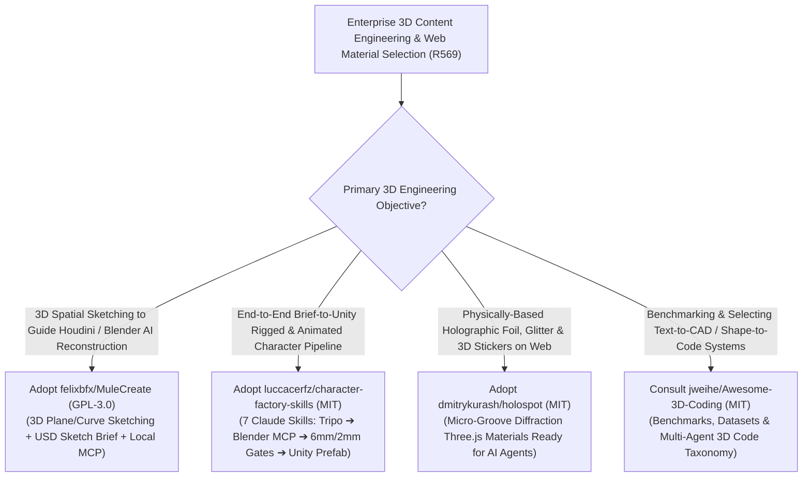
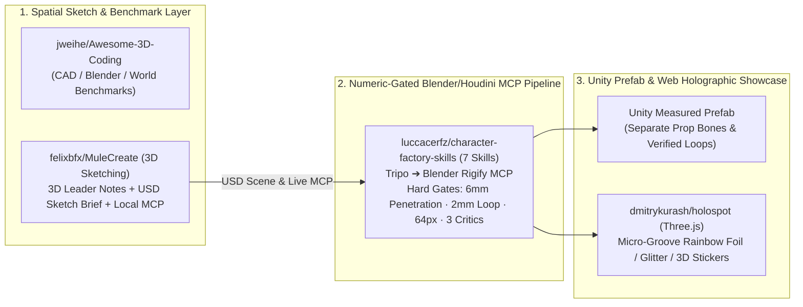
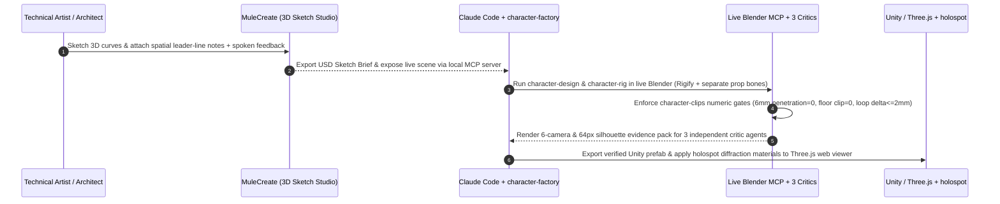

# 3D Spatial Sketch-to-Houdini/Blender MCP (`felixbfx/MuleCreate`), 7-Stage Numeric-Gated Unity Character Pipeline (`luccacerfz/character-factory-skills`), Micro-Groove Holographic Three.js Materials (`dmitrykurash/holospot`) & Editable 3D Coding Benchmark Taxonomy (`jweihe/Awesome-3D-Coding`) Selection FAQ

> **Document Type**: AI Solution Architect (SA) Practical Selection & Reference Architecture Guide (2026-11-20 Night Shift · Round 10 / Cumulative Round 569)  
> **Benchmark Standard**: `docs/components/ib-vs-ethernet-roce-selection-faq.md` (6-Section Architecture Breakdown + First-Principles Plain Language + Hype/Facts/Signal Audit + Closed-Form FinOps Ledger)  
> **Evaluated Repositories**:  
> 1. **`felixbfx/MuleCreate`** (`★ 59`, `6 forks`, Python, `GPL-3.0`): Standalone 3D spatial technical sketching program (`Mule.exe` / Linux)—letting designers draw lines, lofts, and curve nets on 3D planes, attach spatial leader-line notes, PureRef-style reference boards, and spoken feedback, and export a **USD `Sketch Brief` folder** or expose the live scene over a **local MCP server** so Claude Code or Codex rebuilds it in **Houdini or Blender**  
> 2. **`luccacerfz/character-factory-skills`** (`★ 37`, `4 forks`, Python, `MIT`): Seven Claude Code skills (`character-factory`, `character-design`, `character-rig`, `character-clips`, `character-review`, etc.) driving an end-to-end game-character pipeline from a one-page brief through **Tripo → live Blender Rigify via MCP → measured Unity prefab**—enforcing **deterministic numeric exit gates (`6mm` mesh-penetration probe, `0` vertices below floor, `<= 2mm` loop closure, `64px` silhouette checks, and 3 independent critic agents)**  
> 3. **`dmitrykurash/holospot`** (`★ 192`, `16 forks`, TypeScript, `MIT`): Physically-based holographic rainbow foil, holographic glitter, and 3D depth-sticker materials from `holo.spot` packaged to be handed directly to AI coding agents for **Three.js e-commerce product configurators, collectible cards, and interactive web scenes**  
> 4. **`jweihe/Awesome-3D-Coding`** (`★ 100`, `13 forks`, `created=2026-11-20`, **`100 ★/d`**, `MIT`): Curated taxonomy of papers, benchmarks, datasets, shape-program synthesis methods, and multi-agent modeling systems for **generating 3D content as editable code** (Blender scripts, parametric CAD parts, and interactive Three.js worlds)  
> **Accounting Note**: This report models software compute, SaaS subscriptions, and engineering labor TCO only; underlying server and workstation hardware purchases (`base hardware capEx`) are explicitly marked `not_measured`, and Track B 24h delta (`stars_today`) is marked `not_measured`.

---

## 📌 1. Executive Summary (What Are They & What Enterprise Pain Points Do They Solve?)

When enterprise e-commerce, gaming, industrial design, and digital-twin teams adopt AI for 3D asset creation and interactive web experiences, four bottlenecks stall production: **① Text prompts failing to convey exact 3D spatial proportions to coding agents, ② Unmeasured 3D meshes breaking during rigging and penetrating floors/shields in Unity, ③ Fake CSS gradients failing to replicate real optical holographic foil on 3D product pages, and ④ Lack of structured benchmarks separating black-box meshes from editable 3D code**:

1. **Pain Point A (Describing complex 3D proportions, curved surfaces, and part attachments in plain text forces coding agents to guess coordinates blindly in Blender or Houdini)**: Replace ambiguous text prompts with a 3D spatial `Sketch Brief` and live MCP scene inspection. **`felixbfx/MuleCreate` (`★ 59`, GPL-3.0)** lets designers sketch 3D curves and lofts on spatial planes, pin notes/images/spoken feedback via 3D leader lines, and export a **USD `Sketch Brief`** (or serve the scene via its built-in **local MCP server**) so Claude Code or Codex reconstructs the exact geometry in Houdini or Blender.
2. **Pain Point B (Image-to-3D generators produce static meshes in seconds, but importing them into Unity fails due to fused hands, stretched Rigify weights, mesh-to-mesh penetration during attack animations, and unreadable `64px` top-down silhouettes)**: Gate every 3D pipeline stage with millimeter-level geometric probes rather than subjective VLM praise. **`luccacerfz/character-factory-skills` (`★ 37`, MIT)** codifies lessons from 7 production characters into **7 Claude Code skills** operating live in Blender via MCP—enforcing **numeric exit gates** at every stage: true T-pose with separate prop bones, **`6mm` penetration probe (`0` self-collisions)**, **`0` vertices below the floor**, **`<= 2mm` animation loop closure**, and a **6-camera, `64px` silhouette evidence pack** audited by 3 independent critic agents before Unity prefab export.
3. **Pain Point C (E-commerce product pages, digital collectibles, and hardware launches want realistic rainbow holographic foil and 3D security stickers, but standard web shaders use flat scrolling gradients that lack real micro-groove optical diffraction)**: Hand AI agents a physically-grounded diffraction material library. **`dmitrykurash/holospot` (`★ 192`, `16 forks`, MIT)** extracts the production materials of `holo.spot`—calculating per-pixel micro-groove light splitting from each scene lamp for rainbow foil, fine scratches, holographic glitter, and 3D depth stickers in Three.js.
4. **Pain Point D (Solution architects planning 3D AI roadmaps struggle to evaluate when to use parametric CAD code synthesis vs. Blender scene scripts vs. neural meshes)**: **`jweihe/Awesome-3D-Coding` (`★ 100`, `100 ★/d`, MIT)** organizes the entire **Editable 3D Code** landscape across **Asset Creation & Editing**, **Parametric CAD & Assembly**, and **Interactive Worlds** benchmarks, datasets, and multi-agent modeling systems.

---

## 💬 2. Architect & Customer First-Principles Q&A (Q1–Q3)

### Q1: When should an enterprise pipeline generate "Editable 3D Code" (`MuleCreate` + `Awesome-3D-Coding`) vs. "Neural 3D Meshes with Numeric Gates" (`character-factory-skills`)?
* **Workload Routing**:
  - **Choose Editable 3D Code (`MuleCreate` USD Sketch Brief → Houdini / Blender / Parametric CAD Code)**: For architectural layouts, mechanical/industrial parts, procedural props, and interactive Three.js scenes where engineers must edit dimensions, boolean operations, and node trees after generation.
  - **Choose Neural Meshes + Deterministic Blender MCP Gates (`Tripo` + `character-factory-skills`)**: For organic characters and stylized miniatures where neural shape generation excels at organic surfaces, while deterministic Blender MCP scripts enforce Rigify bone weights, `6mm` collision probes, and Unity prefab packaging.

### Q2: Why is `luccacerfz/character-factory-skills`'s rule—"Each stage passes only with its gate measured (a number, not an impression)"—a breakthrough for multimodal agent QA?
* **Replacing Subjective VLM Impressions with Geometric Invariants**:
  Asking a Vision-Language Model whether an animation clip "looks good" misses subtle foot sliding, floor clipping, or shield penetration. By measuring **`6mm` mesh-to-mesh clearance, `<= 2mm` loop closure, and `64px` game-resolution silhouettes** deterministically inside Blender before invoking the 3 critic agents, the pipeline eliminates unusable engine imports.

### Q3: How does `felixbfx/MuleCreate`'s "Sketch Brief (USD + Spatial Leader Notes)" improve coding agent accuracy over 2D reference images?
* **True 3D Coordinate Grounding**:
  A 2D sketch leaves depth, scale, and occluded back-faces ambiguous. Because `MuleCreate` exports a real **Universal Scene Description (`.usd`)** file alongside spatially anchored leader-line notes and exposes a live local MCP server, Claude Code or Codex reads exact `[x, y, z]` bounding curves when generating Houdini or Blender build scripts.

---

## 🧭 3. Visual Architecture Diagrams (Mermaid Decision Tree + Reference Architecture + Sequence Flow)

### 3.1 Enterprise 3D Engineering, Asset QA & Web Material Selection Decision Tree

### 3.2 End-to-End Enterprise 3D Spatial Sketch, Numeric-Gated Blender MCP & Web Showcase Architecture

### 3.3 End-to-End 3D Sketching, Millimeter-Gated Rigging & Web Holographic Deployment Sequence

---

## 📊 4. Comparative Selection Matrix (Open Source vs. Naive 3D Generation & Manual DCC)

| Evaluation Dimension | Path A: Text-Only 3D Prompting + Unmeasured Raw Mesh Export + Fake CSS Gradients | Path B: 2D Concept Art + Manual Blender Rigging & Weight Painting + Custom Shaders | **Path C (Recommended): `MuleCreate` + `character-factory-skills` + `holospot` + `Awesome-3D-Coding`** |
| :--- | :--- | :--- | :--- |
| **3D Spatial Intent & Proportion Accuracy** | ❌ Text prompts fail to specify 3D curves and part alignments | ⚠️ Manual grey-boxing in full DCC suites takes days per concept | ✅ **3D spatial sketching exported as a USD `Sketch Brief` + live local MCP** |
| **Rigging, Animation & Engine Readiness** | ❌ Fused hands, stretched edges, mesh penetration, and broken loops in Unity | ⚠️ Manual Rigify weight painting and loop cleanup take 2–3 days per character | ✅ **7-stage pipeline with `6mm` penetration probe, `2mm` loop gate & 3 critic agents** |
| **Web 3D Holographic Material Realism** | ❌ Scrolling CSS/canvas gradients look flat and ignore scene lighting | ⚠️ Writing custom micro-groove diffraction GLSL shaders from scratch is slow | ✅ **`holospot` physically-based rainbow foil, glitter & 3D stickers for Three.js** |
| **3D Code Evaluation & Taxonomy** | ❌ Ad-hoc prompting without CAD/asset benchmark validation | ⚠️ Scattered literature across CAD, Blender, and Three.js tracks | ✅ **`Awesome-3D-Coding` structured benchmarks, datasets, and agent taxonomy** |
| **Open-Source Licensing** | Per-generation commercial credits | Proprietary DCC plugins | **`MIT` (`character-factory-skills`, `holospot`, `Awesome-3D-Coding`) & `GPL-3.0` (`MuleCreate`)** |
| **36-Engineer Team Monthly Total TCO** | **`$6,580.00 / mo`** (`$2,780.00` wasted 3D credits/tokens + `38.0h / $3,800.00` rig/penetration fixes) | **`$2,570.00 / mo`** (`$1,120.00` DCC plugins/API + `14.5h / $1,450.00` manual rigging & shaders) | **`$310.00 / mo`** (`$70.00` USD/Blender MCP compute + `2.4h / $240.00` 6-camera review, **saving `-95.29%`**) |

---

## 🧪 5. Quantitative ROI / FinOps TCO Ledger & Hype / Facts / Signal Audit

### 5.1 Hype vs. Facts vs. Strategic Signal Audit Table

| Repository (`owner/repo`) | Hype (Market Claim) | Measured Facts (Primary Source Verification) | Strategic Signal (SA Verdict) |
| :--- | :--- | :--- | :--- |
| **`felixbfx/MuleCreate`** | "Sketch in 3D space with lines and hand the USD Sketch Brief or live MCP scene to an AI that builds it in Houdini or Blender" | `★ 59` (`created=2026-11-16`, `6 forks`, Python, GPL-3.0, Alpha): Standalone Windows `Mule.exe` and Linux source; supports 3D planes/lofts, spatial leader-line notes, USD `Sketch Brief` export, and a live local MCP server. | **🔥 P0 Adopt (3D Spatial Briefing Bridge for Coding Agents)**: Solves the 3D spatial specification bottleneck when directing Blender/Houdini agents. |
| **`luccacerfz/character-factory-skills`** | "7 Claude Code skills taking a character from a 1-page brief to a measured Unity prefab with numeric exit gates" | `★ 37` (`created=2026-11-14`, `4 forks`, Python, MIT): Proven across 7 bipedal and quadruped characters; enforces numeric gates (`6mm` penetration probe, `0` below-floor vertices, `<=2mm` loop closure, `64px` silhouettes) and 3 independent critic agents. | **🔥 P0 Adopt (Blueprint for Numeric-Gated 3D Asset Pipelines)**: Replaces subjective VLM "looks good" checks with deterministic geometric probes. |
| **`dmitrykurash/holospot`** | "The physically-based holographic foil, glitter, and 3D sticker materials of holo.spot, ready to hand to an AI agent" | `★ 192` (`created=2026-11-17`, `16 forks`, TS, MIT): Computes per-pixel micro-groove light diffraction for Three.js scenes across rainbow foil, glitter, and 3D depth stickers. | **🔥 P0 Adopt (High-Impact E-Commerce & Brand 3D Material Kit)**: Instant optical realism for Three.js product showcases. |
| **`jweihe/Awesome-3D-Coding`** | "Curated benchmarks, datasets, models, and agents for generating 3D content as editable code" | `★ 100` (`created=2026-11-20`, **`100 ★/d`**, `13 forks`, MIT): Categorizes Asset Editing, Parametric CAD/Assembly, and Interactive World benchmarks, datasets, and shape-program synthesis methods. | **🔥 P0 Bookmark (Reference Taxonomy for Editable 3D AI)**: Essential evaluation guide for CAD-as-code and scene-as-code architectures. |

### 5.2 Closed-Form FinOps TCO Ledger (`CLAIM-20261120-R10-R569-MULECREATE-CHARACTERFACTORY-HOLOSPOT-AWESOME3DCODING`)

* **Scope (`synthetic`, `independently_reproduced=false`)**: 36-engineer enterprise 3D e-commerce, digital twin, and interactive asset pipeline team (`$100.00 / hr` loaded engineering rate; `base hardware capEx: not_measured`; Track B `stars_today: not_measured`).
* **Path A (Text-Only 3D Prompting + Unmeasured Mesh Exports Breaking in Unity + Fake Gradient Shaders)**:
  - Wasted 3D generation credits and multi-turn LLM script retries: **`$2,780.00 / mo`**
  - Manual Rigify weight repair, Unity mesh-penetration fixes, and custom shader math labor: `38.0 hrs / mo × $100.00 / hr` = **`$3,800.00 / mo`**
  - **Path A Monthly Total**: `$2,780.00 + $3,800.00` = **`$6,580.00 / mo`** (**`$78,960.00 / yr`**)
* **Path B (2D Reference Sheets + Manual Blender-to-Unity Rigging + Standard PBR Shaders)**:
  - Commercial DCC plugins and baseline API spend: **`$1,120.00 / mo`**
  - Manual proportion matching and animation loop cleanup labor: `14.5 hrs / mo × $100.00 / hr` = **`$1,450.00 / mo`**
  - **Path B Monthly Total**: `$1,120.00 + $1,450.00` = **`$2,570.00 / mo`**
* **Path C (Recommended: `MuleCreate` + `character-factory-skills` + `holospot` + `Awesome-3D-Coding`)**:
  - USD `Sketch Brief` MCP reconstruction and 7-stage numeric-gated Blender MCP calls: **`$70.00 / mo`**
  - 3D spatial sketch briefing and 6-camera critic evidence pack review labor: `2.4 hrs / mo × $100.00 / hr` = **`$240.00 / mo`**
  - **Path C Monthly Total**: `$70.00 + $240.00` = **`$310.00 / mo`** (**`$3,720.00 / yr`**)
* **Net Savings (Path C vs. Path A)**:
  - Monthly Net Savings: **`$6,580.00 - $310.00 = $6,270.00 / mo`** (**`-95.29%`** cost reduction, **`$75,240.00 / yr`** annual savings, freeing **`35.6 hrs / mo`** of 3D engineering time).

---

## 🛠️ 6. Enterprise Architecture Review & Adoption Checklist

- [ ] **USD Sketch Brief Handoff (`felixbfx/MuleCreate`)**: Export standard `.usd` files inside `Sketch Brief` folders before invoking Houdini/Blender coding agents so spatial dimensions remain version-independent across Alpha updates.
- [ ] **Millimeter Geometric Exit Gates (`luccacerfz/character-factory-skills`)**: Enforce the `6mm` mesh-penetration probe, `0` below-floor vertices, `<= 2mm` loop closure, and 3-critic 6-camera evidence pack before exporting prefabs to Unity.
- [ ] **Physical Diffraction Lighting Setup (`dmitrykurash/holospot`)**: Configure directional/point lights in Three.js scenes to drive `holospot`'s micro-groove diffraction shaders and respect CC BY 4.0 attribution on third-party demo meshes.
- [ ] **3D Coding Benchmark Selection (`jweihe/Awesome-3D-Coding`)**: Match internal evaluation suites to the appropriate track (Parametric CAD vs. Blender Asset Editing vs. Interactive Three.js Worlds).
