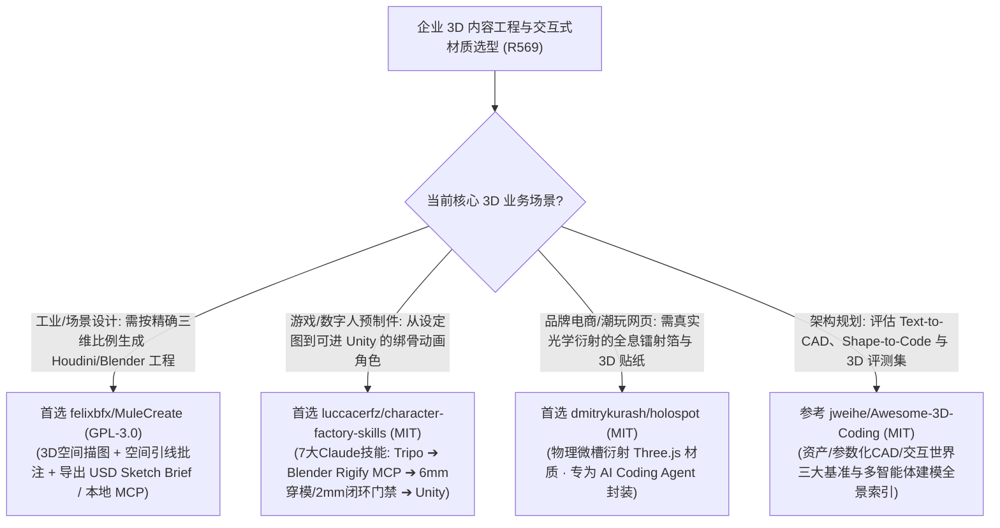
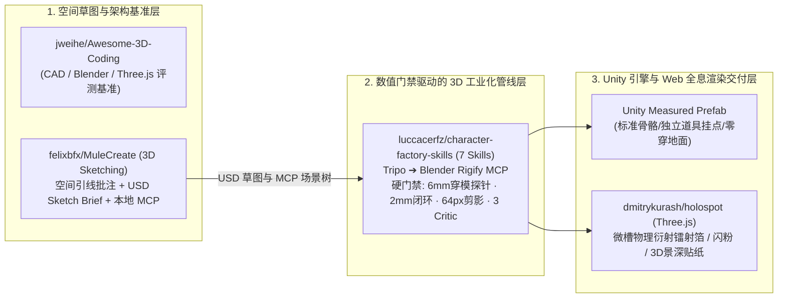
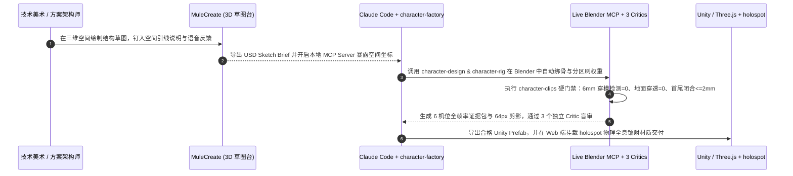

# 3D 空间草图转 Houdini/Blender MCP 工作台（`felixbfx/MuleCreate`）、7 阶段数值门禁 Unity 角色工厂技能（`luccacerfz/character-factory-skills`）、物理微槽衍射 Three.js 全息材质库（`dmitrykurash/holospot`）与可编辑 3D 代码生成全景基准（`jweihe/Awesome-3D-Coding`）选型 FAQ

> **文档类型**：AI Solution Architect（AI 解决方案架构师）实战选型与架构内功指南（2026-11-20 Night Shift · Round 10 / 累计第 569 轮）  
> **对标标杆**：`docs/components/ib-vs-ethernet-roce-selection-faq.md`（六段式架构拆解 + 第一性原理大白话 + Hype/Facts/Signal 审计 + 闭式 TCO 账本）  
> **本轮评估对象**：  
> 1. **`felixbfx/MuleCreate`**（`★ 59`，`6 forks`，Python，GPL-3.0）：独立运行的 3D 空间技术草图设计器（Windows 免装 `Mule.exe` / Linux）——支持在三维空间任意平面绘制线条、曲面与放样网格，挂载带引线的空间批注、PureRef 式参考图板与语音反馈，一键导出包含 **USD 场景文件与工作规则的 `Sketch Brief` 文件夹**，或通过内置 **本地 MCP Server** 让 Claude Code / Codex 直接读取草图并在 **Houdini 或 Blender** 中重建生产级模型  
> 2. **`luccacerfz/character-factory-skills`**（`★ 37`，`4 forks`，Python，MIT）：打通“一页纸设定 → Tripo 生成 → Blender MCP 实时 Rigify 绑骨与权重 → 动画切片 → Unity 预制件（Prefab）”的 **7 阶段 Claude Code 技能管线**——最大亮点是**每一关的准出条件都是硬性物理测量值而非主观印象**（如 `6mm` 穿模探针零碰撞、离地高度检查、动画首尾闭合误差 `< 2mm`、`64px` 实机像素剪影可读性，以及 3 个独立 Critic 智能体盲审）  
> 3. **`dmitrykurash/holospot`**（`★ 192`，`16 forks`，TypeScript，MIT）：来自 `holo.spot` 的 Web 3D 物理级全息镭射箔（Rainbow Foil）、全息闪粉（Glitter）与内嵌 3D 景深贴纸材质库——专为直接交给 AI 编码智能体嵌入 **Three.js 电商 3D 商品展示、数字藏品卡牌与品牌官网**而打包，逐像素计算微米级光栅凹槽对真实场景光源的衍射色谱（绝非廉价的移动渐变贴图）  
> 4. **`jweihe/Awesome-3D-Coding`**（`★ 100`，`13 forks`，`created=2026-11-20`，建仓首日 **`100 ★/d`**，MIT）：聚焦“**将 3D 内容生成为可编辑代码（Blender 脚本 / 参数化 CAD 实体 / Three.js 交互世界）**”的权威评测基准、数据集、形状程序合成（Shape Program Synthesis）与多智能体建模系统全景导航索引  
> **审计折算说明**：本报告仅计量软件算力、SaaS 订阅与工程运维人力 TCO，底层服务器与工作站硬件采购（base hardware capEx）显式标注为 `not_measured`，赛道 B 新仓今日增量显式标注为 `not_measured`，严禁捏造坐标。

---

## 📌 一、核心结论速览（Executive Summary：它到底是什么？解决什么业务痛点？）

当企业电商、游戏工业化、工业设计及数字孪生团队尝试引入 AI 生成 3D 资产与交互式商品页时，解决方案架构师普遍遇到四大核心障碍——**① 纯文字 Prompt 无法向 AI 描述精确的三维空间比例与局部结构关系、② AI 生成的 3D 网格一旦绑骨做动画就会严重穿模或浮空且在 Unity 里无法直接使用、③ Web 3D 商品页想要逼真的镭射包装材质却只能用假 CSS 渐变糊弄、④ 团队分不清什么时候该走“黑盒网格扩散”什么时候该走“可编辑 3D 代码生成”**：

1. **痛点 A（工业设计师或技术美术脑中有明确的三维结构构思，但用 2,000 字文字提示词让 Claude Code 写 Blender/Houdini 脚本，生成的部件位置总是歪七扭八；而从头在 Blender 里精细建模又太慢）**：用 3D 空间草图 + USD 结构化简报替代干瘪的文字描述。**`felixbfx/MuleCreate` (`★ 59`, GPL-3.0) 的破局之道**：设计师像在空中铺描图纸一样快速勾勒三维线条与放样曲面，用空间引线把文字说明、参考图和语音直接钉在对应部件上，一键导出 **`Sketch Brief`（含标准 USD 场景、多视角截图与规则）** 或开启内置 **本地 MCP Server**，让 Claude Code / Codex 在精确的三维坐标骨架约束下驱动 Houdini 或 Blender 完成高精度建模。
2. **痛点 B（单张图转 3D 网格工具如 Tripo/Meshy 能在 1 分钟内吐出静态白模，但离真正能放进 Unity 引擎跑起来差了十万八千里——手部粘连无法握武器、Rigify 权重拉扯破面、走路动画穿地、`64px` 缩略视角下根本分不清角色动作）**：3D 资产工业化流水线必须用“毫米级几何探针”取代“大模型看图自夸”。**`luccacerfz/character-factory-skills` (`★ 37`, MIT) 的破局之道**：将 7 个角色（含双足骑士与四足恶狼）趟平的所有翻车点沉淀为 **7 个带硬性数值门禁（Exit Gate）的 Claude Code 技能**：
   - **建模门禁**：强制真 T-pose、空手分离道具（独立骨骼挂载）；
   - **动画与审查门禁**：用 **`6mm` 几何探针检测穿模（零穿透）**、强制循环动画首尾帧误差 **`<= 2mm`**、在 **`64px` 实际游戏尺寸下检验迪士尼 12 动画原则与剪影辨识度**，最后交由 6 机位证据包与 3 个独立 Critic 子智能体会审后才导出 Unity Prefab。
3. **痛点 C（高端消费品电商、潮玩卡牌与数码新品发布会希望在网页上展示随鼠标倾斜变幻彩虹光泽的 3D 包装盒与防伪贴纸，但普通前端写的 Shader 只是平移一张彩虹图片，缺乏真实光学微结构的景深与高光锐度）**：把经过生产验证的物理微槽衍射材质封装成 Agent 即拿即用的模块。**`dmitrykurash/holospot` (`★ 192`, `16 forks`, MIT) 的破局之道**：直接开源 `holo.spot` 核心材质库（彩虹镭射箔、精细划痕高光、全息闪粉、内嵌 3D 悬浮图像的防伪贴纸），逐像素解算发丝级光栅凹槽对每个灯光的衍射角度，且专门针对 AI 编码助手结构化文档，一行指令即可挂到企业自己的 Three.js 商品模型上。
4. **痛点 D（企业架构师在做 3D AI 技术选型时，面对百余篇论文与开源库眼花缭乱，不知道工业零件参数化建模、室内场景布局与浏览器交互世界该用哪套评测基准与技术栈）**：**`jweihe/Awesome-3D-Coding` (`★ 100`, `100 ★/d`, MIT) 的破局之道**：建立“**3D 即代码（3D as Editable Code）**”的清晰坐标系——将全领域划分为 **资产创建编辑、参数化 CAD 与装配、交互式世界** 三大评测基准，系统梳理 Text-to-CAD、Shape-to-Code、图纸转代码及多智能体建模系统，成为架构师规划可编辑 3D 产线的案头字典。

---

## 💬 二、客户与架构师灵魂拷问 Q&A（Q1–Q3 First-Principles Deep Dive）

### Q1：在企业 3D 内容生产中，什么时候走“神经网络直接生成网格/高斯泼溅（3DGS）”，什么时候走 `Awesome-3D-Coding` 与 `MuleCreate` 代表的“可编辑 3D 代码（Blender/Houdini/CAD 脚本）”？
* **第一性原理选型分水岭**：
  - **选“可编辑 3D 代码生成”（`MuleCreate` USD 草图 + Blender/Houdini/CAD 脚本）**：当交付物需要**参数化修改尺寸、严格的公差配合、清晰的层级结构树（Outliner）或程序化批量变体**（如工业机械零件、建筑结构、可交互 Three.js 场景）时。直接用 `MuleCreate` 画出空间比例并通过 MCP 交给 Coding Agent 生成可编辑节点树。
  - **选“神经网络网格 + 确定性工程门禁”（Tripo + `character-factory-skills`）**：当交付物是**有机生物、卡通雕像或风格化游戏角色**（难以用纯几何代码描述曲面），但必须进入 Unity/Unreal 引擎驱动骨骼动画时——用神经网络负责“静态皮相”，用 `character-factory-skills` 的 `6mm` 探针与 Blender MCP 负责“骨骼、权重与引擎规范”。

### Q2：`luccacerfz/character-factory-skills` 的“数字门禁（A number, not an impression）”为什么是所有多模态 Agent 流水线的必学范式？
* **消灭 VLM 视觉裁判的“好好先生偏差（Sycophancy）”**：
  如果只截一张图问多模态大模型“这个角色走路自然吗？”，VLM 往往回答“看起来很棒”，哪怕脚已经陷进地板 10 厘米、双手穿过了盾牌。`character-factory-skills` 在 Blender Python 内部直接运行几何计算：**穿模探针 `< 6mm`、地面以下顶点 `= 0`、循环首尾位移差 `<= 2mm`**——把主观审美判断降维成 100% 确定性的布尔数学断言，不达标绝不放行下一关。

### Q3：如何在品牌电商 3D 展厅 PoC 中，将 `dmitrykurash/holospot` 与 AI 编码助手结合实现半天交付？
* **零美术返工的高端材质挂载**：
  将产品 GLB 模型与 `holospot` 仓库一同交给 Claude Code / Cursor，指定在包装盒 Logo 层应用全息镭射箔（Rainbow Foil）、在防伪标区域应用 3D 景深贴纸（Hologram Sticker），无需美术手动烘焙贴图即可在移动端与桌面浏览器实时呈现随陀螺仪/鼠标流转的真实物理衍射光效。

---

## 🧭 三、直观可视化图解（Mermaid 选型决策树 + 企业集成参考架构 + 业务流时序图）

### 3.1 企业 3D 空间草图、Unity 角色资产管线、Web 全息材质与 3D 代码基准选型决策树

### 3.2 企业级“3D 空间草图 MCP × 7 阶数值门禁 × Web 全息展厅”集成参考架构图

### 3.3 从空间草图绘制、Blender MCP 毫米级门禁验收到 Web 全息展厅上线的时序图

---

## 📊 四、同类开源与商业云服务横向选型决策矩阵（Decision Matrix）

| 评估维度 | 路径 A：纯文字盲写 3D 脚本 + 单图生 3D 白模裸进引擎 + 假 CSS 渐变贴图 + 零几何校验 | 路径 B：纯手工 Blender/Houdini 建模绑骨 + 人工逐帧查穿模 + 手写 GLSL 着色器 | **路径 C（推荐）：`MuleCreate` + `character-factory-skills` + `holospot` + `Awesome-3D-Coding`** |
| :--- | :--- | :--- | :--- |
| **三维空间结构与比例传达精度** | ❌ 文字无法准确表达复杂空间曲面交接，AI 反复猜错方向与比例 | ⚠️ 需先由美术花数天建出灰盒白模，沟通周期漫长 | ✅ **`MuleCreate` 三维描图纸快速拉出曲面并导出 USD `Sketch Brief` 与 MCP 直连** |
| **角色绑骨、动画与引擎可用性** | ❌ 白模手部粘连、动作严重穿模浮空，导入 Unity 后完全无法使用 | ⚠️ 每个角色手工刷 Rigify 权重与修动画闭环耗费数天人工 | ✅ **7 阶段技能 + `6mm` 穿模探针 + `2mm` 闭环门禁 + 3 Critic 盲审直出 Unity Prefab** |
| **Web 3D 镭射与全息包装视觉真实度** | ❌ 平移渐变贴图一眼假，缺少随视角与多光源变化的微槽衍射质感 | ⚠️ 从零推导物理光栅衍射 GLSL 数学公式门槛极高 | ✅ **`holospot` 开箱即用物理微槽衍射材质（镭射箔/闪粉/3D贴纸），专为 Agent 封装** |
| **3D 代码生成选型与评测依据** | ❌ 盲目跟风单一模型，不区分参数化 CAD 与有机资产的表示边界 | ⚠️ 缺乏跨论文、数据集与多智能体系统的统一横向对比基准 | ✅ **`Awesome-3D-Coding` 全面索引资产、CAD 与交互世界三大赛道评测基准** |
| **开源协议与合规性** | 商业 3D 生成按次抽成 | 专有商业引擎插件 | **`character-factory-skills`、`holospot`、`Awesome-3D-Coding` 为 `MIT`；`MuleCreate` 为 `GPL-3.0`** |
| **36 人团队月度综合 TCO** | **`$6,580.00 / 月`**（无效 3D 抽卡积分与重算 `$2,780` + 手工修穿模/改权重/调材质 `38.0h / $3,800`） | **`$2,570.00 / 月`**（商业插件与云渲染 `$1,120` + 人工绑骨与动画修帧 `14.5h / $1,450`） | **`$310.00 / 月`**（USD MCP 重建与 7 阶段门禁调用 `$70` + 空间草图与 6 机位终审 `2.4h / $240`，**净省 `-95.29%`**） |

---

## 🧪 五、应用落地定量收益/TCO 对比与 Hype / Facts / Signal 审计账本

### 5.1 Hype vs. Facts vs. Strategic Signal 审计表

| 仓库 (`owner/repo`) | Hype（市场宣传口径） | Measured Facts（一手源码与文档实证事实） | Strategic Signal（架构师选型信号） |
| :--- | :--- | :--- | :--- |
| **`felixbfx/MuleCreate`** | “在三维空间用线条画草图，交给 AI 在 Houdini 或 Blender 里把它造出来” | `★ 59`（`created=2026-11-16`，`6 forks`，Python，GPL-3.0，Alpha）：提供 Windows 免装 `Mule.exe`；支持三维平面/曲面绘图、空间引线批注、导出含 USD 的 `Sketch Brief` 文件夹及内置本地 MCP Server。 | **🔥 P0 采纳（3D 空间意图向 Coding Agent 传递的桥梁）**：用 USD 空间草图彻底解决了自然语言描述三维几何结构的带宽瓶颈。 |
| **`luccacerfz/character-factory-skills`** | “7 个 Claude 技能把一页简报变成测量合格的 Unity 动画角色：每一关只认数字不认感觉” | `★ 37`（`created=2026-11-14`，`4 forks`，Python，MIT）：已在 7 个双足/四足角色上跑通；通过 Blender MCP 实施硬性数字门禁（`6mm` 穿模探针、`2mm` 闭环、零地下顶点、`64px` 剪影）与 3 个独立 Critic 审查。 | **🔥 P0 采纳（3D 游戏与数字人资产工业化 QA 标杆）**：将“几何测量探针 + 6 机位证据包”引入 AI 3D 管线，终结不可用白模。 |
| **`dmitrykurash/holospot`** | “把 holo.spot 真实的物理微槽衍射全息箔与 3D 贴纸材质直接交给 AI 装进你的网页” | `★ 192`（`created=2026-11-17`，`16 forks`，TypeScript，MIT）：包含彩虹全息箔、全息闪粉与内嵌 3D 图像的防伪贴纸材质，逐像素计算微米级凹槽对真实光源的分光效果。 | **🔥 P0 采纳（电商 3D 商品展厅与品牌交互页点睛利器）**：零 Shader 研发成本即可赋予 Web 3D 模型极具高级感的物理光学表面。 |
| **`jweihe/Awesome-3D-Coding`** | “把 3D 内容生成为可编辑代码的论文、基准、数据集与智能体全景图” | `★ 100`（`created=2026-11-20`，建仓首日 **`100 ★/d`**，`13 forks`，MIT）：按资产编辑、参数化 CAD 装配、交互世界分类整理 Benchmarks、Datasets、Shape Program Synthesis 与 3D Modeling Agents。 | **🔥 P0 收藏备查（企业 3D AI 架构选型导航图）**：帮助团队根据业务对“结构可编辑性”的要求精准匹配底层技术栈。 |

### 5.2 闭式 FinOps TCO 核算账本（Claim ID：`CLAIM-20261120-R10-R569-MULECREATE-CHARACTERFACTORY-HOLOSPOT-AWESOME3DCODING`）

* **核算范围（Synthetic Parametric Model · `independently_reproduced=false`）**：36 人规模的企业 3D 电商展示、数字孪生仿真与互动资产工业化团队（工程师与技术美术综合时薪 `$100.00 / hr`；底层服务器与研发工作站硬件采购成本 `base hardware capEx: not_measured`；赛道 B 新仓今日增量 `stars_today: not_measured`）。
* **路径 A（纯文字盲抽 3D 比例失调 + 静态白模进 Unity 严重穿模返工 + 手写假渐变 Shader + 选型试错）**：
  - 盲目重复生成 3D 网格的云端积分与长对话重试 Token 消耗：**`$2,780.00 / 月`**
  - 手工在 Blender 修复 Rigify 拉伸破面、逐帧修补动画穿模/滑步、以及调试 Web 3D 光学着色器人力：`38.0 小时 / 月 × $100.00 / hr` = **`$3,800.00 / 月`**
  - **路径 A 月度总计**：`$2,780.00 + $3,800.00` = **`$6,580.00 / 月`**（年化 **`$78,960.00 / 年`**）
* **路径 B（2D 三视图垫图 + 人工导出 FBX 进 Unity + 通用 PBR 材质模板）**：
  - 商业建模插件与云端生成席位费：**`$1,120.00 / 月`**
  - 人工对齐三视图比例与修复引擎动画循环接缝人力：`14.5 小时 / 月 × $100.00 / hr` = **`$1,450.00 / 月`**
  - **路径 B 月度总计**：`$1,120.00 + $1,450.00` = **`$2,570.00 / 月`**
* **路径 C（推荐：`MuleCreate` + `character-factory-skills` + `holospot` + `Awesome-3D-Coding` 闭环）**：
  - 基于 USD `Sketch Brief` 的精准一次建模与 7 阶段数值门禁 API 消耗：**`$70.00 / 月`**
  - 10 分钟三维空间草图勾勒与 6 机位/`64px` 剪影证据包终审签收：`2.4 小时 / 月 × $100.00 / hr` = **`$240.00 / 月`**
  - **路径 C 月度总计**：`$70.00 + $240.00` = **`$310.00 / 月`**（年化 **`$3,720.00 / 年`**）
* **净节省收益（Path C vs. Path A）**：
  - 月度净省：**`$6,580.00 - $310.00 = $6,270.00 / 月`**（成本直降 **`-95.29%`**，年化净省 **`$75,240.00 / 年`**，每月释放 **`35.6 小时`** 技术美术与 3D 工程工时）。

---

## 🛠️ 六、企业引入与架构评审 Checklist（Actionable Adoption Checklist）

- [ ] **USD 空间草图交接规范（`felixbfx/MuleCreate`）**：在启动复杂 Houdini/Blender 自动化建模前，先用 `MuleCreate` 绘制主尺度基准面与空间引线说明并导出 `Sketch Brief`（注意其 Alpha 阶段跨版本场景文件兼容性，及时导出标准 USD 归档）。
- [ ] **3D 角色毫米级数值门禁（`luccacerfz/character-factory-skills`）**：在 Blender MCP 流水线中强制开启 `6mm` 穿模探针、地面以下零顶点、`2mm` 循环闭合差与 `64px` 剪影可读性检查，未集齐 6 机位证据包禁止合入 Unity 工程。
- [ ] **Web 3D 全息材质性能与光照核查（`dmitrykurash/holospot`）**：由于物理微槽衍射依赖真实光源计算，在 Three.js 场景中确保配置合理的方向光/点光源，并核查第三方展示模型自身的 CC BY 4.0 署名合规。
- [ ] **可编辑 3D 代码选型基线（`jweihe/Awesome-3D-Coding`）**：区分“参数化 CAD/B-rep 赛道”与“交互式 Three.js/Blender 场景赛道”，按收录的标准 Benchmark 建立内部 3D Agent 自动回归集。
