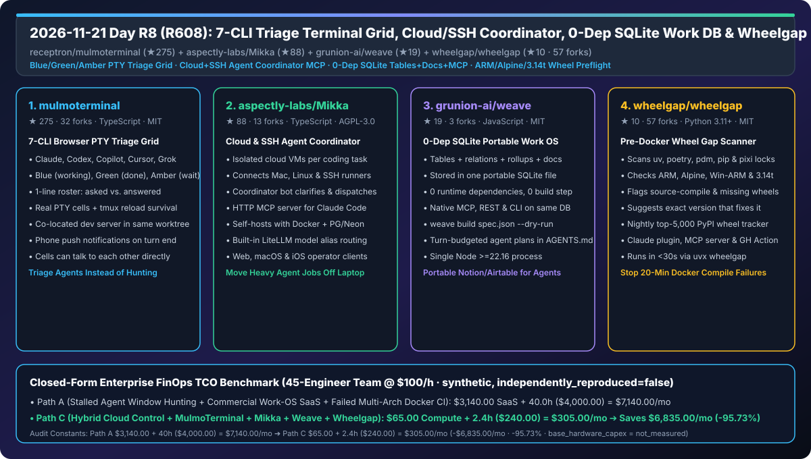
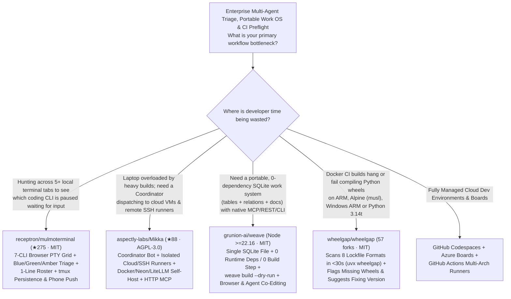
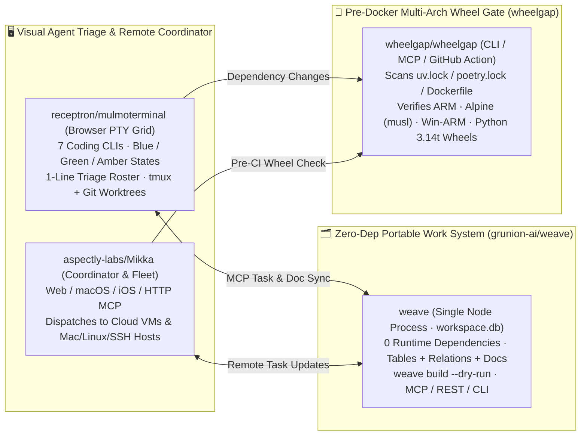

# 7-CLI Triage Terminal Grid (`receptron/mulmoterminal`), Cloud/SSH Agent Coordinator (`aspectly-labs/Mikka`), Zero-Dependency SQLite Work System (`grunion-ai/weave`) & Pre-Docker Python Wheel Gap Scanner (`wheelgap/wheelgap`) Selection & Architecture FAQ

> **Target Audience**: **AI Solution Architects (SAs) & Enterprise DevEx / Platform Engineering Leaders (2026-11-21 Day Round 8 · Cumulative Round 608)**  
> **Benchmark Style**: Strictly aligned with [`ib-vs-ethernet-roce-selection-faq.md`](https://github.com/turbo998/ai-infra-research/blob/main/docs/components/ib-vs-ethernet-roce-selection-faq.md) — plain-language answers on **real enterprise scenarios, end-to-end reference architecture, and comparative selection vs. competing OSS and cloud PaaS**.  
> **Chinese Edition**: [`mulmoterminal-mikka-weave-wheelgap-selection-faq.md`](./mulmoterminal-mikka-weave-wheelgap-selection-faq.md) · **Daily Digest**: [`daily/2026-11-21.en.md`](../daily/2026-11-21.en.md)



---

## 1. 📌 Executive Summary (30-Second Selection Verdict)

1. **Why Evaluate These Four Repositories Together?**  
    *"When you ran one coding agent, the slowest thing in the room was the agent. Now that you run five, the slowest thing in the room is probably you."* As enterprise developers run 5–8 concurrent coding agents and ship multi-architecture containers, four day-to-day bottlenecks emerge:
   - **Bottleneck 1 — Hunting Through Terminal Tabs to Find Which Agent Is Stopped on a Permission Prompt**: One of your five agents is always paused waiting on a question, doing nothing until you notice, and when you switch back you forget what you asked it → **`receptron/mulmoterminal` (`★ 275`, `32 forks`, TypeScript, MIT)** puts **Claude Code, Codex, GitHub Copilot CLI, Cursor CLI, Antigravity, Grok, and Muse** side by side in a `tmux`-backed browser `pty` grid where **Blue is working, Green is done, and Amber is waiting on you**, paired with a **1-line-per-session triage roster** (*what you asked, and what came back*), `git worktree` isolation that still allows co-located `yarn dev` / `lazygit` shells in the same worktree, and phone push notifications!
   - **Bottleneck 2 — Heavy Agent Builds Overheating Laptops & Dying When You Close the Lid**: Running multiple full-stack builds locally drains laptop RAM/battery → **`aspectly-labs/Mikka` (`★ 88`, `13 forks`, TypeScript, AGPL-3.0)** moves Claude Code, Codex, and Cursor runners onto **isolated cloud machines or your own Mac/Linux/SSH servers** (self-hostable with Docker + PostgreSQL/Neon + LiteLLM, or mounted directly into Claude Code via `claude mcp add --transport http mikka`), coordinated from a single chat across Web, macOS, and iOS.
   - **Bottleneck 3 — Project Tables, Specs, and Docs Trapped in Heavy SaaS Instead of a Portable File Your Agent Owns**: External project trackers require per-seat fees and brittle sync webhooks → **`grunion-ai/weave` (`★ 19`, `3 forks`, JavaScript / Node 22.16+, MIT)** packs **connected tables, relations, rollups, per-record documents, and automations into a single SQLite file (`workspace.db`)** running in one Node process with **zero runtime dependencies and no build step**, accessible simultaneously in the browser and by your agent over **MCP (`weave_query`, `weave_update_entity`), REST, and CLI (`weave build <spec.json> --dry-run`)**!
   - **Bottleneck 4 — AI-Added Python Packages Failing 20 Minutes into ARM / Alpine / Python `3.14t` Docker Builds**: Coding agents add packages that have wheels on macOS x86/ARM but lack prebuilt wheels on Linux ARM, Alpine (`musllinux`), Windows ARM, or free-threaded Python `3.14t`, triggering slow C/Rust source compilation or build failures in CI → **`wheelgap/wheelgap` (`★ 10`, `57 forks`, Python 3.11+, MIT)** scans `uv.lock`, `pylock.toml`, `poetry.lock`, `pdm.lock`, `Pipfile.lock`, `requirements.txt`, or `pixi.lock` (`uvx wheelgap`) in seconds before `docker build`, flags every package missing a prebuilt wheel for your target platforms, and names the exact release that fixes it!

2. **One-Sentence Selection Verdict**:
   - Choose **`receptron/mulmoterminal`** when you run **multiple local coding CLIs in parallel and want a Blue/Green/Amber `tmux`-backed browser `pty` grid and 1-line triage roster so you never hunt for a stalled agent**.
   - Choose **`aspectly-labs/Mikka`** when you want **a Coordinator bot to dispatch Claude Code, Codex, and Cursor jobs across isolated cloud VMs and your own SSH servers from Web, macOS, iOS, or HTTP MCP** (or pair with **GitHub Codespaces + GitHub Copilot Coding Agent** for GitHub-hosted cloud workspaces).
   - Choose **`grunion-ai/weave`** when you want **a zero-dependency, no-build-step, single-SQLite-file work system (tables + relations + docs + automations) shared natively between your browser and your agent via MCP/REST/CLI**.
   - Choose **`wheelgap/wheelgap`** when you deploy Python apps to **ARM servers, Alpine containers, Windows on ARM, or free-threaded Python `3.14t` and want to catch missing prebuilt wheels in `<30s` before `docker build`**.

---

## 2. 🎯 Customer & Solution Architect Q&A (Plain-Language Deep Dive)

### Q1: Why do developers lose velocity when running 5+ coding agents in regular terminal tabs, and how does `receptron/mulmoterminal` turn "watching agents" into fast triage?
- **Plain-Language Answer**:
  - In standard terminal emulators, a stalled permission prompt looks identical to a completed or actively compiling session until you click into the tab and read the scrollback.
  - **How `receptron/mulmoterminal` solves multi-agent triage**:
    1. **Blue / Green / Amber Visual State Grid**: Every cell is a real `pty` backed by `tmux` (surviving browser reloads) across 7 first-class CLIs (Claude Code, Codex, Antigravity, Grok, Muse, GitHub Copilot CLI, Cursor CLI). Amber immediately signals that an agent is blocked on your input.
    2. **1-Line Context Roster ("What You Asked & What Came Back")**: Keeps a single summary line per session in the roster so you never waste mental energy remembering what each agent was doing; click the row to send the next instruction immediately.
    3. **Agent-Only Worktree Lock + Co-Located Dev Servers**: Enforces a one-agent-per-worktree rule to prevent git collisions while allowing plain shells, `lazygit`, `htop`, or `yarn dev` launchers to sit inside the exact same worktree alongside the agent.

### Q2: How do `aspectly-labs/Mikka` and `grunion-ai/weave` complement local terminal grids when scaling to larger multi-machine projects?
- **Plain-Language Answer**:
  - **`aspectly-labs/Mikka` offloads heavy execution to cloud sandboxes and SSH hosts**:
    - Lets you describe a goal in one sentence to a Coordinator bot that clarifies requirements and dispatches work to Claude Code, Codex, and Cursor runners across your Mac, Linux box, SSH server, or cloud VMs. Self-hosts cleanly on Linux with Docker, PostgreSQL (or serverless **Neon** via `docker-compose.neon.yml`), and **LiteLLM**, and mounts into local Claude Code via `claude mcp add --transport http mikka`.
  - **`grunion-ai/weave` gives agents and humans one portable SQLite work database**:
    - Runs as a single Node `>= 22.16` process with **0 runtime dependencies and no build step**. An agent can scaffold an entire workspace from a spec (`weave build spec.json --dry-run`), populate relational tables and rollups, attach rich documents to every row, and query/update work in progress over MCP (`weave mcp --data workspace.db`), REST, or CLI while humans view and edit the exact same SQLite file in the browser.

### Q3: Why do coding agents frequently break multi-arch Docker builds in Python, and how does `wheelgap/wheelgap` prevent it?
- **Plain-Language Answer**:
  - When an agent adds or upgrades a Python package, it only tests on the current host architecture. In CI, building for **ARM servers (`manylinux_aarch64`), Alpine (`musllinux`), Windows on ARM, or free-threaded Python `3.14t`** silently falls back to compiling C/C++/Rust extensions from source inside Docker—causing 20-minute QEMU hangs or missing-compiler failures.
  - **What `wheelgap/wheelgap` does in under 30 seconds (`uvx wheelgap`)**:
    1. **Auto-Detects 8 Lockfile Formats & CI Target Platforms**: Reads `uv.lock`, `pylock.toml`, `poetry.lock`, `pdm.lock`, `Pipfile.lock`, `requirements.txt`, `requirements.lock`, or `pixi.lock`, and inspects your repo's `Dockerfile` and CI workflows to infer target platforms.
    2. **Pinpoints Missing Wheels & Names the Fixing Release**: Distinguishes packages that will compile from source from packages that cannot be installed at all, tells you the exact version that ships a prebuilt wheel, and integrates via CLI, Claude plugin, MCP server (`server.json`), or GitHub Action.

---

## 3. 🧭 Visual Architecture & Decision Diagrams (Mermaid)

### 3.1 Solution Architect Selection Decision Tree



### 3.2 End-to-End Enterprise Reference Architecture



### 3.3 End-to-End Execution Sequence Diagram

```mermaid
sequenceDiagram
    autonumber
    participant Eng as Engineer (MulmoTerminal / Mobile)
    participant Weave as grunion-ai/weave (SQLite Work DB)
    participant Mulmo as receptron/mulmoterminal (Triage Grid)
    participant Mikka as aspectly-labs/Mikka (Cloud/SSH Coordinator)
    participant Wheel as wheelgap/wheelgap (Wheel Scanner)

    Eng->>Weave: 1. Run weave build spec.json to scaffold relational Task table & docs in workspace.db
    Eng->>Mulmo: 2. Launch 5 local worktree PTY cells & delegate heavy test suite via Mikka HTTP MCP to cloud VM
    Mulmo-->>Eng: 3. Cell #3 lights up Amber (Waiting on You); 1-line roster shows permission prompt for new Python dep
    Eng->>Wheel: 4. Agent runs uvx wheelgap -p 3.13,3.14t -t alpine-arm64,linux-arm64 on uv.lock
    Wheel-->>Eng: 5. Flag missing musllinux wheel in <3s and recommend exact prebuilt wheel version
    Eng->>Mulmo: 6. Click Amber row to approve fixed version; cell turns Green (Done) & pushes phone alert
    Mikka->>Weave: 7. Cloud runner finishes integration suite & calls weave_update_entity to mark task Done
```

---

## 4. 📊 Comparative Selection Matrix (OSS vs. Peer Projects vs. Cloud PaaS)

| Dimension | `receptron/mulmoterminal` | `aspectly-labs/Mikka` | `grunion-ai/weave` | `wheelgap/wheelgap` | Manual Stack (Raw `tmux` + Notion SaaS + Blind `docker buildx`) | Managed Cloud PaaS (GitHub Codespaces + Azure Boards + ACR) |
| :--- | :--- | :--- | :--- | :--- | :--- | :--- |
| **Primary Role** | **7-CLI Browser PTY Grid & Visual Triage Roster** | **Cloud VM & SSH Coding Agent Coordinator** | **0-Dependency Single-SQLite Portable Work System** | **Pre-Build Python Wheel Gap Scanner (ARM/Alpine/3.14t)** | Uncoordinated tabs, SaaS lock-in, and slow CI build failures | Fully managed cloud dev environments and agile boards |
| **Best-Fit Scenario** | Triaging 4–8 parallel local coding CLI sessions on one screen | Offloading heavy agent tasks from laptops to cloud VMs & SSH hosts | Portable tables, relations, and docs shared between browser and agent MCP | Catching missing binary wheels before multi-arch or Python `3.14t` Docker builds | Single-agent, single-architecture hobby projects | Enterprise-wide cloud-hosted dev teams |
| **Key Differentiator** | **Blue/Green/Amber cells + 1-line roster** + co-located worktree shells | 1-sentence Coordinator + Docker/Neon/LiteLLM self-host + HTTP MCP | **0 runtime dependencies, no build step** + 1 SQLite file (`acme.db`) | Scans 8 lockfile formats + auto-reads Dockerfiles + suggests fixing version | Zero setup, but high human attention loss and 20-min CI compile stalls | Turnkey cloud VMs and enterprise IAM |
| **Integration Effort** | Very Low (wraps local `tmux` and existing CLI installs) | Low (`docker compose` with Neon/LiteLLM or `claude mcp add`) | Very Low (`node bin/weave.js mcp --data workspace.db`) | Very Low (`uvx wheelgap` in `<30s` or GitHub Action) | Medium (custom `tmux` status scripts and SaaS API webhooks) | Low (enterprise license provisioning) |
| **Ops Complexity** | Very Low (100% local, MIT) | Low (stateless server option with managed Neon Postgres) | Very Low (single Node `>=22.16` process + single SQLite file) | Very Low (fast metadata check, zero package compilation) | High (debugging QEMU source compiles inside CI containers) | Very Low (cloud provider managed) |
| **License** | **MIT** (permissive commercial use) | **AGPL-3.0** (server self-host; see client notes) | **MIT** (permissive commercial use) | **MIT** (permissive commercial use) | Mixed | Commercial Per-Seat & Per-Core-Hour SLA |
| **Monthly TCO** | **$0/mo** (runs locally) | Base self-hosted VM + LiteLLM usage | **$0/mo** (replaces per-seat work-OS SaaS) | **$0/mo** (eliminates wasted multi-arch CI minutes) | **$3,340.00/mo** (idle stalled agents + CI build failure triage labor) | **$7,140.00/mo** (cloud VM hours + SaaS seats + CI overages for 45 engineers) |

---

## 5. 🧪 Quantitative ROI, FinOps TCO Model & 7-Card Benchmark Deck

> **🛡️ Provenance Declaration**:  
> - **Primary-Source Measured (`measured`)**: Repository stars/forks, licenses, `mulmoterminal` 7-CLI Blue/Green/Amber `pty` grid and 1-line roster, `aspectly-labs/Mikka` Coordinator + Neon/LiteLLM + HTTP MCP, `grunion-ai/weave` zero-dependency single-SQLite architecture, and `wheelgap` 8-lockfile + `3.14t`/Alpine/ARM scanner are verified via `gh api`.  
> - **Synthetic Architect Workload Model (`synthetic` · `independently_reproduced=false`)**: The closed-form FinOps table below models a **45-engineer enterprise AI & full-stack engineering team** (`$100.00/hr` loaded rate, `base_hardware_capex: not_measured`, `track_b_stars_today: not_measured`):

| FinOps Cost & Quality Dimension | Path A: Per-Seat Work-Management SaaS + Always-On Cloud IDEs + Failed Multi-Arch Docker CI Runs | Path B: Raw Terminal Tab Hunting + Manual SSH Scripts + Trial-and-Error Docker Compiles | Path C: Recommended Stack (`mulmoterminal` + `Mikka` + `weave` + `wheelgap`) | Path A ➔ Path C Net Monthly Savings |
| :--- | :---: | :---: | :---: | :---: |
| **Monthly SaaS Seats / Cloud VM / CI Runner Spend** | `$3,140.00 / mo` (per-seat work SaaS + wasted 20-min QEMU Docker compile timeouts) | `$390.00 / mo` | **`$65.00 / mo`** (self-hosted Mikka + Neon/LiteLLM + `<30s` `wheelgap` preflight) | **`-$3,075.00 / mo` (`-97.93%`)** |
| **Monthly Agent Triage, Sync & Build Debugging Labor** | `40.0 hrs / mo` (hunting paused agent tabs & debugging Alpine/ARM wheel failures in CI) | `29.5 hrs / mo` (manual `tmux` window hunting & checking PyPI wheel matrices by hand) | **`2.4 hrs / mo`** (Amber-light instant triage + single-SQLite `weave` + `wheelgap` gate) | **`-37.6 hrs / mo` (`-94.00%`)** |
| **Monthly Engineering Labor Cost (`@ $100.00/h`)** | `$4,000.00 / mo` | `$2,950.00 / mo` | **`$240.00 / mo`** | **`-$3,760.00 / mo` (`-94.00%`)** |
| **Total Monthly TCO** | **`$7,140.00 / mo`** | **`$3,340.00 / mo`** | **`$305.00 / mo`** | **`-$6,835.00 / mo` (`-95.73%` · `$82,020.00/yr`)** |
| **Agent Triage Latency & Multi-Arch Build Reliability** | Stalled prompts go unnoticed; CI fails 20 mins into build | High cognitive load across tabs; manual wheel debugging | **0-second Amber triage + 0-dep portable SQLite work DB + 100% pre-build wheel check** | **Eliminates idle agent wait time & Docker source-compile failures** |

- **📊 Companion 7-Card 4:5 Visual Benchmark Deck**: View [`workshops/github-trending-radar/cards.en.html`](../cards.en.html) (EN) and [`workshops/github-trending-radar/cards.html`](../cards.html) (ZH).

---

## 6. 🛠️ Enterprise Adoption & Architecture Review Checklist

- [ ] **1. Triage Parallel Local Agents by Amber State & 1-Line Roster (`receptron/mulmoterminal`)**: Deploy `mulmoterminal` for engineers running 3+ concurrent coding CLIs (Claude Code, Codex, Copilot, Cursor), using its `tmux`-backed `pty` grid, 1-line context roster, and co-located worktree shells to eliminate stalled-agent hunting.
- [ ] **2. Offload Long-Running Suites to Self-Hosted Coordinator Nodes (`aspectly-labs/Mikka`)**: Connect remote Linux/Mac SSH servers and cloud sandboxes via Mikka (`docker-compose.neon.yml` + LiteLLM or `claude mcp add --transport http mikka`), reviewing its `AGPL-3.0` server license and official client requirements before deployment.
- [ ] **3. Store Agent Task Tables & Docs in a Single Portable SQLite File (`grunion-ai/weave`)**: Mount `weave mcp --data workspace.db` (Node `>= 22.16`, zero runtime dependencies) in Claude Code or Codex, and require agents to validate workspace scaffolds with `weave build <spec.json> --dry-run` and turn budgets (`AGENTS.md`).
- [ ] **4. Gate Lockfile Updates on Prebuilt Wheel Availability (`wheelgap/wheelgap`)**: Add `uvx wheelgap` (and its GitHub Action / MCP server) to every Python repository shipping to ARM (`linux-arm64`), Alpine (`musllinux`), Windows on ARM, or free-threaded Python `3.14t` so missing binary wheels are caught before `docker buildx`.
