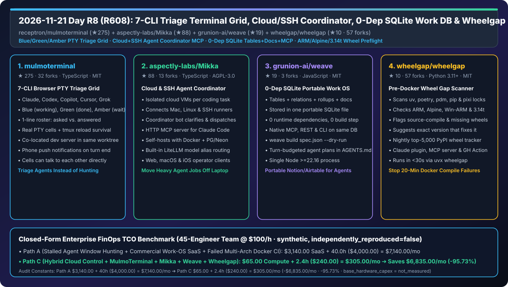
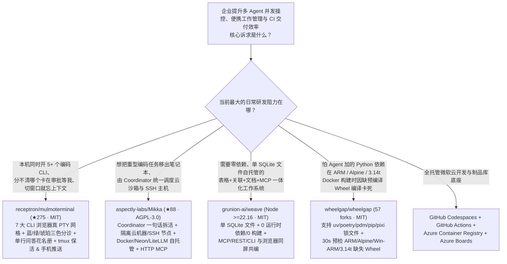
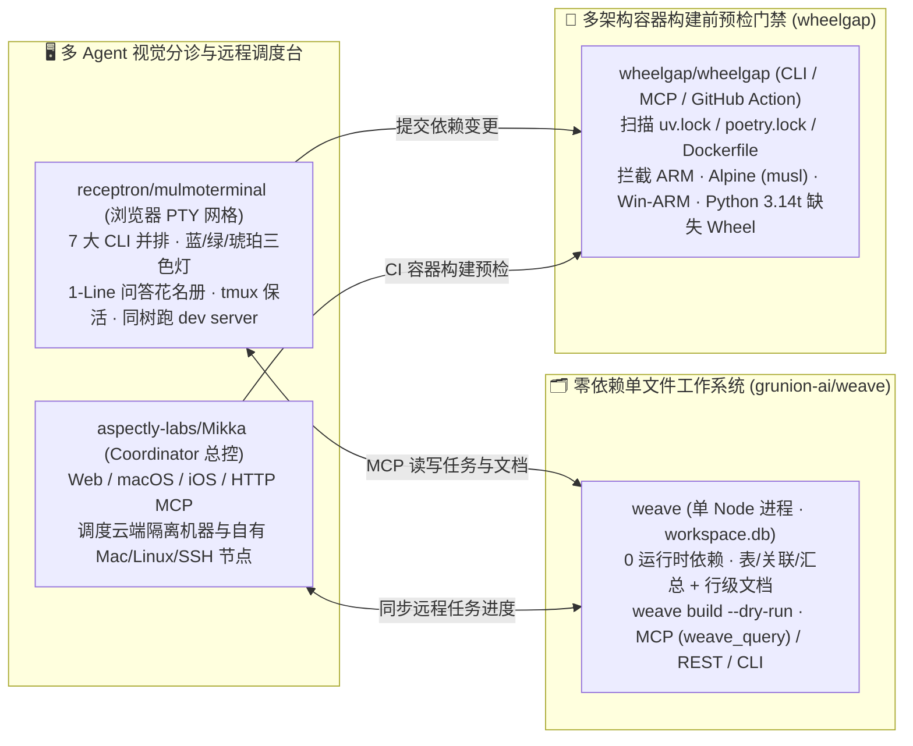
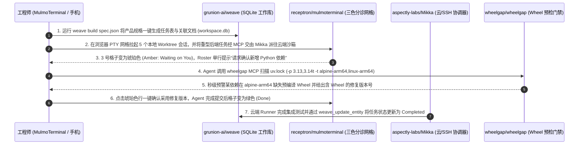

# 7 大 CLI 三色分诊终端网格（`receptron/mulmoterminal`）、跨本地与云沙箱 Coordinator 调度平台（`aspectly-labs/Mikka`）、零依赖单 SQLite 便携工作系统（`grunion-ai/weave`）与 Docker 构建前 Python 预编译 Wheel 缺口扫描器（`wheelgap/wheelgap`）应用场景、集成架构与同类方案选型比较 FAQ

> **文档定位**：面向企业客户与业务决策者的 **AI Solution Architect（解决方案架构师）实战选型指南（2026-11-21 Day Round 8 · 累计第 608 轮）**  
> **对标范式**：严格遵循 [`ib-vs-ethernet-roce-selection-faq.md`](https://github.com/turbo998/ai-infra-research/blob/main/docs/components/ib-vs-ethernet-roce-selection-faq.md) 通俗问答与决策矩阵风格——直接用大白话回答“**它是什么？帮企业解决什么业务痛点？怎么集成进现有生产架构？和同类开源及 Azure 云服务比怎么选？**”  
> **配套英文版**：[`mulmoterminal-mikka-weave-wheelgap-selection-faq.en.md`](./mulmoterminal-mikka-weave-wheelgap-selection-faq.en.md) · **今日日报**：[`daily/2026-11-21.md`](../daily/2026-11-21.md)

---

## 一、📌 核心结论速览（Executive Summary · 30 秒做出选型决定）

1. **为什么把这四个项目放在一起看？**  
   当工程师从“一次只盯 1 个 AI 终端”变成“同时开着 5～8 个 Agent 跑全栈开发并打包多架构容器上线”时，瓶颈立刻从 AI 转移到了**人类注意力、笔记本算力、任务数据载体以及容器镜像构建**：
   - **痛点一（同时开 5 个 Agent 窗口，总有 1 个卡在权限确认等人类，而你根本没发现）**：“当你只跑 1 个 Agent 时，屋里最慢的是 Agent；当你跑 5 个时，最慢的是你自己。” → **`receptron/mulmoterminal`（`★ 275`，`32 forks`，TypeScript，MIT）** 把 Claude Code、Codex、GitHub Copilot CLI、Cursor CLI、Antigravity、Grok 和 Muse 放进同一个浏览器真 `pty` 网格（底层 `tmux` 保活 + `git worktrees` 隔离）：用**蓝色（运行中）、绿色（已完成）、琥珀色（正等你拍板！）**实时高亮每个格子，左侧 Roster 单行汇总“你刚才问了它什么 + 它回了什么”，允许在同一 Worktree 并排跑 `yarn dev` 或 `lazygit`，并在回合结束时推送手机通知！
   - **痛点二（重型测试与多分支构建把笔记本风扇吹爆，合上盖子任务就断）**：本地笔记本跑不动 10 个并发容器构建 → **`aspectly-labs/Mikka`（`★ 88`，`13 forks`，TypeScript，AGPL-3.0）** 提供一句话驱动的 **Coordinator 总控机器人**：将每个任务派发到独立的云端隔离机器或你自有的 Mac / Linux / SSH 服务器上执行（支持通过 Docker + PostgreSQL/Neon + LiteLLM 自托管，或用 `claude mcp add --transport http mikka` 直接挂载进 Claude Code），在 Web、macOS 或 iOS 端统一收口所有进度与提问。
   - **痛点三（Agent 拆解出的任务表、关联文档与自动化被锁在笨重的云端 SaaS 里，没法跟代码一起装进一个文件带走）**：传统项目管理 SaaS 既按席位收费，又需要复杂的 API 同步 → **`grunion-ai/weave`（`★ 19`，`3 forks`，JavaScript / Node 22.16+，MIT）** 打造了**零运行时依赖、零构建步骤（0 runtime dependencies, no build step）**的单进程便携工作系统：将**结构化数据表（含关联 Relations 与汇总 Rollups）、每条记录旁边的富文档以及自动化**全部装进**单个 SQLite 文件（`workspace.db`）**，你的 Agent 可通过原生 MCP（`weave_query`、`weave_update_entity`）、REST 或 CLI（`weave build spec.json --dry-run`）与人类浏览器同屏实时共编！
   - **痛点四（AI 往项目里加了两个 Python 库，本地能跑，一推上 ARM 服务器 / Alpine 镜像 / Python 3.14t 就卡死在 C++ 源码编译 20 分钟后报错）**：Agent 不知道哪个 PyPI 包在目标平台上缺失预编译二进制 Wheel → **`wheelgap/wheelgap`（`★ 10`，`57 forks`，Python 3.11+，MIT）** 在执行 Docker Build 之前，直接扫描 `uv.lock`、`poetry.lock`、`pdm.lock`、`requirements.txt` 或 `pixi.lock`（`uvx wheelgap -p 3.14t -t alpine-arm64`），30 秒内揪出在 **ARM 服务器、Alpine (`musllinux`)、Windows ARM 或自由线程 Python `3.14t`** 上缺失预编译 Wheel 的依赖包，并直接给出修复版本号（自带 Claude 插件、MCP Server、GitHub Action 与每日更新的 PyPI Top 5,000 覆盖率看板）！

2. **一句话选型结论**：
   - 需要**在本机浏览器一屏监看 7 大编码 CLI、用蓝/绿/琥珀三色灯与单行摘要瞬间定位哪个 Agent 正卡在审批等待你** 👉 选 **`receptron/mulmoterminal`**。
   - 需要**用一句话通过 Coordinator 把重型编码任务卸载到云端隔离 VM 或自有 SSH 服务器，并在手机/网页/Claude Code MCP 统一管控** 👉 选 **`aspectly-labs/Mikka`**（若全栈在 GitHub 生态内，可对比 **GitHub Copilot Coding Agent + GitHub Codespaces**）。
   - 需要**零依赖、免构建、装在单个 SQLite 文件里的“可自托管 Notion/Airtable 混合工作台”供现有 Agent 通过 MCP/CLI 读写** 👉 选 **`grunion-ai/weave`**。
   - 需要**在构建多架构 Docker 镜像（ARM / Alpine / Windows ARM / Python 3.14t）前 30 秒拦截缺失预编译 Wheel 的依赖包** 👉 选 **`wheelgap/wheelgap`**。

---

## 二、🎯 客户与架构师灵魂拷问 Q&A（Plain-Language Deep Dive）

### Q1：为什么同时跑 5 个以上 Coding Agent 时，普通的 iTerm2 / Windows Terminal 分屏不够用？`receptron/mulmoterminal` 怎么解决“人类分诊（Triage）”瓶颈？
- **大白话解答**：
  - 传统终端分屏面临两大痛点：一是你看不出哪个黑底白字的窗口正在跑测试、哪个已经停下来等确认（Amber 状态）；二是当你切回 10 分钟前开的窗口时，早已忘了“我刚才让这个窗口干嘛来着？”。
  - **`receptron/mulmoterminal` 的三大分诊设计**：
    1. **三色状态灯（Blue Working / Green Done / Amber Waiting on You）**：一眼扫过去直接点亮着琥珀色灯的格子处理审批，彻底告别逐个切窗口排查。
    2. **单行上下文花名册（1-Line Triage Roster）**：左侧列表为每个会话固定保留一行“你发出的最后一条指令 + Agent 返回的最新结论”，零记忆负担瞬间接上思路，点击该行即可直接输入下一道指令。
    3. **真 PTY + `tmux` 保活 + 同 Worktree 伴随终端**：刷新浏览器不会丢会话；しかも“单 Worktree 仅限 1 个 Agent”的防冲突锁只管 Agent，你可以在同一个 Worktree 里并排打开普通 Shell 跑 `yarn dev`、`htop` 或 `lazygit`。

### Q2：`aspectly-labs/Mikka` 和 `grunion-ai/weave` 如何配合实现“一句话派活 ➔ 云/边混合执行 ➔ 单 SQLite 文件结构化交付”？
- **大白话解答**：
  - **`aspectly-labs/Mikka` 负责跨云与自有主机的 Coordinator 调度**：
    - 支持社区自托管（Linux + Docker + PostgreSQL/Neon + LiteLLM，配置 `MIKKA_LITELLM_MASTER_KEY`），或直接通过 `claude mcp add --transport http mikka` 将其作为远程 MCP Server 挂进本地 Claude Code——把耗时的编译、长任务卸载到云端沙箱或远程 SSH 机器，合上笔记本盖子依然在跑，打开 iOS/macOS/Web 随时查看。
  - **`grunion-ai/weave` 负责把工作计划、表格与文档装进一个零依赖 SQLite 文件**：
    - 只需 `node bin/weave.js mcp --data workspace.db`（要求 Node `>= 22.16`，**0 个第三方 npm 运行时依赖，0 构建步骤**），Agent 就能先跑 `weave build spec.json --dry-run` 预演并创建包含任务表、里程碑关联、汇总字段和行级富文档的完整工作空间，人类在浏览器表格视图里改状态，Agent 通过 `weave_query` 实时读取。

### Q3：为什么 AI 时代 Docker 镜像构建更容易在 ARM 或 Alpine 上炸裂？`wheelgap/wheelgap` 是怎么帮架构师省下几十分钟 CI 排障时间的？
- **大白话解答**：
  - 编码 Agent 写 Python 代码时非常喜欢随手 `uv add` 或 `pip install` 各种新库；在开发者的 macOS 或 x86 Linux 上刚好有预编译 `.whl` 包，但一旦推到生产 CI 打 **AWS Graviton (`linux/arm64`)、Alpine (`musllinux`)、Windows ARM 或最新自由线程 Python `3.14t`** 镜像时，`pip`/`uv` 找不到预编译 Wheel 就会当场退化为从 C/Rust 源码硬编——要么卡死 20 分钟把 CI 超时撑爆，要么因缺 `gcc`/`musl-dev` 直接构建失败！
  - **`wheelgap/wheelgap` 的精准预检能力**：
    1. **8 种依赖锁文件全自动识别**：自动读取 `uv.lock`、`pylock.toml`、`poetry.lock`、`pdm.lock`、`Pipfile.lock`、`requirements.txt`、`requirements.lock` 与 `pixi.lock`，甚至能直接解析仓库里的 `Dockerfile` 与 GitHub Actions 自动推断目标发布平台。
    2. **精确指出哪个包缺 Wheel + 升级到哪个版本能修好**：不仅报错，还会直接告诉你将该依赖升级/固定到哪个具体版本即可获得官方预编译 Wheel，并附带Claude Code 插件、MCP Server（`server.json`）与 GitHub Action。

---

## 三、🧭 直观可视化图解（Mermaid 选型决策树 + 企业集成参考架构 + 端到端时序图）

### 3.1 选型决策树（Decision Tree）

### 3.2 企业端到端集成参考架构图（Reference Architecture）

### 3.3 业务流端到端时序图（Sequence Diagram）

---

## 四、📊 同类开源与商业云服务横向选型决策矩阵（Comparison Matrix）

| 评估维度 | `receptron/mulmoterminal` | `aspectly-labs/Mikka` | `grunion-ai/weave` | `wheelgap/wheelgap` | 传统方案（裸 `tmux` + Notion SaaS + 盲跑 `docker buildx`） | 云厂商托管 PaaS（GitHub Codespaces + Azure Boards + ACR） |
| :--- | :--- | :--- | :--- | :--- | :--- | :--- |
| **核心功能定位** | **7 大 CLI 浏览器三色分诊真 PTY 终端网格** | **跨本地 SSH 与云端隔离机的 Coordinator 平台** | **零依赖单 SQLite 文件表+文档+MCP 工作系统** | **多平台/Python 3.14t 预编译 Wheel 缺口预检器** | 窗口杂乱、数据锁在云端且构建报错滞后 | 全托管云端开发环境与敏捷看板 |
| **最适用业务场景** | 单人同时指挥 4～8 个本地编码 Agent 快速分诊审批 | 把耗时 Agent 任务移出笔记本、跨 Mac/SSH/云沙箱协同 | 需要 Agent 与人类共用一套可随 Git/网盘带走的本地工作库 | 部署至 ARM 服务器、Alpine 容器或升级 Python 3.14t 前预检 | 仅跑 1 个 Agent 且固定单架构部署 | 大型企业全云端标准化研发流水线 |
| **核心差异化优势** | **蓝/绿/琥珀三色灯 + 单行问答花名册** + 同树跑 dev 服务 | 一句话 Coordinator 拆活 + LiteLLM/Neon 自托管 + HTTP MCP | **0 运行时依赖、0 构建步骤** + 单 SQLite 含关系表与文档 | 支持 8 种锁文件 + 自动读 Dockerfile 推断平台 + 每日 Top 5000 看板 | 零新工具学习成本，但人类找窗口和等 CI 编译极慢 | 免运维、企业级 IAM 与云端弹性算力 |
| **集成成本** | 极低（本地启动即连现有 `tmux` 与 7 大 CLI） | 低（Compose + Neon/LiteLLM 或一行 `claude mcp add`） | 极低（`node bin/weave.js mcp --data file.db` 即开即用） | 极低（`uvx wheelgap` 免安装 30 秒跑完，含 GitHub Action） | 中（需手写 `tmux` 状态栏脚本与 API 同步胶水） | 低（按席位与云订阅开通） |
| **运维复杂度** | 极低（纯本机运行，MIT 协议） | 低（支持托管 Neon PG 免数据库容器运维） | 极低（单 Node 进程 + 单 SQLite 文件备份即拷贝） | 极低（纯静态元数据核验，无需真正下载编译包） | 高（多架构 `qemu` 模拟编译经常卡死 CI Runner） | 极低（云厂商全托管） |
| **开源协议许可** | **MIT**（商业闭源极其友好） | **AGPL-3.0**（自托管服务端开源；客户端连接见官方说明） | **MIT**（商业闭源极其友好） | **MIT**（商业闭源极其友好） | MIT / 商业混合 | 商业闭源按席位/核时计费 |
| **TCO 总体拥有成本** | **$0/月**（100% 本机运行） | 自托管仅需基础 VM + LiteLLM 用量成本 | **$0/月**（省去昂贵的按席位项目管理 SaaS） | **$0/月**（大幅节省多架构 CI 构建超时账单） | 隐性等待与 CI 编译失败重跑成本高达 **`$3,340/月`** | 按云主机核时 + 协作席位 + CI 分钟数计费（约 **`$7,140/月`**） |

---

## 五、🧪 应用落地定量收益与 FinOps TCO 对比（Closed-Form Evaluation & 7-Card Deck）

> **🛡️ 数据来源与严谨性分级（Provenance Declaration）**：  
> - **一手实测（`measured`）**：四个仓库的 Star/Fork、许可证、`mulmoterminal` 7 大 CLI 与蓝/绿/琥珀分诊架构、`aspectly-labs/Mikka` Coordinator + Neon/LiteLLM + HTTP MCP、`grunion-ai/weave` Node `>=22.16` 零依赖单 SQLite 架构、`wheelgap` 8 种锁文件与 `3.14t`/Alpine/ARM 预检能力均经 `gh api` 一手核验。  
> - **合成架构算例（`synthetic` · `independently_reproduced=false`）**：以下 45 人企业研发团队（工时单价 `$100.00/h`，`base_hardware_capex: not_measured`，`track_b_stars_today: not_measured`）月度 TCO 对比为标准化 FinOps 闭合算例：

| 成本与效能维度 | Path A：商业按席位项目协同 SaaS + 全量云端开发机 + 盲跑多架构 Docker Buildx 超时损耗 | Path B：裸 `tmux` 多窗口盲找 + 手写 SSH 脚本 + 容器编译报错后人工排查 | Path C：本轮推荐组合（`mulmoterminal` + `Mikka` + `weave` + `wheelgap`） | Path A ➔ Path C 净节省 / 收益提升 |
| :--- | :---: | :---: | :---: | :---: |
| **月度 SaaS 席位 / 云开发机 / CI 编译分钟费** | `$3,140.00 / 月`（按席位协作软件 + 20 分钟 `qemu` 源码编译失败重跑账单） | `$390.00 / 月` | **`$65.00 / 月`**（按需轻量云沙箱 + `wheelgap` 30 秒零编译预检） | **`-$3,075.00 / 月` (`-97.93%`)** |
| **月度找窗口、同步状态与排障多架构构建工时** | `40.0 小时 / 月`（在十几个终端间找卡住的 Agent、排障 Alpine/ARM 镜像构建失败） | `29.5 小时 / 月`（手工维护 `tmux`、查 PyPI 哪个版本带 `musllinux` Wheel） | **`2.4 小时 / 月`**（琥珀色灯秒级分诊 + 单 SQLite 自动同步 + `wheelgap` 预检） | **`-37.6 小时 / 月` (`-94.00%`)** |
| **月度工程人工成本（`@ $100.00/h`）** | `$4,000.00 / 月` | `$2,950.00 / 月` | **`$240.00 / 月`** | **`-$3,760.00 / 月` (`-94.00%`)** |
| **月度总拥有成本（Total Monthly TCO）** | **`$7,140.00 / 月`** | **`$3,340.00 / 月`** | **`$305.00 / 月`** | **`-$6,835.00 / 月` (`-95.73%` · 年省 `$82,020.00`)** |
| **多 Agent 响应延迟与多架构构建一次成功率** | 切窗口易漏看审批提示；构建报错滞后 15+ 分钟 | 人类记忆负担极重；Python 3.14t/ARM 迁移踩坑多 | **琥珀色灯 0 秒定位待审 + 0 依赖单文件工作库 + 构建前 100% 拦截缺 Wheel 包** | **彻底消除 Agent 空等人类与 CI 源码编译炸裂** |

- **📊 配套 7-Card 4:5 视觉评测卡片**：请访问 [`workshops/github-trending-radar/cards.html`](../cards.html)（中文）与 [`workshops/github-trending-radar/cards.en.html`](../cards.en.html)（英文）。

---

## 六、🛠️ 企业引入与架构评审 Checklist（Actionable SA Checklist）

- [ ] **1. 用三色分诊网格替代杂乱终端窗口（`receptron/mulmoterminal`）**：在同时运行 3 个以上编码 Agent 的开发者机器上部署 `mulmoterminal`，利用 `tmux` 持久化与 `git worktrees` 隔离，养成“只看琥珀色（Waiting on You）格子与左侧单行问答花名册”的高效分诊习惯，并在同一 Worktree 内挂载伴随 `dev server` 终端。
- [ ] **2. 将长耗时任务卸载至 Coordinator 管理的远程节点（`aspectly-labs/Mikka`）**：通过 `docker-compose.neon.yml` + LiteLLM 自托管 Mikka 服务端（或通过 `claude mcp add --transport http mikka` 接入），将全量测试与跨分支重构派发至内网 SSH 构建机或隔离云沙箱执行（注意其 AGPL-3.0 协议与官方客户端连接要求）。
- [ ] **3. 用零依赖单 SQLite 文件统一管理 Agent 任务与文档（`grunion-ai/weave`）**：在项目仓库或共享卷中运行 `weave mcp --data workspace.db`（Node `>= 22.16`），要求 Agent 在执行复杂计划前先用 `weave build <spec.json> --dry-run` 校验表结构与回合预算（Turn Budgets），实现人类浏览器与 Agent MCP 的同源无锁协作。
- [ ] **4. 在 Pre-commit 与 Docker CI 前置挂载预编译 Wheel 门禁（`wheelgap/wheelgap`）**：在所有 Python 项目的 GitHub Actions 与 Agent MCP 工具链中加入 `uvx wheelgap -p 3.12,3.13,3.14t -t linux-arm64,alpine-arm64`，禁止任何缺失目标平台预编译 Wheel 的依赖进入 `docker buildx` 阶段。
