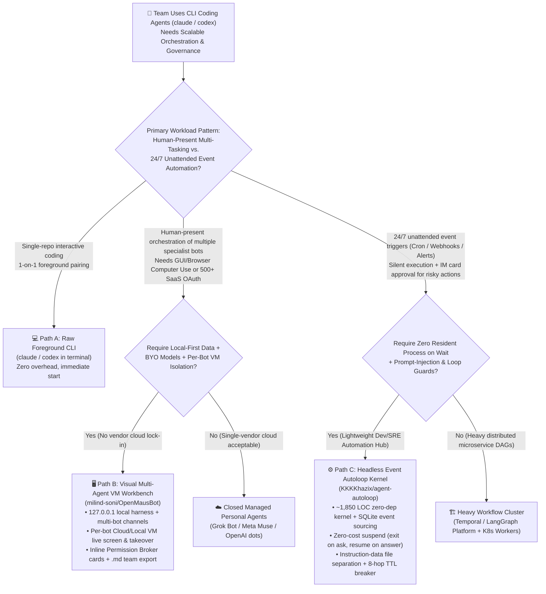

# Multi-Agent VM Workbench vs. Headless Event Autoloop Kernel vs. Single-Terminal CLI Selection & Architecture FAQ (OpenMausBot vs. agent-autoloop)

> **Audience & Purpose**: A first-principles, plain-English architectural selection guide for AI Solution Architects, Developer Productivity Platform Leads, and Enterprise Agent Automation Engineers. Modeled strictly on `ib-vs-ethernet-roce-selection-faq.md`, this guide answers: **Once your team adopts CLI coding agents (`claude`, `codex`), why does babysitting foreground terminal windows become a scaling bottleneck? And between today's two breakout GitHub projects—the interactive multi-agent VM desktop workbench (`milind-soni/OpenMausBot`) and the zero-dependency headless event autoloop kernel (`KKKKhazix/agent-autoloop`)—how should an architect choose and combine them?**
>
> **Provenance & Velocity Disclosure**:
> - **`measured` (Primary verification in this shift)**:
>   - **Track A #1 Daily AI Velocity Leader (`milind-soni/OpenMausBot`)**: **`+1,437 stars today`** (`17,935` total stars in Trending DOM / `17,961` via GitHub REST API, `2,511` forks, Apache-2.0, release `v0.1.149`), verified directly from the archived raw GitHub Daily Trending HTML snapshot (`workshops/github-trending-radar/evidence/trending-daily-2026-11-08-raw.html`, `sha256: 353914ef985b6a4f269094bea6a075a391f5e5da0e85145e54f704909dbf11d0`). Affiliation audit: independent user repository (`owner.type = User`; author explicitly states no affiliation with xAI, Meta, OpenAI, or Manus).
>   - **Track B 5-Day Newly Created Breakout (`KKKKhazix/agent-autoloop`)**: Created `2026-11-03T08:02:11Z`, reaching `4,072`–`4,085` total stars and `744`–`745` forks in ~5 days (MIT license, ~`1,850` LOC TypeScript kernel with zero runtime dependencies). **Strict Velocity Separation**: Its creation-to-date **lifecycle average velocity (`avg_stars_per_day`) is `~814 stars/day`**; because it is not in the top-25 Daily Trending HTML DOM snapshot and the GitHub REST API does not expose 24-hour star deltas, its **24h delta is strictly recorded as `stars_today = not_measured`** and never blended into Track A single-day rankings. Affiliation audit: independent user repository (`owner.type = User`).
> - **`anonymized_reported` (`independently_reproduced=false`, upstream author-reported benchmarks & specs)**: `agent-autoloop` kernel benchmark numbers on Apple M5 Pro (24 GB RAM, Node 24.21.0: `88.78 ms` cold start, `59.94 MB RSS` idle memory, `170.49 MB RSS` at 1,000 concurrent long-polls, `2,394 writes/sec` durable single-transaction throughput, `1.82 ms` dispatch p99, `99.8 ms` startup at 1.1M facts / `43.1 s` full projection rebuild) are cited from upstream [`README.md`](https://github.com/KKKKhazix/agent-autoloop/blob/main/README.md) and [`docs/protocol.md`](https://github.com/KKKKhazix/agent-autoloop/blob/main/docs/protocol.md); `OpenMausBot` architecture features (`127.0.0.1` local harness server, per-bot Cloud Linux Desktop / Local VM, Composio 500+ OAuth connectors, Jev fast routing model, portable Markdown team packages `FORMAT.md`) are cited from upstream [`README.md`](https://github.com/milind-soni/OpenMausBot/blob/main/README.md).
> - **`synthetic` (`independently_reproduced=false`, architect parametric worked example)**: Section 4's 15-engineer DevOps/SRE team resource and operational cost comparison across resident polling scripts, zero-cost suspend event kernels, and multi-VM desktop workbenches is a parametric architectural calculation under explicitly stated assumptions.

---

## 📌 1-Minute Executive Summary

| Evaluation Dimension | Raw Single-Terminal CLI (`claude` / `codex` Foreground) | Visual Multi-Agent VM Workbench (`milind-soni/OpenMausBot`) | Headless Event Autoloop Kernel (`KKKKhazix/agent-autoloop`) |
| :--- | :--- | :--- | :--- |
| **Plain-English Definition** | **"Babysitting a terminal window"**—you type a prompt, watch it scroll, and answer prompts inline; close the window or walk away and the workflow stops | **"A Telegram-style chat app where every contact is a CLI agent with its own virtual computer"**—chat with a roster of bots, watch their live VM desktops, and click inline approval cards | **"A zero-dependency background event dispatcher & zero-cost suspend hub for CLI agents"**—no GUI; triggers agents from Cron/Webhooks, exits the process while waiting for Feishu/Slack card approval, and resumes on click |
| **Core Pain Point Solved** | Fastest for single-task interactive coding, but breaks down across 5+ concurrent tasks or unattended 24/7 webhooks | Solves **multi-role interactive collaboration + isolated GUI/browser computer use + 1-file team playbook sharing** (open-source local alternative to Grok Bot, Meta Muse, OpenAI dots, Manus Cue) | Solves **24/7 unattended event-driven automation (Cron/Issues/Alerts) + zero-process/zero-token multi-day HITL approval wait + prompt-injection & infinite-loop protection** |
| **Execution Surface & Isolation Boundary** | Runs directly in the host shell working directory with no desktop isolation | Local `127.0.0.1` harness + per-bot isolated Cloud Linux Desktop / Local VM / opt-in host computer + Composio OAuth sessions | Executes CLI subprocesses in rule-defined `cwd`; enforces **Instruction-Data Separation** (untrusted payloads saved to files, never interpolated into prompts) + **8-hop TTL circuit breaker** |
| **Human-in-the-Loop (HITL) Mechanism** | Blocks the foreground terminal waiting for stdin (process stays resident; closing terminal drops state) | Inline chat Permission Broker cards (Allow / Deny / voice call approval / 1-click live browser desktop takeover) | Parses trailing `agent-autoloop` JSON block → **agent subprocess immediately `exit(0)` (0 RAM / 0 tokens)** → pushes Feishu/DingTalk/Slack/Desktop card → `--resume` exact session on reply |
| **Resource Footprint** | ~`150–350 MB` RAM per active resident Node/CLI terminal process | Electron GUI + local harness server + local/cloud VM desktop (rich interactive workstation client) | Kernel idles at **`59.94 MB RSS`** (`anonymized_reported`) with **0 resident agent subprocesses** during human approval waits |
| **Architect Selection Rule of Thumb** | Best for ad-hoc single-repo coding, quick bug fixes, or interactive exploration | Best for **interactive multi-agent teamwork, GUI/browser automation (Computer Use), 500+ OAuth SaaS workflows, and portable department templates** | Best for **unattended engineering/SRE pipelines (daily briefs, GitHub Issue triage, production alert investigation, PR `deliver` auto-merge)** with mobile IM card approvals |

---

## 1. Three Core Architectural Questions (First-Principles Q&A)

### Q1: Our engineers already use Claude Code and Codex CLI every day. When is a raw terminal enough, and when do we strictly need `OpenMausBot` or `agent-autoloop`?

#### Short Answer
- **If a developer is sitting at their keyboard pairing 1-on-1 with an agent on a single repository**, a raw terminal running `claude` or `codex` is unbeatable in simplicity.
- **However, raw terminals break down at two distinct scaling inflection points**—and each inflection point maps to one of today's breakout repositories:

#### Inflection Point A: Interactive Breadth — Orchestrating a Roster of Specialized Agents with Isolated Computers & SaaS Apps (Choose `OpenMausBot`)
1. **Why Raw Terminals Fail Here**:
   - Managing 6 concurrent terminal tabs (frontend refactor, competitor web research, doc drafting, PR review) quickly turns into window-juggling chaos. You cannot easily see which terminal is blocked on a permission prompt, nor can you give each agent its own isolated desktop screen and browser session without polluting your host OS.
   - Closed-source personal agent apps launched in 2026 (xAI Grok Bot, Meta Muse, OpenAI dots, Manus Cue) proved the **"messaging app roster + dedicated virtual computer"** UX, but they lock you into a single model vendor and store your transcripts and credentials on vendor clouds.
2. **How `OpenMausBot` Solves It (Local-First Multi-Agent Workbench)**:
   - **Bring Your Own CLI Agents**: Runs directly on top of the `claude`, `codex`, and `grok` CLIs already installed on your machine. A lightweight local harness server on `127.0.0.1` manages every agent process, storing transcripts, keys, and events locally in `~/.openmausbot`.
   - **Every Bot Gets Its Own Computer**: Each bot can spin up an isolated Cloud Linux Desktop or Local VM with live screen preview and 1-click browser takeover ("Open desktop"), keeping risky GUI/browser actions off your primary host desktop.
   - **Inline Permission Broker & Jev Fast Auto-Routing**: Shell commands, file edits, and clarifying questions surface as inline chat cards (`Allow` / `Deny`). Multi-bot channels set to `Auto` use a fast decision model (`Jev` / Workers AI / OpenRouter) to pick the right specialist bot for un-mentioned messages in a few hundred milliseconds.

#### Inflection Point B: Temporal Span & Event-Driven Autonomy — 24/7 Background Dispatch with Asynchronous Mobile Card Approvals (Choose `agent-autoloop`)
1. **Why Raw Terminals Fail Here**:
   - CLI agents are built for interactive foreground sessions. If you want an agent to automatically wake up at 08:00 for a daily commit brief, triage incoming GitHub Issues every 5 minutes, or investigate a 03:00 AM production alert—and pause to ask you on Feishu/Slack before restarting a service—leaving interactive CLI processes hanging in background `tmux` sessions wastes gigabytes of RAM, drops state on network blips, and exposes you to runaway retry loops.
2. **How `agent-autoloop` Solves It (Headless Event-Sourced Autoloop Kernel)**:
   - **Zero-Dependency Headless Hub**: An ~`1,850`-line TypeScript kernel with **zero runtime dependencies** and no web dashboard to maintain. It normalizes Cron schedules, GitHub/GitLab Webhooks, and HTTP alerts into standard events and dispatches CLI agents according to declarative rules in `~/.agent-autoloop/rules.json`.
   - **Zero-Cost Suspend (Exit-on-Ask, Resume-on-Answer)**: When an agent needs human approval (deleting data, restarting a service, spending money, sending external messages), it appends a fenced `agent-autoloop` JSON block containing an `ask` card at the end of its final reply—and **the agent process immediately exits (`exit(0)`)**. Even if you take three days to tap the approval button on Feishu, DingTalk, Slack, or Desktop notifications, **zero agent processes run and zero tokens are consumed** during those three days. The moment you tap an option, the kernel resumes the exact prior CLI session (`"resume": true`) to finish the job.

---

### Q2: How do their internal architectures work under the hood, and how does `agent-autoloop` guarantee zero-cost suspend, prompt-injection immunity, and loop circuit-breaking?

#### 1. `OpenMausBot`: Three-Layer Interactive Workbench Architecture
- **Control Plane (Electron + React 19 + `127.0.0.1` Harness Server)**:
  - Organizes bots as contacts inside topic-specific Channels (each with its own transcript, shared instructions, working directory, responder rules, and bot roster).
  - **Write-Only Credential Isolation**: API keys are persisted locally on the host; the UI layer only ever receives boolean `"configured"` flags so secrets cannot be exfiltrated through frontend inspection.
- **Execution & Tool Plane (Isolated VM Computers + Composio OAuth Sessions)**:
  - Supports three computer backends per bot: (1) Cloud Linux Desktop, (2) isolated Local VM, or (3) explicit opt-in host control (certified on macOS and Ubuntu Xorg; disabled on Ubuntu Wayland pending upstream security boundary issue `#345`).
  - Integrates 500+ SaaS tools (Gmail, Slack, GitHub, Notion, Linear) via one-click Composio OAuth sessions rather than raw password sharing.
- **Portable Team & Department Packaging (`FORMAT.md`)**:
  - Exports an entire department (bots, system instructions, skills, Chief of Staff, channels, routines, and connector slots) as a single Markdown file with YAML frontmatter. Exports automatically strip chat history, keys, model bindings, and secret patterns; imports initialize all bots in `Ask` permission mode with skills off and routines paused until reviewed.

#### 2. `agent-autoloop`: Four Systems-Engineering Kernel Invariants (~1,850 LOC)
`agent-autoloop` separates its pure deterministic decision kernel (`kernel/`—which never reads the system clock, never uses random numbers, and never makes outbound network calls) from its I/O shell (`host/`, `protocol/`, `worker/`, `plugins/`), implementing four classic systems patterns for CLI agents:

1. **Zero-Cost Suspend (Process Exit + SQLite State Projection)**:
   - The hub requires only one contract from any CLI agent: state its conclusion in its final reply, optionally followed by an `agent-autoloop` fenced JSON receipt (`ask`, `notice`, `resolve`, `later`, or `events`).
   - Once `worker/` submits the receipt, the CLI subprocess terminates immediately. Waiting state lives purely as a SQLite projection while channel plugins deliver interactive cards. If an agent emits malformed receipt JSON, the kernel simply resumes the existing session and asks it to rewrite the final receipt block—**never re-executing already completed business side effects**.
2. **Single-Transaction Append-Only Event Sourcing & Deterministic Simulation**:
   - Every state transition is derived from an append-only fact log committed in the same SQLite disk transaction as its index before acknowledging any request.
   - Inspired by deterministic simulation testing (`sim/`), `node sim/random.ts 24301 200000` replays 200,000 steps of network drops, out-of-order deliveries, crashes, and duplicate submissions from a single seed, while `node sim/crash.ts 1000 12648430` forcefully kills the process 1,000 times to verify zero lost committed records.
   - Running `agent-autoloop why <round>` reconstructs the exact causal chain (rule version, trigger event, worker claim, receipt) for any execution round.
3. **Parameterized-SQL-Style Instruction-Data Separation**:
   - Interpolating untrusted GitHub Issue titles or webhook bodies directly into an agent prompt invites indirect prompt injection.
   - `agent-autoloop` treats untrusted event payloads like parameterized SQL data: **external Issue titles and bodies are written to local data files and never concatenated into the prompt string**; the prompt contains only character-validated event types, IDs, and file references.
   - Furthermore, which agent runs, in which `cwd`, and with what permissions are dictated solely by local `rules.json`. **Any incoming event payload containing `cwd`, `agent`, or `access` fields is rejected outright at the protocol boundary**.
4. **Network-TTL-Style 8-Hop Circuit Breaker**:
   - Because agents can emit follow-up `events` or schedule `later` self-check timers, `kernel/` tracks an immutable hop counter across the entire causal chain. **Human `ask` pauses and `later` timers do not reset the hop count, and agents cannot modify it**. Once a chain exceeds **8 hops**, the kernel logs the event, refuses further dispatch, and sends an alert card to the operator.

---

### Q3: How should an Enterprise AI Solution Architect combine both patterns—and where are the hard red lines?

#### Recommended Dual-Track Pattern: Foreground Sandbox Workbench + Background Event Autoloop
- **Foreground Interactive Design & Computer Use (`OpenMausBot` Pattern)**: Use the visual multi-agent workbench when humans are actively steering multi-role brainstorming, browser/GUI automation inside isolated VMs, and packaging reusable team playbooks (`FORMAT.md`).
- **Background 24/7 Unattended Operations (`agent-autoloop` Pattern)**: Offload codified engineering and SRE routines (GitHub Issue reproduction, alert triage, daily release checks, PR `deliver` pipelines) to the headless event kernel with Feishu/Slack approval cards.
- **Hard Security Rule for Autonomous PR Delivery**: Following `agent-autoloop`'s `delivery` plugin architecture, when automating `review -> wait for CI -> merge -> verify deployment` on PRs labeled `deliver`, **always read review and delivery configuration exclusively from `main`, and never checkout or execute untrusted PR branch code on the automation host**.

#### Enterprise Red Lines (When NOT to Copy Blindly)
1. **Never Run High-Frequency Unattended Automation on Personal Consumer Subscriptions**: As `agent-autoloop`'s compliance notes emphasize, consumer Claude/ChatGPT subscriptions are governed by interactive fair-use terms. Production webhook/cron automation must route through enterprise API keys (Anthropic API, OpenAI API, Azure AI Foundry, or AWS Bedrock).
2. **Never Use Host-Control Mode or Shared Single-User Directories for Multi-Tenant SaaS**: In multi-tenant enterprise environments, combine the event-sourced kernel pattern with ephemeral container/MicroVM sandboxes rather than sharing a single host user filesystem.

---

## 2. Selection Decision Tree & State-Machine Comparison (Mermaid)

### 2.1 CLI Agent Orchestration Selection Decision Tree



### 2.2 Zero-Cost Suspend & Instruction-Data Separation Sequence (`agent-autoloop`)

```mermaid
sequenceDiagram
    autonumber
    participant Src as External Event Source (GitHub Issue / Alert / Cron)
    participant K as agent-autoloop Kernel (SQLite Event-Sourced)
    participant W as CLI Agent Subprocess (claude / codex)
    participant IM as Feishu / WeCom / Slack / Desktop Card

    Src->>K: 1. Emit raw event JSON (e.g., issues.opened #42)
    Note over K: 🛡️ Instruction-Data Separation:<br/>Reject payloads containing cwd/agent/access;<br/>write untrusted Issue body to local file, never into prompt string
    K->>W: 2. Dispatch per rules.json (verify Hop TTL <= 8)
    W->>W: 3. Read local data file, inspect repo, diagnose root cause
    W->>K: 4. Output summary + trailing ```agent-autoloop {"ask": [...]}```
    W-->>W: 5. ⚡ Subprocess immediately exits (exit 0)!<br/>(During human wait: 0 resident agent processes, 0 tokens burned)
    K->>IM: 6. Commit SQLite transaction & push interactive approval card
    Note over K,IM: ⏳ Even if human replies 12 hours or 3 days later, only ~60MB idle kernel runs
    IM->>K: 7. Architect taps "1. Approve restart & verify" on mobile IM
    K->>W: 8. Trigger continuation round (--resume original CLI session ID)
    W->>K: 9. Complete verification & emit {"resolve": true} receipt
    K->>IM: 10. Update original IM card in-place to "Resolved"
```

---

## 3. Multi-Dimensional Architectural Comparison Matrix

| Dimension | Raw Foreground CLI (`claude` / `codex`) | `milind-soni/OpenMausBot` (Multi-Agent VM Workbench) | `KKKKhazix/agent-autoloop` (Headless Event Autoloop Kernel) | Heavy Workflow Cluster (LangGraph Cloud / Temporal) |
| :--- | :--- | :--- | :--- | :--- |
| **License & Footprint** | Per CLI tool | **Apache-2.0** (`v0.1.149`) | **MIT** (~`1,850` LOC kernel, **0 runtime dependencies**) | MIT / Commercial Managed Cloud |
| **Verified Velocity & Provenance** | Baseline control | **Track A `+1,437 stars today` (`measured`)**, `17,935` DOM / `17,961` API total stars | **Track B `4,072`–`4,085` total stars in 5 days (`~814 stars/day` lifecycle avg, `measured`)**; **`stars_today = not_measured`** | Mature enterprise baseline |
| **Primary User Interface** | Interactive terminal (TUI/CLI) | **Telegram/Slack-style Desktop App** (live VM screen panel, model rail, app marketplace) | **Headless by design** (CLI `status` / `why` / `check` + Feishu/DingTalk/WeCom/Slack/Desktop cards) | Web DAG dashboard + API gateway |
| **Supported Underlying Agents** | Single CLI binary | `claude`, `codex`, `grok`, custom CLI binaries | `claude`, `codex`, ACP (`gemini --acp`, `opencode acp`), `dsh`, `pi`, `openclaw`, `hermes`, `cursor`, any command | Requires rewriting agents against framework SDK |
| **Integration Effort** | 0 | Install desktop package; 1-click `.md` team playbook import | **Zero SDK lock-in**: no agent code changes; edit `~/.agent-autoloop/rules.json` + trailing receipt block | **High** (refactor into graph nodes + deploy Redis/Postgres) |
| **Overhead During Human Approval Wait** | Terminal process stays resident & blocked | Local harness + Electron GUI resident (plus VM if active) | **Zero-Cost Suspend**: agent process exits (`0` agent RAM/tokens); kernel idles at **`59.94 MB RSS`** (`anonymized_reported`) | Worker pods resident; state persisted in external DB |
| **Indirect Prompt Injection Defense** | Relies on manual terminal confirmation | Permission Broker cards + per-bot VM isolation + Composio OAuth | **Instruction-Data Separation** (untrusted text saved to files) + **rejects `cwd`/`agent`/`access` fields in events** | Must be custom-built by engineering team |
| **Runaway Loop Protection** | Manual `Ctrl+C` by human | Visual desktop monitoring + per-action approval gates | **Immutable 8-hop TTL circuit breaker** (persists across human asks & `later` timers) | Graph `recursion_limit` parameter |
| **Auditability & Crash Recovery** | Scrollback buffer only | Per-channel local transcripts + live desktop takeover | **Single-transaction SQLite event sourcing** + `agent-autoloop why <id>` + 200k-step deterministic crash/network sim | OpenTelemetry / LangSmith distributed traces |

---

## 4. Quantitative Worked Example & 7-Card Benchmark Insights

### 4.1 Upstream Kernel Performance Baseline (Provenance: `anonymized_reported`, `independently_reproduced=false`)
Per `KKKKhazix/agent-autoloop`'s published benchmark suite on an **Apple M5 Pro (24 GB RAM, Node 24.21.0)** with synchronous per-event disk transaction commits ([`README.md`](https://github.com/KKKKhazix/agent-autoloop/blob/main/README.md) & [`docs/protocol.md`](https://github.com/KKKKhazix/agent-autoloop/blob/main/docs/protocol.md)):

| Kernel Metric | Upstream Reported Value (`anonymized_reported`) | Architectural Takeaway |
| :--- | :--- | :--- |
| **Cold Start Latency** | **`88.78 ms`** (empty) / **`99.8 ms`** (at 1.1M historical facts) | Sub-100ms startup even with 1.1M logged facts (full projection rebuild on schema change takes `43.1 s`) |
| **Idle Memory Footprint** | **`59.94 MB RSS`** | Lightweight enough to run continuously on any developer laptop or small edge VM |
| **Memory at 1,000 Concurrent Long-Polls** | **`170.49 MB RSS`** | Holding 1,000 concurrent waiting connections adds only ~`110 MB` RSS |
| **Durable Write Throughput & Dispatch p99** | **`2,394 writes/sec`** / **Dispatch `p99 = 1.82 ms`** | Backpressure heartbeat rejection at 5,000 queued items is `p99 = 1.66 ms`—easily handles team-wide webhook bursts |

### 4.2 15-Engineer Dev & SRE Automation Footprint Worked Example (Provenance: `synthetic`, `independently_reproduced=false`)
**Explicit Parametric Assumptions**:
- A 15-engineer AI & SRE team operates **30 automated CLI agent rules** (GitHub Issue reproduction, alert triage, daily briefs, website monitoring, PR `deliver` pipelines).
- The system processes **120 events/day**, of which **40 require human approval** (restarting staging services, modifying configs, sending external updates) with an average human turnaround wait of **3.5 hours/approval** (including overnight alerts answered the next morning).

| Metric | Option 1: Resident Shell / `tmux` Polling Scripts (No Suspend) | Option 2: Headless Event Autoloop Kernel (`agent-autoloop`) | Option 3: Full-Team Interactive VM Workbenches (`OpenMausBot`) |
| :--- | :--- | :--- | :--- |
| **Resident Agent Subprocesses During Approval Waits** | **15–20 resident CLI processes** hanging on stdin/polling | **0 resident agent processes** (immediate `exit(0)` on `ask`; only 1 `~60 MB` kernel process) | 15 desktop clients + on-demand Cloud/Local VMs |
| **Average Idle Host RAM Consumed** | `18 processes × 250 MB ≈ 4.5 GB RAM` | **`~60 MB – 170 MB RAM`** (**>96% RAM reduction** during HITL waits) | `~600 MB – 1.5 GB RAM` per workstation (for full GUI + live VM screen preview) |
| **Wasted Token Re-Runs from Dropped Sessions** | `40 waits/day × 22 workdays = 880 waits/mo × 15% drop rate = 132 re-runs/mo × $3.18/re-run = $419.76/mo` (~**`$420/mo`** wasted token re-runs, `synthetic`) | **Near-zero full re-runs** (`--resume` session continuation + receipt-only rewrite on malformed JSON) | Local `~/.openmausbot` state persistence across app restarts |
| **Prompt Injection & Runaway Loop Exposure** | **High** (shell string interpolation + unbounded retry scripts) | **Very Low** (file-isolated payloads + protocol rejection of `cwd`/`agent`/`access` + **8-hop hard breaker**) | **Controlled** (Permission Broker inline cards + isolated VM desktop boundary) |

---

## 5. Architect's 30-Minute PoC & Production Go-Live Checklist

### 5.1 30-Minute Hands-On Verification PoC (Zero Cloud GPU Required)
1. **Minutes 0–15: Verify Zero-Cost Suspend & Session Continuation (`agent-autoloop`)**
   - On any Windows, macOS, or Linux workstation with Node 24+, Git, and an authenticated CLI agent (`claude` or `codex`):
     ```powershell
     # Windows PowerShell 1-line release installer
     irm https://raw.githubusercontent.com/KKKKhazix/agent-autoloop/main/install.ps1 | iex
     # Run interactive end-to-end trial: dispatch -> ask & exit(0) -> human answer -> resume
     agent-autoloop try
     ```
   - While paused at the approval prompt, verify in your OS process monitor that **zero `claude`/`codex` subprocesses are running**. Then run `agent-autoloop answer 1 2`, `agent-autoloop status`, and `agent-autoloop why 1` to demonstrate session continuation and causal audit replay.
2. **Minutes 15–30: Verify Rule Dry-Run & 200,000-Step Deterministic Crash Simulation**
   - Validate a draft rule without touching the running hub via `agent-autoloop check <draft.json>` and `agent-autoloop emit issues.opened --dry-run`.
   - Run `node sim/random.ts 24301 200000` inside `~/.agent-autoloop/app` to verify deterministic fault-tolerance under simulated packet loss and crashes.

### 5.2 Production Go-Live Gate Checklist
- [ ] **Gate 1 (Instruction-Data Separation Audit)**: Confirm that untrusted external payloads (GitHub Issues, support tickets, webhook bodies) are written to local data files and **never concatenated directly into prompt strings** in `rules.json`.
- [ ] **Gate 2 (Protocol Privilege-Escalation Rejection Test)**: Send a synthetic webhook payload containing `"cwd": "/"`, `"agent": "command"`, or `"access": "full"` and verify that the protocol validator rejects it immediately.
- [ ] **Gate 3 (PR `deliver` Branch Isolation Rule)**: When enabling automated PR review and merge pipelines, verify that review/delivery configs are read **exclusively from `main`** and that untrusted PR branches are never checked out or executed on the automation host.
- [ ] **Gate 4 (8-Hop Circuit Breaker & Mandatory `ask` Gates)**: Confirm the immutable 8-hop TTL breaker is active and that all destructive or external actions (deleting data, restarting services, spending money, messaging external users) require an `ask` approval card on Feishu/WeCom/Slack.
- [ ] **Gate 5 (VM Sandbox Boundary for GUI Computer Use)**: When deploying `OpenMausBot` for GUI/browser tasks, default bots to **Cloud Linux Desktop** or **isolated Local VM** mode rather than unrestricted host control (note that Ubuntu Wayland host control remains disabled pending upstream issue `#345`).
- [ ] **Gate 6 (API Billing & Terms Compliance)**: Ensure all 24/7 cron and webhook-triggered agents authenticate via enterprise API keys (Anthropic API, OpenAI API, Azure AI Foundry, or AWS Bedrock) rather than personal interactive consumer subscriptions.
