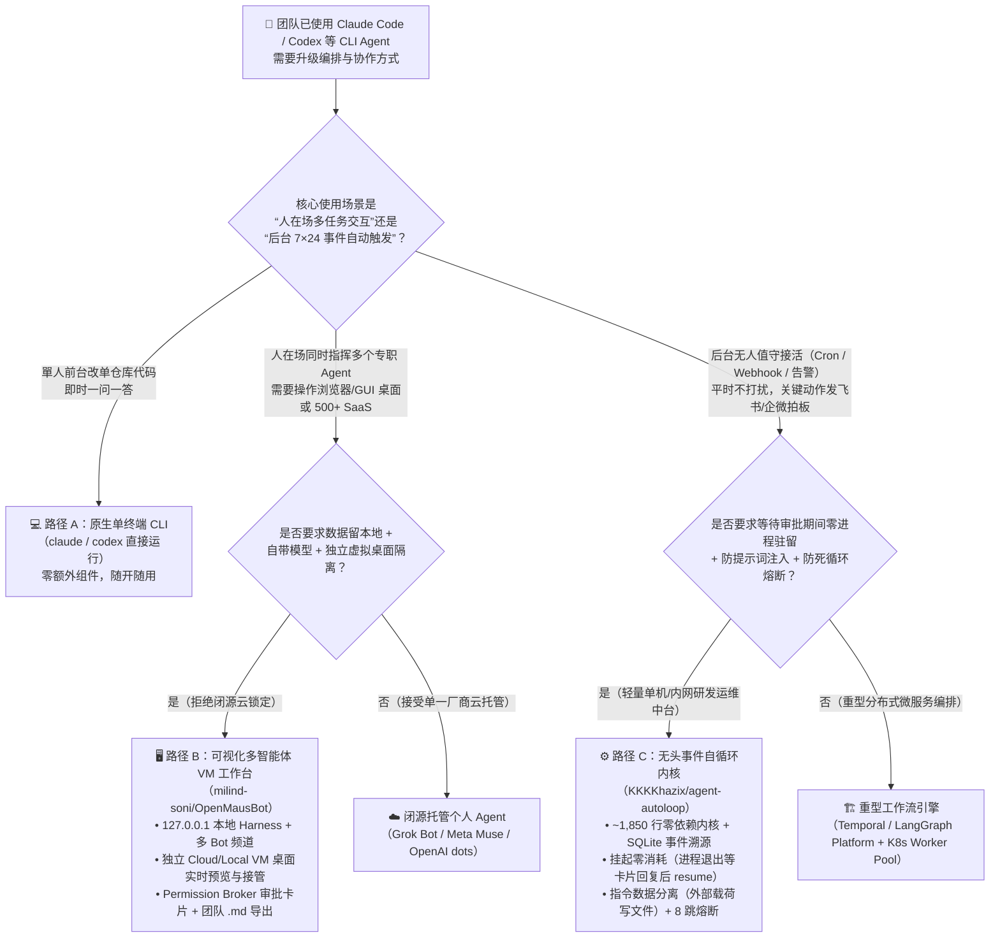
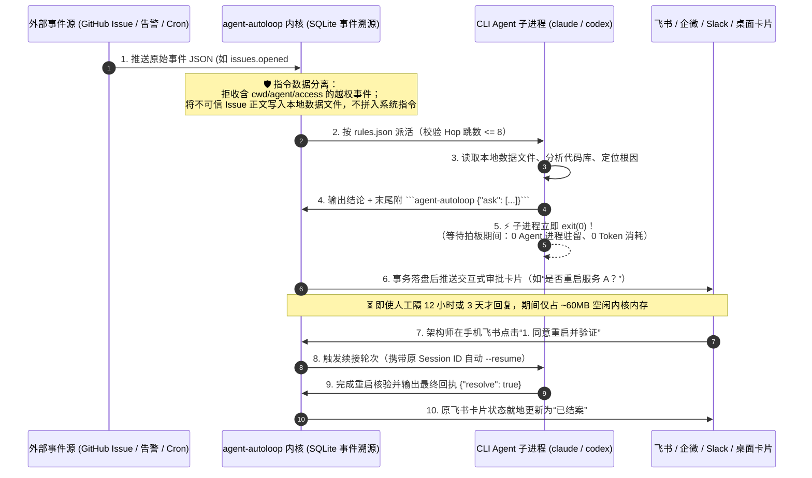

# 多智能体沙箱工作台 vs 无头事件自循环内核 vs 传统单终端 CLI 选型与架构 FAQ（OpenMausBot vs agent-autoloop）

> **文档定位**：面向 AI Solution Architect（AI 解决方案架构师）、研发效能平台负责人与企业 Agent 自动化架构师的实战选型指南。用大白话、第一性原理、架构状态机图、多维对比矩阵、定量算例与可落地的生产核验清单，彻底讲透：**当团队已经用上了 Claude Code / Codex CLI，为什么“人守着终端窗口盯跑”会成为规模化瓶颈？面对今日 GitHub 飙升榜两大代表方案——带独立虚拟机桌面的可视化多智能体工作台（`milind-soni/OpenMausBot`）与零依赖无头事件自循环内核（`KKKKhazix/agent-autoloop`）——架构师到底该如何选型与组合？**
>
> **证据来源与增长口径声明（Provenance & Velocity Disclosure）**：
> - **`measured`（本班次一手抓取核验）**：
>   - **Track A 单日新增榜首（`milind-soni/OpenMausBot`）**：`+1,437 stars today`（总 Star `17,935` DOM / `17,961` API，Forks `2,511`，Apache-2.0，最新版本 `v0.1.149`），提取自封存的 GitHub Daily Trending 原始 HTML 快照（`workshops/github-trending-radar/evidence/trending-daily-2026-11-08-raw.html`，`sha256: 353914ef985b6a4f269094bea6a075a391f5e5da0e85145e54f704909dbf11d0`）。归属核验：独立开发者仓库（`owner.type = User`，作者明确声明与 xAI、Meta、OpenAI、Manus 无官方隶属关系）。
>   - **Track B 新仓生命周期斜率黑马（`KKKKhazix/agent-autoloop`）**：创建于 `2026-11-03T08:02:11Z`，截至核验时总 Star `4,072`–`4,085`、Forks `744`–`745`（MIT 协议，内核约 `1,850` 行 TypeScript、零运行时依赖）。**口径严格区分**：其建仓 5 天以来的**生命周期日均增速（`avg_stars_per_day`）约为 `814 stars/day`**；由于该仓未出现在当日 GitHub Daily Trending 前 25 名 DOM 快照中，且 GitHub REST API 不返回 24h Star 增量，其**当日新增 Star 严格记为 `stars_today = not_measured`**，绝不混入 Track A 单日增量排名。归属核验：独立开发者开源仓库（`owner.type = User`）。
> - **`anonymized_reported`（`independently_reproduced=false`，上游仓库实测报告）**：`agent-autoloop` 在 Apple M5 Pro（24 GB RAM，Node 24.21.0）上的内核基准数据（冷启动 `88.78 ms`、空闲内存 `59.94 MB RSS`、1,000 并发长轮询 `170.49 MB RSS`、持久化事务写入 `2,394 条/秒`、派活延迟 `p99 = 1.82 ms`、110 万条事实日志冷启动 `99.8 ms` / 全量重建 `43.1 s`）引自上游 [`README.md`](https://github.com/KKKKhazix/agent-autoloop/blob/main/README.md) 与 [`docs/protocol.md`](https://github.com/KKKKhazix/agent-autoloop/blob/main/docs/protocol.md)；`OpenMausBot` 的模块特性（`127.0.0.1` 本地 Harness Server、云端 Linux 桌面/本地隔离 VM、Composio 500+ OAuth 连接器、Jev 路由决策模型、`FORMAT.md` 便携式 Markdown 团队包）引自上游 [`README.md`](https://github.com/milind-soni/OpenMausBot/blob/main/README.md)。
> - **`synthetic`（`independently_reproduced=false`，架构师参数化算例）**：第 4 节关于 15 人研发/运维团队在“常驻后台守护进程 vs 挂起零消耗事件内核 vs 多 VM 桌面工作台”下的主机内存、空闲计算开销与人工盯屏损耗模型，属于显式给定参数假设的架构推演。

---

## 📌 一分钟核心结论速览（Executive Summary）

| 评估维度 | 传统单终端前台 CLI（Raw `claude` / `codex` Terminal） | 可视化多智能体 VM 工作台（`milind-soni/OpenMausBot`） | 无头事件自循环内核（`KKKKhazix/agent-autoloop`） |
| :--- | :--- | :--- | :--- |
| **一句话大白话定位** | **“人肉守着黑框终端盯跑”**——你输一句、盯着它跑、等它问你下一步；关窗口或切走就断流 | **“装在聊天软件里的多 Agent 虚拟电脑战队”**——像聊微信/Telegram 一样同时指挥多个带独立 VM 桌面的智能体，看实时屏幕并点卡片审批 | **“零依赖的命令行 Agent 后台自动派单与挂起中台”**——无界面，接定时/Webhook 事件自动派活，拿不准时发飞书/企微卡片等你拍板，等待期退出进程零消耗 |
| **核心解决痛点** | 单点交互最直接，但无法同时盯 5+ 个长耗时任务，也不支持无人值守事件触发 | 解决**多角色交互协同 + GUI/浏览器操作隔离 + 团队配置一键分享**（Grok Bot / Meta Muse / OpenAI dots 的开源本地替代） | 解决**7×24 后台事件驱动（Cron/Issue/告警）+ 跨天人工审批挂起零进程/零 Token 消耗 + 防提示词注入与死循环熔断** |
| **执行环境与隔离边界** | 直接跑在宿主机当前 Shell 目录，无独立桌面隔离 | 本地 `127.0.0.1` Harness + 每个 Bot 绑定独立 Cloud Linux Desktop / 本地隔离 VM / 显式授权宿主机 + Composio OAuth | 宿主机指定 `cwd` 目录执行 CLI 子进程；通过**指令数据分离**（外部载荷写文件不拼 Prompt）+ **8 跳 TTL 熔断**控险 |
| **人工审批（HITL）机制** | 终端阻塞等待键盘输入（进程常驻挂起，关终端即丢失上下文） | 聊天流内嵌 Permission Broker 卡片（Allow / Deny / 语音通话审批 / 一键接管实时远程桌面） | 识别回复末尾 `agent-autoloop` JSON 块 → **进程立即退出（0 内存/0 Token）** → 飞书/钉钉/Slack/桌面推卡片 → 点击后 `--resume` 续接原会话 |
| **资源占用特征** | 每个活跃终端约 `150–350 MB` Node/CLI 进程内存 | Electron GUI + 本地 Server + 本地/云端 VM 桌面（交互富客户端，适合开发机主力工作台） | 内核空闲仅 `59.94 MB RSS`（`anonymized_reported`），等待人工拍板期间 **0 个 Agent 子进程驻留** |
| **架构师选型金律** | 适合单次即时编码、修单文件 Bug 或临时探索 | 适合**需要可视化多 Bot 协同、浏览器/桌面 GUI 操控（Computer Use）、OAuth SaaS 工具链连接与部门模板共享**的交互式工作台 | 适合**无人值守研发/运维流水线（定时早报、Issue 自动分诊、线上告警排查、PR `deliver` 自动合并上线）**与 IM 卡片异步拍板 |

---

## 1. 核心灵魂三问（Q&A 深度拆解）

### Q1：我们团队已经在用 Claude Code 和 Codex CLI 了，什么时候用传统终端就够了？什么时候必须上 `OpenMausBot` 或 `agent-autoloop`？

#### 一句话结论
- **如果你只是“人坐在电脑前，一对一让 Agent 改当前仓库的几行代码”**，直接开原生终端跑 `claude` 或 `codex` 最简单，不需要任何套壳；
- **但只要你遇到以下两个规模化拐点之一**，原生单终端模式就会立刻失效，而且这两个拐点分别对应 `OpenMausBot` 和 `agent-autoloop`：

#### 拐点 A：交互宽度拐点 —— 你需要同时指挥多个不同分工的 Agent，且 Agent 需要操作完整的桌面/浏览器或 SaaS 应用（选 `OpenMausBot`）
1. **原生单终端的痛点**：
   - 你开了 6 个终端 Tab（一个跑前端重构、一个查竞品网页、一个整理论文、一个盯 PR），每个 Tab 都在刷屏输出；你根本分不清哪个窗口卡在权限确认（`Allow bash command?`），更没法给不同任务分配独立的浏览器登录态和虚拟电脑桌面。
   - 2026 年闭源个人智能体产品（xAI Grok Bot、Meta Muse、OpenAI dots、Manus Cue）验证了**“通讯录式多 Bot + 独立云电脑”**的交互范式，但闭源方案绑定单一厂商模型且把你的代码和登录态锁在厂商云端。
2. **`OpenMausBot` 的破局方式（Local-First Multi-Agent Workbench）**：
   - **BYO-Agent（自带本地 CLI）**：直接复用你本机已安装登录的 `claude`、`codex`、`grok` CLI，由本机 `127.0.0.1` 的小型 Harness Server 统一托管进程，对话记录与密钥保存在本地 `~/.openmausbot`。
   - **每个 Bot 一台独立电脑（Computer Panel）**：为需要 GUI 操作的 Bot 挂载隔离的 Cloud Linux Desktop 或本地 VM，提供实时屏幕预览与浏览器一键接管（Take over），避免 Agent 在你宿主机上乱点鼠标或污染主系统环境。
   - **聊天流内嵌权限代理（Permission Broker）与 Jev 自动路由**：高危 Shell 命令和文件修改统一转化为聊天卡片（Allow / Deny）；群聊频道开启 `Auto` 后通过轻量级 Jev 决策模型在数百毫秒内自动挑选最匹配的专职 Bot 接单。

#### 拐点 B：时间跨度与事件驱动拐点 —— 你希望 Agent 在后台 7×24 自己接活、遇到拿不准的事发飞书/企微卡片找你拍板（选 `agent-autoloop`）
1. **原生单终端的痛点**：
   - 命令行 Agent 默认是“请求-响应”的前台工具。想让它“每天早上 8 点自动汇总提交写早报”、“GitHub 有人提 Issue 自动拉代码排查”、“半夜收到线上告警先查日志，需要重启服务时发飞书问我，我早上睡醒点同意它再接着干”——如果用传统 Shell 脚本挂后台，等待人工回复的几个小时里进程一直挂着占内存，一旦超时、断网或终端退出，上下文就彻底断了。
2. **`agent-autoloop` 的破局方式（Headless Event-Sourced Autoloop Kernel）**：
   - **无 GUI 的极简事件中台**：全内核仅约 `1,850` 行代码、**0 个运行时外部依赖**。把定时任务（Cron）、GitHub/GitLab Webhook、HTTP 告警统一抽象成标准事件，按 `~/.agent-autoloop/rules.json` 自动派发给对应的 CLI Agent。
   - **挂起零消耗（Zero-Cost Suspend）**：Agent 干完一轮后，如果需要人工拍板，只需在最后一条回复末尾输出一段 `agent-autoloop` JSON 代码块（含 `ask` 选项卡片），**随后 Agent 进程立即退出**。哪怕你三天后才在飞书/钉钉/桌面点按钮回复，这三天里本机**没有任何 Agent 进程在跑，也不消耗半个 Token**；你一点按钮，内核自动调用原 CLI 的会话恢复能力接着干完。

---

### Q2：这两个项目底层到底是怎么运作的？为什么 `agent-autoloop` 能做到“挂起零消耗 + 防提示词注入 + 防无限自循环”？

我们从源码架构出发，拆解两者截然不同的设计哲学：

#### 1. `OpenMausBot` 的三层双工工作台架构（Interactive Workbench Stack）
- **控制面（Electron + React 19 + `127.0.0.1` Harness Server）**：
  - 将每个智能体抽象为“联系人（Contact）”并归组到不同业务频道（Channels），每个频道拥有独立的共享指令、工作目录、响应规则（含 Jev 毫秒级自动路由）和连接器槽位。
  - **密钥只写隔离（Write-Only Secrets）**：API Key 存储在本地配置中，前端 UI 只接收 `"configured": true/false` 布尔标记，防止渲染层泄露凭证。
- **执行面（Per-Bot Computer & Composio Sessions）**：
  - 每个 Bot 可绑定三种计算表面：① 隔离的云端 Linux 桌面、② 本地隔离虚拟机（Local VM）、③ 经安全边界认证并显式 Opt-in 的宿主机（macOS / Ubuntu Xorg；Ubuntu Wayland 因安全边界未闭环默认禁用）。
  - 通过 Composio Sessions 一键完成 Gmail、Slack、GitHub、Notion、Linear 等 500+ 应用的 OAuth 授权，避免把明文账号密码交给大模型。
- **团队打包与组织分发（Portable Markdown Team Format）**：
  - 整个部门的多 Bot 编排、Chief of Staff、群聊频道、Playbook 与连接器清单可导出为单个 `.md` 文件（YAML Frontmatter + Markdown 正文）。导入时自动脱敏所有密钥与历史对话，并将所有 Bot 默认设为 `Ask` 审批模式、Routines 默认暂停，确保跨团队分享的安全性。

#### 2. `agent-autoloop` 的四大计算机系统级内核机制（1,850 LOC Zero-Dependency Kernel）
`agent-autoloop` 将源码严格切分为纯逻辑内核（`kernel/`，不读系统时钟、不用随机数、不向外发网络请求，保证相同输入 100% 确定性输出）与运行外壳（`host/`、`protocol/`、`worker/`、`plugins/`），并落地了四项极具启发性的系统工程机制：

1. **挂起零消耗（Suspend-to-SQLite without Resident Agent Process）**：
   - 传统多 Agent 框架在等待人类审批（HITL）时通常保持 Python/Node 协程与子进程常驻。
   - `agent-autoloop` 对 Agent 只有一个极简协议约定：在最后一条回复末尾附上 `agent-autoloop` 代码块（支持 `ask` 提问、`notice` 通告、`resolve` 结案、`later` 预约复查、`events` 派生新事件）。
   - `worker` 读取回执并提交给 `kernel` 后，**CLI 子进程立即 `exit(0)`**。挂起状态持久化在 SQLite 中，由通道插件（飞书/钉钉/企微/Slack/桌面）渲染交互卡片。当人类点击选项时，内核触发新轮次并通过 `--resume` 唤醒原 CLI 会话。如果 Agent 输出的回执 JSON 语法写错了，内核只会让它在原会话里重写最后一段回执，**绝不把已经执行完的业务动作重做一遍**。
2. **单事务事件溯源与确定性故障模拟（Append-Only Event Sourcing & Simulation Testing）**：
   - 所有系统状态均由一条只追加（Append-Only）的事实日志投影计算得出，日志追加与索引更新在同一个 SQLite 磁盘事务中提交后才返回 HTTP 应答。
   - 仓库内置了受 FoundationDB / TigerBeetle 启发的确定性仿真测试：`node sim/random.ts 24301 200000`（单随机种子复现 20 万步断网、丢包、崩溃与重复提交）以及 `node sim/crash.ts 1000 12648430`（真实强杀进程 1,000 次验证已确认记录零丢失）。
   - 线上任何一轮任务为什么触发、匹配了哪条规则、走到了哪一步，敲一行 `agent-autoloop why <轮次号>` 即可输出完整因果链。
3. **类 SQL 参数化的指令数据分离（Instruction-Data Separation against Prompt Injection）**：
   - 当处理外部不可信事件（如陌生人提交的 GitHub Issue 或外部告警）时，如果直接把 Issue 标题和正文拼接到 Prompt 里，极易遭遇间接提示词注入（Indirect Prompt Injection）。
   - `agent-autoloop` 采用类似“SQL 参数化查询”的隔离设计：**外部 Issue 的标题和正文只作为纯数据写入本地临时文件，绝不直接拼入系统提示词**；提示词中仅包含经严格字符集校验的事件类型、编号与文件路径。
   - 同时，具体调用哪个 Agent、在哪个 `cwd` 目录执行、拥有什么权限，100% 由本机受保护的 `rules.json` 决定；**如果外部输入的事件 JSON 中夹带了 `cwd`、`agent` 或 `access` 字段，协议层直接拒收**，从根源阻断攻击者通过篡改 Webhook 载荷越权执行命令。
4. **网络包 TTL 式的 8 跳熔断（8-Hop TTL Circuit Breaker）**：
   - Agent 可以在回执里通过 `events` 派生后续事件，或者通过 `later` 预约半小时后自己醒来复查。为防止两个 Agent 互相派活或定时复查陷入无限死循环烧光 Token，内核在事件链路中维护了一个**不可被 Agent 篡改、即使经过人工提问和定时休眠也绝不清零的跳数计数器（Hop Counter）**。一旦累计超过 **8 层**，内核只记录日志、不再派活，并立即发卡片告警。

---

### Q3：如果我是企业 AI 架构师，能不能把两者的架构优势结合起来？什么时候严禁直接照搬？

#### 最佳实践：交互式沙箱工作台（前景探索） + 无头事件自循环内核（后台值守）双轨组合
- **前景人机协同层（参照 `OpenMausBot`）**：架构师与工程师在日常设计、跨应用调研、UI 原型验证与多方案比选时，使用带隔离 VM 桌面和内嵌审批卡片的工作台，通过便携式 Markdown 团队模板（`FORMAT.md`）沉淀标准角色分工。
- **后台无人值守层（参照 `agent-autoloop`）**：将已经定型的日常研发/运维 SOP（如 Issue 预分诊、线上告警初筛、每日构建巡检、PR 自动合并交付流水线）下沉到 `agent-autoloop` 规则引擎中，平时静默运行，只在涉及删库、重启服务、发版上线或对外回复时推送飞书/企微卡片由负责人一键拍板。
- **PR 自动交付的安全铁律（参考 `agent-autoloop` `delivery` 插件设计）**：在实现 PR 自动审查与交付流水线时，**审查规则与交付脚本必须只从受保护的 `main` 分支读取，严禁在接单宿主机上直接 `git checkout` 并执行外部未合入 PR 分支中的代码**，防止恶意 PR 通过修改构建脚本夺取宿主机控制权。

#### 什么时候严禁盲目照搬（红线警示）
1. **高频对客生产服务严禁挪用个人 CLI 订阅额度**：正如 `agent-autoloop` 官方合规声明所强调，个人 Claude/ChatGPT 订阅额度专为人工交互设计；若用于高频后台自动化或对外提供服务，必须切换为企业级 API Key / Azure OpenAI / AWS Bedrock 计费通道。
2. **多租户 SaaS 生产环境严禁直接共用单机 `~/.agent-autoloop` 或宿主机模式**：企业生产环境多租户任务必须配合容器/MicroVM（如 Kata Containers / Firecracker 或 `OpenMausBot` 的独立云端 VM）实现网络与文件系统硬隔离。

---

## 2. 架构选型决策树与状态机对比图（Mermaid）

### 2.1 CLI Agent 规模化编排选型决策树



### 2.2 传统常驻轮询 vs `agent-autoloop` 挂起零消耗状态机对比



---

## 3. 多维架构选型对比矩阵（Decision Matrix）

| 对比维度 | 原生单终端 CLI（Raw Terminal） | `milind-soni/OpenMausBot`（多智能体 VM 工作台） | `KKKKhazix/agent-autoloop`（无头事件自循环内核） | 重型工作流集群（LangGraph Cloud / Temporal） |
| :--- | :--- | :--- | :--- | :--- |
| **开源协议与版本** | 随各 CLI 工具（专有或开源） | **Apache-2.0**（`v0.1.149`） | **MIT**（内核约 `1,850` 行，0 运行时依赖） | MIT / 商业托管服务 |
| **当日热度与增长口径** | 基准对照组 | **Track A `+1,437 stars today`（`measured`）**，总 Star `17,935` DOM / `17,961` API | **Track B 建仓 5 天总 Star `4,072`–`4,085`（日均 `~814 stars/day`，`measured`）**；**`stars_today = not_measured`** | 成熟基础设施对照 |
| **核心交互界面** | 命令行黑框（TUI / CLI） | **类 Telegram/Slack 桌面客户端**（含实时 VM 屏幕面板、模型切换栏、应用市场） | **无后台 GUI**（纯 CLI `status` / `why` / `check` + 飞书/钉钉/企微/Slack 交互卡片） | Web DAG 监控台 + API 网关 |
| **可接入的底层 Agent** | 单一 CLI | `claude`、`codex`、`grok` 及自定义二进制 | `claude`、`codex`、ACP（`gemini --acp`、`opencode acp`）、`dsh`、`pi`、`openclaw`、`hermes`、`cursor`、任意命令 | 需使用专属 SDK 改写 Agent 节点代码 |
| **接入改造成本** | 0 | 桌面安装包即装即用（支持一键导入 `.md` 团队模板） | **零 SDK 侵入**：不改 Agent 源码，只配 `~/.agent-autoloop/rules.json` 并约定末尾代码块回执 | **高**（需重构为状态图节点并额外部署 Redis/Postgres） |
| **人工拍板（HITL）期间开销** | 终端进程常驻挂起，阻塞当前窗口 | 本地 Harness + Electron GUI 常驻（若开启云/本地 VM 则含 VM 开销） | **挂起零消耗**：Agent 进程直接退出，SQLite 落盘等待，内核空闲仅 `59.94 MB RSS`（`anonymized_reported`） | Worker 节点常驻，状态持久化于外部数据库 |
| **防间接提示词注入机制** | 依赖 CLI 自身权限确认 | Permission Broker 拦截高危 Shell/文件动作 + 独立 VM 沙箱隔离 + OAuth 令牌隔离 | **指令数据分离**（外部不可信文本存文件不拼 Prompt）+ **协议层拒收 `cwd`/`agent`/`access` 越权字段** | 需开发团队自行编写输入清洗与沙箱层 |
| **防自治死循环机制** | 人工盯屏手动 `Ctrl+C` | 界面实时观察 + 动作级审批拦截 | **内核级 8 跳 TTL 熔断**（跨人工提问与定时复查累计，Agent 无法清零） | 依赖 Graph `recursion_limit` 配置 |
| **可观测性与故障复盘** | 翻看终端滚动日志 | 频道独立聊天历史 + 实时桌面画面回看 | **单事务事件溯源** + `agent-autoloop why <id>` 因果链回放 + 20 万步确定性乱序/强杀仿真测试 | OpenTelemetry / LangSmith 分布式追踪 |

---

## 4. 定量算例与 7-Card 评测洞察（Worked Example & Benchmark Insights）

### 4.1 上游实测性能基线（Provenance: `anonymized_reported`, `independently_reproduced=false`）
根据 `KKKKhazix/agent-autoloop` 官方仓库在 **Apple M5 Pro（24 GB RAM，Node 24.21.0）** 上披露的逐事务落盘基准测试（来源：[`README.md#实测性能`](https://github.com/KKKKhazix/agent-autoloop/blob/main/README.md) 与 [`docs/protocol.md`](https://github.com/KKKKhazix/agent-autoloop/blob/main/docs/protocol.md)）：

| 核心内核指标 | 上游实测数值（`anonymized_reported`） | 架构师解读 |
| :--- | :--- | :--- |
| **冷启动耗时（Cold Start）** | **`88.78 ms`**（空库）/ **`99.8 ms`**（110 万条历史事实） | 毫秒级拉起，100 万级历史事件下启动几乎无衰减（仅在数据格式升级需全量重建投影时耗时 `43.1 s`） |
| **空闲内存占用（Idle RSS）** | **`59.94 MB RSS`** | 仅相当于一个轻量级命令行工具的几分之一，可常驻任何开发机或轻量边缘节点 |
| **1,000 并发等待长轮询内存** | **`170.49 MB RSS`** | 即使同时挂起上千个等待外部拍板或 Worker 领活的连接，内存增长仅约 `110 MB` |
| **单事务持久化吞吐与派活延迟** | **`2,394 条/秒`**（落盘才应答）/ **派活 `p99 = 1.82 ms`** | 排队 5,000 条时被挡下的心跳 `p99 = 1.66 ms`，单机即可轻松承载百人研发团队的所有 Webhook 与定时派单 |

### 4.2 15 人研发与运维团队后台自动化成本算例（Provenance: `synthetic`, `independently_reproduced=false`）
**算例假设（Explicit Parametric Assumptions）**：
- 某 15 人 AI 研发与 SRE 团队，日常运行 **30 条后台 Agent 自动化规则**（含 GitHub Issue 自动复现分诊、线上告警初筛、每日早报汇总、网站巡检、PR 自动审查交付）。
- 每天触发 **120 次事件**，其中 **40 次涉及敏感操作（如重启预发服务、修改配置、对外发通知）需等待负责人拍板**，平均人工响应等待时长为 **3.5 小时/次**（例如夜间告警等到次日早晨处理）。
- 对比三种架构落地形态的资源与运维损耗：

| 成本与效率维度 | 方案 1：传统常驻终端 / Shell 轮询脚本（挂起不退出） | 方案 2：无头事件自循环内核（`agent-autoloop` 模式） | 方案 3：全员开启带独立云桌面的富工作台（`OpenMausBot` 模式） |
| :--- | :--- | :--- | :--- |
| **等待人工拍板期间驻留进程数** | 平均 **15–20 个 CLI 子进程**常驻挂起（极易因 SSH 断连或内存溢出丢失会话） | **0 个 Agent 子进程**（输出 `ask` 后立即 `exit(0)`，仅 1 个 `~60 MB` 内核驻留） | 15 台客户端本地 Harness + 按需唤醒的独立 VM 桌面 |
| **宿主机/服务器日均空闲内存占用** | `18 个驻留进程 × 250 MB ≈ 4.5 GB RAM` + 心跳轮询开销 | **`~60 MB – 170 MB RAM`**（节省 **>96%** 挂起内存） | 桌面端约 `600 MB – 1.5 GB RAM`（换取完整 GUI 桌面可视化与接管能力） |
| **断连/崩溃导致重跑的浪费 Token** | `40 次拍板/天 × 22 工作日 = 880 次/月 × 15% 断连率 = 132 次重跑/月 × $3.18/次 = $419.76/月`（约 **`$420/月`** 额外浪费，`synthetic`） | **接近 0 重复重跑**（单事务事件溯源 + `--resume` 断点续接 + 回执语法错误仅重写最后一段） | 交互式会话持久化于 `~/.openmausbot`，支持跨重启恢复 |
| **间接提示词注入与死循环爆账单风险** | **高**（Webhook 拼接脚本易被恶意 Issue 注入或陷入重试死循环） | **极低**（指令数据文件分离 + 拒收 `cwd`/`agent`/`access` + **8 跳硬熔断**） | **可控**（Permission Broker 逐动作卡片审批 + 独立 VM 沙箱边界） |

> 💡 **架构师算账结论**：对于**不需要 GUI 屏幕操作**的后台研发/运维事件流，用 `agent-autoloop` 替代传统常驻脚本能将挂起内存开销压缩 **96% 以上**，并消除断连重跑与死循环爆账单隐患；而对于**需要操作浏览器 GUI、跨多应用 OAuth 协同与可视接管**的复杂任务，则应将该步骤封装为 `OpenMausBot` 的专职桌面 Bot 或通过浏览器接力插件调用。

---

## 5. 架构师 30 分钟上手与生产落地核验清单（Production Checklist）

### 5.1 30 分钟快速验证 Demo（无需购买云 GPU，本机即可跑通）
1. **前 15 分钟：验证 `agent-autoloop`“提问 → 进程退出零消耗 → 拍板 → 自动续接”闭环**
   - 在已安装 Node 24+、Git 与任意已登录 CLI Agent（如 `claude` 或 `codex`）的开发机上运行：
     ```powershell
     # Windows PowerShell 一键安装最新通过检查的 Release
     irm https://raw.githubusercontent.com/KKKKhazix/agent-autoloop/main/install.ps1 | iex
     # 运行内置交互试跑：触发事件 -> Agent 提问并退出进程 -> 人工回答 -> 续接完成
     agent-autoloop try
     ```
   - 当终端提示 `Agent 结束了这一轮，问了你一个问题。它现在不占进程、不花 Token` 时，打开任务管理器确认此时**确实没有 `claude`/`codex` 子进程驻留**；随后执行 `agent-autoloop answer 1 2` 与 `agent-autoloop status`、`agent-autoloop why 1`，向客户现场演示**零消耗挂起 + 完整事件溯源因果链**。
2. **后 15 分钟：验证规则干跑（Dry-Run）与确定性故障仿真**
   - 编写一条 GitHub Issue 自动分诊规则草稿，运行 `agent-autoloop check <草稿文件>` 与 `agent-autoloop emit issues.opened --dry-run`，在不改动生产中台、不写日志的前提下预演事件路由。
   - 在 `~/.agent-autoloop/app` 下运行 `node sim/random.ts 24301 200000`，向客户展示 20 万步断网/崩溃确定性仿真验证。

### 5.2 生产环境落地六项强制门禁（Go-Live Gate Checklist）
- [ ] **门禁 1（指令与数据硬隔离核验）**：接入外部 GitHub Issue、工单或客户邮件事件时，确认不可信正文仅写入本地数据文件由 Agent 按资料读取，**严禁将外部自由文本直接拼接到 `rules.json` 的 `prompt` 模板中**。
- [ ] **门禁 2（协议越权字段拦截测试）**：使用 `curl` 向本地或 Webhook 接口发送夹带 `"cwd": "/"`、`"agent": "command"` 或 `"access": "full"` 的测试事件，验证协议层是否 100% 拒收（HTTP 4xx）。
- [ ] **门禁 3（PR 自动交付分支隔离铁律）**：若启用 `delivery` 自动合并流水线，确认审查与交付配置**仅从 `main` 分支读取**，严禁在自动化宿主机上检出或运行外部 PR 分支内的未审核脚本。
- [ ] **门禁 4（跳数熔断与高危动作卡片强制拦截）**：验证连续派生事件的 **8 跳 TTL 熔断**处于开启状态；在 Agent 规则与系统提示词中明确规定：涉及**删除数据、重启服务、产生费用、对外发送消息**四类动作，必须输出 `ask` 代码块触发飞书/企微卡片由人工拍板。
- [ ] **门禁 5（GUI 宿主机控制安全边界检查）**：若部署 `OpenMausBot` 供团队使用，默认将 Bot 计算表面限制在 **Cloud Linux Desktop** 或 **隔离 Local VM**；除非经安全团队显式审批，否则不要在生产办公机上开启宿主机直接控制（且注意 Ubuntu Wayland 宿主控制目前因上游 Issue `#345` 处于禁用状态）。
- [ ] **门禁 6（API 计费与服务条款合规检查）**：确认所有 7×24 高频定时与 Webhook 触发的 Agent 均配置为**企业级 API Key / Azure Foundry / Bedrock 端点**，不违规使用个人交互式订阅账号承载高频无人值守流量。
