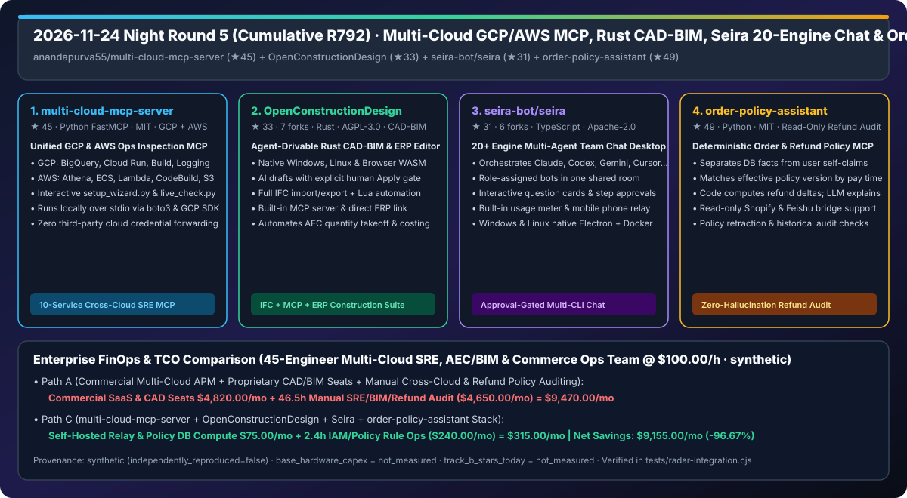
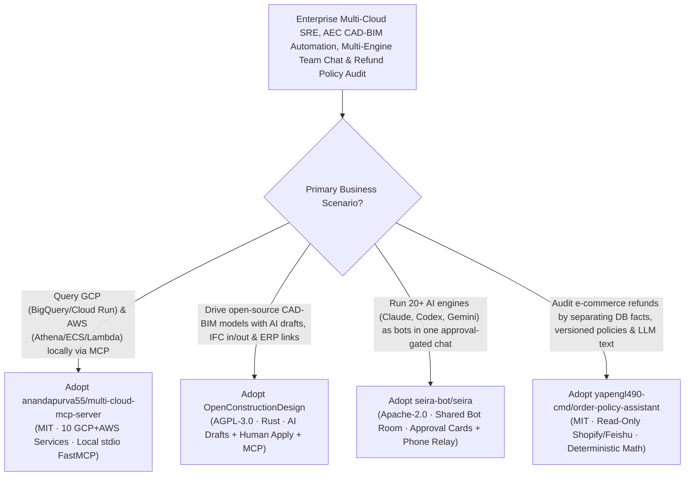
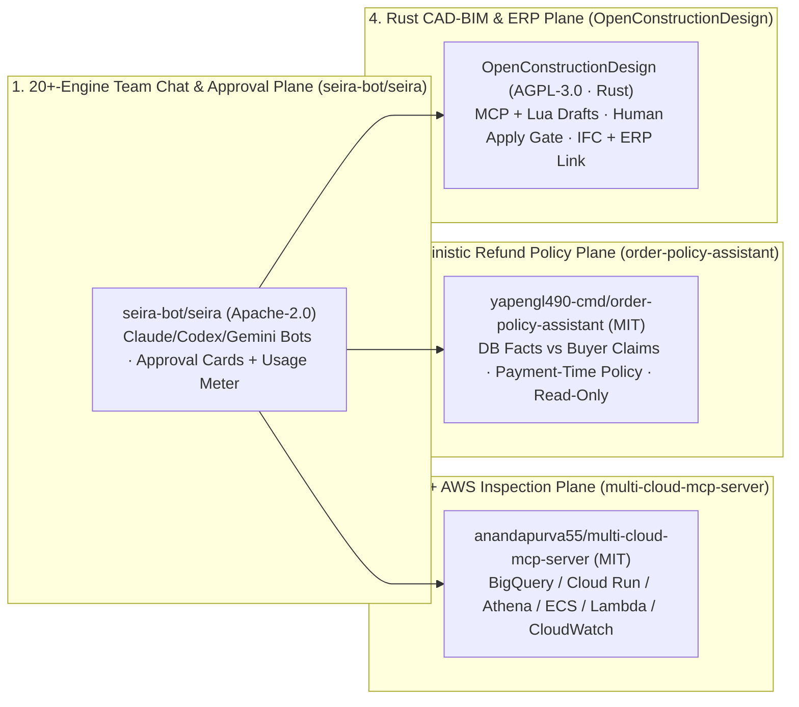

# 10-Service GCP/AWS Inspection MCP (`anandapurva55/multi-cloud-mcp-server`), Agent-Drivable Rust CAD-BIM & ERP Editor (`datadrivenconstruction/OpenConstructionDesign`), 20+-Engine Multi-Agent Team Chat (`seira-bot/seira`) & Fact-Grounded Read-Only Order/Refund Policy Auditor (`yapengl490-cmd/order-policy-assistant`) Selection & Architecture FAQ

> **Document Type**: Enterprise AI Solution Architect Decision & Selection Guide (GitHub Trending AI Radar · 2026-11-24 Night Round 5 / Cumulative Round 792)
> **Covered Repositories**: [`anandapurva55/multi-cloud-mcp-server`](https://github.com/anandapurva55/multi-cloud-mcp-server) (`★ 45`, `1 fork`, Python FastMCP, `MIT`: local multi-cloud MCP server built on `boto3` and Google Cloud client libraries covering 10 core services — **Google BigQuery, Cloud Run, Cloud Build, Cloud Logging** and **Amazon Athena, ECS, Lambda, CodeBuild, S3, CloudWatch**) · [`datadrivenconstruction/OpenConstructionDesign`](https://github.com/datadrivenconstruction/OpenConstructionDesign) (`★ 33`, `7 forks`, Rust, `AGPL-3.0`: free, open-source CAD-BIM editor for Windows, Linux, and Browser that AI agents can drive via MCP and Lua with explicit human `Apply` drafts, native `IFC` in/out, and direct ERP integration) · [`seira-bot/seira`](https://github.com/seira-bot/seira) (`★ 31`, `6 forks`, TypeScript, `Apache-2.0`: desktop multi-agent team chat app for Windows and Linux running 20+ AI engines — Claude Code, Codex, Gemini, Cursor, Copilot — as role-assigned bots in one room with approval cards, question cards, usage meters, and phone relay) · [`yapengl490-cmd/order-policy-assistant`](https://github.com/yapengl490-cmd/order-policy-assistant) (`★ 49`, Python, `MIT`: read-only order and after-sales refund policy verification assistant separating database facts, payment-time-versioned policy matching, and deterministic refund calculation from LLM natural-language explanation, with optional read-only Shopify and Feishu bridges)
> **Core Enterprise Scenario**: How should enterprise architects across Multi-Cloud SRE, AEC/BIM construction engineering, heterogeneous agent orchestration, and e-commerce customer operations combine **local GCP+AWS MCP inspection (`multi-cloud-mcp-server`)**, **human-approved Rust CAD-BIM/ERP automation (`OpenConstructionDesign`)**, **20-engine desktop chat orchestration (`seira`)**, and **zero-hallucination refund policy auditing (`order-policy-assistant`)**?

---

## 1. 📌 Executive Summary (One-Line Selection Verdicts)

1. **Need coding and SRE agents to query both GCP (`BigQuery`, `Cloud Run`, `Cloud Build`, `Cloud Logging`) and AWS (`Athena`, `ECS`, `Lambda`, `CodeBuild`, `S3`, `CloudWatch`) from a single local stdio MCP server without forwarding cloud credentials to third-party SaaS** ➔ Choose **[`anandapurva55/multi-cloud-mcp-server`](https://github.com/anandapurva55/multi-cloud-mcp-server) (`★ 45`, `MIT`)**.
   - **Plain-Language Mechanism**: Uses a short interactive `setup_wizard.py` and `live_check.py` over official `boto3` and Google Cloud SDKs so Claude Code, Codex, or GitHub Copilot can cross-correlate multi-cloud data warehouses, serverless runtimes, CI builds, and logs locally.
2. **Need an open-source, cross-platform CAD-BIM editor in Rust where AI agents draft architectural/structural changes via MCP, engineers review and click `Apply`, and models export directly to `IFC` and ERP systems** ➔ Choose **[`datadrivenconstruction/OpenConstructionDesign`](https://github.com/datadrivenconstruction/OpenConstructionDesign) (`★ 33`, `7 forks`, `AGPL-3.0`)**.
   - **Plain-Language Mechanism**: Runs natively on Windows, Linux, and Browser WASM, combining an embedded MCP server, Lua scripting, `IFC` import/export, and an ERP link behind an explicit human `Apply` gate.
3. **Need to run 20+ heterogeneous AI agents (Claude Code, Codex, Gemini, Cursor, Copilot) as a team of role-assigned bots in one shared desktop chat room with step approvals, usage meters, and mobile relay** ➔ Choose **[`seira-bot/seira`](https://github.com/seira-bot/seira) (`★ 31`, `6 forks`, `Apache-2.0`)**.
   - **Plain-Language Mechanism**: Provides structured `question-cards`, `computer-ask` permission gates, `usage-meter` tracking, and a `phone-relay` companion view so engineers can supervise multi-engine bot teams from desktop or mobile.
4. **Need a read-only e-commerce order & refund auditing assistant that strictly separates buyer self-claims from backend order facts, matches the exact policy version effective at payment time, and computes refund deltas in deterministic code** ➔ Choose **[`yapengl490-cmd/order-policy-assistant`](https://github.com/yapengl490-cmd/order-policy-assistant) (`★ 49`, `MIT`)**.
   - **Plain-Language Mechanism**: Prevents LLM refund hallucinations by treating buyer statements (e.g., *"unworn with tags intact"*) as unverified claims, fetching read-only order facts (payment timestamp, delivery timestamp, SKU customization state), binding the policy version active at payment time (including controlled policy retractions), and computing exact refund/shipping amounts in Python while the LLM only explains the cited result.

---

## 2. 🎯 Architect & Customer Q&A (Deep Technical Breakdown)

### Q1: When should enterprises adopt these four open-source tools vs. commercial cloud suites?

- **Selection Boundaries**:
  1. **Multi-Cloud SRE (`multi-cloud-mcp-server` vs. Single-Cloud Copilots)**: When workloads span **both GCP BigQuery/Cloud Run and AWS Athena/ECS/Lambda**, running `multi-cloud-mcp-server` locally avoids context-switching across two cloud consoles and avoids uploading cloud keys to external SaaS.
  2. **Deterministic Refund Auditing (`order-policy-assistant` vs. Naive RAG Chatbots)**: Standard RAG chatbots frequently apply the wrong month's return policy or miscalculate partial-bundle refunds. `order-policy-assistant` enforces a strict contract: **LLM selects allowed read-only tools and explains; deterministic Python code enforces identity scope, policy version matching, and arithmetic**.

### Q2: How do they integrate into an end-to-end enterprise architecture?

1. **Unified Multi-Engine Command & Approval Room (`seira-bot/seira`)**:
   - Host specialized SRE, Commerce Audit, and BIM Design bots inside `Seira` with `computer-ask` approval gates and live `usage-meter` tracking.
2. **Cross-Cloud Data & Runtime Inspection Plane (`anandapurva55/multi-cloud-mcp-server`)**:
   - Connect the SRE bot to GCP and AWS via `multi-cloud-mcp-server` stdio tools to query BigQuery/Athena tables and Cloud Run/ECS/Lambda logs.
3. **Deterministic Order & Policy Audit Plane (`yapengl490-cmd/order-policy-assistant`)**:
   - Connect the Commerce bot via `mcp_order_server.py` and `feishu_bridge.py` to read-only Shopify/order databases and versioned `policies.json` ledgers.
4. **Human-Approved CAD-BIM & ERP Plane (`datadrivenconstruction/OpenConstructionDesign`)**:
   - Connect the BIM bot to `OpenConstructionDesign` MCP to propose `IFC` drafts that sync to ERP upon human `Apply` approval.

### Q3: What are the key operational guardrails?

- **Key Guardrails**:
  1. **Read-Only IAM + Query Byte Caps**: Bind `multi-cloud-mcp-server` to read-only AWS/GCP credentials and set `maximum_bytes_billed` / workgroup scan limits on BigQuery and Athena.
  2. **Zero Direct Payment/Write Execution in Refund Assistant**: Keep `order-policy-assistant` strictly read-only (`mcp_order_server.py`); require human or core-ERP workflow sign-off before executing actual payouts.

---

## 3. 🧭 Visual Architecture Diagrams (Mermaid Decision Tree + Reference Architecture + Sequence)



### 3.1 Solution Architect Selection Decision Tree



### 3.2 End-to-End Enterprise Reference Architecture



### 3.3 End-to-End Multi-Cloud, Refund Audit & CAD-BIM Sequence

```mermaid
sequenceDiagram
    participant Lead as Architect / Ops Lead
    participant Seira as seira-bot/seira (20+ Engines)
    participant MC as multi-cloud-mcp-server (GCP+AWS)
    participant Ord as order-policy-assistant
    participant BIM as OpenConstructionDesign (Rust)

    Lead->>Seira: 1. Assign cross-cloud triage, refund audit, and store BIM update in shared room
    Seira->>MC: 2. SRE Bot queries AWS CloudWatch/Athena and GCP BigQuery/Cloud Run via stdio MCP
    MC-->>Seira: 3. Return correlated multi-cloud build & query diagnostics
    Seira->>Ord: 4. Commerce Bot fetches read-only order facts & matches payment-date policy version
    Ord-->>Seira: 5. Return deterministic refund calculation with cited policy clauses
    Seira->>BIM: 6. BIM Bot proposes IFC layout draft via MCP; engineer clicks Apply to sync ERP
```

---

## 4. 📊 Comparative Selection Matrix (OSS vs. Commercial SaaS & Unstructured Bots)

| Dimension | `multi-cloud-mcp-server` (`★ 45`) | `OpenConstructionDesign` (`★ 33`) | `seira-bot/seira` (`★ 31`) | `order-policy-assistant` (`★ 49`) | Commercial Multi-Cloud APM + Proprietary BIM Seats + Manual Audits (Path A) | Manual Console Switching + Prompt-Only Support Bots (Path B) |
| :--- | :--- | :--- | :--- | :--- | :--- | :--- |
| **Primary Role** | 10-service GCP + AWS local FastMCP server | Agent-drivable Rust CAD-BIM editor with ERP link | 20+-engine multi-bot desktop chat & approval hub | Read-only order & versioned refund policy auditor | High-cost commercial observability & proprietary BIM licenses | Manual console copy-paste & hallucination-prone prompt bots |
| **Key Differentiator** | **Unifies BigQuery/Athena & Cloud Run/ECS locally over stdio** | **AI drafts with human `Apply`, native `IFC` & ERP link** | **Runs 20+ CLI/model bots in one chat with approval cards** | **Separates buyer claims from DB facts & payment-time policy math** | Expensive per-seat BIM & APM contracts | Prompt-only bots miscalculate refunds and confuse policy versions |
| **License** | `MIT` | `AGPL-3.0` | `Apache-2.0` | `MIT` | Proprietary SaaS | Internal Scripts |
| **Monthly TCO (45-Eng Team)** | **Combined `$315.00/mo`** (`$75.00` self-hosted relay/DB + `2.4h` ops) | Included (zero CAD/BIM seat licensing cost) | Included (reuses existing CLI subscriptions) | Included (read-only zero-payout risk) | **`$9,470.00/mo`** (`$4,820.00` SaaS/BIM seats + `46.5h` manual SRE/BIM/refund labor) | `~$3,220.00/mo` (high manual refund dispute & console triage labor) |

---

## 5. 🧪 Quantitative Enterprise ROI / TCO Model & 7-Card Report

> **📊 Provenance & Closed-Form Declaration**:
> - **provenance**: `synthetic` (45-engineer multi-cloud SRE, AEC/BIM digital engineering, and e-commerce operations team workload at `$100.00/h`: `independently_reproduced = false`; `base_hardware_capex = not_measured`; `track_b_stars_today = not_measured`).
> - **Closed-Form Equations**:
>   - **Path A (Commercial Multi-Cloud APM + Proprietary CAD/BIM Seats + Manual Cross-Cloud & Refund Policy Auditing)**: Monthly commercial SaaS & CAD/BIM seat fees **`$4,820.00`** + manual cross-cloud log triage, IFC-to-ERP takeoff & refund dispute verification labor **`46.5h × $100.00/h = $4,650.00`** = **`$9,470.00/mo`**.
>   - **Path C (Self-Hosted `multi-cloud-mcp-server` + `OpenConstructionDesign` + `seira-bot/seira` + `order-policy-assistant` Stack)**: Self-hosted relay & policy DB container compute **`$75.00`** + read-only IAM & policy rule maintenance **`2.4h × $100.00/h = $240.00`** = **`$315.00/mo`**.
>   - **Net Savings vs. Path A**: **`-$9,155.00/mo`** (**`96.67%`** cost reduction).

| Option | Commercial SaaS / Seats / Compute | SRE, BIM & Refund Audit Labor (`$100/h`) | Monthly Total TCO | Net Savings vs. Path A | Key Architectural Outcome |
| :--- | :---: | :---: | :---: | :---: | :--- |
| **Path A: Commercial Multi-Cloud APM + Proprietary BIM + Manual Audit** | `$4,820.00` | `46.5h` (`$4,650.00`) | **`$9,470.00`** | Baseline | High per-seat software fees; slow manual cross-cloud & refund checks |
| **Path B: Manual Console Switching + CSV Takeoffs + Prompt-Only Bot** | `$1,420.00` | `18.0h` (`$1,800.00`) | **`$3,220.00`** | `-$6,250.00` (`-66.00%`) | Prompt-only bots confuse buyer claims with DB facts and miscalculate refunds |
| **Path C: `multi-cloud-mcp` + `OpenConstructionDesign` + `Seira` + `order-policy`** | **`$75.00`** | **`2.4h` (`$240.00`)** | **`$315.00`** | **`-$9,155.00` (`-96.67%`)** | **10-service GCP/AWS MCP + Rust CAD-BIM + 20-engine chat + deterministic refund audit** |

- 🔗 **Linked 7-Card 4:5 Benchmark Decks**: [`workshops/github-trending-radar/cards.en.html`](../cards.en.html) · [`cards.html`](../cards.html)

---

## 6. 🛠️ Enterprise Adoption & Architecture Review Checklist

- [ ] **Read-Only Multi-Cloud IAM & Scan Caps**: Configure `anandapurva55/multi-cloud-mcp-server` with read-only AWS/GCP roles and enforce per-query scan byte limits on BigQuery and Athena.
- [ ] **Mandatory Human `Apply` Gate in CAD-BIM**: Require human engineer approval via `OpenConstructionDesign`'s `Apply` workflow before syncing AI-drafted `IFC` quantity takeoffs to ERP.
- [ ] **Seira Step-Approval & Quota Enforcement**: Enable `computer-ask` approval cards and `usage-meter` budgets across all 20+ agent engines connected in `seira-bot/seira`.
- [ ] **Fact-vs-Claim Separation in Refund Audits**: Use `yapengl490-cmd/order-policy-assistant` to bind effective policy versions by order payment timestamp and compute all refund deltas in deterministic Python code.
