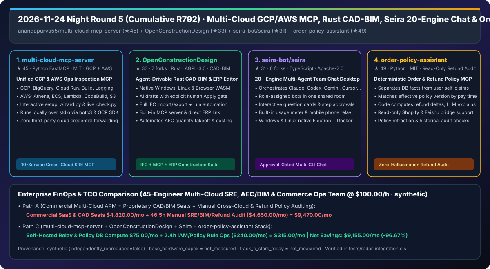
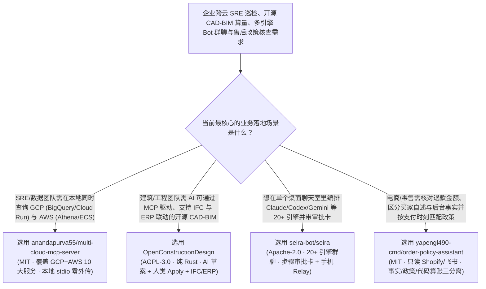
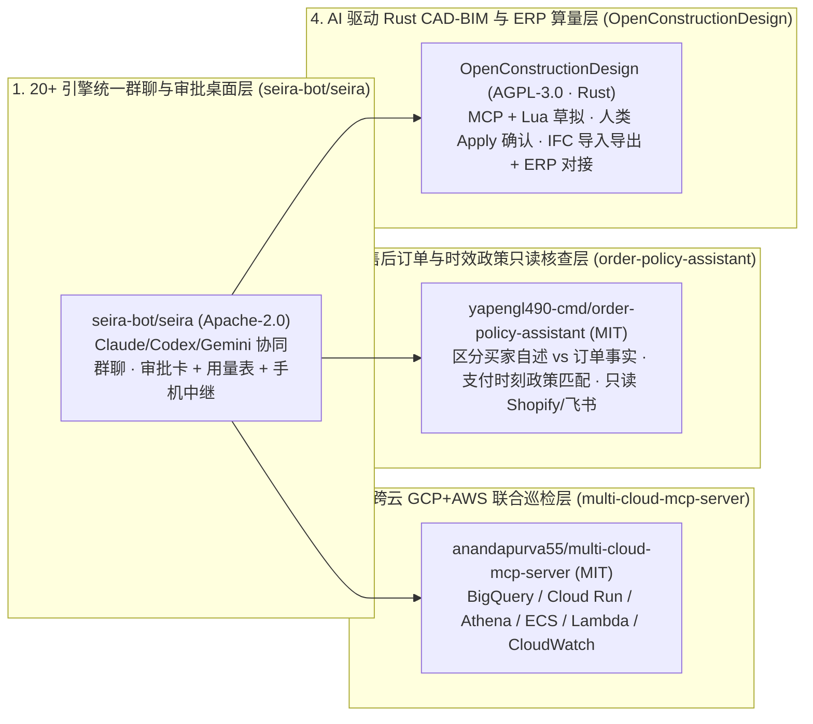
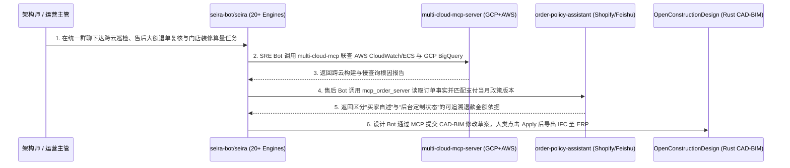

# 跨云 GCP/AWS 十大服务只读巡检 MCP（`anandapurva55/multi-cloud-mcp-server`）、AI 可驾驶且直连 ERP 的 Rust 开源 CAD-BIM 编辑器（`datadrivenconstruction/OpenConstructionDesign`）、20+ 引擎同群协同与步骤审批桌面台（`seira-bot/seira`）及事实/规则/解释三分离的只读订单售后核查助手（`yapengl490-cmd/order-policy-assistant`）选型与集成架构 FAQ

> **文档类型**：企业 AI 解决方案架构师（AI Solution Architect）选型决策指南（GitHub Trending AI 雷达 2026-11-24 Night Round 5 / 累计第 792 轮）
> **覆盖项目**：[`anandapurva55/multi-cloud-mcp-server`](https://github.com/anandapurva55/multi-cloud-mcp-server)（`★ 45`、`MIT`，基于 Python FastMCP + `boto3` + Google Cloud 官方 SDK 的本地跨云巡检 MCP Server，一站式打通 **GCP** 的 `BigQuery`/`Cloud Run`/`Cloud Build`/`Cloud Logging` 与 **AWS** 的 `Athena`/`ECS`/`Lambda`/`CodeBuild`/`S3`/`CloudWatch` 共 10 大核心服务）· [`datadrivenconstruction/OpenConstructionDesign`](https://github.com/datadrivenconstruction/OpenConstructionDesign)（`★ 33`、`7 forks`、`AGPL-3.0`，纯 Rust 编写的跨 Windows/Linux/Browser 开源 CAD-BIM 建筑设计编辑器，支持 AI 起草 + 人类 `Apply` 确认、IFC 标准导入导出、Lua 脚本、内置 MCP Server 与直连 ERP 工程量清单核算）· [`seira-bot/seira`](https://github.com/seira-bot/seira)（`★ 31`、`6 forks`、`Apache-2.0`，支持在单个桌面聊天室内同时编排 Claude Code、Codex、Gemini、Cursor、Copilot 等 **20+ 种 AI Agent 引擎**的多智能体团队工作台，内置步骤审批卡片、问题决策卡、用量仪表盘与手机端远程中继）· [`yapengl490-cmd/order-policy-assistant`](https://github.com/yapengl490-cmd/order-policy-assistant)（`★ 49`、`MIT`，面向买家与商家的只读订单和售后核查助手，将**数据库后台事实、按支付时刻匹配的时效政策规则与确定性金额计算**同大模型自然语言解释彻底解耦，支持只读 Shopify 接入与飞书桥接）
> **核心场景**：当企业架构师在跨云运维（Multi-Cloud SRE）、工程建设数字化（AEC CAD/BIM）、多工具异构 Agent 团队协同与电商售后合规核查四大场景落地 AI 时，如何构建一套**“凭据不出本机的 GCP+AWS 联合查询底座 + 带 Apply 门禁的 Rust CAD-BIM/ERP 编辑器 + 20 引擎统一群聊审批工作台 + 零算错金额的只读售后政策审计引擎”**？

---

## 一、📌 核心结论速览（选型一句话结论）

1. **想让 SRE 或数据研发 Agent 在同一个终端会话里同时查询 GCP（`BigQuery`、`Cloud Run`、`Cloud Build`、`Cloud Logging`）与 AWS（`Athena`、`ECS`、`Lambda`、`CodeBuild`、`S3`、`CloudWatch`），且云账号密钥 100% 留在本地不经过任何第三方 SaaS** ➔ 选 **[`anandapurva55/multi-cloud-mcp-server`](https://github.com/anandapurva55/multi-cloud-mcp-server)（`★ 45`，`MIT`）**。
   - **通俗原理**：很多跨国与多云企业数据在 BigQuery/Athena、容器跑在 Cloud Run/ECS、构建在 Cloud Build/CodeBuild，排障时工程师要在两个云控制台之间切十几个标签页。该项目通过交互式 `setup_wizard.py` 与 `live_check.py` 复用本机 `boto3` 和 GCP ADC 凭证，通过本地 stdio FastMCP 将 10 大跨云数仓、无服务器运行时、CI 构建与日志服务统一暴露给 Claude Code、Codex 或 GitHub Copilot。
2. **想在建筑工程（AEC）与园区设计场景中，摆脱动辄数万元/席位的闭源商业 BIM 软件锁定，让 AI Agent 通过 MCP 直接驱动 CAD-BIM 模型草拟、导出标准 IFC 并直连企业 ERP 生成工程量清单（BOQ）** ➔ 选 **[`datadrivenconstruction/OpenConstructionDesign`](https://github.com/datadrivenconstruction/OpenConstructionDesign)（`★ 33`，`7 forks`，`AGPL-3.0`）**。
   - **通俗原理**：采用高性能 Rust 构建（原生支持 Windows、Linux 与浏览器端），专为“人机共绘”设计：AI Agent 通过内置 MCP Server 或 Lua 脚本生成图纸修改草案（Drafts），人类工程师在界面上审查无误后点击 **`Apply`** 才正式写入 BIM 模型，并支持标准 `IFC` 双向交换与 ERP 系统联动算量。
3. **想把团队手里已有的 Claude Code、Codex、Gemini、Cursor、Copilot 等 20 多种不同长处的 AI 引擎拉进同一个“本地群聊房间”，按角色分派任务、看实时用量表并在关键步骤弹出交互式审批卡** ➔ 选 **[`seira-bot/seira`](https://github.com/seira-bot/seira)（`★ 31`，`6 forks`，`Apache-2.0`）**。
   - **通俗原理**：提供 Windows 与 Linux 桌面客户端及手机端 Relay 伴侣页，每个 Bot 可绑定不同底层 CLI/模型与职责（如架构师 Bot 用 Claude、后端 Bot 用 Codex、前端 Bot 用 Gemini），内置结构化问题卡片（`question-cards`）、计算机操作审批卡（`computer-ask`）与实时配额表（`usage-meter`）。
4. **想在电商客服、零售售后与财务内审场景落地 AI 助手，既要让它回答“为什么这笔退货被拒或扣了运费”，又要 100% 杜绝大模型被买家自述话术忽悠、用错历史政策版本或算错退款差额** ➔ 选 **[`yapengl490-cmd/order-policy-assistant`](https://github.com/yapengl490-cmd/order-policy-assistant)（`★ 49`，`MIT`）**。
   - **通俗原理**：将售后核查严格拆解为三层确定性职责：① **事实 vs 自述分离**：买家口头声称“未穿着、吊牌完好”仅作为待核查自述（User Claim），程序强制通过只读工具拉取数据库/Shopify 后台真实订单事实（支付时刻、收货时刻、品类、是否定制款）；② **按订单支付时刻绑定历史政策版本**：即使店铺 12 月修改了退货规则，11 月支付的订单依然精确匹配 11 月生效的政策条款，并支持受控政策撤回与历史依据核对；③ **代码算账、模型说话**：资格判定与退款差额完全由 Python 确定性代码算出，LLM 仅负责把带证据链的结论组织成通俗回复（且默认只读、绝不执行直接打款或改价）。

---

## 二、🎯 客户与架构师灵魂拷问 Q&A（深度架构拆解）

### Q1：在企业多云运维、BIM 工业软件与电商售后风控中，何时选这四个开源项目 vs 云厂商托管服务？

- **选型边界拆解**：
  1. **多云联合排障（`multi-cloud-mcp-server` vs 单云原生助手）**：若企业 100% 单一使用 Azure，直接使用 Azure Copilot / Azure MCP；若存在 **AWS + GCP 混合多云数仓与容器栈**（例如日志在 CloudWatch、分析表在 BigQuery），本地挂载 `multi-cloud-mcp-server` 可实现零成本跨云联合根因定位。
  2. **电商售后规则核查（`order-policy-assistant` vs 纯 Prompt 客服机器人）**：纯 Prompt 或普通向量 RAG 客服机器人极易在“跨月政策变更”和“满减凑单拆单退款计算”上出现幻觉导致资损；`order-policy-assistant` 的“后台事实 + 时效政策版本 + 确定性代码算账 + 只读安全边界”是企业级售后 AI 的标准范式。

### Q2：典型企业级“20 引擎协同控制室 (`Seira`) + 跨云 GCP/AWS 巡检 (`multi-cloud-mcp`) + 售后规则确定性审计 (`order-policy-assistant`) + Rust CAD-BIM 交付 (`OpenConstructionDesign`)”架构怎么搭？

1. **统一多智能体交互与审批入口层（`seira-bot/seira`）**：
   - 在工程师与运营桌面部署 `Seira`，将 SRE Bot、售后内审 Bot 与工程设计 Bot 汇聚于同一房间，通过 `question-cards` 与 `computer-ask` 执行人机协同审批。
2. **跨云基础设施与数据湖只读探测层（`anandapurva55/multi-cloud-mcp-server`）**：
   - SRE Bot 通过本地 stdio 调用 `multi-cloud-mcp-server`，跨 BigQuery/Athena 与 Cloud Run/ECS 联合排查线上慢任务与构建失败日志。
3. **售后订单与政策版本确定性核查层（`yapengl490-cmd/order-policy-assistant`）**：
   - 售后 Bot 通过 `mcp_order_server.py` 与 `feishu_bridge.py` 只读对接 Shopify/内部订单库，按支付时间戳匹配生效政策并输出可追溯金额差额依据。
4. **工业 CAD-BIM 起草与 ERP 算量层（`datadrivenconstruction/OpenConstructionDesign`）**：
   - 工程设计 Bot 通过 MCP 驱动 `OpenConstructionDesign` 生成 IFC 构件草案，经工程师点击 `Apply` 确认后同步至 ERP 核算物料成本。

### Q3：这套架构的生产落地红线是什么？

- **架构师落地红线**：
  1. **跨云 IAM 只读策略绑定**：为 `anandapurva55/multi-cloud-mcp-server` 配置 AWS IAM Profile 与 GCP Service Account 时，必须仅授予 `ReadOnlyAccess` / `Viewer` 权限，并在 BigQuery/Athena 侧设置单次扫描字节上限（Query Byte Cap）以防大表全表扫描烧钱。
  2. **售后助手严禁直接绑定打款写接口**：保持 `yapengl490-cmd/order-policy-assistant` 的只读核查定位，任何实际退款打款或政策撤回必须走核心交易系统的审批流。

---

## 三、🧭 直观可视化图解（Mermaid 决策树 + 集成架构 + 时序图）

### 3.1 架构师选型决策树

### 3.2 企业端到端生产集成参考架构图

### 3.3 多 Bot 群聊调度、跨云日志数仓联查、售后时效政策核对与 CAD-BIM Apply 确认时序图

---

## 四、📊 同类开源与商业云服务横向选型决策矩阵

| 对比维度 | `multi-cloud-mcp-server` (`★ 45`) | `OpenConstructionDesign` (`★ 33`) | `seira-bot/seira` (`★ 31`) | `order-policy-assistant` (`★ 49`) | 商业多云 APM + 闭源商业 BIM 席位 + 人工核单 (Path A) | 手工切云控制台 + 裸 Prompt 客服算账 (Path B) |
| :--- | :--- | :--- | :--- | :--- | :--- | :--- |
| **核心能力定位** | GCP + AWS 10 大服务本地 FastMCP | AI 可驱动的纯 Rust 开源 CAD-BIM 编辑器 | 20+ 引擎多 Agent 群聊与步骤审批桌面台 | 事实/时效政策/代码算账分离的只读售后助手 | 昂贵的商业可观测性 SaaS 与商业工业设计软件授权 | 多窗口人工拼凑日志与易出幻觉的纯文本客服对话 |
| **核心技术突破** | **打通 BigQuery/Athena 与 Cloud Run/ECS，密钥零外传** | **AI Draft + 人类 `Apply` + 原生 IFC/MCP/ERP 联动** | **单房间混编 20+ CLI/模型并带交互审批卡与手机中继** | **严格区分买家自述与后台事实，按支付时刻锁定政策版本** | 商业 BIM 与多云 APM 年费极高；人工核对历史政策慢 | 纯 LLM 算退货差额经常算错或被买家话术绕过规则 |
| **开源协议** | `MIT` | `AGPL-3.0` | `Apache-2.0` | `MIT` | 闭源商业软件 | 内部脚本 |
| **月度 TCO（45 人团队）** | **组合仅 `$315.00/月`**（`$75.00` 自托管中继/规则库 + `2.4h` 维护） | 同左（开源免除高昂 CAD/BIM 席位费） | 同左（复用现有 CLI 订阅） | 同左（只读零资损风险） | **`$9,470.00/月`**（`$4,820.00` 商业软件/SaaS 席位 + `46.5h` 跨云排障与人工核单） | 约 `$3,220.00/月`（大量售后算错赔付返工与手工导表工时） |

---

## 五、🧪 应用落地定量收益/TCO 对比与 7-Card 报告

> **📊 数据来源与闭式核算声明（Provenance & Closed-Form Schema）**：
> - **provenance**: `synthetic`（基于 45 人企业跨云 SRE、工程建设 BIM 数字化与电商运营售后团队月度工作负载模型：`independently_reproduced = false`；硬件采购基线 `base_hardware_capex = not_measured`；Track B 单日增量 `track_b_stars_today = not_measured`）。
> - **核算公式**：
>   - **Path A（采购商业跨云 APM 监控席位 + 采购闭源商业 CAD/BIM 席位 + 人工跨 AWS/GCP 控制台排障与人工比对历史售后政策核查退款争议）**：月度商业 SaaS 与设计软件席位费 **`$4,820.00`** + 跨云日志排查、手工算量与售后政策核对人工 **`46.5h × $100.00/h = $4,650.00`** = **`$9,470.00/月`**。
>   - **Path C（自建 `multi-cloud-mcp-server` + `OpenConstructionDesign` + `seira-bot/seira` + `order-policy-assistant` 开源栈）**：内网中继与政策数据库容器分摊开销 **`$75.00`** + 只读 IAM 与售后政策版本库维护人工 **`2.4h × $100.00/h = $240.00`** = **`$315.00/月`**。
>   - **净节省（Net Savings vs Path A）**：**`-$9,155.00/月`**（成本降低 **`96.67%`**）。

| 评估方案 | 商业软件 / SaaS / 容器成本 | 跨云排障、BIM 算量与售后核单人工（`$100/h`） | 月度总 TCO | 相对 Path A 净节省 | 关键架构交付指标 |
| :--- | :---: | :---: | :---: | :---: | :--- |
| **Path A：商业多云 SaaS + 商业 BIM 席位 + 人工核查** | `$4,820.00` | `46.5h` (`$4,650.00`) | **`$9,470.00`** | Baseline | 跨云切换与历史政策人工比对耗时长；软件席位费昂贵 |
| **Path B：手工切控制台 + 导 CSV 算量 + 裸 Prompt 客服** | `$1,420.00` | `18.0h` (`$1,800.00`) | **`$3,220.00`** | `-$6,250.00` (`-66.00%`) | 裸 LLM 易混淆买家自述与后台事实，导致退款金额算错 |
| **Path C：`multi-cloud-mcp` + `OpenConstructionDesign` + `Seira` + `order-policy`** | **`$75.00`** | **`2.4h` (`$240.00`)** | **`$315.00`** | **`-$9,155.00` (`-96.67%`)** | **10 服务跨云 MCP + Rust CAD-BIM + 20 引擎群聊 + 零幻觉售后核查** |

- 🔗 **关联 7-Card 4:5 视觉评测报告**：[`workshops/github-trending-radar/cards.html`](../cards.html) · [`cards.en.html`](../cards.en.html)

---

## 六、🛠️ 企业引入与架构评审 Checklist

- [ ] **GCP/AWS 跨云 MCP 只读与扫描限额**：运行 `anandapurva55/multi-cloud-mcp-server` 的 `setup_wizard.py` 时，仅绑定只读 IAM 角色，并在 BigQuery 与 Athena 侧开启单次查询扫描上限。
- [ ] **CAD-BIM `Apply` 人工确认门禁**：在 `OpenConstructionDesign` 中启用 MCP 自动绘图时，强制保留 `Draft ➔ Human Apply` 确认步骤，确保导出至 ERP 的 IFC 工程量清单经过注册工程师签字确认。
- [ ] **Seira 高危操作卡片审批**：在 `seira-bot/seira` 多 Bot 房间中将涉及外部命令执行与配置变更的操作绑定至 `computer-ask` 审批卡片，并开启 `usage-meter` 配额监控。
- [ ] **售后政策版本时间轴与事实隔离**：在 `yapengl490-cmd/order-policy-assistant` 中维护带生效起止时间戳的 `policies.json`，确保所有退款核算均由确定性代码基于后台订单事实生成。
