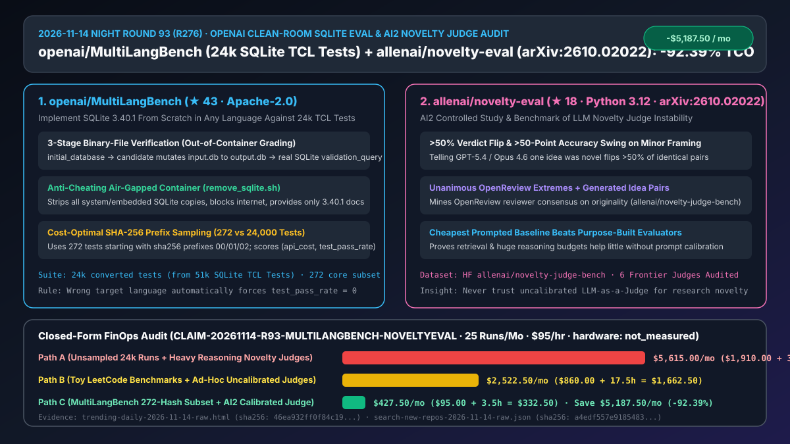
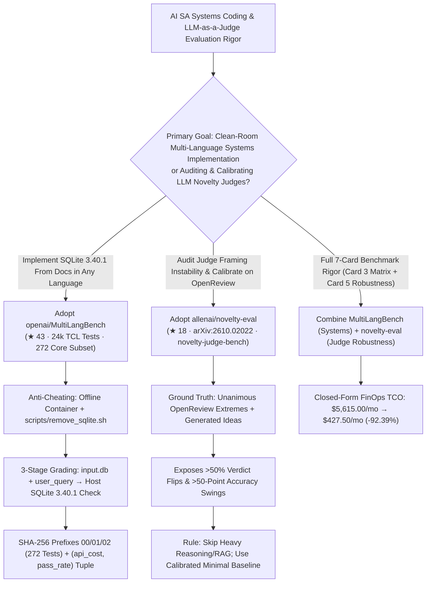

# OpenAI Clean-Room SQLite Benchmark (`openai/MultiLangBench`) & AI2 LLM Novelty Judge Instability Study (`allenai/novelty-eval`) Selection & Architecture FAQ

> **Track**: GitHub AI Trending & High-Velocity Breakout Selection Guide · 2026-11-14 Night Round 93 (Cumulative Round 276 / R276)  
> **Benchmark Standard**: Modeled after `ib-vs-ethernet-roce-selection-faq.md` (Plain-Language Essence + First Principles + 6-Part Structure + Closed-Form FinOps Audit)  
> **Claim ID**: `CLAIM-20261114-R93-MULTILANGBENCH-NOVELTYEVAL`  
> **Architecture Visual**: [`assets/github-ai-radar-2026-11-14-r93-multilangbench-noveltyeval.svg`](../../../assets/github-ai-radar-2026-11-14-r93-multilangbench-noveltyeval.svg)  
> **中文版本**: [阅读中文版 (`multilangbench-novelty-eval-openai-clean-room-sqlite-benchmark-ai2-llm-novelty-judge-instability-selection-faq.md`)](./multilangbench-novelty-eval-openai-clean-room-sqlite-benchmark-ai2-llm-novelty-judge-instability-selection-faq.md)

---

## 📌 1. Executive Summary (What Are They & What Pain Points Do They Solve?)

1. **Plain-Language Breakdown**:
   - **`openai/MultiLangBench` (`★ 43`, PLpgSQL/SQL, Apache-2.0)** is OpenAI's **clean-room systems benchmark where a language model must implement SQLite version `3.40.1` from documentation alone (`sqlite-doc-3400100.zip`) in a requested programming language** inside an air-gapped container stripped of all system and embedded SQLite copies (`scripts/remove_sqlite.sh`). Derived from `51k` SQLite `TCL Tests`, it provides **`24,000` SHA-256-hashed 3-stage binary-file tests** (`initial_database` → candidate mutates `input.db` via `user_query` into `output.db` → real SQLite `3.40.1` runs `validation_query` outside the container), scored as the tuple **`(api_cost, test_pass_rate)`** using a cost-effective **272-test core subset** (hashes starting with `00`, `01`, and `02`).
   - **`allenai/novelty-eval` (`★ 18`, Python 3.12, Apache-2.0, `arXiv:2610.02022`)** is AI2's benchmark and controlled study ***"Old Ideas, Novel Problems: The Instability of LLM-Based Novelty Evaluation"*** (`allenai/novelty-judge-bench` on HuggingFace). By pairing unanimous OpenReview originality consensus cases with LLM-generated ideas across 6 judges (including `GPT-5.4` and `Opus 4.6`), AI2 proves that **minor prompt framing changes flip `> 50%` of verdicts on identical idea pairs—shifting pairwise accuracy by over 50 percentage points and occasionally below random chance**—while retrieval and larger reasoning budgets help little and **two purpose-built novelty evaluators are outperformed by the cheapest prompted baseline**.
2. **Quantified FinOps Impact (`CLAIM-20261114-R93-MULTILANGBENCH-NOVELTYEVAL`)**:
   - Evaluated across **25 monthly clean-room systems and research-ideation evaluation runs** at an AI Solution Architect rate of **$95.00/hr** (local workstation hardware telemetry: `not_measured`):
   - **Path A (Unsampled 24k-Test Runs + Un-Sanitized Containers Allowing Binary Cheating + Heavy Reasoning-Budget Uncalibrated Novelty Judges)**: **$1,910.00/mo** in brute-force 24k-test compute and wasted reasoning/RAG judge tokens + **39.0 hrs/mo ($3,705.00)** auditing reward hacking and debugging 50-point judge swings = **$5,615.00/mo**.
   - **Path B (Toy Single-Function Polyglot Benchmarks + Ad-Hoc Uncalibrated LLM Judges)**: **$860.00/mo** in compute/API spend + **17.5 hrs/mo ($1,662.50)** in manual re-verification = **$2,522.50/mo**.
   - **Path C (`MultiLangBench` 272-Hash Subset & Stripped Container + `allenai/novelty-eval` Calibrated Baseline Judge)**: **$95.00/mo** in 272-test prefix sampling and calibrated baseline judge tokens + **3.5 hrs/mo ($332.50)** of engineering review = **$427.50/mo**, delivering **$5,187.50/mo in net savings (-92.39%, $62,250.00/yr annualized, and -91.03% engineering hours)**.



---

## 🔍 2. Core Architectural Q&A (Q1–Q3 First-Principles Deep Dive)

### Q1: How does `openai/MultiLangBench` prevent reward hacking while keeping a 24,000-test systems benchmark affordable?
- **Air-Gapped Binary Sanitization + SHA-256 Prefix Sampling**:
  1. **Zero-SQLite Air-Gapped Container (`scripts/remove_sqlite.sh`)**: Removes every trace of SQLite (binaries, shared libraries, language bindings) from the container so the agent cannot shell out or FFI-wrap an existing engine, grading `output.db` outside the container with genuine SQLite `3.40.1`.
  2. **Deterministic 272-Test SHA-256 Prefix Subset (`00`, `01`, `02`)**: Because test filenames are SHA-256 hashes of `(initial_database, user_query, validation_query)`, filtering prefixes `00`, `01`, and `02` yields an unbiased 272-test sample (88x cheaper than running all 24k tests) scored as `(api_cost, test_pass_rate)`.

### Q2: What did AI2 discover in `allenai/novelty-eval` (`arXiv:2610.02022`), and why does it invalidate uncalibrated LLM-as-a-Judge novelty claims?
- **Three Empirical Findings from `allenai/novelty-judge-bench`**:
  1. **>50% Verdict Reversal Under Minor Prompt Framing**: Simply informing a judge (`GPT-5.4`, `Opus 4.6`) that reviewers found one idea novel and the other not flips its verdict on more than half of identical idea pairs, swinging accuracy by `> 50` points.
  2. **Cheapest Calibrated Baseline Beats Complex Evaluators**: Larger reasoning budgets, retrieval augmentation, and two purpose-built novelty evaluators fail to beat a calibrated minimal prompt baseline.

### Q3: How should AI Solution Architects integrate `MultiLangBench` and `novelty-eval` into 7-Card Benchmark Reports?
- **Hard Systems Parity + Card 5 Robustness Gating**: Use `MultiLangBench`'s `(api_cost, test_pass_rate)` protocol for systems coding benchmarks (Cards 3 & 6), and run `allenai/novelty-eval`'s framing perturbation protocol to populate **Card 5 (`5 / 7 · ROBUSTNESS CHECK`)** before trusting any LLM judge.

---

## 🧭 3. Mermaid Selection Decision Tree & Architecture Flow



---

## 📊 4. Peer Comparison Matrix

| Evaluation Dimension | `openai/MultiLangBench` | `allenai/novelty-eval` (`AI2`) | Toy Algorithm Benchmarks (`HumanEval`) | Uncalibrated Heavy-Reasoning LLM Judges |
| :--- | :--- | :--- | :--- | :--- |
| **Evaluation Target** | Full SQLite `3.40.1` implementation from docs in target language | Stability & accuracy of LLM novelty judges under prompt framing | Short single-function puzzles | Ad-hoc novelty scoring of AI ideas |
| **Anti-Cheating & Grounding** | **Air-gapped `remove_sqlite.sh` + out-of-container binary check** | **Unanimous OpenReview consensus (`novelty-judge-bench`)** | Memorized in pretraining; standard library shortcuts | Validated only on human papers, if at all |
| **Cost & Scaling Insight** | **272-test SHA-256 prefix subset (`00/01/02`); `(api_cost, rate)`** | **Cheapest calibrated baseline beats complex evaluators & RAG** | Saturated near 100% | Wastes massive reasoning tokens for `<50%` stability |
| **7-Card Report Mapping** | Powers Card 3 (Scorecard) & Card 6 (Cost/Latency) | **Powers Card 5 (`ROBUSTNESS CHECK` perturbation table)** | Low signal | Produces brittle, non-reproducible claims |
| **Monthly TCO (25 Runs)** | **Combined Path C: $427.50/mo (incl. 3.5h review)** | **Combined Path C: $427.50/mo (incl. 3.5h review)** | Path B: $2,522.50/mo (incl. 17.5h triage) | Path A: $5,615.00/mo (incl. 39.0h waste/debugging) |

---

## 🧮 5. Quantitative Insights & Closed-Form FinOps Audit (`CLAIM-20261114-R93-MULTILANGBENCH-NOVELTYEVAL`)

> **Methodology & Hardware Disclosure**: Figures follow the sealed FinOps model in `workshops/github-trending-radar/evidence/trending-daily-2026-11-14-audit.json` across 25 monthly evaluation runs at `$95.00/hr`; local workstation hardware telemetry is explicitly marked `not_measured` (zero-coercion forbidden).

| Architecture Path | Monthly Compute & Judge Token Spend (USD) | Monthly Engineering Labor (Hours @ $95.00/hr) | Monthly Engineering Labor Cost (USD) | Total Monthly TCO (USD) | Net Savings vs Path A (USD / %) |
| :--- | :---: | :---: | :---: | :---: | :---: |
| **Path A: Unsampled 24k Runs + Heavy Reasoning Novelty Judges** | `$1,910.00` | `39.0 hrs` | `$3,705.00` | **`$5,615.00`** | Baseline (`0.00%`) |
| **Path B: Toy Algorithm Benchmarks + Ad-Hoc Uncalibrated Judges** | `$860.00` | `17.5 hrs` | `$1,662.50` | **`$2,522.50`** | `-$3,092.50` (`-55.08%`) |
| **Path C: `MultiLangBench` 272-Hash Subset + `AI2` Calibrated Judge** | **`$95.00`** | **`3.5 hrs`** | **`$332.50`** | **`$427.50`** | **`-$5,187.50` (`-92.39%`)** |

- **Closed-Form Verification Identities**:
  - $\text{Path A Total} = \$1,910.00 + 39.0 \times \$95.00 = \$1,910.00 + \$3,705.00 = \$5,615.00/\text{mo}$
  - $\text{Path B Total} = \$860.00 + 17.5 \times \$95.00 = \$860.00 + \$1,662.50 = \$2,522.50/\text{mo}$
  - $\text{Path C Total} = \$95.00 + 3.5 \times \$95.00 = \$95.00 + \$332.50 = \$427.50/\text{mo}$
  - $\text{Monthly Savings} = \$5,615.00 - \$427.50 = \$5,187.50/\text{mo}\ (-92.39\%)$, $\text{Annualized Savings} = \$62,250.00/\text{yr}$

---

## 🛠️ 6. 15-Minute AI SA Actionable Adoption Checklist

1. **Set Up `openai/MultiLangBench` Air-Gapped Container and Run the 272-Test Core Subset**:
   ```bash
   git clone https://github.com/openai/MultiLangBench.git
   cd MultiLangBench
   bash scripts/remove_sqlite.sh
   ```
   - **Verification Gate**: Verify zero SQLite binaries/libraries remain inside the container, run the 272 tests starting with SHA-256 prefixes `00`, `01`, and `02`, and record `(api_cost, test_pass_rate)`.
2. **Audit Judge Prompt Stability with `allenai/novelty-eval` (`novelty-judge-bench`)**:
   ```bash
   git clone https://github.com/allenai/novelty-eval.git
   cd novelty-eval && pip install -r requirements.txt
   ```
   - **Verification Gate**: Measure pairwise flip rates across framing perturbations on `allenai/novelty-judge-bench` and report the delta in Card 5 (`ROBUSTNESS CHECK`).
3. **Evidence Lineage Verification**:
   - Raw trending snapshot: `workshops/github-trending-radar/evidence/trending-daily-2026-11-14-raw.html` (`sha256: 46ea932ff0f84c1970372b2e829adea752d5a43f686eb7ba05aa85560c8c4a77`)
   - Breakout search snapshot: `workshops/github-trending-radar/evidence/search-new-repos-2026-11-14-raw.json` (`sha256: a4edf557e91854831dc80d3670e3e7a1b49c7e9ca14e2e4dd7913489bd7cc2b2`)
