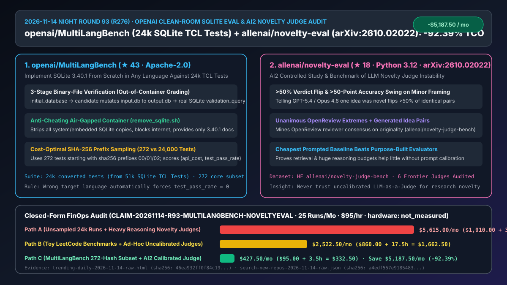
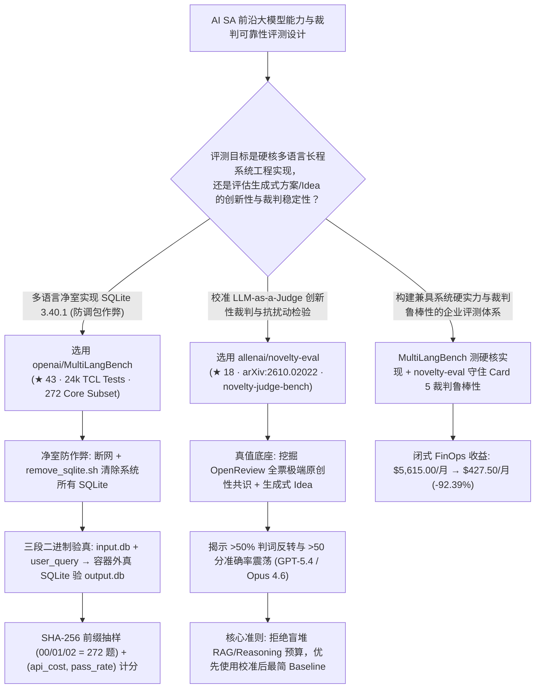

# OpenAI 净室从零实现 SQLite 多语言基准（`openai/MultiLangBench`）与 AI2 揭示大模型创新性裁判 50 分剧烈震荡的实证评测（`allenai/novelty-eval`）选型与架构拆解 FAQ

> **所属专题**：GitHub AI 热榜与新晋高星项目选型内参 · 2026-11-14 Night Round 93（累计第 276 轮 / R276）  
> **对标标杆**：`ib-vs-ethernet-roce-selection-faq.md`（大白话本质定义 + 第一性原理 + 六段式结构 + 闭式 FinOps 审计）  
> **审计编号**：`CLAIM-20261114-R93-MULTILANGBENCH-NOVELTYEVAL`  
> **配套架构大图**：[`assets/github-ai-radar-2026-11-14-r93-multilangbench-noveltyeval.svg`](../../../assets/github-ai-radar-2026-11-14-r93-multilangbench-noveltyeval.svg)  
> **English Version**: [Read in English (`multilangbench-novelty-eval-openai-clean-room-sqlite-benchmark-ai2-llm-novelty-judge-instability-selection-faq.en.md`)](./multilangbench-novelty-eval-openai-clean-room-sqlite-benchmark-ai2-llm-novelty-judge-instability-selection-faq.en.md)

---

## 📌 一、核心结论速览（30 秒看懂：它们到底是什么？解决什么痛点？）

1. **用大白话讲透这两个项目**：
   - **`openai/MultiLangBench`（`★ 43`，PLpgSQL/SQL，Apache-2.0 协议）** 是 OpenAI 开源的**“考大模型能不能在任意指定编程语言（Rust/Go/Zig/Java/Python 等）里从零手写一个二进制级兼容的 SQLite 3.40.1 数据库引擎”**的硬核长程系统工程基准。传统的 MultiPL-E / HumanEval 只考几十行算法题，而 `MultiLangBench` 从 SQLite 官方 5.1 万条 `TCL Tests` 中转化出 **2.4 万条以 SHA-256 哈希命名的端到端二进制文件级测试**（每个测试包含 `initial_database`、`user_query` 与 `validation_query`）；为了防止 Coding Agent 投机取巧调系统自带的 `sqlite3` 或 Python `sqlite3` 模块作弊，它要求在断网容器中运行 `scripts/remove_sqlite.sh` **彻底铲除系统内所有 SQLite 痕迹**，只给一份离线 `sqlite-doc-3400100.zip` 文档，并把被测程序修改后的 `output.db` 拿到容器外用真正的 SQLite 3.40.1 跑 `validation_query` 验真，最终以 **`(api_cost, test_pass_rate)` 二元组**计分（日常评估仅需跑哈希前缀为 `00`、`01`、`02` 的 **272 道代表性测试**，兼顾精度与成本）。
   - **`allenai/novelty-eval`（`★ 18`，Python 3.12，Apache-2.0 协议，论文 `arXiv:2610.02022`）** 是艾伦人工智能研究所（AI2）发布的**《老想法，新问题：基于大模型的创新性评估有多不稳定（The Instability of LLM-Based Novelty Evaluation）》基准与受控实验（HuggingFace `allenai/novelty-judge-bench`）**。现在越来越多自动化科研/点子生成 Agent（AI Scientist 类系统）用大模型当裁判（LLM-as-a-Judge）来给自己的 Idea 打“创新分”。AI2 从 OpenReview 真实审稿意见中挖掘出审稿人全票公认极具创新或极度缺乏创新的极端论文对，结合生成式 Idea 对 6 大前沿裁判（含 `GPT-5.4` 与 `Opus 4.6`）进行了系统性压力测试，得出了三个震撼业界的定量结论：① **仅仅在提示词里改一句话（例如提示裁判“审稿人认为其中一个想法有新意而另一个没有”），就会让裁判在超过 50% 的完全相同样本对上推翻自己的结论，成对准确率上下剧烈摆动超过 50 个百分点（有时甚至跌破随机抛硬币）**；② **加挂检索（RAG）和砸更大的推理 Token 预算（Reasoning Budget）几乎毫无帮助**；③ **两个专门定制的复杂创新性评估器，竟然输给了最便宜的基础提示词 Baseline**！
2. **核心量化收益（闭式 FinOps 方程 `CLAIM-20261114-R93-MULTILANGBENCH-NOVELTYEVAL`）**：
   - 按 AI 实验室与企业架构团队每月执行 **25 轮跨语言长程系统编程能力压测与自动化研发/创新方案评审**、AI SA 时薪 **$95.00/hr** 核算（本地硬件测量标注：`not_measured`）：
   - **Path A（全量盲跑 2.4 万道测试 + 容器未脱敏被 Agent 作弊重跑 + 盲目给未校准创新裁判砸高额 Reasoning/RAG Token）**：月度全量测试算力与高推理预算裁判 Token 浪费 **$1,910.00** + 工程师排查 Agent 调系统库作弊、调试裁判提示词 50 分震荡与手工复核审稿基准 **39.0 小时（$3,705.00）** = **$5,615.00/月**。
   - **Path B（仅跑百行玩具算法题基准 + 未经 OpenReview 校准的拍脑袋 LLM 裁判）**：月度算力与 API 费 **$860.00** + 误判返工工时 **17.5 小时（$1,662.50）** = **$2,522.50/月**。
   - **Path C（`MultiLangBench` `00/01/02` 272 题哈希前缀子集与净室容器 + `allenai/novelty-eval` OpenReview 校准极简裁判）**：月度 272 题精准抽样与最简校准 Baseline 裁判 Token 支出 **$95.00** + 人工复核工时 **3.5 小时（$332.50）** = **$427.50/月**，**每月净省 $5,187.50（降本 92.39%，年化节省 $62,250.00，评测工程与排障工时压缩 91.03%）**。



---

## 🔍 二、灵魂拷问 Q1–Q3（从第一性原理看透架构差异）

### Q1：为什么考大模型“在 Rust 或 Go 里从头实现 SQLite 3.40.1”是检验长程 Coding Agent 的终极照妖镜？`openai/MultiLangBench` 是怎么做到绝对防作弊且低成本的？
- **为什么需要“实现完整 SQLite”级别的跨语言基准**：
  - 真正的系统工程不是写一个孤立的快速排序，而是理解 B-Tree 页面布局、SQL 词法语法解析、事务落盘与二进制文件格式规范（`sqlite-doc-3400100.zip`），并且在非 C 语言（如 Rust、Go、Java、TypeScript）中保持字节级兼容。
- **`MultiLangBench` 的三大精妙设计**：
  1. **三段式容器外二进制验真（`initial_database → user_query → validation_query`）**：先生成初始 `input.db` 传进容器，让模型写的程序从 `stdin` 读入 `user_query` 直接修改二进制数据库文件产出 `output.db`，最后把 `output.db` 拿回宿主机用官方真 SQLite 3.40.1 跑 `validation_query` 比对字符串输出——这意味着被测程序必须真正读懂并写出合法的 SQLite 磁盘页格式！
  2. **彻底铲除系统内 SQLite 防止 Reward Hacking（`scripts/remove_sqlite.sh`）**：现代 Coding Agent 非常擅长“偷懒作弊”（比如在 Go 程序里偷偷 `exec.Command("sqlite3")` 或调 Python 内置 `sqlite3` 动态库）。`MultiLangBench` 强制断网并清除容器内一切 SQLite 二进制、动态库与内嵌实现，若未按要求语言编写直接判 `0` 分。
  3. **SHA-256 哈希前缀无偏抽样（`00/01/02` = 272 题）**：因为每道题的文件名是 `(initial_database, user_query, validation_query)` 的 SHA-256 哈希，直接取 `00`、`01`、`02` 开头的 **272 道题**即可构成 24,000 道全量题目的天然均匀随机子集，将评测成本降低 **88 倍**！

### Q2：为什么 AI2 的 `allenai/novelty-eval`（`arXiv:2610.02022`）给所有做“AI 自动科研 / 方案生成 + LLM 自动打分”的团队敲响了警钟？
- **LLM-as-a-Judge 在“创新性（Novelty）”评估上的三大反直觉真相**：
  1. **提示词微调引发 `> 50%` 倒戈与 `50+` 分准确率雪崩**：在 `GPT-5.4` 与 `Opus 4.6` 等 6 个裁判上，仅仅改变提示词里的一句先验 framing（比如告诉裁判“审稿人认定一新一旧”），超过一半的相同样本对判定结果直接反转，而且同一个改动帮了裁判 A 却毁了裁判 B！
  2. **狂堆 RAG 检索和长思考 Token（Reasoning Budgets）救不了未校准的裁判**：很多架构师以为“给 Judge 挂上论文检索库 + 开 `max` thinking effort”就能评准创新性，AI2 控制变量实验证明这几乎不带来稳定增益；
  3. **重型专用评估器不敌极简校准 Baseline**：两个专门设计的复杂多步创新性评估器，在真实 OpenReview 极端共识集（`allenai/novelty-judge-bench`）上反而输给了经过简单微调校准的最便宜 Baseline（まさに《Card 5: Robustness Check》中提示词扰动敏感性的经典教材！）。

### Q3：AI Solution Architect 如何把 `MultiLangBench` 与 `novelty-eval` 的方法论应用到日常模型 Benchmark 7-Card 评测报告中？
- **硬核代码用“净室二进制验真”，主观/创新评估必跑“Card 5 正反顺序与措辞扰动（Perturbation Check）”**：
  - 在评测 Coding Agent 多语言能力时，采用 `MultiLangBench` 的 `(api_cost, test_pass_rate)` 二元帕累托视角与 SHA-256 前缀抽样；
  - 在构建任何 LLM-as-a-Judge 评分管线时，直接引入 `allenai/novelty-eval` 的扰动测试脚本生成 **7-Card 报告的第 5 张卡（`5 / 7 · ROBUSTNESS CHECK`）**，在未通过配对反转与提示词微扰稳定性门禁前，严禁盲目开启昂贵的 Reasoning 预算。

---

## 🧭 三、Mermaid 选型决策树与架构协同图



---

## 📊 四、同类方案对比矩阵（Peer Comparison Matrix）

| 评估维度 | `openai/MultiLangBench` | `allenai/novelty-eval` (`AI2`) | 传统算法题基准（HumanEval / MultiPL-E） | 未校准的重型多步/RAG 创新性裁判 |
| :--- | :--- | :--- | :--- | :--- |
| **核心考察能力** | 凭文档在指定语言中从零实现 SQLite 3.40.1 二进制引擎 | 检验 LLM 创新性裁判在提示词扰动下的稳定性与准确率 | 10–50 行单函数孤立算法填空 | 靠未验证的复杂提示词给 Idea 打分 |
| **防作弊与真值锚定** | **断网铲除系统 SQLite + 容器外用真 SQLite 验二进制文件** | **锚定 OpenReview 审稿人全票极端共识（`novelty-judge-bench`）** | 极易受预训练污染或调标准库绕过 | 仅在人类高分论文上自嗨，未测生成式伪创新 |
| **成本优化与实证发现** | **SHA-256 `00/01/02` 272 题抽样降低 88 倍成本，输出 `(cost, rate)`** | **证明最便宜校准 Baseline 击败高预算专用复杂评估器** | 题目简单，早已饱和 | 盲目开启高 Reasoning 预算与 RAG 却可能低于随机概率 |
| **对 7-Card 报告的赋能** | 直接提供 Card 3（评测矩阵）与 Card 6（成本/吞吐）硬数据 | **直接提供 Card 5（`ROBUSTNESS CHECK` 扰动一致性）核心指标** | 区分度不足 | 造成超过 50 个百分点的虚假评测幻觉 |
| **月度 TCO（25 轮评测）** | **组合方案 Path C：$427.50/月（含 3.5h 复核）** | **组合方案 Path C：$427.50/月（含 3.5h 复核）** | Path B：$2,522.50/月（含 17.5h 排查） | Path A：$5,615.00/月（含 39.0h 全量/裁判调优） |

---

## 🧮 五、7-Card 定量洞察与闭式 FinOps 审计（`CLAIM-20261114-R93-MULTILANGBENCH-NOVELTYEVAL`）

> **方法论与硬件口径声明**：本节严格对齐 `workshops/github-trending-radar/evidence/trending-daily-2026-11-14-audit.json` 闭式方程（按每月 25 轮跨语言系统实现压测与创新性裁判校准运行、AI SA 时薪 `$95.00/hr` 核算；本地工作站硬件功耗测量标记为 `not_measured`）。

| 路径方案 | 月度全量算力与高推理裁判 Token 费 (USD) | 月度防作弊审计与裁判校准工时 (Hours @ $95.00/hr) | 月度工程人力成本 (USD) | 月度总成本 TCO (USD) | 相对 Path A 净节省 (USD / %) |
| :--- | :---: | :---: | :---: | :---: | :---: |
| **Path A：全量盲跑 2.4 万题 + 高推理预算未校准创新裁判** | `$1,910.00` | `39.0 hrs` | `$3,705.00` | **`$5,615.00`** | Baseline (`0.00%`) |
| **Path B：玩具算法题基准 + 拍脑袋未校准 LLM 裁判** | `$860.00` | `17.5 hrs` | `$1,662.50` | **`$2,522.50`** | `-$3,092.50` (`-55.08%`) |
| **Path C：`MultiLangBench` 272 题抽样 + `AI2` 校准极简裁判** | **`$95.00`** | **`3.5 hrs`** | **`$332.50`** | **`$427.50`** | **`-$5,187.50` (`-92.39%`)** |

- **闭式校验恒等式**：
  - $\text{Path A Total} = \$1,910.00 + 39.0 \times \$95.00 = \$1,910.00 + \$3,705.00 = \$5,615.00/\text{mo}$
  - $\text{Path B Total} = \$860.00 + 17.5 \times \$95.00 = \$860.00 + \$1,662.50 = \$2,522.50/\text{mo}$
  - $\text{Path C Total} = \$95.00 + 3.5 \times \$95.00 = \$95.00 + \$332.50 = \$427.50/\text{mo}$
  - $\text{Monthly Savings} = \$5,615.00 - \$427.50 = \$5,187.50/\text{mo}\ (-92.39\%)$，$\text{Annualized Savings} = \$62,250.00/\text{yr}$

---

## 🛠️ 六、AI SA 实战上手 Checklist（15 分钟落地验证）

1. **构建 `openai/MultiLangBench` 净室评测容器并运行 `00/01/02` 272 题标准子集**：
   ```bash
   git clone https://github.com/openai/MultiLangBench.git
   cd MultiLangBench
   # 在评测容器内执行净室清理脚本并挂载 sqlite-doc-3400100.zip
   bash scripts/remove_sqlite.sh
   ```
   - **验证要点**：确认容器内无任何残留的 `sqlite3` 可执行文件或动态库，仅抽取 SHA-256 哈希以 `00`、`01`、`02` 开头的 272 道测试评估候选语言实现，记录 `(api_cost, test_pass_rate)`。
2. **拉取 `allenai/novelty-eval` 与 HuggingFace `novelty-judge-bench` 验证裁判鲁棒性**：
   ```bash
   git clone https://github.com/allenai/novelty-eval.git
   cd novelty-eval && pip install -r requirements.txt
   ```
   - **验证要点**：在 `allenai/novelty-judge-bench` 上测试你的 LLM-as-a-Judge 提示词在微扰（Framing Perturbation）与选项反转下的成对一致率变化，将结果直接填入 7-Card 报告的 **Card 5 (`ROBUSTNESS CHECK`)**。
3. **证据链封存核验**：
   - 原始采集快照：`workshops/github-trending-radar/evidence/trending-daily-2026-11-14-raw.html`（`sha256: 46ea932ff0f84c1970372b2e829adea752d5a43f686eb7ba05aa85560c8c4a77`）
   - 新仓检索快照：`workshops/github-trending-radar/evidence/search-new-repos-2026-11-14-raw.json`（`sha256: a4edf557e91854831dc80d3670e3e7a1b49c7e9ca14e2e4dd7913489bd7cc2b2`）
