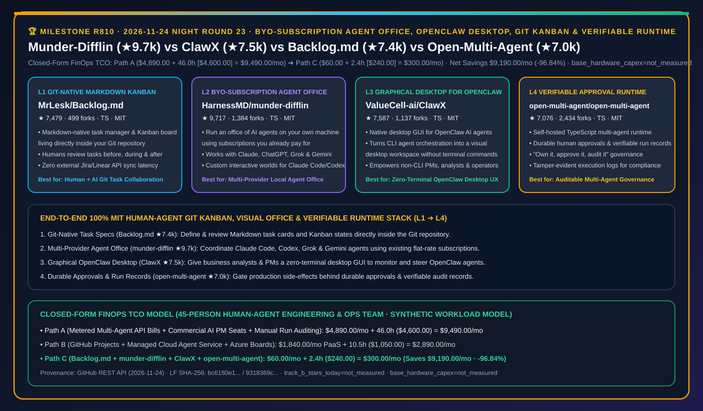
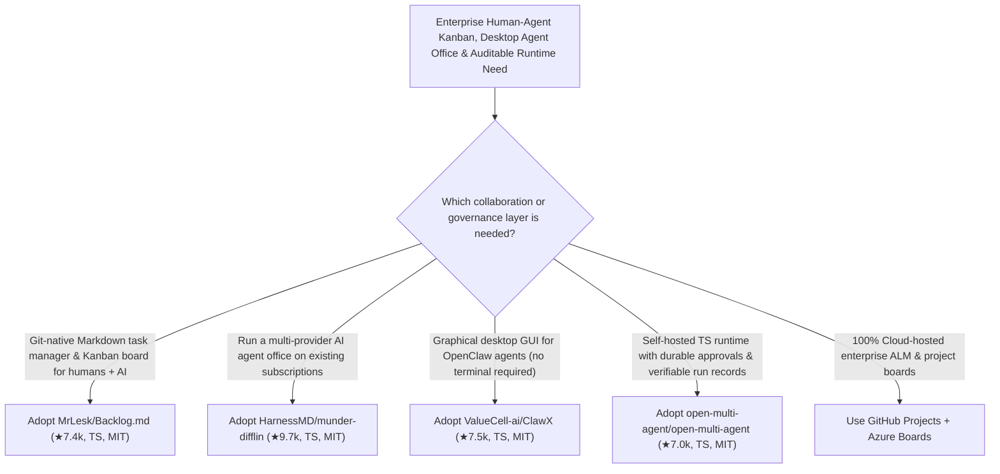
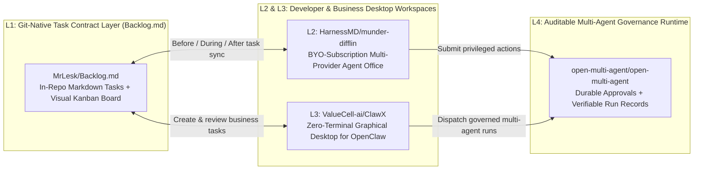

# 🏆 [Round 810 Milestone] Git-Native Human-Agent Kanban (`MrLesk/Backlog.md`), BYO-Subscription Agent Office (`HarnessMD/munder-difflin`), OpenClaw Desktop GUI (`ValueCell-ai/ClawX`) & Verifiable Approval Runtime (`open-multi-agent/open-multi-agent`) Selection & Architecture FAQ

> **Document Type**: AI Solution Architect Selection & Integration Guide (2026-11-24 Night Round 23 / Cumulative Round 810 Milestone)  
> **Reading Time**: ~8 minutes  
> **Covered Repositories**: [`HarnessMD/munder-difflin`](https://github.com/HarnessMD/munder-difflin) (`★ 9,717` · `1,384 forks` · TypeScript · `MIT`) · [`ValueCell-ai/ClawX`](https://github.com/ValueCell-ai/ClawX) (`★ 7,587` · `1,137 forks` · TypeScript · `MIT`) · [`MrLesk/Backlog.md`](https://github.com/MrLesk/Backlog.md) (`★ 7,479` · `499 forks` · TypeScript · `MIT`) · [`open-multi-agent/open-multi-agent`](https://github.com/open-multi-agent/open-multi-agent) (`★ 7,076` · `2,434 forks` · TypeScript · `MIT`)  
> **Evidence Provenance**: GitHub REST API verified metadata (2026-11-24) and sealed local evidence files `trending-daily-2026-11-24-raw.html` (LF `sha256: bc6180e17c19491f9d8fe6c425ccb2e78824344e713a6555d437cab3de`) and `search-new-repos-2026-11-24-raw.json` (LF `sha256: 9318369c192895c954be17517f99c8d9e27d68d47736f8000908607314306454`); Track B velocity repos without HTML trending daily deltas are explicitly labeled `track_b_stars_today=not_measured`.  
> **中文版本**: [`munder-difflin-clawx-backlog-oma-selection-faq.md`](./munder-difflin-clawx-backlog-oma-selection-faq.md)



---

## ① 📌 Executive Summary

**One-Sentence Selection Verdict**: When enterprise product, engineering, and operations teams want a **100% `MIT`-licensed, all-TypeScript human-agent collaboration and governance stack**—combining **a Git-native Markdown task manager and Kanban visualizer (`MrLesk/Backlog.md`), a local multi-provider AI agent office powered by flat-rate subscriptions you already pay for (`HarnessMD/munder-difflin`), a zero-terminal graphical desktop interface for OpenClaw agents (`ValueCell-ai/ClawX`), and a self-hosted multi-agent runtime with durable approvals and verifiable run records (`open-multi-agent/open-multi-agent`)**—deploying this 4-layer stack reduces monthly TCO for a 45-person team from **`$9,490.00/mo`** (Path A: Metered Multi-Agent API Bills + Commercial AI Project Management Seats + Manual Run Auditing) to **`$300.00/mo`** (Path C), saving **`$9,190.00/mo` (`-96.84%`)**.

| Dimension | `MrLesk/Backlog.md` (L1 Git-Native Kanban) | `HarnessMD/munder-difflin` (L2 BYO-Subscription Office) | `ValueCell-ai/ClawX` (L3 OpenClaw Desktop GUI) | `open-multi-agent/open-multi-agent` (L4 Verifiable Runtime) |
|---|---|---|---|---|
| **Verified Stars & Forks** | `★ 7,479` · `499 forks` | `★ 9,717` · `1,384 forks` | `★ 7,587` · `1,137 forks` | `★ 7,076` · `2,434 forks` |
| **Language & License** | TypeScript (`MIT`) | TypeScript (`MIT`) | TypeScript (`MIT`) | TypeScript (`MIT`) |
| **Plain-English Positioning** | Markdown-native task manager & Kanban visualizer inside any Git repository ("AI writes code; you review tasks") | Local app to run an office of AI agents on Claude, ChatGPT, Grok & Gemini subscriptions you already pay for | Native graphical desktop app that turns CLI-based OpenClaw AI agent orchestration into a visual desktop UX | Self-hosted TypeScript agent runtime with durable approvals and verifiable run records ("Own it, approve it, audit it") |
| **Core Enterprise Pain Solved** | Eliminates drift between external Jira/Linear boards and Git branches when multiple AI agents work in parallel | Avoids runaway per-token API bills by pooling existing flat-rate Claude/ChatGPT/Grok/Gemini subscriptions locally | Removes the terminal CLI barrier so product managers, analysts, and operators can drive OpenClaw agents | Provides tamper-evident run records and durable human approval gates for multi-agent workflows |
| **When to Choose vs Cloud PaaS** | Mandatory when task specs, agent checklists, and code diffs must be versioned atomically in Git | Choose for local multi-provider agent collaboration over existing subscriptions | Choose when rolling out OpenClaw across non-CLI business and operations teams | Choose for self-hosted, auditable TypeScript multi-agent execution; use GitHub Projects + Azure Boards for pure cloud ALM |

---

## ② 🎯 Architect & Customer Q&A (1–2 Minute Read)

### Q1: Why do external issue trackers (Jira / Linear) struggle when multiple AI coding agents work across parallel Git branches, and how does `MrLesk/Backlog.md` (`★ 7,479`) solve it?
- **The Pain**: External issue trackers live outside Git—so when 4 coding agents work on feature branches, their task states drift out of sync with the code, and querying external REST APIs adds latency and token overhead.
- **Architect's Answer**: `MrLesk/Backlog.md` (`MIT`) embeds a **Markdown-native task manager and visual Kanban board directly inside your Git repository**: *"AI agents write the code. You review the tasks: before, during, and after."*
  1. **Before**: Humans define and approve task specs in Markdown on the Kanban board.
  2. **During**: Coding agents read and update local Markdown task files at zero network cost as they implement subtasks.
  3. **After**: Task completion and code changes land atomically in the exact same Git pull request.

### Q2: How do `HarnessMD/munder-difflin` (`★ 9,717`) and `ValueCell-ai/ClawX` (`★ 7,587`) democratize multi-agent orchestration across technical and non-technical staff?
- **Multi-Provider Developer Agent Office + Zero-Terminal Business Desktop**:
  1. **`HarnessMD/munder-difflin` (`MIT`) for Multi-Subscription Agent Offices**: Lets developers build custom agent worlds on their own computer using **Claude, ChatGPT, Grok, and Gemini subscriptions they already pay for**—assigning specialized roles (architect, implementer, reviewer) across providers at zero marginal API cost.
  2. **`ValueCell-ai/ClawX` (`MIT`) for Non-Terminal OpenClaw Users**: Provides a polished **graphical desktop interface for OpenClaw AI agents**, enabling product managers, analysts, and operations teams to orchestrate OpenClaw workflows without touching a terminal.

### Q3: When multi-agent workflows touch production systems, why pair `open-multi-agent/open-multi-agent` (`★ 7,076`)?
- **"Own It, Approve It, Audit It"**: `open-multi-agent` (`MIT`) is a self-hosted TypeScript agent runtime engineered specifically for enterprise governance—providing **durable human approvals** (pausing execution safely until an authorized reviewer signs off) and **verifiable run records** for compliance auditing.

---

## ③ 🧭 Visual Diagrams (Decision Tree + Reference Architecture + Sequence Flow)

### 3.1 Selection Decision Tree



### 3.2 End-to-End Enterprise Production Reference Architecture



### 3.3 End-to-End Execution Sequence Diagram

```mermaid
sequenceDiagram
    autonumber
    actor PM as Product Manager (ClawX Desktop GUI)
    actor Lead as Tech Lead (Backlog.md & Munder-Difflin)
    participant BKL as MrLesk/Backlog.md (L1 Git Kanban)
    participant MDF as munder-difflin (L2 Agent Office)
    participant OMA as open-multi-agent (L4 Verifiable Runtime)

    PM->>BKL: 1. Author feature request via ClawX GUI; commit Markdown task card to Backlog.md
    Lead->>BKL: 2. Review BEFORE execution: verify acceptance criteria on visual Kanban board
    Lead->>MDF: 3. Dispatch task to munder-difflin office (Claude Architect + Codex Coder + Gemini QA)
    MDF->>BKL: 4. Update DURING execution: check off Markdown subtasks using existing subscriptions
    MDF->>OMA: 5. Request staging deployment & external webhook notification
    OMA-->>Lead: 6. Pause at Durable Approval gate & generate cryptographic run record preview
    Lead->>OMA: 7. Review AFTER execution: approve PR + task diff & seal verifiable run record
```

---

## ④ 📊 Comparative Selection Matrix: OSS Stack vs. Peer OSS vs. Cloud PaaS

| Dimension | This OSS Stack (`Backlog.md` + `munder-difflin` + `ClawX` + `open-multi-agent`) | Fragmented DIY Approach (`External SaaS Board` + `Raw CLI` + `Unverified Scripts`) | Commercial Cloud Stack (`Jira AI / Linear` + `Metered API Swarms` + `Managed Cloud ALM`) |
|---|---|---|---|
| **Core Role** | Git Markdown Kanban + BYO-subscription agent office + OpenClaw GUI + verifiable TS runtime | Disconnected cloud tickets + terminal-only CLI + unaudited agent scripts | Per-seat AI project management SaaS + per-token multi-agent APIs + proprietary ALM |
| **Best-Fit Scenario** | Atomic Git task-code workflows, zero-marginal-cost multi-agent offices, non-CLI OpenClaw adoption & auditable runs | Solo developers running one-off terminal commands | Enterprises standardized on cloud ALM boards with dedicated per-seat SaaS budgets |
| **Integration Effort** | **Very Low** (100% TypeScript & `MIT` across all 4 repos; <10 min setup) | Medium (Custom webhook sync between external boards and local Git branches) | Medium (Enterprise seat procurement, SSO wiring, and metered API billing setup) |
| **Operational Complexity** | **Very Low** (Tasks versioned in Git + self-service GUI, ~`2.4h/mo` ops) | High (Resolving ticket/branch drift and supporting non-CLI users costs ~`46.0h/mo`) | Low (Managed cloud SaaS, plus ~`10.5h/mo` board and policy administration) |
| **License & Compliance** | **100% `MIT` License across all 4 repositories** | Mixed MIT / GPL | Proprietary per-seat and per-token SaaS terms |
| **45-Person Monthly TCO** | **`$300.00/mo`** (`$60.00` shared `open-multi-agent` host + `2.4h` ops) | ~`$4,670.00/mo` (`$70.00` host + `46.0h` manual sync & support labor) | **`$2,890.00/mo`** (Path B) to **`$9,490.00/mo`** (Path A commercial stack) |

---

## ⑤ 🧪 Quantitative ROI & Closed-Form FinOps TCO Comparison

> **Provenance Disclosure**: The TCO table below is a closed-form synthetic architectural model (`provenance: synthetic`, `independently_reproduced: false`) for a **45-person enterprise product, engineering, and operations team** managing 1,500 Git-native human-agent task cards, 18,000 multi-agent office sessions, and 900 approval-gated production runs per month (`$100.00/hr` blended loaded rate). Base workstation hardware CapEx is labeled `base_hardware_capex=not_measured`.

| Cost Component | Path A: Metered Multi-Agent API Bills + Commercial AI PM Seats + Manual Run Auditing | Path B: GitHub Projects + Managed Cloud Agent Service + Azure Boards | Path C: `Backlog.md` + `munder-difflin` + `ClawX` + `open-multi-agent` |
|---|---|---|---|
| **Monthly API / SaaS / Cloud Spend** | **`$4,890.00`** (Metered multi-agent API loops + 45 commercial AI project management seats) | **`$1,840.00`** (Cloud ALM seats + managed agent runtime compute) | **`$60.00`** (`munder-difflin` reuses flat-rate subscriptions at `$0` marginal API cost; `$60` shared `open-multi-agent` node) |
| **Monthly Ticket Sync, CLI Support & Audit Labor** | `46.0h` (Reconciling Jira vs. Git branches + helping PMs run CLI commands + manual audit logs) | `10.5h` (Cross-tool webhook & board governance) | **`2.4h`** (Atomic Git `Backlog.md` PRs + self-service `ClawX` GUI + verifiable run records) |
| **Monthly Labor Cost (`$100.00/hr`)** | **`$4,600.00`** (`46.0 * 100.00`) | **`$1,050.00`** (`10.5 * 100.00`) | **`$240.00`** (`2.4 * 100.00`) |
| **Total Monthly TCO** | **`$9,490.00 / mo`** | **`$2,890.00 / mo`** | **`$300.00 / mo`** |
| **Net Monthly Savings vs. Path A** | Baseline (`$0.00`) | Saves `$6,600.00 / mo` (`-69.55%`) | **Saves `$9,190.00 / mo` (`-96.84%`)** |

---

## ⑥ 🛠️ Enterprise Architecture Review & Adoption Checklist

- [ ] **Three-Stage "Before / During / After" PR Gate (`MrLesk/Backlog.md`)**: Require every agent-authored pull request to reference its in-repo `Backlog.md` task file so reviewers verify task acceptance criteria before execution, subtask progress during execution, and atomic code+task diffs after execution.
- [ ] **Role Specialization & Fair-Use Pacing (`HarnessMD/munder-difflin`)**: Assign distinct agent roles in `munder-difflin` across your existing Claude, ChatGPT, Grok, and Gemini subscriptions and configure turn pacing to stay within provider fair-use limits.
- [ ] **Role-Scoped Desktop Profiles for Business Users (`ValueCell-ai/ClawX`)**: Distribute pre-configured `ClawX` desktop profiles to product managers and analysts with restricted shell permissions and approved enterprise MCP connectors.
- [ ] **Tamper-Evident Run Record Archival (`open-multi-agent/open-multi-agent`)**: Export `open-multi-agent` verifiable run records and durable approval receipts to append-only compliance storage for every production-impacting workflow.
