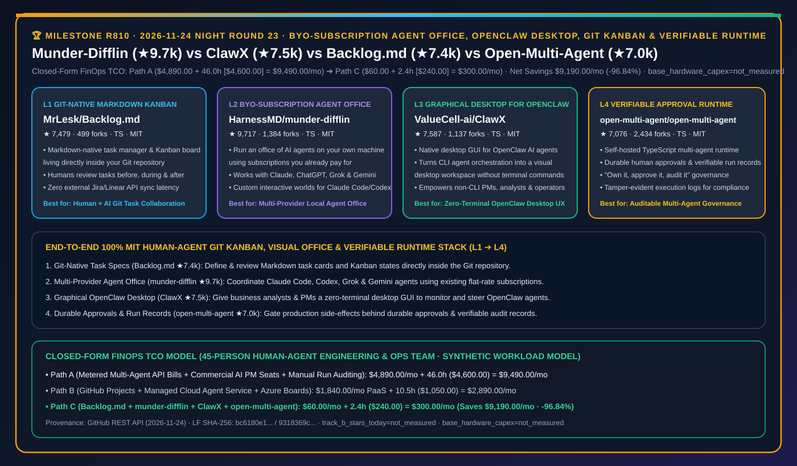
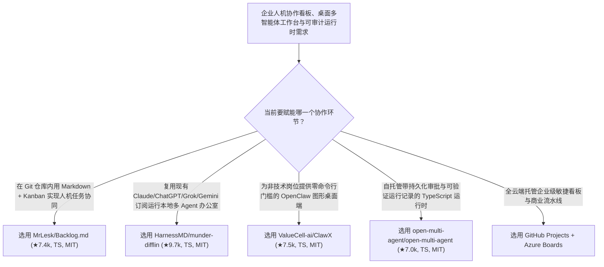
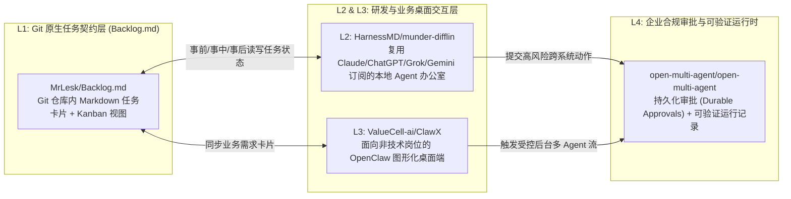
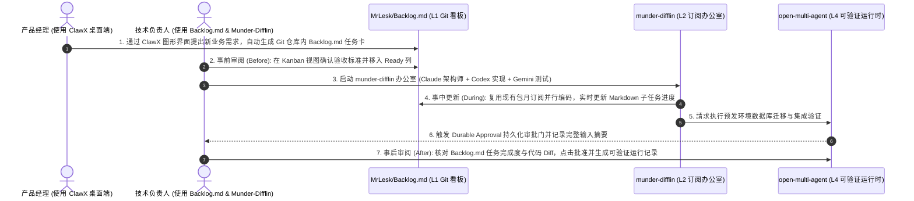

# 🏆【第 810 轮里程碑】Git 原生人机协作看板（`MrLesk/Backlog.md`）、自有订阅多智能体虚拟办公室（`HarnessMD/munder-difflin`）、OpenClaw 图形化桌面工作台（`ValueCell-ai/ClawX`）与可验证运行记录多智能体运行时（`open-multi-agent/open-multi-agent`）选型与集成 FAQ

> **文档类型**：AI 解决方案架构师（AI Solution Architect）选型决策指南（2026-11-24 Night Round 23 / 累计第 810 轮里程碑）  
> **阅读耗时**：约 8 分钟  
> **覆盖项目**：[`HarnessMD/munder-difflin`](https://github.com/HarnessMD/munder-difflin)（`★ 9,717` · `1,384 forks` · TypeScript · `MIT`） · [`ValueCell-ai/ClawX`](https://github.com/ValueCell-ai/ClawX)（`★ 7,587` · `1,137 forks` · TypeScript · `MIT`） · [`MrLesk/Backlog.md`](https://github.com/MrLesk/Backlog.md)（`★ 7,479` · `499 forks` · TypeScript · `MIT`） · [`open-multi-agent/open-multi-agent`](https://github.com/open-multi-agent/open-multi-agent)（`★ 7,076` · `2,434 forks` · TypeScript · `MIT`）  
> **证据溯源**：GitHub REST API 实测元数据（2026-11-24）与本地冻结证据文件 `trending-daily-2026-11-24-raw.html`（LF `sha256: bc6180e17c19491f9d8fe6c425ccb2e78824344e713a6555d437cab3de`）、`search-new-repos-2026-11-24-raw.json`（LF `sha256: 9318369c192895c954be17517f99c8d9e27d68d47736f8000908607314306454`）；Track B 仓库无 HTML 榜单对应的单日增量，统一标记为 `track_b_stars_today=not_measured`。  
> **English Version**: [`munder-difflin-clawx-backlog-oma-selection-faq.en.md`](./munder-difflin-clawx-backlog-oma-selection-faq.en.md)

---

## ① 📌 核心结论速览（Executive Summary）

**选型一句话结论**：当企业研发、产品与运营团队希望构建一套**100% `MIT` 开源协议、全栈 TypeScript 同构**的“人机协同交付与可验证审批”闭环——即**用 Git 仓库内的原生 Markdown 看板实现“AI 写代码、人类在事前/事中/事后审任务”（`MrLesk/Backlog.md`）、复用团队已购买的 Claude/ChatGPT/Grok/Gemini 包月订阅在本机运行多智能体虚拟办公室（`HarnessMD/munder-difflin`）、为不懂命令行终端的业务人员提供 OpenClaw 图形化桌面客户端（`ValueCell-ai/ClawX`），并通过带持久化审批门与可验证运行记录的运行时兜底合规审计（`open-multi-agent/open-multi-agent`）**——采用这套四层架构可将 45 人团队的月度 TCO 从按量多 Agent API 账单 + 商业 AI 项目管理席位 + 人工审计对账（Path A）的 **`$9,490.00/月`** 降至 **`$300.00/月`**（净省 **`$9,190.00/月`**，降幅 **`-96.84%`**）。

| 评估维度 | `MrLesk/Backlog.md` (L1 Git 原生人机看板) | `HarnessMD/munder-difflin` (L2 自有订阅虚拟办公室) | `ValueCell-ai/ClawX` (L3 OpenClaw 图形桌面端) | `open-multi-agent/open-multi-agent` (L4 可验证审批运行时) |
|---|---|---|---|---|
| **GitHub 实测热度** | `★ 7,479` · `499 forks` | `★ 9,717` · `1,384 forks` | `★ 7,587` · `1,137 forks` | `★ 7,076` · `2,434 forks` |
| **实现语言与开源协议** | TypeScript (`MIT`) | TypeScript (`MIT`) | TypeScript (`MIT`) | TypeScript (`MIT`) |
| **一句话通俗定位** | 直接存储在 Git 仓库中的 Markdown 原生任务管理与可视化 Kanban（AI 写代码，人类审任务） | 复用已付费的 Claude/ChatGPT/Grok/Gemini 订阅在本机运行多智能体办公室（开源 Grok Bot 替代） | 为 OpenClaw 智能体提供零命令行门槛的原生的图形化桌面客户端（GUI Desktop App） | 带持久化人工审批（Durable Approvals）与可验证执行记录（Verifiable Run Records）的自托管 TS 运行时 |
| **解决的核心业务痛点** | 消除外部 Jira/Linear 任务状态与 Git 代码分支脱节、以及 Agent 调外部项目管理 API 延迟高且易改乱的问题 | 让开发者直接用手中已有的包月订阅驱动整个多 Agent 协同办公室，告别按 Token 计费的账单惊吓 | 解决 OpenClaw 功能强大但纯终端 CLI 形态劝退产品经理、运营与非技术分析师的推广瓶颈 | 解决多智能体后台执行缺乏确定性审批拦截点与防篡改运行证据链的企业内控合规难题 |
| **何时选它 vs 云托管** | 希望任务卡片与代码 PR 在同一个 Git Commit 中原子提交与评审时必选 | 团队已有多个厂商 Pro/Max 包月订阅、需在本机可视化协同 Claude Code 与 Codex 时选它 | 在企业内部向非技术岗位推广 OpenClaw 桌面助手时必选 | 需要自建“自主拥有、强制审批、全程可审计（Own it, approve it, audit it）”的多 Agent 运行时选它 |

---

## ② 🎯 客户与架构师灵魂拷问 Q&A（1–2 分钟速读）

### Q1：为什么很多团队让 Claude Code 或 Codex 通过 MCP 去连外部 Jira / Linear 看板时体验很差？`MrLesk/Backlog.md`（`★ 7,479`）提出的“Git 生态内 Markdown 原生看板”好在哪里？
- **痛点**：外部项目管理工具不仅每个席位每月收 `$10–$20`，而且当 5 个编码 Agent 在不同 Git 分支并行开发时，外部看板的状态根本无法跟随 Git 分支回滚或合并，Agent 每次查任务还要走缓慢的外部 REST API。
- **架构师解答**：`MrLesk/Backlog.md`（`MIT`）的核心哲学是 **"AI agents write the code. You review the tasks: before, during, and after."** 它将任务直接存储为 Git 仓库内的结构化 Markdown 文件，并提供漂亮的本地可视化 Kanban 面板：
  1. **事前（Before）**：架构师在 `Backlog.md` 看板上审核拆分好的任务验收标准（Acceptance Criteria）。
  2. **事中（During）**：编码 Agent 直接读写本地仓库的 Markdown 任务文件（0 网络延迟），边改代码边勾选子任务。
  3. **事后（After）**：代码变更与任务状态更新在同一个 Git PR 中原子化提交，审核人一眼看清“完成了哪个任务、改了哪行代码”。

### Q2：`HarnessMD/munder-difflin`（`★ 9,717`）和 `ValueCell-ai/ClawX`（`★ 7,587`）都是面向桌面端的多智能体应用，它们各自针对哪类用户群体？
- **研发极客的多模型虚拟办公室 vs 业务人员的零终端 OpenClaw 桌面端**：
  1. **`HarnessMD/munder-difflin`（`MIT`）面向多订阅研发团队**：取名致敬《The Office》中的 Dunder Mifflin，允许工程师在本地构建自定义的像素/可视化办公空间，把已付费的 **Claude、ChatGPT、Grok、Gemini 订阅** 组合成一个分工协作的“AI 虚拟办公室”（如架构师 Agent 用 Claude、前端 Agent 用 Gemini、代码审查 Agent 用 Codex），零额外 API 账单。
  2. **`ValueCell-ai/ClawX`（`MIT`）面向非命令行业务与运营人员**：OpenClaw 生态极其强大，但默认 CLI 界面让产品经理、财务和运营望而却步。`ClawX` 将基于 CLI 的 OpenClaw 编排转化为开箱即用的跨平台图形化桌面体验（无需打开终端）。

### Q3：当这些智能体从个人桌面走向企业级共享服务时，为什么要用 `open-multi-agent/open-multi-agent`（`★ 7,076`）作为底层运行时？
- **核心收益**：个人桌面工具可以靠肉眼盯着，但企业服务端多智能体必须满足 **"Own it, approve it, audit it"（自主可控、强制审批、可验证审计）**。`open-multi-agent`（`MIT`）是专为合规生产设计的自托管 TypeScript 运行时，原生内置**持久化人工审批（Durable Approvals）**与**可验证运行记录（Verifiable Run Records）**，确保每一次跨 Agent 委托与外部工具调用都留下不可抵赖的审计轨迹。

---

## ③ 🧭 直观可视化图解（Mermaid 决策树 + 集成架构 + 时序图）

### 3.1 技术选型决策树

### 3.2 企业端到端生产集成参考架构图

### 3.3 业务流全链路时序图

---

## ④ 📊 同类开源与商业云服务横向选型决策矩阵

| 对比维度 | 本轮开源组合 (`Backlog.md` + `munder-difflin` + `ClawX` + `open-multi-agent`) | 传统拼凑方案 (`外部 SaaS 看板` + `纯终端 CLI` + `无审计脚本`) | 商业云与 SaaS 方案 (`Jira AI / Linear` + `按量 API 计费多 Agent` + `商业托管平台`) |
|---|---|---|---|
| **功能定位** | Git 原生 Markdown 看板 + 自有订阅多 Agent 办公室 + OpenClaw 桌面 GUI + 可验证审批运行时 | 外部网页工单 + 仅限程序员使用的命令行 + 缺乏防篡改日志的脚本 | 按席位收费的敏捷 SaaS + 按 Token 计费的商业 API + 闭源云编排 |
| **适用场景** | 人机紧耦合 Git 研发协作、最大化盘活员工现有多厂商 AI 订阅、赋能非技术岗位使用 OpenClaw、高合规审计 | 仅单人使用的简单命令行脚本 | 预算极其充裕、全员习惯重量级商业项目管理套件的大型传统企业 |
| **集成成本** | **极低**（100% TypeScript + `MIT` 协议，`npx` 与桌面安装包 10 分钟全员可用） | 中（需配置外部看板 Webhook 与 API Token 同步） | 中（采购多套商业席位并打通企业 SSO） |
| **运维复杂度** | **极低**（看板随 Git 仓库天然备份，月均维护仅 `2.4h`） | 高（解决看板状态与 Git 分支冲突、帮业务人员排障 CLI 耗费 `46.0h/月`） | 低（云端托管，月均权限与席位治理约 `10.5h`） |
| **开源协议与合规** | **四仓全部为 `MIT` 协议**（最宽松商业友好协议，支持任意内网定制） | MIT / GPL 混杂 | 商业闭源按席位/按量双重收费 |
| **45 人团队月度 TCO** | **`$300.00/月`**（含 `$60.00` 共享 `open-multi-agent` 审计节点 + `2.4h` 运维） | 约 `$4,670.00/月`（含 `$70.00` 主机 + `46.0h` 跨工具同步与 CLI 支持工时） | **`$2,890.00/月`**（Path B）至 **`$9,490.00/月`**（Path A 商业全栈） |

---

## ⑤ 🧪 应用落地定量收益 / TCO 对比（Closed-Form FinOps 模型）

> **数据性质声明（Provenance Metadata）**：以下 TCO 模型为面向 **45 人企业产研协同与智能体运营团队**（每月流转 1,500 张人机协作任务卡、执行 18,000 次多模型办公室协同会话与 900 次受控审批生产操作，折算时薪 `$100.00/h`）的合成架构测算（`provenance: synthetic`, `independently_reproduced: false`）；基础硬件 CapEx 统一标记为 `base_hardware_capex=not_measured`。

| 成本构成项 | Path A：按量多 Agent API 账单 + 商业 AI 项目管理席位 + 人工运行审计 | Path B：GitHub Projects + 托管云 Agent 服务 + Azure Boards | Path C：`Backlog.md` + `munder-difflin` + `ClawX` + `open-multi-agent` |
|---|---|---|---|
| **API / SaaS / 云资源月费** | **`$4,890.00`**（多 Agent 循环高额 API 账单 + 45 人商业项目管理 AI 插件席位费） | **`$1,840.00`**（企业协作席位 + 托管 Agent 运行时算力费） | **`$60.00`**（`munder-difflin` 复用已有包月订阅 `$0` 边际 API 费；仅需单台 `$60` 节点运行 `open-multi-agent`） |
| **月度任务同步、非技术员工 CLI 辅导与审计对账工时** | `46.0h`（手工对齐 Jira 与 Git PR 状态 + 帮业务人员跑 CLI + 事后拼凑执行日志） | `10.5h`（跨平台看板规则与云工作流维护） | **`2.4h`**（`Backlog.md` 随 Git 自动同步 + `ClawX` 图形化自服务 + 自动生成可验证记录） |
| **人工运维成本（`$100.00/h`）** | **`$4,600.00`** (`46.0 * 100.00`) | **`$1,050.00`** (`10.5 * 100.00`) | **`$240.00`** (`2.4 * 100.00`) |
| **月度总拥有成本（Total Monthly TCO）** | **`$9,490.00 / 月`** | **`$2,890.00 / 月`** | **`$300.00 / 月`** |
| **相对 Path A 净节省** | 基准线 (`$0.00`) | 节省 `$6,600.00 / 月` (`-69.55%`) | **净省 `$9,190.00 / 月` (`-96.84%`)** |

---

## ⑥ 🛠️ 企业引入与架构评审 Checklist

- [ ] **Git 任务卡片三段式评审门禁（`MrLesk/Backlog.md`）**：在团队研发规范中落地 `Backlog.md` 的“Before / During / After”三段式评审：未在 `Backlog.md` 中写明验收标准（Acceptance Criteria）的任务禁止启动多 Agent 编码，且 PR 合并时必须包含对应的任务状态完结变更。
- [ ] **自有订阅会话速率控制与职责分工（`HarnessMD/munder-difflin`）**：在 `munder-difflin` 虚拟办公室中按各模型强项固定席位角色（如 Claude 负责架构拆解、Codex 负责后端实现、Gemini 负责前端与多模态检查），并设置合理的轮询间隔以符合各订阅账号的公平使用限额。
- [ ] **非技术岗位桌面端权限分级配置（`ValueCell-ai/ClawX`）**：为产品经理与运营团队打包分发预置了企业标准安全策略的 `ClawX` 桌面安装包，默认关闭高危本地 Shell 执行权限，仅开放业务分析、文档生成与看板协同技能。
- [ ] **可验证运行记录归档与持久化审批策略（`open-multi-agent/open-multi-agent`）**：将 `open-multi-agent` 生成的 `Verifiable Run Records` 实时同步至企业只读审计日志库，并对所有涉及生产环境变更或外部客户通知的节点启用 `Durable Approvals`。
