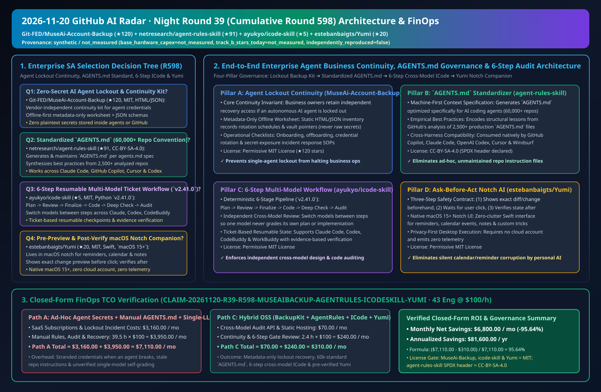
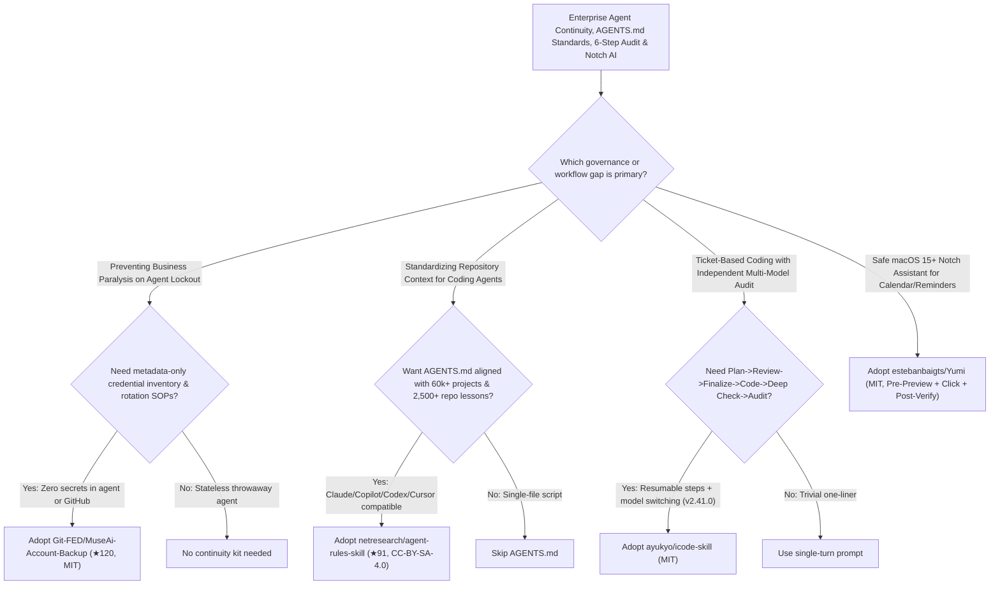
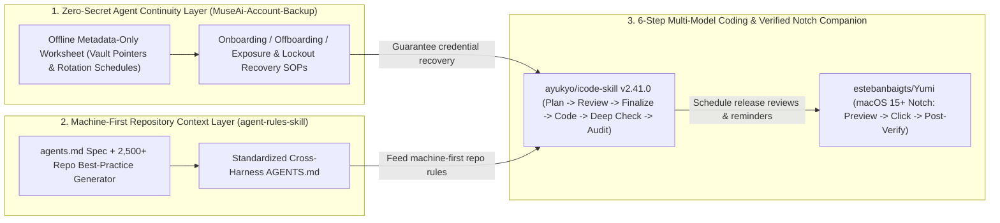

# Zero-Secret AI Agent Lockout Continuity Kit (`Git-FED/MuseAi-Account-Backup`), Standardized `AGENTS.md` Generator (`netresearch/agent-rules-skill`), 6-Step Resumable Cross-Model Coding Workflow (`ayukyo/icode-skill`) & Pre-Preview / Post-Verify macOS Notch Companion (`estebanbaigts/Yumi`) Selection & Integration FAQ (2026-11-20 Night Round 39 · Cumulative Round 598)

> **Cross-File Navigation**: [Back to 2026-11-20 Daily Digest (`daily/2026-11-20.en.md`)](../daily/2026-11-20.en.md) · [中文版 (`museai-account-backup-agent-rules-skill-icode-skill-yumi-selection-faq.md`)](museai-account-backup-agent-rules-skill-icode-skill-yumi-selection-faq.md) · [7-Card 4:5 Visual Report (`cards.en.html`)](../cards.en.html) · [Column Index (`README.en.md`)](../README.en.md)  
> **Architecture Diagram**: [`assets/github-ai-radar-2026-11-20-r39-r598-museaibackup-agentrules-icodeskill-yumi.svg`](../../../assets/github-ai-radar-2026-11-20-r39-r598-museaibackup-agentrules-icodeskill-yumi.svg)  
> **Provenance & Synthetic Disclaimer**: Repository metadata (stars, forks, licenses, version tags, and adoption statistics) is verified from live GitHub API data (`measured`). The 43-engineer FinOps TCO figures represent a parameterized Solution Architect model (`provenance: synthetic`, `independently_reproduced: false`, `base_hardware_capex: not_measured`, `track_b_stars_today: not_measured`, claim ID `CLAIM-20261120-R39-R598-MUSEAIBACKUP-AGENTRULES-ICODESKILL-YUMI`).



---

## ① 📌 Executive Summary

> **One-Sentence Selection Verdict**: For Enterprise AI Solution Architects establishing four operational governance safeguards across **AI agent business continuity, repository context standardization, cross-model code auditing, and verified desktop assistant actions**—(1) **business-continuity lockouts when an autonomous AI agent becomes unavailable and its credential/configuration lineage is trapped inside agent memory**; (2) **inconsistent hand-written `AGENTS.md` files that miss critical build/test commands across repositories**; (3) **single-model coding sessions that grade their own plans and miss systemic bugs**; and (4) **desktop AI assistants that mutate calendar events and reminders silently without pre-action preview or post-action verification**—combine **`Git-FED/MuseAi-Account-Backup`** (`★ 120`, MIT vendor-independent AI Agent Lockout Backup Kit with metadata-only offline worksheets, rotation checklists, and JSON schemas), **`netresearch/agent-rules-skill`** (`★ 91`, `CC-BY-SA-4.0` skill generating `AGENTS.md` files aligned with the `60,000+` project `agents.md` standard and lessons from `2,500+` repositories), **`ayukyo/icode-skill`** (`v2.41.0`, MIT 6-step `Plan → Review → Finalize → Code → Deep Check → Audit` workflow supporting cross-model switching across Claude Code, Codex, CodeBuddy, and WorkBuddy), and **`estebanbaigts/Yumi`** (MIT native Swift `macOS 15+` notch companion that previews exact changes, waits for a click, and verifies completion with zero telemetry). Across a 43-engineer team, this stack reduces monthly TCO from **`$7,110.00/mo`** to **`$310.00/mo`**, saving **`$6,800.00/mo` (`-95.64%`, or `$81,600.00/yr`)**.

| Evaluation Dimension | Path A: Undocumented Agent Credentials + Ad-Hoc `AGENTS.md` + Single-Model Self-Grading | Path B: Manual GRC Consulting Spreadsheets & Manual Peer Copy-Pasting | Path C (Recommended): `MuseAi-Account-Backup` + `agent-rules-skill` + `icode-skill` + `Yumi` |
| :--- | :--- | :--- | :--- |
| **AI Agent Lockout Recovery & Continuity** | Credentials stranded inside agent sessions or leaked in plaintext docs | Fragile shared spreadsheets lacking structured exposure checklists | **`MuseAi-Account-Backup` offline metadata-only worksheet + rotation/lockout SOPs (zero stored secrets)** |
| **Repository `AGENTS.md` Standardization** | Human-oriented prose READMEs that waste agent context tokens | Manual per-repo authoring that quickly drifts out of date | **`agent-rules-skill` generates machine-first `AGENTS.md` grounded in 2,500+ repo best practices** |
| **Resumable Multi-Model Coding & Audit** | Single model plans, codes, and self-reviews in one fragile turn | Manual copy-paste between Claude and Codex windows | **`icode-skill v2.41.0` 6-step ticket workflow (`Plan→Review→Finalize→Code→Deep Check→Audit`) with model switching** |
| **Desktop Calendar/Reminder Action Safety** | Unverified background API mutations corrupting schedules | Manual entry across separate calendar/reminder apps | **`Yumi` (`macOS 15+` notch) previews exact change -> waits for click -> verifies post-action state** |
| **43-Engineer Monthly Total TCO** | **`$7,110.00 / mo`** (`$3,160.00` SaaS/lockouts + `39.5h × $100` labor) | **`$2,150.00 / mo`** (`$650.00` tools + `15.0h × $100` manual sync) | **`$310.00 / mo`** (`$70.00` cross-model API + `2.4h × $100` review, **`-95.64%` savings**) |

---

## ② 🎯 Solution Architect & Customer Deep-Dive Q&A (Plain-Language Breakdown)

### Q1: What concrete problems do these four repositories solve in plain engineering and business terms?

1. **`Git-FED/MuseAi-Account-Backup` (`★ 120`, `4 forks`, HTML/JSON, MIT) — Plain-Language View: A vendor-independent AI Agent Lockout Backup Kit that ensures business continuity without storing secrets in the agent or GitHub**:
   - **Pain Point Solved**: When an autonomous AI agent is rate-limited, locked out, or decommissioned, teams often discover that nobody documented which credentials, webhooks, and recovery procedures the agent relied on—or worse, someone committed plaintext secrets into a repo. `MuseAi-Account-Backup` provides a **static, offline-first metadata-only worksheet**, credential and access inventory templates, onboarding/offboarding/exposure checklists, and JSON schemas so business owners retain independent recovery access with **zero secrets stored in the agent or GitHub**.
2. **`netresearch/agent-rules-skill` (`★ 91`, `11 forks`, Shell/Markdown, SPDX `CC-BY-SA-4.0`) — Plain-Language View: An AI skill that generates and maintains machine-first `AGENTS.md` files following the `60,000+` repository `agents.md` standard**:
   - **Pain Point Solved**: `AGENTS.md` is a context file written **for AI coding agents, not humans** (adopted by `60,000+` open-source projects). Synthesizing best practices from GitHub's analysis of **`2,500+` repositories**, this skill inspects your repository and generates a compliant, high-signal `AGENTS.md` supported across Claude Code, GitHub Copilot, Codex, and Cursor.
3. **`ayukyo/icode-skill` (`★ 5`, `2 forks`, Python, MIT, `v2.41.0`) — Plain-Language View: A 6-step resumable ticket-based coding workflow (`Plan → Review → Finalize → Code → Deep Check → Audit`) that lets you switch models between steps**:
   - **Pain Point Solved**: Single-step coding prompts lack independent design and code review. `ICode v2.41.0` structures development into six resumable ticket stages (**`Plan → Review → Finalize → Code → Deep Check → Audit`**) across Claude Code, Codex, CodeBuddy, and WorkBuddy—allowing you to run all steps at once or **switch models between steps** for independent multi-model verification.
4. **`estebanbaigts/Yumi` (`★ 20`, `5 forks`, Swift, MIT, `macOS 15+`) — Plain-Language View: A native Swift `macOS 15+` notch companion that previews exact changes, waits for your click, and verifies the action actually happened**:
   - **Pain Point Solved**: Personal desktop agents shouldn't silently modify your calendar, reminders, or notes. Living inside the MacBook notch on `macOS 15+` with no account and zero telemetry, `Yumi` shows exactly what will change before acting, waits for your explicit click, and verifies the post-execution state.

---

### Q2: How do these four components wire together into an enterprise agent governance & engineering architecture?

1. **Machine-First Repository Context (`netresearch/agent-rules-skill`)**: Standardize `AGENTS.md` files across all enterprise repositories so every coding agent starts with exact build, test, and boundary rules.
2. **6-Step Multi-Model Development & Audit (`ayukyo/icode-skill`)**: Execute feature tickets through `icode-skill v2.41.0` (`Plan → Review → Finalize → Code → Deep Check → Audit`), switching between model families at the `Review` and `Audit` gates.
3. **Pre-Previewed Desktop Scheduling (`estebanbaigts/Yumi`)**: Manage engineering reminders, release calendar events, and notes from the `macOS 15+` notch with mandatory pre-click preview and post-action verification.
4. **Vendor-Independent Lockout Continuity (`Git-FED/MuseAi-Account-Backup`)**: Record metadata-only credential pointers, rotation cadences, and fallback procedures in the offline continuity worksheet so no agent outage blocks operations.

---

### Q3: What are the key architectural mechanisms and licensing highlights?

1. **Key Mechanisms**:
   - **Metadata-Only Continuity Invariant (`MuseAi-Account-Backup`)**: Tracks *where* secrets live and *how* to rotate/recover them without ever becoming a secret store itself.
   - **Step-Boundary Model Switching (`icode-skill`)**: Decouples planning/coding models from review/audit models using persistent ticket state on disk.
2. **Licensing Highlights**:
   - `MuseAi-Account-Backup`, `icode-skill`, and `Yumi` are **MIT**, while `netresearch/agent-rules-skill` is **CC-BY-SA-4.0** (SPDX header).

---

## ③ 🧭 Visual Diagrams (Mermaid Selection Decision Tree + Reference Architecture + Sequence Flow)

### 3.1 Selection Decision Tree



### 3.2 Enterprise Integration Reference Architecture



### 3.3 End-to-End Sequence Flow

```mermaid
sequenceDiagram
    autonumber
    actor Arch as Solution Architect / Developer
    participant Rules as netresearch/agent-rules-skill
    participant ICode as ayukyo/icode-skill (v2.41.0)
    participant Yumi as estebanbaigts/Yumi (macOS Notch)
    participant Backup as Git-FED/MuseAi-Account-Backup

    Arch->>Rules: Generate standardized AGENTS.md following agents.md specification
    Arch->>ICode: Run 6-step ticket workflow; switch models at Review and Audit gates
    Arch->>Yumi: Create release review calendar event via macOS notch; preview, click & verify
    Arch->>Backup: Record service metadata & rotation schedule in offline continuity worksheet
```

---

## ④ 📊 Comparative Selection Matrix (OSS vs. Ad-Hoc Governance & Single-Model Workflows)

| Dimension | `Git-FED/MuseAi-Account-Backup` (`★ 120`) | `netresearch/agent-rules-skill` (`★ 91`) | `ayukyo/icode-skill` (`★ 5`) | `estebanbaigts/Yumi` (`★ 20`) | Undocumented Credentials + Single-Model Prompts |
| :--- | :--- | :--- | :--- | :--- | :--- |
| **Primary Role** | Vendor-independent AI agent lockout continuity kit | `AGENTS.md` generator following the `agents.md` standard | 6-step resumable multi-model coding workflow (`v2.41.0`) | Pre-preview, post-verify `macOS 15+` notch AI companion | Ad-hoc prompts & unbacked agent accounts |
| **Sweet-Spot Use Case** | Ensuring business recovery if an AI agent is locked out | Generating high-signal `AGENTS.md` files across enterprise repos | Ticket-based development with independent cross-model review | Safe, zero-telemetry macOS reminders, calendar & note actions | Disposable prototypes |
| **Key Architectural Metric** | **Metadata-only offline worksheet** + JSON schemas + checklists | **60,000+ project spec** + 2,500+ repo best practices | **6-step pipeline** + cross-model switching + evidence gates | **Swift `macOS 15+` notch UI** + preview/click/verify loop | Operational paralysis on lockout; unverified self-reviews |
| **Integration Effort** | Very Low (Static offline HTML worksheet + templates) | Very Low (Claude Code compatible skill) | Low (`SKILL.md` for Claude Code, Codex, CodeBuddy, WorkBuddy) | Very Low (Native macOS 15+ app, no account needed) | High (emergency credential recovery & bug triage) |
| **License** | **MIT License** | **CC-BY-SA-4.0 (SPDX header)** | **MIT License** | **MIT License** | Internal Incident Cost |

---

## ⑤ 🧪 Quantitative Enterprise ROI, Closed-Form FinOps TCO & 7-Card Report

### 5.1 43-Engineer Closed-Form FinOps TCO Model (`CLAIM-20261120-R39-R598-MUSEAIBACKUP-AGENTRULES-ICODESKILL-YUMI`)

- **Model Assumptions (`provenance: synthetic`, `independently_reproduced: false`, `base_hardware_capex: not_measured`, `track_b_stars_today: not_measured`)**:
  - Team size: **43 software and platform governance engineers** at a loaded engineering rate of **`$100.00 / hour`**.
  - **Path A (Agent Lockout Downtime & SaaS Fees + Manual `AGENTS.md` Maintenance + Single-Model Uncaught Defect Rework)**:
    - Commercial governance/assistant SaaS & lockout recovery fees: **`$3,160.00 / mo`**
    - Manual credential recovery, per-repo `AGENTS.md` maintenance & single-model defect rework labor: `39.5 h/mo × $100.00/h = $3,950.00 / mo`
    - **Path A Monthly Total**: `$3,160.00 + $3,950.00 = $7,110.00 / mo`
  - **Path C (Hybrid OSS Stack: `MuseAi-Account-Backup` + `agent-rules-skill` + `icode-skill` + `Yumi`)**:
    - Cross-model `Review/Audit` API calls & static hosting: **`$70.00 / mo`**
    - Continuity audit & 6-step ticket approval labor: `2.4 h/mo × $100.00/h = $240.00 / mo`
    - **Path C Monthly Total**: `$70.00 + $240.00 = $310.00 / mo`
  - **Closed-Form Savings Verification**:
    $$\text{Monthly Net Savings} = \$7,110.00 - \$310.00 = \$6,800.00\text{ / mo}\quad(\text{Annualized: }\$81,600.00\text{ / yr})$$
    $$\text{Percentage Savings} = \frac{\$7,110.00 - \$310.00}{\$7,110.00} = \frac{\$6,800.00}{\$7,110.00} = 95.64\%$$

| Cost Component | Path A (Lockout Incidents & Single-Model Rework) | Path C (R598 Hybrid OSS Stack) | Closed-Form Delta / ROI |
| :--- | :--- | :--- | :--- |
| **Governance SaaS / Cross-Model Audit API** | `$3,160.00 / mo` | **`$70.00 / mo`** | `- $3,090.00 / mo` |
| **Engineering & Governance Labor (`@ $100.00/h`)** | `39.5 h × $100.00 = $3,950.00 / mo` | **`2.4 h × $100.00 = $240.00 / mo`** | `- $3,710.00 / mo` (`37.1 h/mo` saved) |
| **Monthly Total TCO** | **`$7,110.00 / mo`** | **`$310.00 / mo`** | **`$6,800.00 / mo` saved (`-95.64%`)** |
| **Annualized Total TCO** | `$85,320.00 / yr` | **`$3,720.00 / yr`** | **`$81,600.00 / yr` saved** |

---

## ⑥ 🛠️ Enterprise Adoption & Architecture Review Checklist

- [ ] **1. `Git-FED/MuseAi-Account-Backup` Metadata-Only Continuity Ledger**: Populate the offline worksheet with vault pointers, rotation schedules, and fallback owners for every production AI agent without recording raw secrets.
- [ ] **2. `netresearch/agent-rules-skill` Standardized `AGENTS.md` Rollout**: Generate and validate `AGENTS.md` files across all active repositories following the `agents.md` specification.
- [ ] **3. `ayukyo/icode-skill` 6-Step Cross-Model Gate**: Enforce `Plan → Review → Finalize → Code → Deep Check → Audit` on complex tickets, switching model families for the `Review` and `Audit` stages.
- [ ] **4. `estebanbaigts/Yumi` Pre-Click & Post-Check Verification**: Deploy `Yumi` on `macOS 15+` laptops so all AI-initiated calendar and reminder actions require pre-click preview and post-execution verification.
