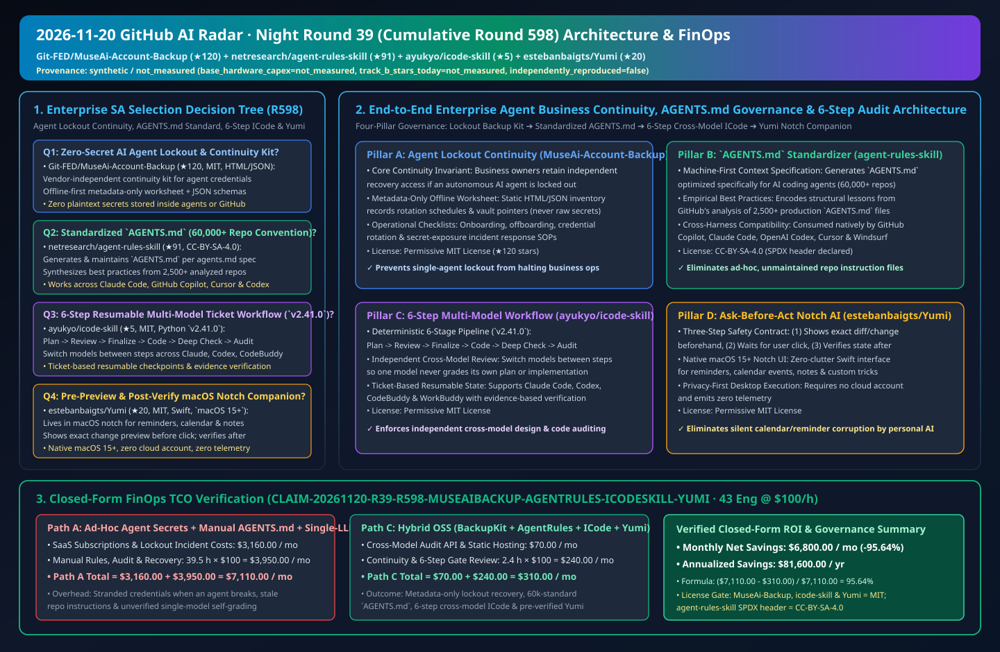
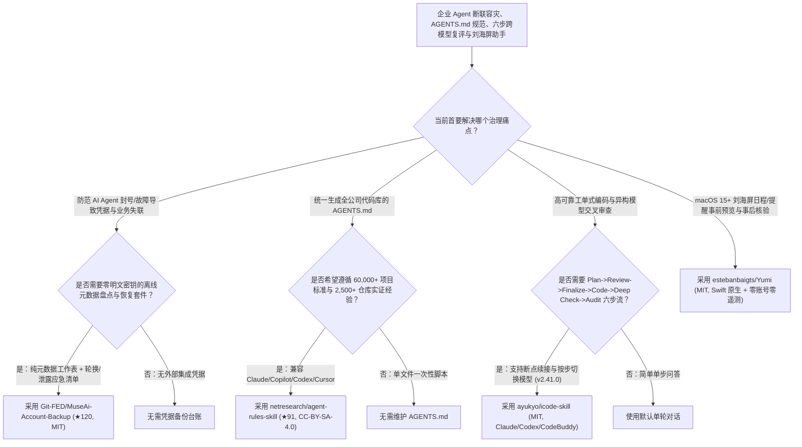
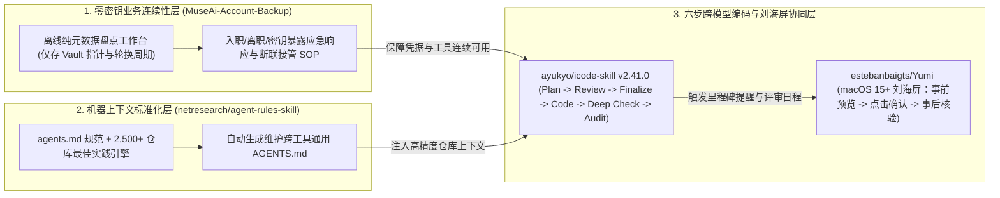
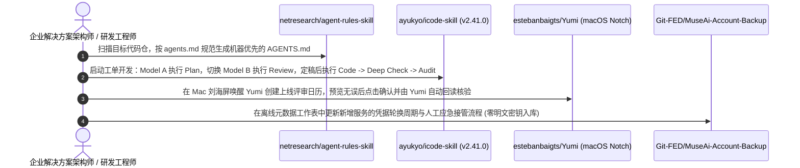

# 零密钥存储 AI Agent 断联业务连续性套件（`Git-FED/MuseAi-Account-Backup`）、符合 60,000+ 仓库规范的 `AGENTS.md` 生成技能（`netresearch/agent-rules-skill`）、六步断点续接跨模型复评工作流（`ayukyo/icode-skill`）与先预览后核验的 macOS 刘海屏助手（`estebanbaigts/Yumi`）架构选型与集成 FAQ（2026-11-20 Night Round 39 · 累计 Round 598）

> **跨文件导航**：[返回 2026-11-20 当日全景日报 (`daily/2026-11-20.md`)](../daily/2026-11-20.md) · [English Version (`museai-account-backup-agent-rules-skill-icode-skill-yumi-selection-faq.en.md`)](museai-account-backup-agent-rules-skill-icode-skill-yumi-selection-faq.en.md) · [查看 7-Card 4:5 评测报告 (`cards.html`)](../cards.html) · [返回专栏主索引 (`README.md`)](../README.md)  
> **本轮架构大图**：[`assets/github-ai-radar-2026-11-20-r39-r598-museaibackup-agentrules-icodeskill-yumi.svg`](../../../assets/github-ai-radar-2026-11-20-r39-r598-museaibackup-agentrules-icodeskill-yumi.svg)  
> **数据溯源与口径声明（Provenance & Synthetic Disclaimer）**：本报告中实时采集的 GitHub 仓库元数据（Stars、Forks、License、版本号与标准采纳数据）为 `measured`；针对 43 人企业 AI 治理与研发工程团队的 FinOps TCO 测算参数属于架构师参数化测算模型（`provenance: synthetic`，`independently_reproduced: false`，`base_hardware_capex: not_measured`，`track_b_stars_today: not_measured`，审计契约号 `CLAIM-20261120-R39-R598-MUSEAIBACKUP-AGENTRULES-ICODESKILL-YUMI`）。

---

## ① 📌 核心结论速览（Executive Summary）

> **一句话选型结论**：面向企业 AI 解决方案架构师（SA）在建立**自主 AI Agent 账号断联业务连续性（BCP）、全公司代码仓 `AGENTS.md` 标准化、跨模型独立交叉复评（Cross-Model Audit）以及个人办公日程操作防误改**四大治理防线时的核心痛点——① **一旦企业重度依赖的某个云端或本地 AI Agent 发生账号封禁、服务宕机或主理人离职，由于所有服务配置与凭据脉络只存在于 Agent 记忆里，业务瞬间陷入瘫痪（Agent Lockout）**；② **不同团队手写的 `AGENTS.md` 格式混乱、遗漏构建/测试命令，无法对齐 60,000+ 开源项目验证的最佳实践**；③ **让同一个大模型既写方案又自己审代码，等于“自己改自己的考卷”，极易放过系统性逻辑盲区**；④ **桌面个人 AI 助手在后台静默改错日历或待办事项却不提前展示变更详情**——建议组合 **`Git-FED/MuseAi-Account-Backup`**（`★ 120`，MIT 协议的跨厂商 AI Agent 断联备份与业务连续性套件，仅记录非敏感元数据、轮换计划与恢复清单，严禁在 Agent 或 GitHub 中存明文密钥）、**`netresearch/agent-rules-skill`**（`★ 91`，遵循 `agents.md` 官方规范与 GitHub 2,500+ 仓库实证经验自动生成维护 `AGENTS.md` 的标准化技能）、**`ayukyo/icode-skill`**（`v2.41.0`，MIT 协议的 `Plan → Review → Finalize → Code → Deep Check → Audit` 六步工单式编码工作流，支持在步骤间切换不同大模型执行独立复评，兼容 Claude Code / Codex / CodeBuddy / WorkBuddy）与 **`estebanbaigts/Yumi`**（MIT 协议、专为 `macOS 15+` 刘海屏打造的原生 Swift 伴侣——操作前精确展示变更内容、等待点击确认、操作后自动核验结果且零遥测）。在 43 人工程与治理团队模型下，该组合可将月度总拥有成本（TCO）从 **`$7,110.00/月`** 降至 **`$310.00/月`**，净省 **`$6,800.00/月`（`-95.64%`，年省 `$81,600.00`）**。

| 评估维度 | 方案 A：凭据散落于 Agent 会话 + 手写杂乱 `AGENTS.md` + 单模型自编自审 | 方案 B：重型企业 GRC 合规咨询 + 手工拉会交叉评审 | 方案 C（推荐）：`MuseAi-Account-Backup` + `agent-rules-skill` + `icode-skill` + `Yumi` |
| :--- | :--- | :--- | :--- |
| **AI Agent 断联容灾与凭据连续性** | 密钥直接塞进 Agent 提示词或无台账管理，Agent 封号/故障即导致业务停摆 | 人工维护 Excel 密码本，极易造成明文密钥泄露 | **`MuseAi-Account-Backup` 离线优先纯元数据工作表 + 轮换/应急 Checklist，零明文密钥入库** |
| **代码仓库 `AGENTS.md` 规范化生成** | 把人类阅读的冗长 README 直接当成 `AGENTS.md`，浪费上下文且缺构建指令 | 架构师逐个仓库手工编写维护，随代码演进迅速过期 | **`agent-rules-skill` 基于 `agents.md` 规范与 2,500+ 仓库最佳实践自动生成维护机器优先上下文** |
| **编码工作流断点续接与跨模型复评** | 单一模型一口气写到底，遇到中断从头再来，且无法发现自身思维盲区 | 工程师手工把代码复制到另一个网页聊天框做交叉 Review | **`icode-skill v2.41.0` 六步工单流（`Plan→Review→Finalize→Code→Deep Check→Audit`），支持按步切换模型** |
| **桌面日程/提醒操作安全性与核验** | AI 助手直接调用系统 API 盲改日历，改错时间或未写入成功无人知晓 | 完全纯手工打开日历与提醒应用逐项录入 | **`Yumi`（`macOS 15+` 刘海屏）事前精确展示变更 + 点击确认 + 事后核验真正落盘，零账号零遥测** |
| **43 人团队月度总成本（TCO）** | **`$7,110.00 / 月`**（`$3,160.00` 故障恢复/SaaS + `39.5h × $100` 人工） | **`$2,150.00 / 月`**（`$650.00` 工具费 + `15.0h × $100` 人工同步） | **`$310.00 / 月`**（`$70.00` 跨模型复评 API + `2.4h × $100` 巡检，**净省 `95.64%`**） |

---

## ② 🎯 客户与架构师灵魂拷问 Q&A（通俗解构）

### Q1：这四个开源项目各自解决什么痛点？用大白话怎么向业务方和工程团队解释？

1. **`Git-FED/MuseAi-Account-Backup`（`★ 120`，`4 forks`，HTML/JSON，MIT）——用大白话讲：它是专门防范“万一你的 AI Agent 账号被封或挂掉，公司业务怎么在 5 分钟内接管恢复”的零密钥业务连续性工具包（AI Agent Lockout Backup Kit）**：
   - **解决什么痛点**：越来越多团队把日常部署、外部 API 接入和自动化任务交给常驻 AI Agent 打理，但一旦 Agent 所在平台抽风、账号被锁或配置丢失，业务负责人往往两眼一抹黑；而如果为了备份把密码直接写在 GitHub 或 Agent 记忆里又等于裸奔。该项目确立了一条黄金准则——**绝不在 Agent 或 GitHub 中存放任何真实密钥**，而是提供一套**静态离线优先的纯元数据工作站（Metadata-only worksheet）**、凭据与访问盘点模板、入职/离职/密钥泄露应急 Checklist 以及标准 JSON Schema，确保任何时候人类管理员都能独立接管全部生产流程！
2. **`netresearch/agent-rules-skill`（`★ 91`，`11 forks`，Shell/Markdown，SPDX `CC-BY-SA-4.0`）——用大白话讲：它是“按照全球 60,000 多个开源项目通用的 `agents.md` 标准，帮你的代码库自动写出最懂 AI 胃口的 `AGENTS.md` 说明书生成器”**：
   - **解决什么痛点**：正如其文档一针见血指出的——**“`AGENTS.md` 是写给 AI 编码智能体看的上下文文件，不是写给人类看的（人类能读懂只是顺带的副作用）”**。该项目浓缩了 GitHub 官方对 **2,500+ 个优秀仓库 `AGENTS.md`** 的实证分析经验，自动扫描你的项目并生成符合 `agents.md` 规范的高密度指令文件，一次生成即可同时被 Claude Code、GitHub Copilot、OpenAI Codex 与 Cursor 原生识别。
3. **`ayukyo/icode-skill`（`★ 5`，`2 forks`，Python，MIT，`v2.41.0`）——用大白话讲：它是支持 Claude Code、Codex、CodeBuddy 和 WorkBuddy 的“六步工单式跨模型交叉审查工作流”**：
   - **解决什么痛点**：让同一个模型既当裁判又当运动员很容易出错。`ICode v2.41.0` 把每一次开发拆成可断点续接的 **6 个标准步骤：`Plan（规划）→ Review（方案复评）→ Finalize（定稿）→ Code（编码）→ Deep Check（深度自检）→ Audit（独立审计）`**；你可以选择一键跑完，或者**在每一步之间自由切换不同的大模型**（例如用 Claude 写 Plan、切到 GPT/Codex 做 Review 与 Audit），每一步都基于工单（Ticket）保存证据化验证结果！
4. **`estebanbaigts/Yumi`（`★ 20`，`5 forks`，Swift，MIT，`macOS 15+`）——用大白话讲：它是藏在 MacBook 刘海（Notch）里的“先请示、再动手、最后自己检查有没有干成的老实人小助手”**：
   - **解决什么痛点**：让桌面 AI 帮你建日历事件、设提醒或记笔记时，最怕它听错时间直接覆盖了你的重要会议。`Yumi` 原生驻留在 `macOS 15+` 刘海区域，严格执行三步走：**① 动手前精确展示即将发生的变更（Shows you exactly what will change）** ➔ **② 等待你点一下鼠标确认（Waits for your click）** ➔ **③ 执行后再次读取系统状态确认真的写入成功（Checks it really happened）**，无需注册任何云端账号且 100% 零遥测。

---

### Q2：这四个项目如何组合成企业级“仓库规范化 → 六步跨模型研发 → 个人日程协同 → 业务连续性容灾”闭环架构？

1. **代码仓机器上下文标准化层（`netresearch/agent-rules-skill`）**：在企业所有微服务仓库运行 `agent-rules-skill`，自动生成并维护符合 `agents.md` 标准的 `AGENTS.md` 文件。
2. **六步跨模型编码与独立审计层（`ayukyo/icode-skill`）**：工程师在 Claude Code、Codex 或 CodeBuddy 中启动 `icode-skill v2.41.0`，读取标准化 `AGENTS.md`，按 `Plan → Review → Finalize → Code → Deep Check → Audit` 六步推进，并在 `Review` 与 `Audit` 阶段切换异构大模型执行独立交叉审查。
3. **架构师桌面日程与提醒确认层（`estebanbaigts/Yumi`）**：在 `macOS 15+` 刘海屏通过 `Yumi` 管理发版提醒与评审日历，通过“事前预览 + 点击批准 + 事后回读核验”确保零误操作。
4. **AI Agent 断联容灾与凭据生命周期层（`Git-FED/MuseAi-Account-Backup`）**：使用离线纯元数据工作台统一登记所有 Agent 依赖的凭据位置（指向企业密码保险箱而非存明文）、轮换周期与断联应急接管 SOP。

---

### Q3：这套架构的核心机制亮点与生产环境合规注意事项是什么？

1. **核心机制亮点**：
   - **`icode-skill` 的“异构模型交叉复评（Cross-Model Review）”**：利用不同家族大模型（如 Claude vs. GPT/Codex）不同的训练偏置，在 `Review` 和 `Audit` 阶段揪出单一模型自审时发现不了的边界漏洞。
   - **`Yumi` 的“事后回读校验（Post-Action State Verification）”**：很多工具调完系统 API 返回 200 就以为成功了；`Yumi` 在点击执行后还会主动回读日历/提醒数据库，确保变更真正落盘。
2. **许可证注意事项**：
   - `MuseAi-Account-Backup`、`icode-skill` 与 `Yumi` 均为 **MIT License**；`netresearch/agent-rules-skill` 在文件头声明为 **CC-BY-SA-4.0**（其生成的项目专属 `AGENTS.md` 归属各业务仓库自身所有）。

---

## ③ 🧭 直观可视化图解（Mermaid 选型决策树 + 集成架构图 + 业务时序图）

### 3.1 选型决策树（Selection Decision Tree）

### 3.2 企业集成参考架构图（Enterprise Reference Architecture）

### 3.3 端到端业务流时序图（End-to-End Sequence Flow）

---

## ④ 📊 同类开源与商业云服务横向选型决策矩阵

| 对比维度 | `Git-FED/MuseAi-Account-Backup` (`★ 120`) | `netresearch/agent-rules-skill` (`★ 91`) | `ayukyo/icode-skill` (`★ 5`) | `estebanbaigts/Yumi` (`★ 20`) | 凭据散落 + 手写规则 + 单模型直跑 |
| :--- | :--- | :--- | :--- | :--- | :--- |
| **核心功能定位** | 零密钥存储的 AI Agent 断联备份与业务连续性套件 | 遵循 `agents.md` 官方标准的 `AGENTS.md` 自动生成技能 | 六步断点续接与跨模型独立复评的 AI 编码工作流 (`v2.41.0`) | 先预览、等点击、后核验的 `macOS 15+` 刘海屏 AI 伴侣 | 传统无治理开发模式 |
| **最佳适用场景** | 防范 Agent 平台故障或账号锁定导致企业自动化凭据失联 | 为 Claude Code/Copilot/Codex/Cursor 批量生成高质量 `AGENTS.md` | 需要异构模型交叉 Review 设计与代码的严肃生产工单开发 | 在 Mac 上安全管理日程、提醒与笔记且拒绝云端账号追踪 | 个人临时玩具项目 |
| **关键性能/架构指标** | **离线纯元数据工作台** + JSON Schema + 应急恢复 Checklist | **对齐 60,000+ 仓库标准** + 凝练 2,500+ 仓库实证经验 | **6 步标准链路** + 按步切换模型 + 证据化验证 | **Swift 原生刘海 UI** + 事前展示/事后核验 + 零遥测 | Agent 故障即断工；单模型自审漏 Bug；盲改日历出错 |
| **集成与运维复杂度** | 极低（静态 HTML 工作台本地离线打开即用） | 极低（Claude Code 兼容技能一键运行） | 低（支持 Claude Code、Codex、CodeBuddy 与 WorkBuddy） | 极低（`macOS 15+` 原生安装包即装即用） | 高（事故后耗费数天人工找回凭据与排查自审漏网 Bug） |
| **开源协议（License）** | **MIT License** | **CC-BY-SA-4.0（SPDX 声明）** | **MIT License** | **MIT License** | 内部高昂排障成本 |

---

## ⑤ 🧪 应用落地定量收益 / 闭式 FinOps TCO 对比与 7-Card 报告

### 5.1 43 人企业 AI 治理与研发工程团队闭式 FinOps TCO 模型（`CLAIM-20261120-R39-R598-MUSEAIBACKUP-AGENTRULES-ICODESKILL-YUMI`）

- **测算基准设定（`provenance: synthetic`，`independently_reproduced: false`，`base_hardware_capex: not_measured`，`track_b_stars_today: not_measured`）**：
  - 团队规模：**43 名软件研发与平台治理工程师**，综合人力工时成本 **`$100.00 / 小时`**。
  - **方案 A（无凭据连续性台账导致的停工恢复 + 手写维护各仓库 `AGENTS.md` + 单模型漏检返工 + 商业个人效率 SaaS）**：
    - 商业效率软件订阅与外部合规工具费：**`$3,160.00 / 月`**
    - 人工排查 Agent 凭据断联、手工同步几十个仓库的 `AGENTS.md` 以及修复单模型自审遗漏的缺陷工时：`39.5 小时/月 × $100.00/小时 = $3,950.00 / 月`
    - **方案 A 月度总计**：`$3,160.00 + $3,950.00 = $7,110.00 / 月`
  - **方案 C（混合开源组合：`MuseAi-Account-Backup` + `agent-rules-skill` + `icode-skill` + `Yumi`）**：
    - 六步工作流中的跨模型 `Review/Audit` API 调用费：**`$70.00 / 月`**
    - 季度凭据连续性演练与六步审计报告抽检人工工时：`2.4 小时/月 × $100.00/小时 = $240.00 / 月`
    - **方案 C 月度总计**：`$70.00 + $240.00 = $310.00 / 月`
  - **闭式净节省验算**：
    $$\text{Monthly Net Savings} = \$7,110.00 - \$310.00 = \$6,800.00\text{ / 月}\quad(\text{Annualized: }\$81,600.00\text{ / 年})$$
    $$\text{Percentage Savings} = \frac{\$7,110.00 - \$310.00}{\$7,110.00} = \frac{\$6,800.00}{\$7,110.00} = 95.64\%$$

| 成本分项 | 方案 A（无连续性台账与单模型漏检返工） | 方案 C（本轮 R598 开源四件套） | 闭式差额 / 收益 |
| :--- | :--- | :--- | :--- |
| **商业 SaaS / 跨模型 Audit API** | `$3,160.00 / 月` | **`$70.00 / 月`** | `- $3,090.00 / 月` |
| **工程维护与排障人工成本（`@ $100.00/h`）** | `39.5 h × $100.00 = $3,950.00 / 月` | **`2.4 h × $100.00 = $240.00 / 月`** | `- $3,710.00 / 月`（节省 `37.1 h/月`） |
| **月度总拥有成本（Monthly Total TCO）** | **`$7,110.00 / 月`** | **`$310.00 / 月`** | **净省 `$6,800.00 / 月`（`-95.64%`）** |
| **年度总拥有成本（Annualized TCO）** | `$85,320.00 / 年` | **`$3,720.00 / 年`** | **年省 `$81,600.00 / 年`** |

---

## ⑥ 🛠️ 企业引入与架构评审 Checklist

- [ ] **1. `Git-FED/MuseAi-Account-Backup` 零明文密钥连续性台账建立**：使用离线静态工作表登记所有生产 Agent 关联的凭据元数据、所有权人与轮换周期，严禁在工作表或 GitHub 中录入任何明文密码/Token。
- [ ] **2. `netresearch/agent-rules-skill` 全仓 `AGENTS.md` 巡检生成**：在 CI 或架构巡检中使用 `agent-rules-skill` 为所有核心仓库生成符合 `agents.md` 规范的上下文文件。
- [ ] **3. `ayukyo/icode-skill` 异构模型交叉复评门禁**：在核心模块开发中启用 `icode-skill v2.41.0` 六步流，强制要求 `Plan/Code` 与 `Review/Audit` 阶段使用不同模型家族以消除同源盲区。
- [ ] **4. `estebanbaigts/Yumi` 刘海屏操作事前预览与事后校验**：在 `macOS 15+` 办公机部署 `Yumi`，所有日历与提醒变更均经过点击确认与落盘核验。
