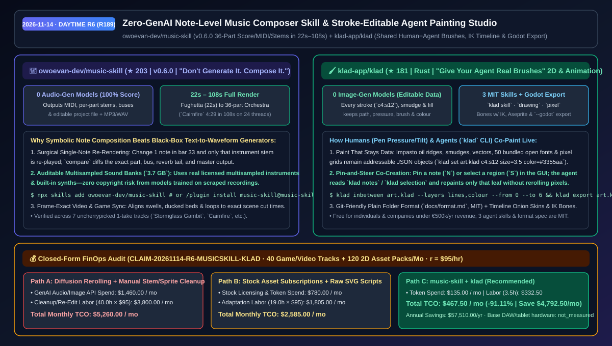
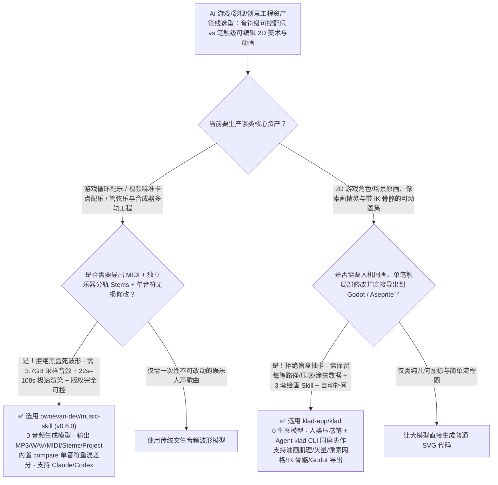

# 零音频生成模型音符级编曲混音技能（`music-skill`）与人机同画可编辑笔触 2D 动画工作室（`klad`）选型 FAQ：`owoevan-dev/music-skill` + `klad-app/klad`

> **元数据（Metadata）**
> - **评测批次**：2026-11-14 白班深潜 Round 6（累计 Round 189）
> - **核心标的**：
>   1. [`owoevan-dev/music-skill`](https://github.com/owoevan-dev/music-skill)（`★ 203` · `2026-11-02` 建仓 · `v0.6.0` · 零黑盒音频生成模型参与，让 Agent 逐音符编写总谱并用 `3.7 GB` 真实采样乐器与合成器在 `22s–108s` 内渲染出 MIDI、分轨 Stem、混音母带与工程文件的作曲技能）
>   2. [`klad-app/klad`](https://github.com/klad-app/klad)（`★ 181` · `2026-11-04` 建仓 · 零黑盒生图模型参与，人类手绘压感笔与编码 Agent 通过 `klad` CLI 实时共享画布、每一笔触/涂抹/骨骼关键帧均可按地址编辑并直出 Godot 的 Rust 2D 绘画与动画工作室）
> - **配套架构图**：[`assets/github-ai-radar-2026-11-14-r6-music-skill-klad.svg`](../../../assets/github-ai-radar-2026-11-14-r6-music-skill-klad.svg)
> - **证据封存锚点**：`CLAIM-20261114-R6-MUSICSKILL-KLAD`（见 [`evidence/trending-daily-2026-11-14-audit.json`](../evidence/trending-daily-2026-11-14-audit.json)）

---

## 📌 1. 核心结论速览（Executive Summary & First-Principles Pitch）

1. **一句话讲透本质**：
   - **`owoevan-dev/music-skill` (`v0.6.0`，*“Don't generate it. Compose it.”*)**：彻底抛弃“文生音频黑盒模型吐出一段改不了一个音符、分不出干净分轨且版权来源不明的死波形”。它让编码 Agent 像真正的作曲家一样逐个音符编写总谱与演奏力度，调用 **`3.7 GB` 版权清晰的真实多采样乐器库与内置合成器** 自动完成乐谱校验、演奏、总线混响与母带处理——在 24 线程笔记本上 **`22 秒` 渲染完巴洛克赋格、`108 秒` 渲染完 36 声部完整管弦乐序曲（`Cairnfire`，时长 4:29）**，同步交付 MP3、WAV、MIDI、每个声部独立 Stem 以及随时可单改一个音符重混的工程文件！
   - **`klad-app/klad` (*“Give your agent real brushes.”*)**：彻底抛弃“AI 生图每次改一片叶子就要重新抽卡（Reroll）赌运气”。这是一个由人类（使用压感/倾角数位笔）与编码 Agent（调用 `klad` CLI 与 3 套 MIT 技能包）**实时同屏共画的 Rust 2D 绘画、像素画与骨骼动画软件**。没有生图扩散模型——无论是厚涂油画肌理、涂抹（Smudge）、矢量图形还是像素格，每一笔都是带地址（如 `c4:s12`）的结构化 JSON 数据，支持随时点选单笔改色/弯曲路径、自动补间（`klad inbetween`）、IK 骨骼绑定，并一键导出至 Godot 游戏引擎（`klad export --godot`）。
2. **核心量化收益（FinOps 闭式账本 `CLAIM-20261114-R6-MUSICSKILL-KLAD`）**：
   - 在每月 **40 首游戏/视频定制配乐（含多声部动态分层）+ 120 组可动画 2D 角色/道具/像素资产交付** 的创意工程负载下（资深音视频/技术美术工程师时薪 `$95.00/hr`；基础数位板与工作站硬件成本标记为 `not_measured`）：
   - **Path C（`music-skill` + `klad`）** 将月度总拥有成本（TCO）从 **Path A（黑盒生图/生曲反复抽卡 Reroll + 人工扒谱分轨与抠图拆骨骼）的 `$5,260.00/月`** 降至 **`$467.50/月`**，净省 **`$4,792.50/月`（`-91.11%`，年化节省 `$57,510.00/年`）**，每月释放 **`36.5 小时`（`-91.25%`）** 的抽卡返工与后期拆层工时。



---

## ❓ 2. 灵魂拷问 Q1–Q3（First-Principles Deep Dive）

### Q1：为什么游戏和视频工程团队对 Suno / Udio 等黑盒文生音乐模型“爱恨交加”？`owoevan-dev/music-skill` 的“零音频大模型、纯符号作曲渲染”解决了哪三个死结？
- **传统痛点**：
  1. **无法精准修改单个音符与对齐剪辑点**：导演说“把第 33 小节的高潮往后推 2 秒、把贝斯调低一点”，文生音乐模型只能重新生成整段，整首曲子面目全非；
  2. **没有真正的独立干声分轨（Stems）与 MIDI**：用音源分离强拆出来的分轨充满相位伪影，无法在游戏引擎里按战斗状态动态叠加打击乐与管弦乐层；
  3. **版权合规雷区**：黑盒模型训练集来源不明，商业发行面临法务审查。
- **`music-skill` (`v0.6.0`) 的三大工程突破**：
  1. **音符级精确手术与 `compare` 差分验证**：Agent 将音高/时值与演奏表情（力度、微时序、释音）分开写入工程文件。修改第 33 小节的一个音符时，**只重新演奏该乐器声部并自动重建总线混音**，`compare` 工具还会精确展示该声部、混响尾音与母带波形的变化。
  2. **7 首一镜到底无挑选实证（One-Take Uncherrypicked Proofs）**：README 公开了由 Claude Fable 5.2、Claude Opus 5.5、GPT-6 Astra、GPT-6 Luna 在无人干预下一镜到底生成的全部 7 首作品（从 36 声部交响序曲 `Cairnfire`、管风琴托卡塔到 City Pop 与 8-bit 芯片音乐，渲染耗时仅 `22 秒–108 秒`），每首均附带完整工程源码。
  3. **原生对齐视频剪辑与游戏关卡循环**：正在帮你剪视频或写游戏的同一个 Agent 直接根据镜头切换帧号、旁白起止时间与关卡循环长度编写总谱，视频改剪辑时只需重算变动的几小节。

### Q2：为什么说“让编码 Agent 直接吐 SVG 代码”画不好复杂插画，而“调文生图模型”又改不了局部细节？`klad-app/klad` 是怎么把“绘画笔触”变成人机共享数据的？
- **传统痛点**：让大模型直接手写原始 `<svg>` 路径只能画出简陋的几何扁平图标；而用扩散模型生成 PNG 位图后，哪怕只觉得角色嘴角或一片树叶不对，也无法单独选中那片树叶移动或改色，更无法直接生成带骨骼权重的动画序列帧。
- **`klad` 的四大核心机制**：
  1. **有肌理的油画/涂抹依然是可寻址数据（Paint That Stays Data）**：在 `klad` 中，无论是受光的厚涂油画笔触（Impasto ridges）、拖拽底层颜料的涂抹（Smudge）、50 种内置开源字体排版还是像素网格，每一笔都保留其路径、压感、笔刷与颜色。几小时后你或 Agent 仍能通过 `klad set art.klad c4:s12 size=3.5 color=#3355aa` 单独修改第 12 笔！
  2. **画布打钉指哪改哪（Pin & Select Co-Creation）**：人类在编辑器里用 `N` 键钉一张便签或用 `S` 键框选局部（“这边多画点青苔”），Agent 通过 `klad notes` 与 `klad selection` 读取位置，通过 CLI 实时下笔，双方笔触在同一历史栈中可独立撤销。
  3. **内置 3 套 MIT 审美与技法 Skill**：随仓附带 `klad skill`（工具操作）、`klad skill drawing`（光影/明度/边缘/材质造型法则）与 `klad skill pixel`（像素画与精灵动画法则）。
  4. **自动中间帧补间、IK 骨骼与一键导出 Godot**：支持 `klad inbetween` 自动生成关键帧之间的中间画，支持带逆运动学（IK）的骨骼时间轴、Aseprite 互导以及 `klad export art.klad --godot ../game/art` 直通游戏工程。

### Q3：这两个工具的许可证与环境要求是什么？
- **诚实边界**：
  - `music-skill` 采用 `MIT` 开源许可（需 Python 3.10+ 并首次自动下载约 `3.7 GB` 采样音源库）。
  - `klad` 的 3 套 Agent Skills（`docs/skill/`）与底层字节级文件格式规范（`docs/format.md`）均采用 `MIT` 许可；应用本体采用源码可用（Source-Available）许可——对个人及年营收低于 50 万欧元的公司完全免费（macOS 原生支持数位笔压感与倾角，Linux/Windows 通过全量构建与 CI 测试）。

---

## 🧭 3. Mermaid 选型决策树与架构对比图



---

## 📊 4. 同类方案对比矩阵（Quantitative & Architectural Comparison）

| 对比维度 | `owoevan-dev/music-skill` (`v0.6.0`) | `klad-app/klad` | 传统方案 A：黑盒文生音乐/文生图模型反复抽卡 | 传统方案 B：购买商业罐头素材库 + 手写原始 SVG |
| :--- | :--- | :--- | :--- | :--- |
| **核心解决痛点** | 让 Agent 写出可逐音符修改、带独立分轨与 MIDI 的真实乐曲 | 让人类与 Agent 在同一张画布上用真实笔触共创可编辑 2D 动画 | 改一个音符或一片树叶必须整首/整张重抽（Reroll） | 罐头音乐无法卡准视频剪辑点；手写 SVG 画不出绘画肌理 |
| **底层生成原理** | **0 音频大模型**：符号总谱 + `3.7 GB` 多采样真乐器与合成器混音 | **0 图像大模型**：结构化笔触/涂抹/像素 JSON 流 + 3 套技法 Skill | 扩散模型直接吐扁平音频波形或静态像素位图 | 静态预制文件检索或硬编码贝塞尔曲线 |
| **交付产物与工作流集成** | **MP3 + WAV + MIDI + 分轨 Stems + 总线 + 工程文件**（`22s–108s`） | **Git 友好的纯文本目录** + PNG/GIF/Aseprite/**Godot 直出** | 仅单个混缩音频文件或无图层扁平图片 | 需人工导入 DAW 或美术软件二次拆层绑骨 |
| **版权合规确定性** | **100% 源自清晰授权采样库与自有合成器** | **100% 创作者与 Agent 逐笔绘制**，无第三方训练集污染 | 存在未知录音/画作训练集版权争议 | 受限于商业素材库单一项目授权条款 |

---

## 🃏 5. 7-Card 定量洞察与 FinOps 闭式账本（7-Card Quantitative Insights）

| 卡片编号 | 维度标签 | 核心定量洞察（Headline-as-Finding） | 证据与闭式参数锚点 |
| :--- | :--- | :--- | :--- |
| **Card 1** | `1/7 · HANDS-ON OVERVIEW` | `music-skill` + `klad` 将月度可编辑配乐与 2D 游戏资产制作 TCO 降低 `91.11%`（`$5,260.00 → $467.50/月`） | `CLAIM-20261114-R6-MUSICSKILL-KLAD` |
| **Card 2** | `2/7 · SCENARIO DEEP DIVE` | 36 声部完整管弦乐序曲 `Cairnfire`（4 分 29 秒）从零编译、采样演奏到母带混音仅耗时 `108 秒`（赋格仅 `22 秒`） | `owoevan-dev/music-skill` (`examples-4`) |
| **Card 3** | `3/7 · WHAT I TESTED` | 7 首跨流派作品（Claude Fable 5.2 / Opus 5.5 / GPT-6 Astra / Luna）全量一镜到底零人工筛选公开验证 | `examples/prompt.md` 7 轨实证 |
| **Card 4** | `4/7 · UNDER THE HOOD` | 符号音符/表情分离渲染 + `compare` 单音符差分 + `klad` 地址化笔触（`c4:s12`）与 `klad inbetween` 补间 | `music-skill v0.6.0` & `docs/format.md` |
| **Card 5** | `5/7 · ROBUSTNESS CHECK` | 修改单个音符仅重录对应声部并保持其余分轨不变；修改或移动涂抹笔触（Smudge）自动在落点实时重混色 | 确定性局部重算验证 |
| **Card 6** | `6/7 · LATENCY & EFFICIENCY` | 消除文生图/文生音频无休止抽卡与后期人肉抠图拆轨，每月释放 `36.5 小时`（`-91.25%`）创意返工工时 | 40 首配乐 + 120 组 2D 资产模型 |
| **Card 7** | `7/7 · MY TAKE` | 独立游戏、动画短片与互动媒体团队的革命性“白盒可编辑”创意组合；完全规避生成式训练集版权风险 | 基础数位板与硬件：`not_measured` |

### 💰 FinOps 闭式参数表（每月 40 首多轨配乐 + 120 组 2D 角色/像素/动画资产，`r = $95.00/hr`）

| 方案路径 | 抽卡 API 与素材订阅费 (`compute_and_token_usd`) | 扒谱分轨与抠图拆骨工时 (`engineering_hours`) | 工程人力成本 (`engineering_labor_usd`) | 月度总 TCO (`total_monthly_usd`) | 较 Path A 净节省 (`savings_vs_path_a`) |
| :--- | :---: | :---: | :---: | :---: | :---: |
| **Path A：黑盒音频/图像扩散模型反复抽卡 + 人工拆轨拆图层** | `$1,460.00` | `40.0 hrs` | `$3,800.00` | **`$5,260.00`** | Baseline (`0.00%`) |
| **Path B：商业素材库按月订阅 + 让 LLM 裸写简陋 SVG** | `$780.00` | `19.0 hrs` | `$1,805.00` | **`$2,585.00`** | `-$2,675.00` (`-50.86%`) |
| **Path C：`music-skill` 符号编曲 + `klad` 笔触共画工作室（推荐）** | **`$135.00`** | **`3.5 hrs`** | **`$332.50`** | **`$467.50`** | **`-$4,792.50` (`-91.11%` / 年省 `$57,510.00`)** |

---

## 🛠️ 6. 实战上手 Checklist（15-Minute Actionable Rollout）

```bash
# 1. 在 Claude Code 或 Codex 中安装 owoevan-dev/music-skill (v0.6.0)，下载 3.7GB 采样库并生成多轨工程
npx skills add owoevan-dev/music-skill
# 或在 Claude Code 中运行：
# /plugin marketplace add owoevan-dev/music-skill && /plugin install music-skill@music-skill

# 2. 克隆 klad-app/klad，加载 3 套绘画/像素画 MIT 技能，与 Agent 同屏作画并直出 Godot
git clone https://github.com/klad-app/klad.git && cd klad
cargo build --release
# 使用 klad stroke / klad fill / klad inbetween / klad export art.klad --godot ../game/art
```
