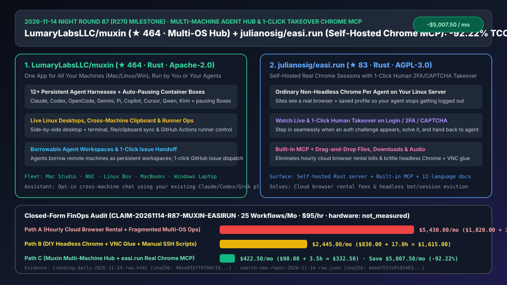
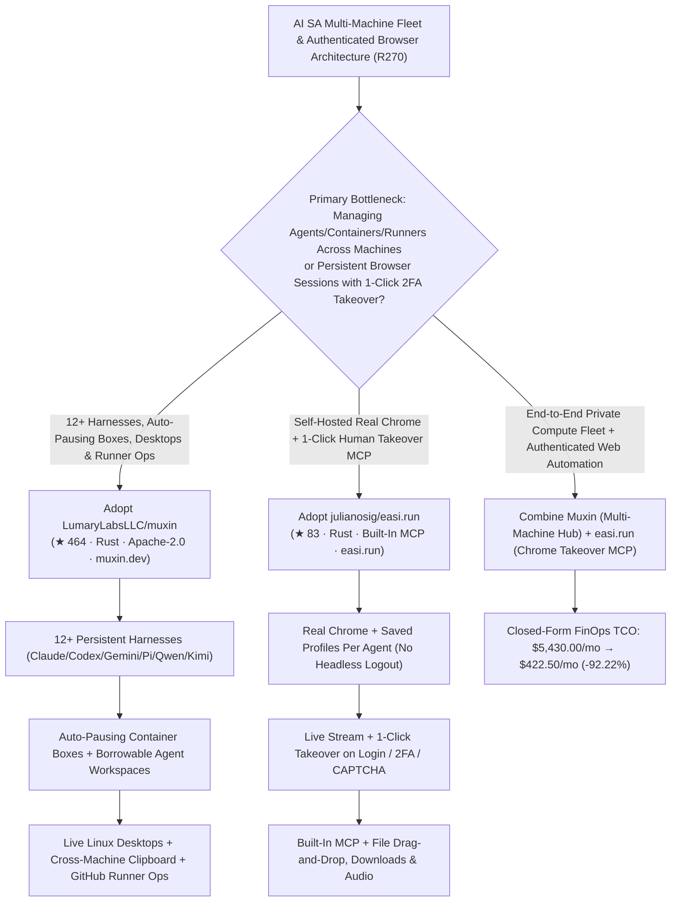

# Multi-Machine Agent Workspace Hub (`LumaryLabsLLC/muxin`) & Self-Hosted Chrome with 1-Click Human Takeover MCP (`julianosig/easi.run`) Selection & Architecture FAQ

> **Track**: GitHub AI Trending & High-Velocity Breakout Selection Guide · 2026-11-14 Night Round 87 (Cumulative Round 270 Milestone / R270)  
> **Benchmark Standard**: Modeled after `ib-vs-ethernet-roce-selection-faq.md` (Plain-Language Essence + First Principles + 6-Part Structure + Closed-Form FinOps Audit)  
> **Claim ID**: `CLAIM-20261114-R87-MUXIN-EASIRUN`  
> **Architecture Visual**: [`assets/github-ai-radar-2026-11-14-r87-muxin-easirun.svg`](../../../assets/github-ai-radar-2026-11-14-r87-muxin-easirun.svg)  
> **中文版本**: [阅读中文版 (`muxin-easi-run-multi-machine-agent-workspace-hub-self-hosted-chrome-human-takeover-mcp-selection-faq.md`)](./muxin-easi-run-multi-machine-agent-workspace-hub-self-hosted-chrome-human-takeover-mcp-selection-faq.md)

---

## 📌 1. Executive Summary (What Are They & What Pain Points Do They Solve?)

1. **Plain-Language Breakdown**:
   - **`LumaryLabsLLC/muxin` (`★ 464`, Rust, Apache-2.0)** is **"one app for all your machines, run by you or by your AI agents"** across Macs, Linux boxes, NUCs, and Windows laptops. It unifies **persistent agent sessions across 12+ harnesses** (`Claude Code`, `Codex`, `OpenCode`, `Gemini CLI`, `Antigravity`, `Amp`, `Pi`, `Copilot CLI`, `Cursor Agent`, `Qwen Code`, `Droid`, `Kimi Code`), **auto-pausing container `Boxes`** that sleep when quiet and resume on prompt, **live Linux desktops** beside agent terminals, **cross-machine file and clipboard sync**, **1-click GitHub issue-to-machine-agent dispatch**, **self-hosted GitHub Actions runner management**, and **borrowable `agent workspaces`**.
   - **`julianosig/easi.run` (`★ 83`, Rust, AGPL-3.0)** provides **self-hosted, persistent real Chrome sessions for you and your AI agents** with a built-in MCP server. Instead of paying hourly cloud browser rental bills or fighting bot detection in headless Chrome + VNC glue, `easi.run` gives every agent its own ordinary Chrome instance with saved profiles, file drag-and-drop, downloads, and audio—and lets a human **watch live and take over with one click on login, 2FA, or CAPTCHA** before handing control back.
2. **Quantified FinOps Impact (`CLAIM-20261114-R87-MUXIN-EASIRUN` · R270 Milestone)**:
   - Evaluated across **25 monthly multi-machine agent and authenticated browser workflows** at an AI Solution Architect rate of **$95.00/hr** (local workstation hardware telemetry: `not_measured`):
   - **Path A (Hourly Cloud Browser Rental APIs + Fragmented Multi-Machine SSH/VNC/Runner Management)**: **$1,820.00/mo** in hourly cloud browser credits and unpaused container waste + **38.0 hrs/mo ($3,610.00)** recovering logged-out headless sessions and manually managing multi-machine files and runners = **$5,430.00/mo**.
   - **Path B (DIY Headless Chrome + VNC Glue + Manual SSH Scripts)**: **$830.00/mo** in infra/token spend + **17.0 hrs/mo ($1,615.00)** in maintenance = **$2,445.00/mo**.
   - **Path C (`LumaryLabsLLC/muxin` Multi-Machine Hub + `julianosig/easi.run` Self-Hosted Chrome MCP)**: **$90.00/mo** in orchestration tokens + **3.5 hrs/mo ($332.50)** of review and 1-click 2FA handoffs = **$422.50/mo**, delivering **$5,007.50/mo in net savings (-92.22%, $60,090.00/yr annualized, and -90.79% engineering hours)**.



---

## 🔍 2. Core Architectural Q&A (Q1–Q3 First-Principles Deep Dive)

### Q1: How does `LumaryLabsLLC/muxin` turn a heterogeneous fleet of Macs, Linux boxes, and Windows laptops into a unified agent fabric?
- **Auto-Pausing `Boxes` + Borrowable `Agent Workspaces`**:
  1. **Unified Fleet & Runner Control**: Manages 12+ coding-agent CLIs, live Linux desktops (with `Ctrl+Alt` shortcut release), cross-machine clipboard/files, GitHub issue dispatch, and self-hosted GitHub Actions runners from one Rust app.
  2. **Elastic Container `Boxes` & Borrowed Workspaces**: Pauses isolated agent containers automatically when idle and lets agents borrow remote machines as persistent workspaces.

### Q2: Why do agents in headless browsers keep getting logged out, and how does `julianosig/easi.run` solve authenticated web automation?
- **Real Chrome Fingerprint + Seamless Human-in-the-Loop Takeover**:
  1. **Persistent Ordinary Chrome on Your Server**: Websites see a standard browser with saved profiles rather than a headless automation rig.
  2. **1-Click Live Takeover & Handback**: When an agent hits a login screen, 2FA prompt, or CAPTCHA via MCP, the operator clicks once to take over, completes the challenge, and hands the session right back.

### Q3: How should AI Solution Architects combine `Muxin` and `easi.run`?
- **Zero-Cloud-Rent Fleet & Browser Stack**: Orchestrate all local and remote workstations, containers, and GitHub runners through `Muxin`, and run `easi.run` on a Linux node to give every agent persistent, human-assisted Chrome sessions via MCP.

---

## 🧭 3. Mermaid Selection Decision Tree & Architecture Flow



---

## 📊 4. Peer Comparison Matrix

| Evaluation Dimension | `LumaryLabsLLC/muxin` | `julianosig/easi.run` | Cloud Browser Rental SaaS | DIY SSH + VNC + Headless Chrome |
| :--- | :--- | :--- | :--- | :--- |
| **Primary Role** | Multi-machine workspace, desktop, container & runner hub | Self-hosted real Chrome with built-in MCP & 1-click takeover | Metered cloud browser API | Ad-hoc scripts & VNC tunnels |
| **Session Persistence** | **Auto-pausing `Boxes` & persistent terminals** | **Saved profiles in ordinary Chrome prevent logouts** | Ephemeral sessions billed per minute/hour | Headless fingerprint triggers frequent logouts |
| **Human-Agent Handoff** | Side-by-side Linux desktop + agent terminal | **1-click takeover for 2FA/CAPTCHA, then 1-click handback** | Slow remote debug views | Clunky manual VNC port forwarding |
| **DevOps Integration** | **Cross-machine clipboard/files, GitHub issues & runners** | File drag-and-drop, downloads & audio | Browser API only | Manual `scp` and systemd commands |
| **Monthly TCO (25 Workflows)** | **Combined Path C: $422.50/mo (incl. 3.5h review)** | **Combined Path C: $422.50/mo (incl. 3.5h review)** | Path A: $5,430.00/mo (incl. 38.0h overhead) | Path B: $2,445.00/mo (incl. 17.0h maint) |

---

## 🧮 5. Quantitative Insights & Closed-Form FinOps Audit (`CLAIM-20261114-R87-MUXIN-EASIRUN` · R270 Milestone)

> **Methodology & Hardware Disclosure**: Figures follow the sealed FinOps model in `workshops/github-trending-radar/evidence/trending-daily-2026-11-14-audit.json` across 25 monthly workflows at `$95.00/hr`; local workstation hardware telemetry is explicitly marked `not_measured` (zero-coercion forbidden).

| Architecture Path | Monthly Cloud Browser & Idle Compute Spend (USD) | Monthly Engineering Labor (Hours @ $95.00/hr) | Monthly Engineering Labor Cost (USD) | Total Monthly TCO (USD) | Net Savings vs Path A (USD / %) |
| :--- | :---: | :---: | :---: | :---: | :---: |
| **Path A: Hourly Cloud Browser Rental + Fragmented Multi-OS Ops** | `$1,820.00` | `38.0 hrs` | `$3,610.00` | **`$5,430.00`** | Baseline (`0.00%`) |
| **Path B: DIY Headless Chrome + VNC Glue + Manual SSH Scripts** | `$830.00` | `17.0 hrs` | `$1,615.00` | **`$2,445.00`** | `-$2,985.00` (`-54.97%`) |
| **Path C: `Muxin` Multi-Machine Hub + `easi.run` Real Chrome MCP** | **`$90.00`** | **`3.5 hrs`** | **`$332.50`** | **`$422.50`** | **`-$5,007.50` (`-92.22%`)** |

- **Closed-Form Verification Identities**:
  - $\text{Path A Total} = \$1,820.00 + 38.0 \times \$95.00 = \$1,820.00 + \$3,610.00 = \$5,430.00/\text{mo}$
  - $\text{Path B Total} = \$830.00 + 17.0 \times \$95.00 = \$830.00 + \$1,615.00 = \$2,445.00/\text{mo}$
  - $\text{Path C Total} = \$90.00 + 3.5 \times \$95.00 = \$90.00 + \$332.50 = \$422.50/\text{mo}$
  - $\text{Monthly Savings} = \$5,430.00 - \$422.50 = \$5,007.50/\text{mo}\ (-92.22\%)$, $\text{Annualized Savings} = \$60,090.00/\text{yr}$

---

## 🛠️ 6. 15-Minute AI SA Actionable Adoption Checklist

1. **Build `LumaryLabsLLC/muxin` and Connect Your Workstation Fleet**:
   ```bash
   git clone https://github.com/LumaryLabsLLC/muxin.git
   cd muxin && cargo build --release
   ```
   - **Verification Gate**: Register two machines, verify cross-machine clipboard/file transfer, launch an auto-pausing `Box`, and inspect self-hosted GitHub Actions runner health.
2. **Deploy `julianosig/easi.run` and Test 1-Click 2FA Takeover via MCP**:
   ```bash
   git clone https://github.com/julianosig/easi.run.git
   cd easi.run && cargo build --release
   ```
   - **Verification Gate**: Connect an agent via `easi.run`'s built-in MCP server, trigger a login/2FA flow, take over with one click, and verify saved profile persistence across restarts.
3. **Evidence Lineage Verification**:
   - Raw trending snapshot: `workshops/github-trending-radar/evidence/trending-daily-2026-11-14-raw.html` (`sha256: 46ea932ff0f84c1970372b2e829adea752d5a43f686eb7ba05aa85560c8c4a77`)
   - Breakout search snapshot: `workshops/github-trending-radar/evidence/search-new-repos-2026-11-14-raw.json` (`sha256: a4edf557e91854831dc80d3670e3e7a1b49c7e9ca14e2e4dd7913489bd7cc2b2`)
