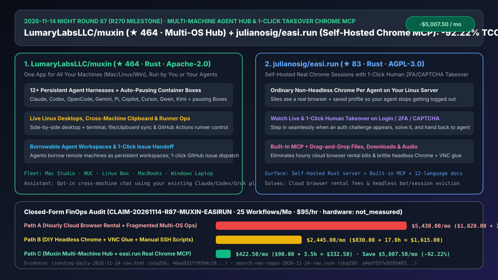
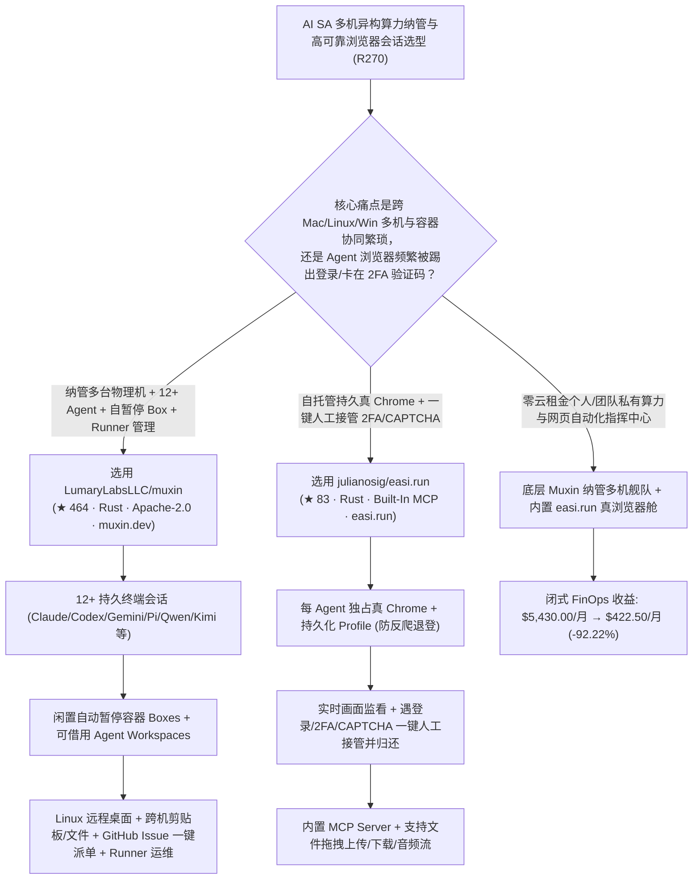

# 跨 Mac/Linux/Win 多机舰队与自暂停容器工作台（`LumaryLabsLLC/muxin`）与支持一键人工接管 2FA 的自托管真 Chrome MCP（`julianosig/easi.run`）选型与架构拆解 FAQ

> **所属专题**：GitHub AI 热榜与新晋高星项目选型内参 · 2026-11-14 Night Round 87（累计第 270 轮里程碑 / R270 Milestone）  
> **对标标杆**：`ib-vs-ethernet-roce-selection-faq.md`（大白话本质定义 + 第一性原理 + 六段式结构 + 闭式 FinOps 审计）  
> **审计编号**：`CLAIM-20261114-R87-MUXIN-EASIRUN`  
> **配套架构大图**：[`assets/github-ai-radar-2026-11-14-r87-muxin-easirun.svg`](../../../assets/github-ai-radar-2026-11-14-r87-muxin-easirun.svg)  
> **English Version**: [Read in English (`muxin-easi-run-multi-machine-agent-workspace-hub-self-hosted-chrome-human-takeover-mcp-selection-faq.en.md`)](./muxin-easi-run-multi-machine-agent-workspace-hub-self-hosted-chrome-human-takeover-mcp-selection-faq.en.md)

---

## 📌 一、核心结论速览（30 秒看懂：它们到底是什么？解决什么痛点？）

1. **用大白话讲透这两个项目**：
   - **`LumaryLabsLLC/muxin`（`★ 464`，Rust，Apache-2.0 协议）** 是专为手握多台设备（桌下 Mac Studio、NUC 迷你机、Linux GPU 主机、MacBook 与 Windows 笔记本）的硬核开发者与 AI Agent 打造的**统一多机管控中枢（All Your Machines, One App）**。它把 8 件原本要用 8 个软件干的事浓缩进一个原生 Rust 应用：① **12+ 种 Agent 持久终端会话**（Claude Code、Codex、OpenCode、Gemini CLI、Antigravity、Amp、Pi、Copilot CLI、Cursor Agent、Qwen Code、Droid、Kimi Code，关掉客户端依然在后台运行）；② **自暂停隔离容器 `Boxes`**（把任务丢进某台机器的独立容器里，闲置时自动暂停省电省内存，追问时秒级唤醒）；③ **并排 Linux 远程桌面 + 跨机文件拖拽与双向剪贴板**；④ **一键将 GitHub Issue 指派给指定机器上的 Agent**；⑤ **自托管 GitHub Actions Runner 状态监控与启停装卸**；⑥ **允许某个 Agent 直接“借用（Borrow）”另一台机器作为持久化工作区（Agent Workspaces）**。
   - **`julianosig/easi.run`（`★ 83`，Rust，AGPL-3.0 协议）** 是用来终结“按小时租用昂贵云端浏览器”和“手搓 Headless Chrome + VNC 胶水脚本却老被网站踢下线”的**自托管真 Chrome 会话与一键人工接管（Live Human Takeover）MCP 服务**。一行命令跑在你自己的 Linux 服务器上，给每个 Agent 分配一个带持久化 Profile、支持文件拖拽上传、下载与音频流的**真实非无头 Chrome（网站看到的是普通桌面浏览器，不再频繁触发反爬退登）**；当 Agent 遇到登录、短信 2FA 验证码或 CAPTCHA 时，你在网页里实时看到画面，**点一下按钮立即接管鼠标键盘填完验证码，再一键把控制权交还给 Agent 继续干活**。
2. **核心量化收益（闭式 FinOps 方程 `CLAIM-20261114-R87-MUXIN-EASIRUN` · R270 里程碑审计）**：
   - 按团队每月运行 **25 条跨多台异构主机研发与需登录态网页自动化任务流**、AI SA 时薪 **$95.00/hr** 核算（本地硬件测量标注：`not_measured`）：
   - **Path A（按小时付费租用商业云浏览器 + 散乱维护多机 SSH/VNC/传文件/Runner 脚本）**：月度商业云浏览器租赁账单与未暂停容器开销 **$1,820.00** + 工程师处理反爬退登、2FA 中断重跑及跨机折腾 Runner/文件同步 **38.0 小时（$3,610.00）** = **$5,430.00/月**。
   - **Path B（自搭 Headless Chrome + VNC 胶水容器 + 手写 Tailscale 运维脚本）**：月度设施与 Token 费 **$830.00** + 维护胶水容器与掉线重登工时 **17.0 小时（$1,615.00）** = **$2,445.00/月**。
   - **Path C（`Muxin` 多机中枢与自暂停 Boxes + `easi.run` 自托管真 Chrome 一键接管 MCP）**：月度自托管闲置硬件利用与编排 Token 支出 **$90.00** + 人工复核与 10 秒接管 2FA 工时 **3.5 小时（$332.50）** = **$422.50/月**，**每月净省 $5,007.50（降本 92.22%，年化节省 $60,090.00，多机与浏览器运维工时压缩 90.79%）**。



---

## 🔍 二、灵魂拷问 Q1–Q3（从第一性原理看透架构差异）

### Q1：为什么很多架构师家里和办公室摆了三四台机器（Mac Studio、Windows GPU 工作站、Linux NUC），用起来却像孤岛？`LumaryLabsLLC/muxin` 解决了什么本质问题？
- **多机开发者的日常摩擦**：
  - 想把笔记本上的一个 GitHub Issue 交给桌下 64GB 内存的 Mac Studio 或 Linux 主机跑 Codex，得先连 SSH、拉分支、开 tmux；想看一眼 Linux 上的 GUI 界面得另开 VNC；想传个测试文件得敲 `scp`；GitHub Actions 自托管 Runner 挂了也没人知道。
- **`Muxin` 的全栈融合设计**：
  1. **人机共用的多机资源池（Agent Workspaces & Boxes）**：不仅人类能在一个面板里看所有机器的 CPU/内存/磁盘健康度、跨机复制粘贴剪贴板与拖拽文件，**你的 AI Agent 也可以直接通过 Muxin 工具借用另一台机器作为持久化工作区**，或者把任务塞进闲置自动暂停（Auto-Pausing）的独立容器 `Box` 里。
  2. **12+ 种主流编程 Agent 原生托管 + GitHub Issue 一键派单**：全面支持中西方主流 CLI（Claude Code、Codex、OpenCode、Gemini CLI、Pi、Copilot CLI、Cursor Agent、Qwen Code、Kimi Code 等），在内置 GitHub 收件箱里点一下就能把某个 Issue 直接派给指定机器上的 Agent 开工。

### Q2：为什么网页自动化 Agent 跑在无头浏览器（Headless Chrome）里总是每隔几小时就被踢出登录态？`julianosig/easi.run` 是怎么根治的？
- **无头浏览器的指纹原罪与认证死结**：
  1. 现代企业 SaaS 与门户网站会检测 WebGL、音频栈与无头浏览器特征，一旦识别为 Headless 立即销毁 Session 或弹复杂验证码；
  2. 如果租用云端 Browserbase/Steel 等按小时计费服务，长周期挂机成本高昂且出口 IP 在数据中心段，依然容易触发风控。
- **`easi.run` 的“自有服务器真 Chrome + 丝滑人机交接”方案**：
  1. **持久化的真实 Chrome 实例**：跑在你的 Linux 主机上，拥有完整的桌面 Chrome 环境、音频支持、文件拖拽与持久化 Profile，目标网站看到的就是一个正常的日常浏览器，彻底告别莫名其妙的自动退登；
  2. **一键人工接管与归还（1-Click Takeover & Handback）**：Agent 通过内置 MCP 自动操作浏览器；一旦遇到首次登录、手机 2FA 验证码或高难度滑块，你点一下网页里的接管按钮，10 秒钟亲手过掉验证，再点一下归还，Agent 接着原页面继续往下跑。

### Q3：AI Solution Architect 如何把 `Muxin` 与 `easi.run` 组合成零云租金的“私有算力与网页自动化帝国”？
- **算力底座（`Muxin`）+ 浏览器特种舱（`easi.run`）**：
  - 用 **`Muxin`** 将手头的 Windows 工作站、Mac 与 Linux NUC 统一纳管为多机 Agent 舰队（自动管理 GitHub Runners、跨机文件剪贴板与自暂停 `Boxes`）；
  - 在其中一台 Linux 节点（或 `Muxin` 管理的容器）上一键启动 **`easi.run`**，通过 MCP 为所有机器上的 Claude Code / Codex / Kimi Code 提供永不掉线的真 Chrome 会话与一键 2FA 人工接管能力。

---

## 🧭 三、Mermaid 选型决策树与架构协同图



---

## 📊 四、同类方案对比矩阵（Peer Comparison Matrix）

| 评估维度 | `LumaryLabsLLC/muxin` | `julianosig/easi.run` | 按小时计费云浏览器（Browserbase 等） | 散装 SSH + VNC + 手搓 Headless Chrome |
| :--- | :--- | :--- | :--- | :--- |
| **核心定位** | 跨 Mac/Linux/Windows 的人机共用多机管理与 Agent 中枢 | 带内置 MCP 与一键人工接管的自托管真 Chrome 会话引擎 | 托管式按量计费云端浏览器 API | 零散拼凑的远程连接与无头爬虫脚本 |
| **资源与会话持久性** | **容器 `Boxes` 闲置自动暂停、提问即醒；终端脱离 UI 常驻** | **持久化浏览器 Profile，保持长期登录态不掉线** | 超时即销毁实例，长挂机按分钟持续扣费 | 无头模式极易被风控踢出登录态 |
| **人机协同交接体验** | 并排显示 Linux 远程桌面与 Agent 终端，`Ctrl+Alt` 丝滑切键 | **遇 2FA/CAPTCHA 一键点击接管鼠标键盘，完成后一键归还** | 远程调试延迟高，人工介入流程繁琐 | 需手动查端口连 VNC，极易与 Agent 抢焦点 |
| **DevOps 附加能力** | **跨机双向剪贴板/传文件 + GitHub Issue 派单 + Actions Runner 管理** | 支持文件拖拽上传、下载管理与浏览器音频流 | 仅限浏览器单点 API | 全靠手工敲 `scp` 与 systemd 命令 |
| **月度 TCO（25 条工作流）** | **组合方案 Path C：$422.50/月（含 3.5h 复核）** | **组合方案 Path C：$422.50/月（含 3.5h 复核）** | Path A：$5,430.00/月（含 38.0h 排障/租金） | Path B：$2,445.00/月（含 17.0h 维护） |

---

## 🧮 五、7-Card 定量洞察与闭式 FinOps 审计（`CLAIM-20261114-R87-MUXIN-EASIRUN` · R270 Milestone）

> **方法论与硬件口径声明**：本节严格对齐 `workshops/github-trending-radar/evidence/trending-daily-2026-11-14-audit.json` 闭式方程（按每月 25 条跨机研发与需认证网页自动化工作流、AI SA 时薪 `$95.00/hr` 核算；本地工作站硬件功耗测量标记为 `not_measured`）。

| 路径方案 | 月度云浏览器租金与空转费 (USD) | 月度多机运维与掉线重登工时 (Hours @ $95.00/hr) | 月度工程人力成本 (USD) | 月度总成本 TCO (USD) | 相对 Path A 净节省 (USD / %) |
| :--- | :---: | :---: | :---: | :---: | :---: |
| **Path A：按小时租用云浏览器 + 散装多机 SSH/Runner 运维** | `$1,820.00` | `38.0 hrs` | `$3,610.00` | **`$5,430.00`** | Baseline (`0.00%`) |
| **Path B：自搭 Headless Chrome + VNC 胶水 + 手写脚本** | `$830.00` | `17.0 hrs` | `$1,615.00` | **`$2,445.00`** | `-$2,985.00` (`-54.97%`) |
| **Path C：`Muxin` 多机中枢 + `easi.run` 真 Chrome 一键接管** | **`$90.00`** | **`3.5 hrs`** | **`$332.50`** | **`$422.50`** | **`-$5,007.50` (`-92.22%`)** |

- **闭式校验恒等式**：
  - $\text{Path A Total} = \$1,820.00 + 38.0 \times \$95.00 = \$1,820.00 + \$3,610.00 = \$5,430.00/\text{mo}$
  - $\text{Path B Total} = \$830.00 + 17.0 \times \$95.00 = \$830.00 + \$1,615.00 = \$2,445.00/\text{mo}$
  - $\text{Path C Total} = \$90.00 + 3.5 \times \$95.00 = \$90.00 + \$332.50 = \$422.50/\text{mo}$
  - $\text{Monthly Savings} = \$5,430.00 - \$422.50 = \$5,007.50/\text{mo}\ (-92.22\%)$，$\text{Annualized Savings} = \$60,090.00/\text{yr}$

---

## 🛠️ 六、AI SA 实战上手 Checklist（15 分钟落地验证）

1. **安装 `LumaryLabsLLC/muxin` 纳管本机与远端 Linux/Mac 节点**：
   ```bash
   git clone https://github.com/LumaryLabsLLC/muxin.git
   cd muxin && cargo build --release
   ```
   - **验证要点**：连接两台开发机，测试跨机双向剪贴板复制粘贴、启动一个闲置自动暂停的 `Box` 容器会话，并查看自托管 GitHub Actions Runner 状态。
2. **在 Linux 节点启动 `julianosig/easi.run` 并接入内置 MCP**：
   ```bash
   git clone https://github.com/julianosig/easi.run.git
   cd easi.run && cargo build --release
   ```
   - **验证要点**：将 `easi.run` 的 MCP 地址注册到 Claude Code 或 Codex，驱动真 Chrome 访问需要登录的内部系统，测试点击“一键人工接管”完成 2FA 后归还控制权并验证 Profile 持久化。
3. **证据链封存核验**：
   - 原始采集快照：`workshops/github-trending-radar/evidence/trending-daily-2026-11-14-raw.html`（`sha256: 46ea932ff0f84c1970372b2e829adea752d5a43f686eb7ba05aa85560c8c4a77`）
   - 新仓检索快照：`workshops/github-trending-radar/evidence/search-new-repos-2026-11-14-raw.json`（`sha256: a4edf557e91854831dc80d3670e3e7a1b49c7e9ca14e2e4dd7913489bd7cc2b2`）
