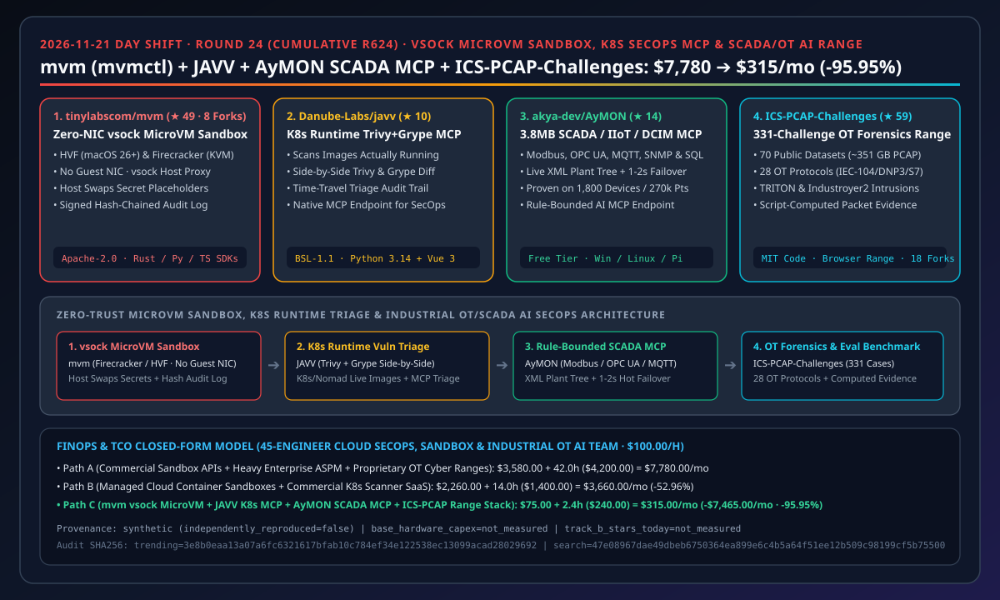
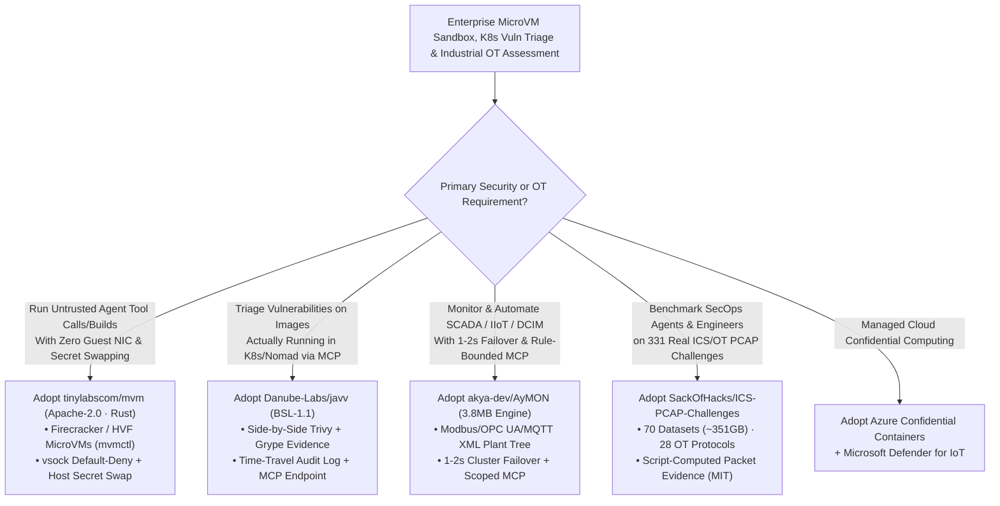
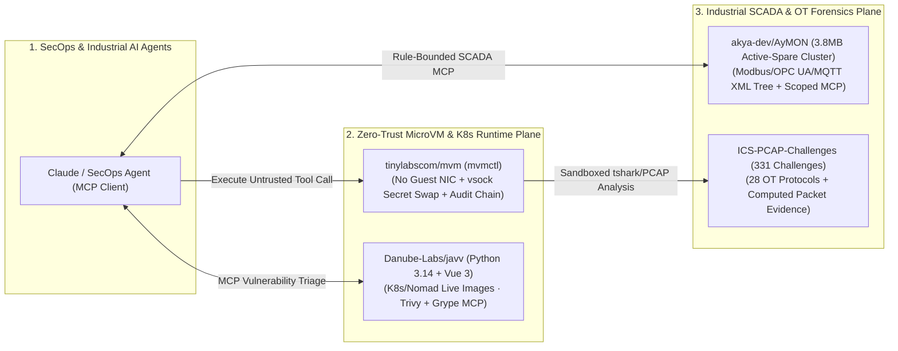

# Zero-NIC `vsock` MicroVM Sandbox (`tinylabscom/mvm`), K8s Runtime Trivy+Grype Triage MCP (`Danube-Labs/javv`), 3.8MB SCADA/IIoT/DCIM MCP Engine (`akya-dev/AyMON`) & 331-Challenge Industrial OT PCAP Range (`SackOfHacks/ICS-PCAP-Challenges`) Selection FAQ

> **Document Metadata (2026-11-21 Day Shift Round 24 · Cumulative Round 624 Deep-Dive)**  
> - **Target Audience**: Enterprise AI Solution Architects, Cloud-Native SecOps Architects, and Industrial IIoT / SCADA / DCIM Platform Leads  
> - **Evaluated Repositories**:  
>   1. [`tinylabscom/mvm`](https://github.com/tinylabscom/mvm) (`★ 49` · `8 forks` · Rust · Apache-2.0 · Hardware-virtualized microVMs `mvmctl` + Python/TS/Rust SDKs for untrusted agent tool calls using HVF on macOS 26+ and Firecracker on Linux `/dev/kvm`, featuring **zero guest NIC**, `vsock` host egress proxy with secret placeholder swapping, and hash-chained signed execution plans)  
>   2. [`Danube-Labs/javv`](https://github.com/Danube-Labs/javv) (`★ 10` · `0 forks` · Python 3.14 / Vue 3 · BSL-1.1 · **Just Another Vulnerability Viewer**: Scans container images *actually running* in Kubernetes, Nomad, and Docker Compose with **Trivy and Grype** side by side, full time-travel triage audit trails, and an **MCP endpoint** for AI agents)  
>   3. [`akya-dev/AyMON`](https://github.com/akya-dev/AyMON) (`★ 14` · `4 forks` · `3.8 MB` Industrial SCADA / IIoT / DCIM Engine · Models plants and data centers [proven on 1,800+ devices / 270,000 points] as a live XML-shaped tree over Modbus, OPC UA, MQTT, SNMP, and SQL with 1–2s cluster failover and a rule-bounded **MCP endpoint**)  
>   4. [`SackOfHacks/ICS-PCAP-Challenges`](https://github.com/SackOfHacks/ICS-PCAP-Challenges) (`★ 59` · `18 forks` · JavaScript · MIT code · Browser-hosted industrial network-forensics range featuring **331 guided challenges** over **70 credited public datasets** [`~351 GB`] and **28 OT protocols** with script-computed packet evidence)  
> - **Sealed Evidence Chain**: `workshops/github-trending-radar/evidence/search-new-repos-2026-11-21-raw.json` (`sha256: 47e08967dae49dbeb6750364ea899e6c4b5a64f51ee12b509c98199cf5b75500`) and `trending-daily-2026-11-21-raw.html` (`sha256: 3e8b0eaa13a07a6fc6321617bfab10c784ef34e122538ec13099acad28029692`)  
> - **Architecture Visual**: [`assets/github-ai-radar-2026-11-21-r24-r624-mvm-javv-aymon-icspcap.svg`](../../../assets/github-ai-radar-2026-11-21-r24-r624-mvm-javv-aymon-icspcap.svg) · [中文版 (`mvm-javv-aymon-ics-pcap-challenges-selection-faq.md`)](mvm-javv-aymon-ics-pcap-challenges-selection-faq.md)



---

## ① 📌 Executive Summary (One-Sentence Selection Verdict)

> **Solution Architect's Verdict**:  
> When deploying AI agents across **untrusted code sandboxes, Kubernetes vulnerability operations, and industrial SCADA / DCIM environments**, shared-kernel Docker containers and raw credential injection violate zero-trust boundaries.  
> - **To isolate untrusted agent tool calls and third-party builds in a dedicated-kernel microVM (Firecracker on Linux `/dev/kvm`, HVF on macOS 26+) with zero guest network card, `vsock` default-deny egress, host-side secret placeholder swapping, and a hash-chained audit log** ➔ Choose **`tinylabscom/mvm`** (Apache-2.0, `mvmctl`);  
> - **To triage vulnerabilities only on images *actually running* in Kubernetes, Nomad, or Docker Compose using side-by-side Trivy + Grype evidence, time-travel audit logs, and an AI MCP endpoint** ➔ Choose **`Danube-Labs/javv`** (BSL-1.1);  
> - **To monitor and automate industrial plants or data centers (`1,800+` devices / `270,000` points) with a `3.8 MB` XML-tree engine speaking Modbus, OPC UA, MQTT, and SNMP with 1–2s failover and a rule-bounded MCP endpoint** ➔ Choose **`akya-dev/AyMON`**;  
> - **To benchmark SecOps agents and train engineers on 331 hands-on ICS/OT packet-forensics challenges across 70 public datasets (`~351 GB`) and 28 OT protocols with script-computed packet evidence** ➔ Choose **`SackOfHacks/ICS-PCAP-Challenges`** (MIT code).  
> Together, this stack cuts monthly commercial sandbox API, heavyweight ASPM, and proprietary cyber-range TCO for a 45-engineer team from **$7,780.00/mo** to **$315.00/mo (-$7,465.00/mo, -95.95%)**.

---

## ② 🎯 Solution Architect & Customer Deep-Dive Q&A

### Q1: Why are standard Docker containers unsafe for untrusted agent tool calls that need API keys, and how does `tinylabscom/mvm` prevent both kernel escape and credential theft?
- **Two Fatal Flaws of Container Sandboxes**:
  1. **Shared Host Kernel**: A kernel exploit inside a container compromises the host.
  2. **Secret Exfiltration from Guest Environment Variables**: If you pass real API tokens into a container so an agent tool can call an external API, untrusted code inside the sandbox can read and exfiltrate those tokens directly.
- **How `tinylabscom/mvm` Enforces Zero-Trust MicroVM Isolation**:
  - **Dedicated Linux Kernel per Workload**: Uses Firecracker on Linux (`/dev/kvm`) and an in-house HVF backend on macOS 26+ Apple Silicon (`libkrun` preview packaged for macOS 13–25), launched from an OCI image, Nix flake, or decorated Python/TypeScript function via `mvmctl`.
  - **No Guest NIC + `vsock` Secret Placeholder Swapping**: Workload VMs have **no network device** and no SSH server. All outbound traffic travels over `vsock` to a per-VM host process that enforces **default-deny egress** and swaps **secret placeholders for real credentials on the host**—so the guest never holds real secrets.
  - **Signed Hash-Chained Execution Plans**: Every boot is governed by an execution plan signed, verified, and appended to a hash-chained audit log before the VM starts.

### Q2: How do `javv`, `AyMON`, and `ICS-PCAP-Challenges` modernize Kubernetes vulnerability triage and industrial OT/SCADA AI operations?
- **`Danube-Labs/javv` (Runtime-Active Image Scanning with Side-by-Side Trivy + Grype & MCP)**:
  - Discovers the container images *actually running* in Kubernetes clusters, Nomad clusters, and Docker Compose hosts, scans them with **Trivy and Grype side by side**, tracks a per-vulnerability triage lifecycle with full audit trails and application-wide time travel, and exposes an **MCP endpoint** for AI SecOps agents.
- **`akya-dev/AyMON` (`3.8 MB` Live XML Plant Tree + 1–2s Failover + Rule-Bounded MCP)**:
  - Represents the entire industrial plant or data center (field-proven on **1,800+ devices and 270,000 points** across 3 nodes) as one live, addressable XML-shaped tree where Modbus, OPC UA, MQTT, SNMP, SQL, REST, and WebSocket are configured declaratively.
  - Provides **1–2 second active-spare cluster failover** and an **MCP endpoint** that lets Claude or any MCP client read the plant and modify only what rule policies explicitly allow.
- **`SackOfHacks/ICS-PCAP-Challenges` (331 Guided OT Forensics Challenges over 28 Protocols)**:
  - Turns **70 credited public datasets (`~351 GB`)** into **331 browser-run challenges** spanning power grids (IEC-104, DNP3, IEC 61850 GOOSE/MMS/SV), PLC testbeds (Modbus, S7), ICS malware (TRITON, Industroyer2), and building automation (BACnet, KNXnet/IP), complete with **script-computed packet evidence** to verify agent or human findings.

### Q3: What hardware witness, licensing, and production-tier boundaries should Solution Architects check?
- **Key Technical & Licensing Boundaries**:
  - **`mvm` macOS 13–25 Hardware Witness Note**: Release binaries run natively on Linux `/dev/kvm` and macOS 26+ Apple Silicon (HVF); on macOS 13–25, the `libkrun` tier is packaged in the archive while live hardware witness verification remains open (run `mvmctl doctor` to verify host readiness).
  - **License & Free-Tier Scope**: `mvm` is **Apache-2.0**, `ICS-PCAP-Challenges` code is **MIT**, `javv` is **BSL-1.1**, and `AyMON`'s **FREE edition** never expires for production use within 5 documents, 8 connections, 8 devices, and 4 logged-in users.

---

## ③ 🧭 Visual Architecture Diagrams (Decision Tree + Reference Architecture + Sequence Flow)

### 3.1 Solution Architect Selection Decision Tree (Mermaid Flowchart)



### 3.2 Zero-Trust MicroVM Sandbox, K8s Triage & Industrial OT SecOps Architecture (Mermaid Architecture)



### 3.3 Secret-Swapped MicroVM Execution, Dual-Scanner Triage & SCADA Failover Sequence (Mermaid Sequence Diagram)

```mermaid
sequenceDiagram
    autonumber
    actor Sec as Security / OT Architect
    participant Agent as SecOps AI Agent
    participant JAVV as JAVV (Trivy + Grype MCP)
    participant MVM as mvmctl (vsock MicroVM)
    participant AyMON as AyMON (SCADA XML Tree MCP)

    Sec->>JAVV: Discover images actively running in Kubernetes & Nomad clusters
    JAVV->>JAVV: Scan running images side by side with Trivy and Grype
    Agent->>JAVV: Read multi-scanner evidence via MCP & initiate verification
    Agent->>MVM: Launch isolated microVM via mvmctl (signed hash-chained execution plan)
    MVM->>MVM: Route guest request over vsock; host enforces egress policy & swaps secret placeholder
    Agent->>AyMON: Query plant OPC UA / Modbus telemetry via rule-bounded AyMON MCP
    AyMON->>AyMON: Enforce XML tree write rules & replicate state across 1-2s failover pair
    AyMON-->>Sec: Confirm safe operational state & record immutable triage trail in JAVV
```

---

## ④ 📊 Horizontal Selection Matrix (Open-Source Quartet vs. Commercial Suites)

| Dimension | `tinylabscom/mvm` (`★ 49`) | `Danube-Labs/javv` (`★ 10`) | `akya-dev/AyMON` (`★ 14`) | `ICS-PCAP-Challenges` (`★ 59`) | Commercial Sandbox APIs + Enterprise ASPM + Cyber Ranges |
| :--- | :--- | :--- | :--- | :--- | :--- |
| **Primary Role** | Zero-NIC `vsock` microVM sandbox with host secret swapping | K8s/Nomad runtime vulnerability triage with Trivy+Grype & MCP | `3.8 MB` SCADA/IIoT/DCIM XML-tree engine with MCP | 331-challenge browser OT/ICS network-forensics range | Metered cloud sandboxes & proprietary security/OT platforms |
| **Best-Fit Scenario** | Running untrusted agent tool calls, scripts & builds on Linux/macOS | Filtering noise by scanning only running images with dual scanners | Industrial/DCIM monitoring across Modbus/OPC UA/MQTT with AI guardrails | Training OT responders & benchmarking AI packet-forensics agents | Organizations purchasing turnkey vendor-managed security suites |
| **Key Differentiator** | No guest NIC, `vsock` host secret swap, hash-chained signed boot plan | Trivy + Grype side-by-side evidence, time travel, MCP endpoint | Live XML plant tree, 1–2s hot failover, proven at 270k points | 70 credited datasets (`~351 GB`), 28 OT protocols, computed evidence | Vendor SLAs, high per-node, per-tag & per-seat licensing |
| **Integration & Ops Effort** | Very Low (`mvmctl` binary + Python/TS/Rust SDKs) | Low (container stack connecting to K8s/Nomad/Compose) | Very Low (`run.bat` / `./run.sh` with simulated machines included) | Very Low (runs directly in browser + `tshark`/Wireshark guides) | Low (high recurring annual subscription cost) |
| **License** | Apache-2.0 | BSL-1.1 | Free Production Edition (5 docs / 8 devices) | MIT (code) / Credited dataset licenses | Proprietary |
| **45-Eng Monthly TCO** | **Combined `$315.00/mo`** (`$75` shared KVM/cluster host + `2.4h` ops) | Included (replaces heavyweight commercial ASPM seats) | Included (`3.8 MB` core runs on existing edge/server nodes) | Included (100% free browser range) | **`$3,660.00 – $7,780.00/mo`** |

---

## ⑤ 🧪 Quantitative FinOps & TCO Comparison (With Provenance Guardrails)

> **Provenance & Guardrails Declaration**:  
> - `provenance`: `"synthetic"` (`independently_reproduced: false`, closed-form FinOps model for a 45-engineer cloud SecOps, sandbox isolation, and industrial OT AI team at `$100.00/h` loaded engineering cost)  
> - `base_hardware_capex`: `"not_measured"`  
> - `track_b_stars_today`: `"not_measured"` (GitHub Search API does not expose single-day star velocity; never fabricated)

| Cost Component (45-Engineer Team / Month) | Path A: Commercial Sandbox APIs + Heavy Enterprise ASPM + Proprietary OT Cyber Ranges | Path B: Managed Cloud Container Sandboxes + Commercial K8s Scanner SaaS | Path C: `mvm` + `JAVV` + `AyMON` + `ICS-PCAP-Challenges` Self-Hosted Stack |
| :--- | :--- | :--- | :--- |
| **Sandbox APIs / ASPM & Cyber Range Licenses** | `$3,580.00 / mo` | `$2,260.00 / mo` | **`$75.00 / mo`** (shared Linux `/dev/kvm` & edge monitoring host) |
| **Scanner Noise Triage, Secret Leak Remediation & Lab Setup** | `42.0 hours / mo` | `14.0 hours / mo` | **`2.4 hours / mo`** (`vsock` secret swap + Trivy/Grype MCP triage) |
| **Engineering Labor Cost (`$100.00/h`)** | `$4,200.00 / mo` | `$1,400.00 / mo` | **`$240.00 / mo`** |
| **Total Monthly TCO** | **`$7,780.00 / mo`** | **`$3,660.00 / mo`** | **`$315.00 / mo`** |
| **Net Monthly Savings vs. Path A** | Baseline (`0.00%`) | `-$4,120.00 / mo` (`-52.96%`) | **`-$7,465.00 / mo` (`-95.95%`)** |

---

## ⑥ 🛠️ Enterprise Adoption & Architecture Review Checklist

- [ ] **Verify Host Hypervisor & Enable `vsock` Secret Swapping (`mvm`)**: Run `mvmctl doctor --workflow cli-run` on Linux `/dev/kvm` or macOS 26+ Apple Silicon, enforce default-deny egress over `vsock`, and configure host-side placeholder swapping so guest microVMs never receive raw API keys.
- [ ] **Connect Runtime Clusters & Audit Triage Trails (`javv`)**: Point `JAVV` at active Kubernetes, Nomad, and Docker Compose environments to compare Trivy and Grype findings side by side and expose its MCP endpoint to SecOps agents.
- [ ] **Test 1–2s Active-Spare Failover & Scoped MCP Rules (`AyMON`)**: Run `examples/cluster/PRJEDU_cluster/` to validate 1–2s hot failover and configure strict XML-tree read/write boundaries before connecting AI assistants to Modbus, OPC UA, or MQTT endpoints.
- [ ] **Evaluate OT Security Agents Against Computed Packet Evidence (`ICS-PCAP-Challenges`)**: Benchmark SecOps agents and incident responders across the 331 guided challenges (IEC-104, DNP3, IEC 61850, Modbus, S7, TRITON, Industroyer2) using the repository's script-computed packet evidence.
