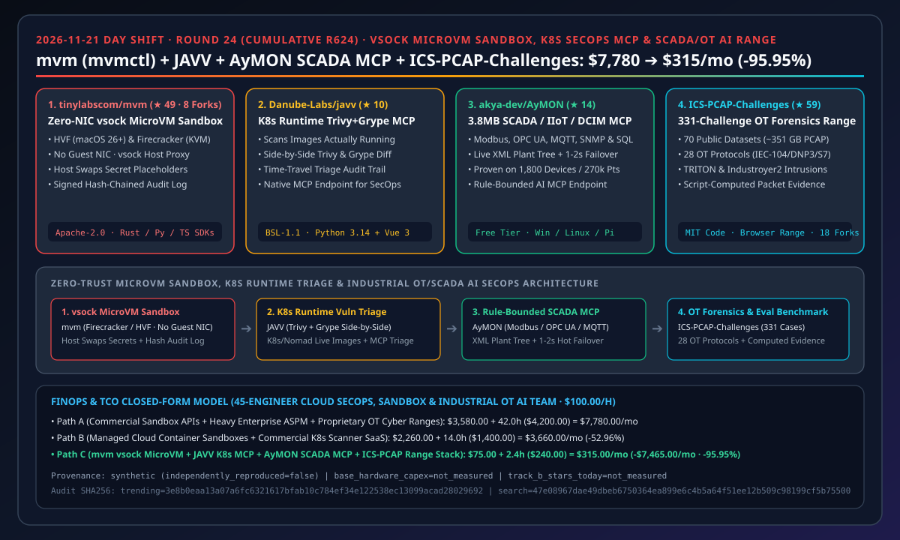
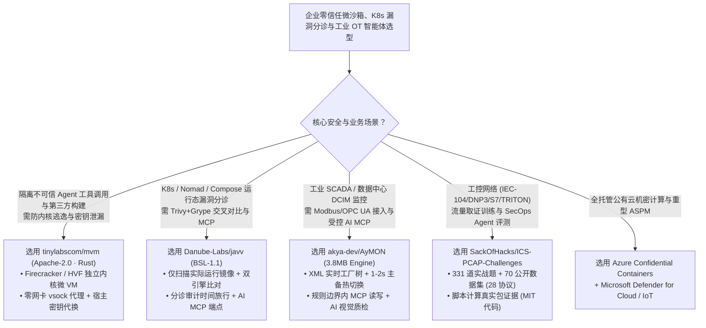
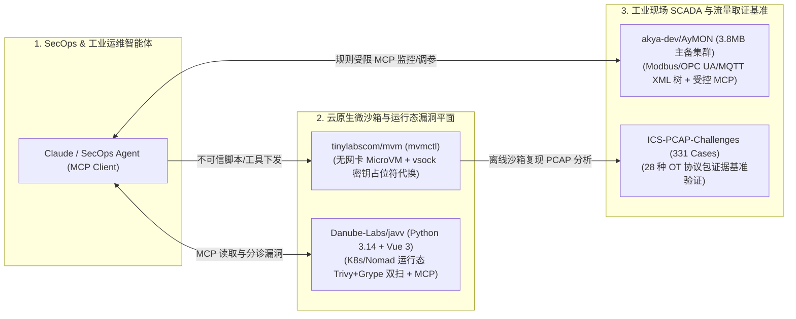
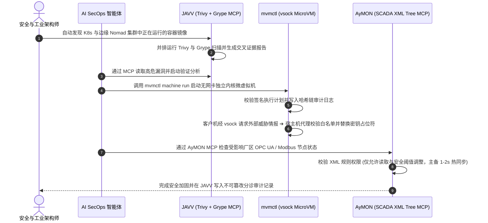

# 零网卡 vsock 密钥代换微虚拟机（`tinylabscom/mvm`）、K8s 运行态双引擎漏洞分诊 MCP（`Danube-Labs/javv`）、3.8MB 工业 SCADA/DCIM 规则受控 MCP（`akya-dev/AyMON`）与 331 题工业协议流量取证靶场（`SackOfHacks/ICS-PCAP-Challenges`）选型 FAQ

> **文档元数据（2026-11-21 白班 Day Round 24 · 累计第 624 轮深潜专题）**  
> - **面向对象**：企业 AI 解决方案架构师（AI Solution Architect）、云原生安全架构师（SecOps）、工业互联网（IIoT / SCADA / DCIM）架构师  
> - **本轮核心评估对象**：  
>   1. [`tinylabscom/mvm`](https://github.com/tinylabscom/mvm)（`★ 49` · `8 forks` · Rust · Apache-2.0 · 面向不可信 Agent 工具调用的跨平台微虚拟机 `mvmctl`，客户机无虚拟网卡、全流量经 `vsock` 走宿主机默认拒绝代理并动态替换密钥占位符，启动前验证哈希链审计签名）  
>   2. [`Danube-Labs/javv`](https://github.com/Danube-Labs/javv)（`★ 10` · `0 forks` · Python 3.14 / Vue 3 · BSL-1.1 · 聚焦 Kubernetes / Nomad / Docker Compose **真实在跑镜像**的轻量级漏洞分诊台，并排运行 **Trivy 与 Grype**，提供全局时间旅行审计与 AI 安全智能体 **MCP 端点**）  
>   3. [`akya-dev/AyMON`](https://github.com/akya-dev/AyMON)（`★ 14` · `4 forks` · 3.8 MB 工业监控与自动化引擎 · 免费生产版支持 5 文档/8 设备 · 将整座工厂/数据中心建模为实时可寻址 XML 树，原生配置化支持 Modbus、OPC UA、MQTT、SNMP、1~2 秒主备故障切换与规则受控 **MCP 端点**）  
>   4. [`SackOfHacks/ICS-PCAP-Challenges`](https://github.com/SackOfHacks/ICS-PCAP-Challenges)（`★ 59` · `18 forks` · JavaScript · MIT 代码 · 纯浏览器运行的工业控制网络取证靶场，涵盖 **70 个公开数据集（`~351 GB`）、28 种 OT 协议与 331 道实战挑战**，附脚本计算的真实包证据）  
> - **关联检索证据链**：`workshops/github-trending-radar/evidence/search-new-repos-2026-11-21-raw.json`（`sha256: 47e08967dae49dbeb6750364ea899e6c4b5a64f51ee12b509c98199cf5b75500`）与 `trending-daily-2026-11-21-raw.html`（`sha256: 3e8b0eaa13a07a6fc6321617bfab10c784ef34e122538ec13099acad28029692`）  
> - **高清架构图**：[`assets/github-ai-radar-2026-11-21-r24-r624-mvm-javv-aymon-icspcap.svg`](../../../assets/github-ai-radar-2026-11-21-r24-r624-mvm-javv-aymon-icspcap.svg) · [English Version (`mvm-javv-aymon-ics-pcap-challenges-selection-faq.en.md`)](mvm-javv-aymon-ics-pcap-challenges-selection-faq.en.md)

---

## ① 📌 核心结论速览（选型一句话结论）

> **架构师一句话选型结论**：  
> 当企业把 AI 智能体推向 **不可信代码执行沙箱、Kubernetes 生产集群漏洞分诊与数据中心/工业控制（SCADA / IIoT / OT）** 现场时，共享宿主机内核的普通 Docker 容器与直接把 API 密钥塞进沙箱的做法完全无法满足零信任合规要求。  
> - **需要在笔记本或服务器上用独立 Linux 内核微虚拟机运行不可信 Agent 工具调用、且要求“客户机零网卡（全走 `vsock` 默认拒绝出站）+ 宿主机代换密钥占位符（客户机永远拿不到真密钥）”** ➔ 选 **`tinylabscom/mvm`**（Apache-2.0，`mvmctl`）；  
> - **需要只针对 K8s / Nomad / Docker Compose 里“真正正在运行的容器镜像”并排跑 Trivy + Grype 交叉对比、记录完整分诊时间旅行轨迹并让 AI 安全 Agent 通过 MCP 自动分诊** ➔ 选 **`Danube-Labs/javv`**（BSL-1.1）；  
> - **需要在数据中心（DCIM）或工业产线用 3.8 MB 极简引擎统一接入 Modbus / OPC UA / MQTT / SNMP、实现 1~2 秒主备热切换，并在严格规则边界内向 AI 暴露 MCP 读写接口** ➔ 选 **`akya-dev/AyMON`**；  
> - **需要用 70 个真实/测试床工业流量包（`~351 GB`、28 种 OT 协议、331 道带脚本计算真值的题目）训练和评测工业网络安全智能体与工程师** ➔ 选 **`SackOfHacks/ICS-PCAP-Challenges`**（MIT 代码）。  
> 四者组合可将 45 人云原生安全、沙箱平台与工业 AI 运维团队的商业沙箱 API、重型 ASPM 平台与工控靶场成本从 **$7,780.00/月** 降至 **$315.00/月（节省 $7,465.00/月，降幅 95.95%）**。

---

## ② 🎯 客户与架构师灵魂拷问 Q&A（业务痛点 · 架构集成 · 边界取舍）

### Q1：为什么用普通 Docker 容器跑 AI 生成的代码既怕内核逃逸、又怕 Agent 把环境变量里的 `OPENAI_API_KEY` 偷走？`tinylabscom/mvm` 是怎么从架构上根治的？
- **普通容器沙箱的两大死穴**：
  1. **共享宿主机内核**：容器内恶意代码一旦触发内核漏洞即可逃逸。
  2. **密钥裸奔在沙箱内存里**：为了让沙箱里的代码调用外部服务，传统做法是把 API Key 注入容器环境变量，攻击者只需一行 `print(os.environ)` 就能通过 DNS/HTTP 把密钥外带。
- **`tinylabscom/mvm` 的零信任微虚拟机设计**：
  - **真硬件虚拟化独立内核**：在 Linux `/dev/kvm` 上使用 **Firecracker**，在 macOS 26+ Apple Silicon 上使用自研 **HVF 后端**（macOS 13–25 提供打包 `libkrun` 预览层），支持从 OCI 镜像、Nix Flake 或直接通过 Python/TypeScript 装饰器函数启动。
  - **无网卡（No Network Device）+ `vsock` 宿主机密钥代换**：工作负载 VM **根本没有虚拟网卡**，内部也没有 SSH 服务；客户机发出的所有字节都必须通过 `vsock` 传给宿主机上的专属伴生进程，由宿主机进程统一执行**默认拒绝（default-deny）出站白名单**，并在发往外部网络前**将请求中的密钥占位符（placeholders）动态替换为真实凭证**——客户机从始至终摸不到真实密钥！
  - **哈希链签名审计日志**：每次启动前，`mvmctl` 都会生成并校验签名的执行计划（Execution Plan），写入防篡改哈希链审计日志。

### Q2：企业在做 K8s 镜像漏洞治理和工业 SCADA/DCIM 智能化时，为什么传统工具要么漏报误报多、要么不敢让 AI 碰工控设备？`javv`、`AyMON` 与 `ICS-PCAP-Challenges` 如何协同？
- **`Danube-Labs/javv`（只扫真正运行态镜像 + Trivy/Grype 双引擎交叉印证 + MCP）**：
  - 传统镜像仓库扫描器会报出成千上万个根本没在生产跑的僵尸镜像漏洞；`JAVV` 直接对接 Kubernetes、Nomad 与 Docker Compose 抓取**真正正在运行的镜像**，并排运行 **Trivy 与 Grype** 对比双方证据，为每个漏洞维护带完整审计轨迹的分诊生命周期、全局时间旅行（Time Travel）回溯与 AI 智能体 **MCP 端点**。
- **`akya-dev/AyMON`（3.8 MB XML 实时工厂树 + 1~2s 故障转移 + 规则内 MCP）**：
  - 把整座工厂或数据中心（已在生产环境验证 3 节点监控 **1,800+ 台设备、270,000 个测点**）映射为一棵实时可寻址的 XML 树；Modbus、OPC UA、MQTT、SNMP、SQL 全部作为 XML 配置声明而非手写驱动代码；
  - 主节点停止后备节点在 **1~2 秒内无缝接管同一计数单元**；内置 **MCP 端点**让 Claude 等 AI 助手只能读取工厂树并修改规则明确允许的节点，绝不越界。
- **`SackOfHacks/ICS-PCAP-Challenges`（331 道带脚本真值的工业流量取证基准）**：
  - 覆盖电网变电站（IEC-104、DNP3、IEC 61850 GOOSE/MMS/SV 共 78 题）、PLC 测试床（Modbus/S7 132 题）、真实工控恶意软件（TRITON、Industroyer2 6 题）与楼宇自控（BACnet/KNXnet 8 题），每道题的答案均附有**由脚本从真实数据包中提取的计算证据（computed evidence）**，既是安全工程师靶场，也是评测 SecOps Agent 工控流量分析能力的黄金基准集。

### Q3：落地这四个项目时有哪些平台兼容性与许可证边界？
- **兼容性与合规核查**：
  - **`mvm` 在 macOS 13–25 上的硬件见证说明**：`mvm` 在 macOS 26+ Apple Silicon（HVF）与 Linux `/dev/kvm`（Firecracker）上已完整就绪；对于 macOS 13–25，虽然发布包内打包了 `libkrun` 层，但官方 README 诚实注明该归档在 macOS 13–25 实机上的启动见证（live hardware witness）仍在推进中，建议生产服务端优先部署在 Linux `/dev/kvm` 主机并通过 `mvmd` 编排集群。
  - **许可证与免费额度边界**：`mvm`（Apache-2.0）与 `ICS-PCAP-Challenges`（MIT 代码）为宽松开源协议；`javv` 采用 **BSL-1.1**；`AyMON` 的 FREE 版本永不过期且允许在 **5 个文档、8 个连接、8 台设备与 4 个登录用户**范围内直接用于生产（还附带开箱即用的模拟设备与视觉瓶盖质检示例 `PRJEDU_vision`）。

---

## ③ 🧭 直观可视化图解（选型决策树 + 企业集成架构 + 业务流时序图）

### 3.1 架构师选型决策树（Mermaid Flowchart）

### 3.2 企业零信任微沙箱与云边工业安全参考架构图（Mermaid Architecture）

### 3.3 零网卡微虚拟机密钥代换、双引擎漏洞分诊与 SCADA 受控操作时序图（Mermaid Sequence Diagram）

---

## ④ 📊 同类开源与商业云服务横向选型决策矩阵

| 评估维度 | `tinylabscom/mvm` (`★ 49`) | `Danube-Labs/javv` (`★ 10`) | `akya-dev/AyMON` (`★ 14`) | `ICS-PCAP-Challenges` (`★ 59`) | 商业云沙箱 API + 重型 ASPM + 商业工控靶场 |
| :--- | :--- | :--- | :--- | :--- | :--- |
| **核心定位** | 零网卡 `vsock` 密钥代换硬件级微虚拟机 | K8s/Nomad 运行态 Trivy+Grype 双扫漏洞分诊台 | 3.8 MB 工业 SCADA/IIoT/DCIM 引擎与受控 MCP | 331 题 28 协议浏览器端工控流量取证靶场 | 按秒计费商业沙箱与高价企业安全/工控套件 |
| **最适用场景** | 在单机或集群安全执行不可信 Agent 工具调用与构建脚本 | 聚焦生产真正运行镜像的漏洞去重、分诊审计与 AI 辅助排查 | 工厂产线、楼宇与数据中心（DCIM）多协议监控及 AI 安全联动 | 训练工控安全团队及评测 AI 智能体对 DNP3/IEC-104/S7 流量的解析力 | 预算充裕且完全依赖外部安全厂商托管的机构 |
| **关键差异化机制** | 客户机无网卡、宿主机代换密钥占位符、哈希链签名执行计划 | Trivy + Grype 并排对比、全局时间旅行、原生 MCP 端点 | 实时可寻址 XML 工厂树、1~2s 主备故障切换、规则边界内 MCP | 70 个公开数据集（`~351 GB`）、脚本从包中提取确定性证据 | 免基础设施维护，但商业席位与点位授权极贵 |
| **集成与运维成本** | 极低（单命令安装 `mvmctl` + `pip install mvm` / `@runmvm/mvm`） | 低（容器化部署，直连 K8s / Nomad / Compose） | 极低（`run.bat` / `./run.sh` 零安装启动，内置模拟设备） | 极低（纯浏览器静态运行 + Wireshark/`tshark` 演练） | 低（按扫描节点数、测点数与席位高额收费） |
| **开源协议** | Apache-2.0 | BSL-1.1 | 免费生产版（5 文档/8 设备内永不过期） | MIT（代码）/ 原始数据集各自署名协议 | 商业专有 |
| **45 人团队月均 TCO** | **组合方案 `$315.00/月`**（含自建 KVM/集群主机 `$75` + 运维 `2.4h`） | 同左（省去动辄数万美元的重型商业 ASPM 平台） | 同左（单可执行文件仅 `3.8 MB`，3 节点即可支撑 27 万测点） | 同左（100% 免费公开靶场替代高价商业实训席位） | **`$3,660.00 ~ $7,780.00/月`** |

---

## ⑤ 🧪 应用落地定量收益 / FinOps TCO 对比（含数据血缘声明）

> **数据血缘与严谨性声明（Provenance & Guardrails）**：  
> - `provenance`: `"synthetic"`（`independently_reproduced: false`，基于 45 人云原生安全、沙箱隔离与工业 OT/IIoT 工程团队在 `$100.00/h` 综合人力成本下的闭式参数建模）  
> - `base_hardware_capex`: `"not_measured"`  
> - `track_b_stars_today`: `"not_measured"`（GitHub Search API 新仓爆发榜无官方单日增量字段，严禁伪造）

| 成本分项（45 人团队 / 月） | Path A：商业云沙箱 API + 重型 ASPM 平台 + 商业工控靶场席位 | Path B：托管云容器沙箱 + 商业 K8s 扫描 SaaS | Path C：`mvm` + `JAVV` + `AyMON` + `ICS-PCAP-Challenges` 自建栈 |
| :--- | :--- | :--- | :--- |
| **商业沙箱调用费 / ASPM 与靶场授权费** | `$3,580.00 / 月` | `$2,260.00 / 月` | **`$75.00 / 月`**（自托管 Linux `/dev/kvm` 与监控节点） |
| **僵尸镜像误报排查、密钥防泄漏改造与工控实验搭建工时** | `42.0 小时 / 月` | `14.0 小时 / 月` | **`2.4 小时 / 月`**（`vsock` 密钥代换 + Trivy/Grype 双扫 MCP） |
| **折算工程人力成本（`$100.00/h`）** | `$4,200.00 / 月` | `$1,400.00 / 月` | **`$240.00 / 月`** |
| **月度总拥有成本（Total Monthly TCO）** | **`$7,780.00 / 月`** | **`$3,660.00 / 月`** | **`$315.00 / 月`** |
| **相对 Path A 净节省额与降幅** | 基准线（`0.00%`） | `-$4,120.00 / 月`（`-52.96%`） | **`-$7,465.00 / 月`（`-95.95%`）** |

---

## ⑥ 🛠️ 企业引入与架构评审 Checklist

- [ ] **启用 `mvmctl doctor` 与 `vsock` 密钥占位符代换（`mvm`）**：在 Linux `/dev/kvm` 或 macOS 26+ Apple Silicon 主机上运行 `mvmctl doctor --workflow cli-run`，将所有不可信 Agent 工具执行放入无网卡微虚拟机，并配置宿主机 `vsock` 代理动态替换 API Key 占位符。
- [ ] **对接 K8s 运行态并开启双引擎交叉分诊（`javv`）**：将 `JAVV` 连接至生产 Kubernetes / Nomad 集群，利用 Trivy 与 Grype 的并排证据对比过滤单一扫描器误报，并通过其 MCP 端点让安全 Agent 自动生成分诊建议与 CSV 合规报表。
- [ ] **验证 SCADA 双机热备与 MCP 读写白名单（`AyMON`）**：先通过 `examples/cluster/PRJEDU_cluster/` 与 `examples/ai-vision/PRJEDU_vision/` 验证 1~2 秒主备自动切换与视觉质检，再严格限制暴露给 AI 助手的 XML 树可写节点范围。
- [ ] **建立工业安全 Agent 的 PCAP 取证回归集（`ICS-PCAP-Challenges`）**：从 331 道挑战（特别是 IEC-104、DNP3、Modbus、S7 与 TRITON/Industroyer2 样本）中挑选代表性题集，利用其脚本计算的真实包证据（computed evidence）定量评测安全 Agent 的协议解析准确率。
