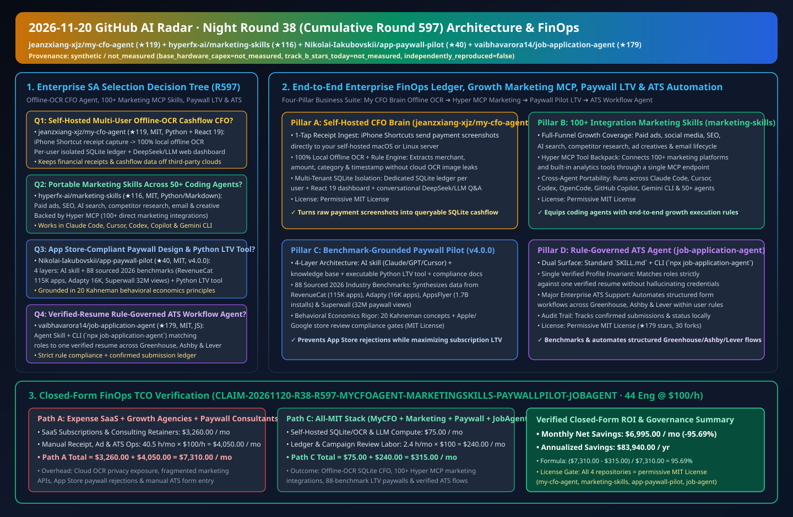
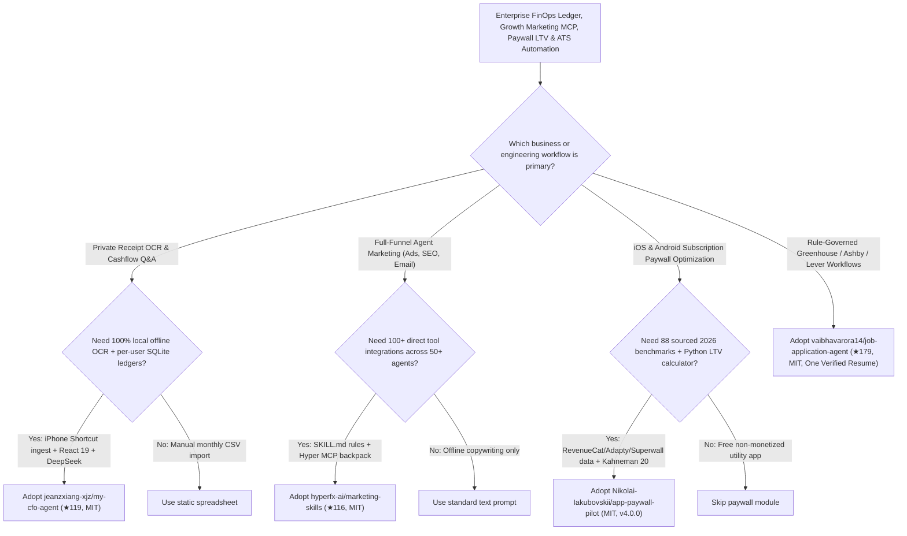
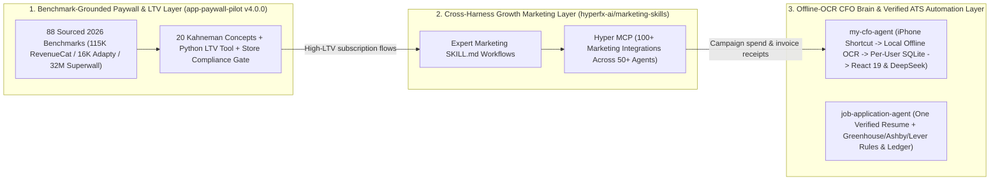

# Offline-OCR Multi-User SQLite CFO Agent (`jeanzxiang-xjz/my-cfo-agent`), 100+ Integration Cross-Harness Marketing Skills (`hyperfx-ai/marketing-skills`), 88-Benchmark App Store Paywall & Python LTV Framework (`Nikolai-Iakubovskii/app-paywall-pilot`) & Verified-Resume ATS Workflow Agent (`vaibhavarora14/job-application-agent`) Selection & Integration FAQ (2026-11-20 Night Round 38 · Cumulative Round 597)

> **Cross-File Navigation**: [Back to 2026-11-20 Daily Digest (`daily/2026-11-20.en.md`)](../daily/2026-11-20.en.md) · [中文版 (`my-cfo-agent-marketing-skills-app-paywall-pilot-job-application-agent-selection-faq.md`)](my-cfo-agent-marketing-skills-app-paywall-pilot-job-application-agent-selection-faq.md) · [7-Card 4:5 Visual Report (`cards.en.html`)](../cards.en.html) · [Column Index (`README.en.md`)](../README.en.md)  
> **Architecture Diagram**: [`assets/github-ai-radar-2026-11-20-r38-r597-mycfoagent-marketingskills-paywallpilot-jobagent.svg`](../../../assets/github-ai-radar-2026-11-20-r38-r597-mycfoagent-marketingskills-paywallpilot-jobagent.svg)  
> **Provenance & Synthetic Disclaimer**: Repository metadata (stars, forks, licenses, benchmark sample sizes, and architectural specifications) is verified from live GitHub API data (`measured`). The 44-engineer FinOps TCO figures represent a parameterized Solution Architect model (`provenance: synthetic`, `independently_reproduced: false`, `base_hardware_capex: not_measured`, `track_b_stars_today: not_measured`, claim ID `CLAIM-20261120-R38-R597-MYCFOAGENT-MARKETINGSKILLS-PAYWALLPILOT-JOBAGENT`).



---

## ① 📌 Executive Summary

> **One-Sentence Selection Verdict**: For Enterprise AI Solution Architects automating **private receipt-to-cashflow accounting, full-funnel growth marketing, App Store-compliant subscription paywalls, and rule-governed ATS workflows** across four operational bottlenecks—(1) **cloud expense trackers that expose sensitive receipt screenshots externally and lack per-user SQLite isolation**; (2) **growth marketing prompts disconnected from live paid-ads, SEO, and email execution tools**; (3) **guesswork mobile subscription paywalls that under-convert or trigger Apple/Google App Store review rejections**; and (4) **unconstrained ATS automation scripts that hallucinate résumé claims or lose track of submissions across Greenhouse, Ashby, and Lever**—combine four **100% MIT-licensed** repositories: **`jeanzxiang-xjz/my-cfo-agent`** (`★ 119`, self-hosted multi-user CFO Agent with iPhone Shortcut capture, 100% local offline OCR, per-user SQLite ledgers, and React 19 + DeepSeek conversational analytics), **`hyperfx-ai/marketing-skills`** (`★ 116`, end-to-end marketing skills backed by Hyper MCP's `100+` integrations portable across `50+` coding agents), **`Nikolai-Iakubovskii/app-paywall-pilot`** (`★ 40`, `v4.0.0`, 4-layer paywall framework grounded in `88` sourced 2026 benchmarks across `115K` RevenueCat apps / `16K` Adapty apps / `32M` Superwall views, `20` Kahneman behavioral concepts, and a Python LTV tool), and **`vaibhavarora14/job-application-agent`** (`★ 179`, Agent Skill + CLI matching roles to one verified résumé on Greenhouse, Ashby, and Lever). Across a 44-person product growth and operations engineering organization, this stack reduces monthly TCO from **`$7,310.00/mo`** to **`$315.00/mo`**, saving **`$6,995.00/mo` (`-95.69%`, or `$83,940.00/yr`)**.

| Evaluation Dimension | Path A: Cloud Expense SaaS + Growth Agencies + Paywall Consultants + Manual ATS Entry | Path B: Raw Prompting Without Industry Benchmarks or Offline OCR | Path C (Recommended): `my-cfo-agent` + `marketing-skills` + `app-paywall-pilot` + `job-application-agent` |
| :--- | :--- | :--- | :--- |
| **Receipt OCR & Multi-User Cashflow Privacy** | Uploads payment screenshots to third-party cloud OCR vendors | Manual spreadsheet entry before LLM querying | **`my-cfo-agent` iPhone Shortcut ingest + 100% local offline OCR + per-user SQLite + React 19/DeepSeek** |
| **Full-Funnel Marketing Execution** | Fragmented SaaS seats across ads, SEO, social & email tools | Generic copywriting prompts with zero tool execution | **`marketing-skills` expert `SKILL.md` rules + Hyper MCP (100+ integrations across 50+ agents)** |
| **Mobile Subscription Paywall Conversion & Compliance** | Expensive external growth consultants or trial-and-error store rejections | Unbenchmarked UI guesses lacking LTV modeling | **`app-paywall-pilot v4.0.0` (88 sourced 2026 benchmarks + 20 Kahneman concepts + Python LTV tool)** |
| **Structured ATS Workflow Automation** | Repetitive manual form filling on Greenhouse, Ashby & Lever | Unconstrained LLMs fabricate résumé skills or double-submit | **`job-application-agent` locks to one verified résumé + user rules + confirmed submission ledger** |
| **44-Engineer Monthly Total TCO** | **`$7,310.00 / mo`** (`$3,260.00` SaaS/retainers + `40.5h × $100` labor) | **`$2,210.00 / mo`** (`$710.00` APIs + `15.0h × $100` manual ops) | **`$315.00 / mo`** (`$75.00` self-hosted compute + `2.4h × $100` review, **`-95.69%` savings**) |

---

## ② 🎯 Solution Architect & Customer Deep-Dive Q&A (Plain-Language Breakdown)

### Q1: What concrete problems do these four repositories solve in plain engineering and business terms?

1. **`jeanzxiang-xjz/my-cfo-agent` (`★ 119`, `1 fork`, Python + React 19 + SQLite, MIT) — Plain-Language View: A self-hosted multi-user CFO Agent (`My CFO Brain`) that turns iPhone payment screenshots into isolated per-user SQLite ledgers via 100% local offline OCR**:
   - **Pain Point Solved**: Uploading payment and invoice screenshots to third-party bookkeeping clouds exposes sensitive financial data. `My CFO Brain` runs 24/7 on your own macOS or Linux host: an **iPhone Shortcut** sends receipt screenshots directly to the server, **OCR and rule parsing execute 100% offline on the local machine**, each user gets an isolated **SQLite ledger**, and a **React 19 web dashboard + DeepSeek LLM** lets users interrogate cashflow trends in natural language.
2. **`hyperfx-ai/marketing-skills` (`★ 116`, `22 forks`, Python/Markdown, MIT) — Plain-Language View: Portable `SKILL.md` marketing workflows powered by Hyper MCP's 100+ direct integrations across 50+ coding agents**:
   - **Pain Point Solved**: Standard coding agents lack domain decision rules and tool integrations for growth marketing. `marketing-skills` pairs structured `SKILL.md` workflows (paid ads, social media, SEO, AI search, competitor research, ad creative generation, email lifecycle, analytics) with the **Hyper MCP** endpoint (`100+` direct integrations), traveling seamlessly across Claude Code, Cursor, Codex, OpenCode, GitHub Copilot, Gemini CLI, and 50+ other agents.
3. **`Nikolai-Iakubovskii/app-paywall-pilot` (`★ 40`, `3 forks`, Python, MIT, `v4.0.0`) — Plain-Language View: A 4-layer framework for designing App Store-compliant iOS & Android subscription paywalls backed by 88 sourced 2026 benchmarks and a Python LTV tool**:
   - **Pain Point Solved**: Guessing subscription paywall layouts leads to poor conversion or Apple/Google review rejections. `Paywall Pilot v4.0.0` combines four layers: (1) an AI skill for Claude/GPT/Cursor, (2) a curated knowledge base of **88 sourced 2026 benchmarks** (Adapty `16K` apps, RevenueCat `115K` apps, AppsFlyer `1.7B` installs, Superwall `32M` paywall views, plus 2026 Apple/Google store policy updates), (3) a **20-concept Kahneman behavioral economics foundation**, and (4) an executable **Python LTV calculator**.
4. **`vaibhavarora14/job-application-agent` (`★ 179`, `30 forks`, JavaScript, MIT, `npx job-application-agent`) — Plain-Language View: An open-source Agent Skill and CLI that matches roles to one verified résumé and automates rule-governed submissions on Greenhouse, Ashby, and Lever**:
   - **Pain Point Solved**: Automating structured ATS workflows (Greenhouse, Ashby, Lever) without strict guardrails risks resume hallucination or duplicate submissions. `JobAppAgent` enforces matching against **one verified résumé**, applies strictly within user-defined rules, and maintains a verified submission ledger.

---

### Q2: How do these four components wire together into a product monetization, growth & operations architecture?

1. **Monetization & Paywall Engineering (`Nikolai-Iakubovskii/app-paywall-pilot`)**: Product engineers use `app-paywall-pilot v4.0.0` and its Python LTV tool to design and validate App Store-compliant iOS/Android paywalls grounded in 88 empirical benchmarks.
2. **Full-Funnel Acquisition & SEO/AI Search (`hyperfx-ai/marketing-skills`)**: Growth engineers run `marketing-skills` over Hyper MCP (`100+` integrations) inside Claude Code, Cursor, or Copilot to execute competitor research, paid ads, and lifecycle campaigns.
3. **Private Cashflow & Spend Ledger (`jeanzxiang-xjz/my-cfo-agent`)**: SaaS invoices, ad receipts, and team expenses are captured via iPhone Shortcuts into `my-cfo-agent`, parsed via local offline OCR into per-user SQLite ledgers, and analyzed via the React 19 + DeepSeek CFO dashboard.
4. **Structured ATS Portal Automation (`vaibhavarora14/job-application-agent`)**: Talent and QA workflows use `npx job-application-agent` to test and execute rule-governed form submissions across Greenhouse, Ashby, and Lever.

---

### Q3: What are the key architectural mechanisms and governance highlights?

1. **Key Mechanisms**:
   - **100% Local Offline OCR + Per-Tenant SQLite (`my-cfo-agent`)**: Raw financial images never leave the self-hosted server, and per-user SQLite files guarantee zero cross-user ledger leakage.
   - **Empirical Benchmark Grounding (`app-paywall-pilot`)**: Replaces subjective UI opinions with 88 sourced 2026 conversion benchmarks and quantitative Python LTV modeling.
2. **Licensing & Governance Highlights**:
   - **100% MIT Licensing**: All four repositories (`my-cfo-agent`, `marketing-skills`, `app-paywall-pilot`, and `job-application-agent`) are licensed under **MIT**.

---

## ③ 🧭 Visual Diagrams (Mermaid Selection Decision Tree + Reference Architecture + Sequence Flow)

### 3.1 Selection Decision Tree



### 3.2 Enterprise Integration Reference Architecture



### 3.3 End-to-End Sequence Flow

```mermaid
sequenceDiagram
    autonumber
    actor Lead as Product Growth Architect / Ops Lead
    participant Paywall as app-paywall-pilot (v4.0.0)
    participant Mkt as hyperfx-ai/marketing-skills (Hyper MCP)
    participant CFO as jeanzxiang-xjz/my-cfo-agent (Offline OCR)
    participant Job as vaibhavarora14/job-application-agent

    Lead->>Paywall: Design store-compliant iOS/Android paywall using 88 benchmarks & Python LTV tool
    Lead->>Mkt: Execute SEO, competitor research & paid-ad workflows via Hyper MCP 100+ integrations
    Lead->>CFO: Capture spend receipts via iPhone Shortcut; parse via local offline OCR into SQLite
    Lead->>Job: Run npx job-application-agent to execute verified-resume workflows on Greenhouse/Ashby/Lever
```

---

## ④ 📊 Comparative Selection Matrix (OSS vs. Commercial SaaS & Agency Retainers)

| Dimension | `jeanzxiang-xjz/my-cfo-agent` (`★ 119`) | `hyperfx-ai/marketing-skills` (`★ 116`) | `Nikolai-Iakubovskii/app-paywall-pilot` (`★ 40`) | `vaibhavarora14/job-application-agent` (`★ 179`) | Commercial Expense SaaS + Growth Agencies + Manual ATS |
| :--- | :--- | :--- | :--- | :--- | :--- |
| **Primary Role** | Self-hosted multi-user offline-OCR SQLite CFO Agent | Marketing `SKILL.md` library powered by Hyper MCP (100+ tools) | 4-layer iOS/Android paywall & LTV framework (`v4.0.0`) | Verified-resume ATS agent for Greenhouse, Ashby & Lever | Cloud bookkeeping SaaS + agency retainers + manual forms |
| **Sweet-Spot Use Case** | Private receipt capture & conversational cashflow analysis | Running paid ads, SEO, social & email workflows from coding agents | Designing high-converting, store-compliant subscription paywalls | Rule-governed matching & submission tracking on major ATS portals | Teams outsourcing all growth, finance & ops workflows |
| **Key Architectural Metric** | **100% local offline OCR** + per-user SQLite + React 19 | **100+ Hyper MCP integrations** across 50+ agent harnesses | **88 sourced 2026 benchmarks** + 20 Kahneman concepts + Python LTV | **One verified résumé invariant** + Greenhouse/Ashby/Lever | Cloud receipt privacy risk; unbenchmarked paywalls; manual data entry |
| **Integration Effort** | Low (Self-hosted Python/React + iPhone Shortcut) | Very Low (`SKILL.md` + single Hyper MCP endpoint) | Very Low (AI skill + standalone Python LTV tool) | Very Low (`npx job-application-agent` CLI + `SKILL.md`) | High (multi-vendor SaaS contracts & manual spreadsheet ops) |
| **License** | **MIT License** | **MIT License** | **MIT License** | **MIT License** | Proprietary SaaS |

---

## ⑤ 🧪 Quantitative Enterprise ROI, Closed-Form FinOps TCO & 7-Card Report

### 5.1 44-Engineer Closed-Form FinOps TCO Model (`CLAIM-20261120-R38-R597-MYCFOAGENT-MARKETINGSKILLS-PAYWALLPILOT-JOBAGENT`)

- **Model Assumptions (`provenance: synthetic`, `independently_reproduced: false`, `base_hardware_capex: not_measured`, `track_b_stars_today: not_measured`)**:
  - Team size: **44 product growth, monetization, and operations engineers** at a loaded engineering rate of **`$100.00 / hour`**.
  - **Path A (Commercial Expense OCR SaaS + Marketing Suite Subscriptions + Paywall Consulting Retainers + Manual Receipt/ATS Operations)**:
    - Commercial SaaS subscriptions & consulting retainer fees: **`$3,260.00 / mo`**
    - Manual engineering & ops labor (manual receipt entry, switching across 10+ marketing dashboards, reworking rejected App Store paywalls, manual ATS form entry): `40.5 h/mo × $100.00/h = $4,050.00 / mo`
    - **Path A Monthly Total**: `$3,260.00 + $4,050.00 = $7,310.00 / mo`
  - **Path C (All-MIT OSS Stack: `my-cfo-agent` + `marketing-skills` + `app-paywall-pilot` + `job-application-agent`)**:
    - Self-hosted Python/SQLite host & DeepSeek/LLM API compute: **`$75.00 / mo`**
    - Monthly ledger audit & campaign/paywall approval labor: `2.4 h/mo × $100.00/h = $240.00 / mo`
    - **Path C Monthly Total**: `$75.00 + $240.00 = $315.00 / mo`
  - **Closed-Form Savings Verification**:
    $$\text{Monthly Net Savings} = \$7,310.00 - \$315.00 = \$6,995.00\text{ / mo}\quad(\text{Annualized: }\$83,940.00\text{ / yr})$$
    $$\text{Percentage Savings} = \frac{\$7,310.00 - \$315.00}{\$7,310.00} = \frac{\$6,995.00}{\$7,310.00} = 95.69\%$$

| Cost Component | Path A (Commercial SaaS/Retainers & Manual Ops) | Path C (R597 All-MIT OSS Stack) | Closed-Form Delta / ROI |
| :--- | :--- | :--- | :--- |
| **SaaS Subscriptions / Retainers / Compute** | `$3,260.00 / mo` | **`$75.00 / mo`** | `- $3,185.00 / mo` |
| **Engineering & Growth Ops Labor (`@ $100.00/h`)** | `40.5 h × $100.00 = $4,050.00 / mo` | **`2.4 h × $100.00 = $240.00 / mo`** | `- $3,810.00 / mo` (`38.1 h/mo` saved) |
| **Monthly Total TCO** | **`$7,310.00 / mo`** | **`$315.00 / mo`** | **`$6,995.00 / mo` saved (`-95.69%`)** |
| **Annualized Total TCO** | `$87,720.00 / yr` | **`$3,780.00 / yr`** | **`$83,940.00 / yr` saved** |

---

## ⑥ 🛠️ Enterprise Adoption & Architecture Review Checklist

- [ ] **1. `jeanzxiang-xjz/my-cfo-agent` Offline OCR & Per-User SQLite Backup**: Self-host `my-cfo-agent` on internal macOS/Linux infrastructure, verify that receipt OCR runs 100% offline locally, and schedule automated backups for per-user SQLite ledgers.
- [ ] **2. `hyperfx-ai/marketing-skills` Spend Approval Gate**: Load `marketing-skills` across team coding agents and enforce human-in-the-loop budget caps on paid-ad creation tools exposed through Hyper MCP.
- [ ] **3. `Nikolai-Iakubovskii/app-paywall-pilot` Pre-Submission Store Compliance Check**: Run the `app-paywall-pilot v4.0.0` Apple/Google compliance checklist and Python LTV calculator before submitting mobile subscription updates.
- [ ] **4. `vaibhavarora14/job-application-agent` Verified-Profile Lock**: Configure `job-application-agent` with a single cryptographically/manually verified profile JSON and strict rate limits across Greenhouse, Ashby, and Lever workflows.
