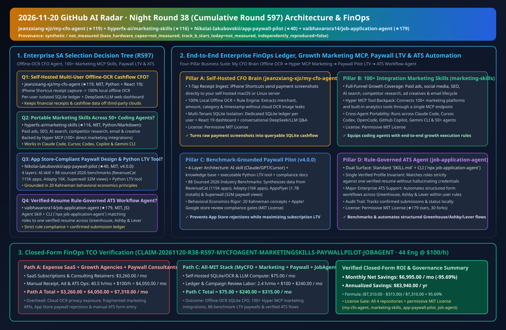
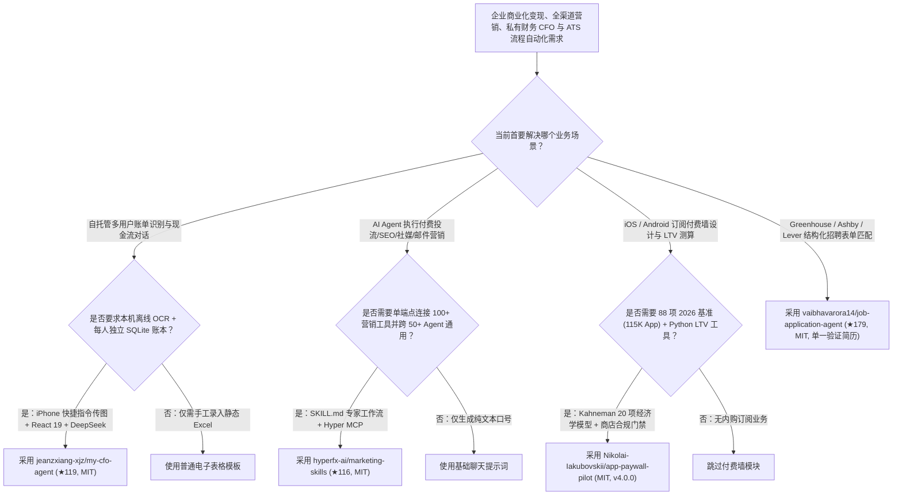
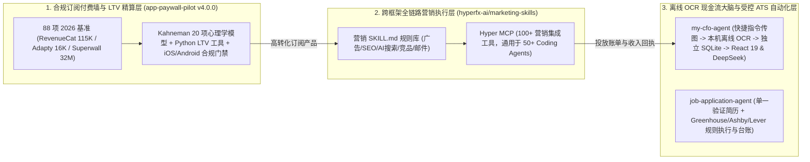
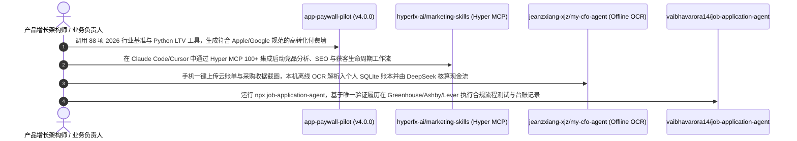

# 离线 OCR 多用户 SQLite 财务 CFO 智能体（`jeanzxiang-xjz/my-cfo-agent`）、连接 100+ 营销工具的跨框架增长技能包（`hyperfx-ai/marketing-skills`）、基于 88 项 2026 行业基准的合规订阅付费墙框架（`Nikolai-Iakubovskii/app-paywall-pilot`）与单真值简历 Greenhouse/Ashby/Lever 投递自动化 Agent（`vaibhavarora14/job-application-agent`）架构选型与集成 FAQ（2026-11-20 Night Round 38 · 累计 Round 597）

> **跨文件导航**：[返回 2026-11-20 当日全景日报 (`daily/2026-11-20.md`)](../daily/2026-11-20.md) · [English Version (`my-cfo-agent-marketing-skills-app-paywall-pilot-job-application-agent-selection-faq.en.md`)](my-cfo-agent-marketing-skills-app-paywall-pilot-job-application-agent-selection-faq.en.md) · [查看 7-Card 4:5 评测报告 (`cards.html`)](../cards.html) · [返回专栏主索引 (`README.md`)](../README.md)  
> **本轮架构大图**：[`assets/github-ai-radar-2026-11-20-r38-r597-mycfoagent-marketingskills-paywallpilot-jobagent.svg`](../../../assets/github-ai-radar-2026-11-20-r38-r597-mycfoagent-marketingskills-paywallpilot-jobagent.svg)  
> **数据溯源与口径声明（Provenance & Synthetic Disclaimer）**：本报告中实时采集的 GitHub 仓库元数据（Stars、Forks、License、行业基准样本量与 README 架构规范）为 `measured`；针对 44 人企业产品增长、商业化变现与财务运营团队的 FinOps TCO 测算参数属于架构师参数化测算模型（`provenance: synthetic`，`independently_reproduced: false`，`base_hardware_capex: not_measured`，`track_b_stars_today: not_measured`，审计契约号 `CLAIM-20261120-R38-R597-MYCFOAGENT-MARKETINGSKILLS-PAYWALLPILOT-JOBAGENT`）。

---

## ① 📌 核心结论速览（Executive Summary）

> **一句话选型结论**：面向企业 AI 解决方案架构师（SA）在落地**内部票据现金流自动化分析、全渠道数字化营销 Agent、移动应用合规订阅变现（Paywall）设计以及结构化招聘系统（ATS）表单自动化**时的四大业务痛点——① **报销与采购账单截图若上传第三方云端记账 App 极易泄露企业与高管消费隐私，而手工记账又无法用自然语言追问现金流向**；② **增长团队在投流、SEO、竞品调研与邮件生命周期管理中需要在十几个 SaaS 后台来回切换**；③ **iOS / Android 订阅付费墙（Paywall）如果靠拍脑袋设计，不仅转化率与 LTV 极低，还经常因违反 Apple/Google 最新商店政策被拒审**；④ **面对 Greenhouse、Ashby、Lever 等主流 ATS 招聘表单的自动化测试或求职匹配，传统脚本容易胡乱编造履历或重复投递**——建议采用全部基于 **MIT 协议**的四款项目：**`jeanzxiang-xjz/my-cfo-agent`**（`★ 119`，自托管多用户私人/团队财务 CFO Agent，iPhone 快捷指令传图 + 本机 100% 离线 OCR + 每人独立 SQLite 账本 + React 19 & DeepSeek 对话大脑）、**`hyperfx-ai/marketing-skills`**（`★ 116`，基于 Hyper MCP 100+ 营销集成、兼容 Claude Code/Cursor/Codex/Copilot 等 50+ Agent 的全链路营销技能库）、**`Nikolai-Iakubovskii/app-paywall-pilot`**（`v4.0.0`，结合 88 项 2026 权威基准数据——RevenueCat 11.5 万应用 / Adapty 1.6 万应用 / Superwall 3,200 万曝光——与 Kahneman 20 项行为经济学原理及 Python LTV 计算器的 4 层合规付费墙设计框架）与 **`vaibhavarora14/job-application-agent`**（`★ 179`，严格绑定单一已验证简历、在用户规则内自动完成 Greenhouse / Ashby / Lever 匹配与状态追踪的 Agent Skill + CLI）。在 44 人产品增长与运营工程团队模型下，该组合可将月度总拥有成本（TCO）从 **`$7,310.00/月`** 降至 **`$315.00/月`**，净省 **`$6,995.00/月`（`-95.69%`，年省 `$83,940.00`）**。

| 评估维度 | 方案 A：商业云端记账 SaaS + 外部增长代运营 + 付费墙咨询顾问 + 人工填表 | 方案 B：裸调通用大模型写营销文案与付费墙代码（无行业基准与离线 OCR） | 方案 C（推荐）：`my-cfo-agent` + `marketing-skills` + `app-paywall-pilot` + `job-application-agent` |
| :--- | :--- | :--- | :--- |
| **票据 OCR 入账与多用户现金流隐私** | 账单图片上传外部云端，无法自定义分类规则或按人物理隔离数据库 | 手工将发票敲成 Excel 再喂给大模型，耗时且易漏记 | **`my-cfo-agent` iPhone 一键传图 + 本机离线 OCR + 每人独立 SQLite 账本 + React 19 & DeepSeek 追问** |
| **跨渠道增长营销与竞品分析执行** | 采购多套昂贵营销自动化 SaaS，数据孤岛严重 | 只有空洞提示词，无直连 100+ 广告/SEO/邮件平台的 MCP 工具背包 | **`marketing-skills` 规范化工作流 + Hyper MCP 单一端点直连 100+ 营销集成，通用于 50+ Agent** |
| **iOS/Android 订阅付费墙转化率与合规** | 聘请外部增长顾问按项目高价收费，或盲目抄袭竞品导致商店拒审 | 大模型缺乏 2026 最新 Apple/Google 审核红线与真实 LTV 转化率基准 | **`app-paywall-pilot v4.0.0` 内置 88 项 2026 基准（11.5 万 App 实证）+ 20 项心理学模型 + Python LTV 工具** |
| **结构化 ATS（Greenhouse/Ashby/Lever）自动化** | 人工逐个打开招聘门户重复填写表单，漏记已提交记录 | 无约束 Agent 擅自篡改简历经历（幻觉造假）或违反投递过滤规则 | **`job-application-agent` 强制锁定唯一验证简历 + 规则门禁 + 确认投递台账追踪** |
| **44 人团队月度总成本（TCO）** | **`$7,310.00 / 月`**（`$3,260.00` SaaS/顾问费 + `40.5h × $100` 人工） | **`$2,210.00 / 月`**（`$710.00` API 调用 + `15.0h × $100` 人工返工） | **`$315.00 / 月`**（`$75.00` 自托管算力 + `2.4h × $100` 审核，**净省 `95.69%`**） |

---

## ② 🎯 客户与架构师灵魂拷问 Q&A（通俗解构）

### Q1：这四个开源项目各自解决什么痛点？用大白话怎么向业务方和工程团队解释？

1. **`jeanzxiang-xjz/my-cfo-agent`（`★ 119`，`1 fork`，Python + React 19 + SQLite，MIT）——用大白话讲：它是“手机付款后点一下快捷指令，截图自动在本机离线 OCR 变成独立 SQLite 账本、随时能用大白话追问钱花哪儿了的私人/团队 CFO 大脑”**：
   - **解决什么痛点**：无论是高管差旅报销、独立开发者项目支出还是企业小团队备用金管理，大家都不想把包含商户、卡号和行程的支付截图传给第三方闭源记账公司。`My CFO Brain` 支持部署在自己的 Mac 或 Linux 服务器上：通过 **iPhone 快捷指令（Shortcuts）** 把账单截图直传服务端 ➔ **OCR 与规则解析全部在本机离线完成** ➔ **每个注册用户拥有物理隔离的独立 SQLite 账本** ➔ 通过 **React 19 Web 财务大脑 + DeepSeek/LLM 对话**随时分析现金流趋势！
2. **`hyperfx-ai/marketing-skills`（`★ 116`，`22 forks`，Python/Markdown，MIT）——用大白话讲：它是“给 Claude Code、Cursor、Copilot 等 50 多种 Agent 背上装有 100 多个真实营销工具的超级书包”**：
   - **解决什么痛点**：让普通 Coding Agent 做营销，它只会写几句干瘪的广告词，没法真正去查 SEO 数据、分析竞品投放或管理邮件生命周期。该项目将专家级营销决策规则写成标准 `SKILL.md`（覆盖付费广告 Paid Ads、社媒、SEO、AI 搜索、竞品调研、广告创意生成、邮件生命周期与数据分析），并通过 **Hyper MCP 单一端点直接提供 100+ 个营销平台集成工具**，跨 50+ 种支持 Agent Skills 规范的客户端随身携带。
3. **`Nikolai-Iakubovskii/app-paywall-pilot`（`★ 40`，`3 forks`，Python，MIT，`v4.0.0`）——用大白话讲：它是“凝聚了 11.5 万个 App 真实转化数据与诺奖得主卡尼曼 20 个心理学定律、专门帮你设计既不违规又能翻倍赚钱的 App 订阅付费墙四层框架”**：
   - **解决什么痛点**：做 iOS 和 Android 商业化应用，付费墙（Paywall）改一个按钮文案或试用期展示方式，收入就能差一倍；但如果写得太激进，又会被 Apple App Store 或 Google Play 直接打回。`Paywall Pilot v4.0.0` 提供了极其扎实的 **4 层架构**：① 面向 Claude/GPT/Cursor 的 AI 技能；② 汇集 **88 项有明确出处的 2026 最新行业基准**（涵盖 Adapty `1.6 万` App、RevenueCat `11.5 万` App、AppsFlyer `17 亿`安装量、Superwall `3,200 万`次付费墙浏览及最新苹果/谷歌商店政策变更）；③ 基于 **Kahneman（卡尼曼）行为经济学 20 个核心概念**的理论底座；④ 可直接运行的 **Python LTV（生命周期价值）测算工具**！
4. **`vaibhavarora14/job-application-agent`（`★ 179`，`30 forks`，JavaScript，MIT）——用大白话讲：它是“绝不瞎编简历、严格按你的规则在 Greenhouse、Ashby 和 Lever 三大招聘系统上自动匹配并记录已确认投递的开源求职/招聘流程测试 Agent”**：
   - **解决什么痛点**：通过 `npx job-application-agent` 一键启动（同时兼容标准 Agent `SKILL.md`），它坚持三大工程铁律：① **单真值简历（One verified résumé）**——严禁大模型为了讨好 JD 而捏造不存在的工作经历；② **规则内执行（Apply within your rules）**——针对企业最常用的 **Greenhouse、Ashby 与 Lever** 三大 ATS 系统按预设条件精准执行；③ **已确认提交台账（Tracks confirmed submissions）**——杜绝重复提交与状态丢失。

---

### Q2：这四个项目如何组合成独立产品团队/企业创新业务部的“商业化变现 + 增长营销 + 财务内控 + 人才流程”自动化架构？

1. **商业化付费墙设计与 LTV 建模层（`Nikolai-Iakubovskii/app-paywall-pilot`）**：产品与客户端工程师在 Claude Code / Cursor 中加载 `app-paywall-pilot v4.0.0`，基于 88 项 2026 行业基准与 Python LTV 工具设计符合 Apple/Google 最新规范的订阅付费墙。
2. **全渠道获客与竞品情报执行层（`hyperfx-ai/marketing-skills`）**：增长 Agent 挂载 `marketing-skills` 与 Hyper MCP（100+ 集成），自动执行竞品广告调研、SEO/AI 搜索优化与邮件生命周期触达。
3. **自托管现金流与投放 ROI 核算层（`jeanzxiang-xjz/my-cfo-agent`）**：团队日常云服务账单、广告投放回执与差旅收据通过快捷指令一键推入自托管 `my-cfo-agent`，本机离线 OCR 自动入账至各自 SQLite 账本，由 DeepSeek 驱动的 Web 财务大脑实时核算各渠道 ROI。
4. **结构化 ATS 流程自动化与回归测试层（`vaibhavarora14/job-application-agent`）**：HR Tech 团队或求职者使用 `job-application-agent` 在 Greenhouse / Ashby / Lever 表单流中执行基于单一验证简历的合规匹配与提交追踪。

---

### Q3：这套架构的核心机制亮点与生产环境合规注意事项是什么？

1. **核心机制亮点**：
   - **`my-cfo-agent` 的“离线 OCR + 每人一库（Per-User SQLite）”**：OCR 识别完全在宿主机本地完成，原始票据图片不经过任何外部云 API；且每个用户对应独立的 SQLite 数据库文件，备份与权限隔离极度干净。
   - **`app-paywall-pilot` 的“实证基准 + Python 精算结合”**：不是让大模型凭感觉猜转化率，而是用 11.5 万个 App 的真实统计分位数配合 Python LTV 脚本算出留存与回收周期。
2. **合规与伦理注意事项**：
   - **真实履历与反滥用原则**：使用 `vaibhavarora14/job-application-agent` 时必须开启严格匹配阈值与人工复核规则，严禁群发垃圾投递；全套四个项目均为 **MIT License**。

---

## ③ 🧭 直观可视化图解（Mermaid 选型决策树 + 集成架构图 + 业务时序图）

### 3.1 选型决策树（Selection Decision Tree）

### 3.2 企业集成参考架构图（Enterprise Reference Architecture）

### 3.3 端到端业务流时序图（End-to-End Sequence Flow）

---

## ④ 📊 同类开源与商业云服务横向选型决策矩阵

| 对比维度 | `jeanzxiang-xjz/my-cfo-agent` (`★ 119`) | `hyperfx-ai/marketing-skills` (`★ 116`) | `Nikolai-Iakubovskii/app-paywall-pilot` (`★ 40`) | `vaibhavarora14/job-application-agent` (`★ 179`) | 商业记账云 + 营销代运营 + 付费墙咨询 + 人工填表 |
| :--- | :--- | :--- | :--- | :--- | :--- |
| **核心功能定位** | 本机离线 OCR + 每人独立 SQLite 的自托管财务 CFO Agent | 基于 Hyper MCP（100+ 集成）的跨 50+ Agent 营销技能库 | 含 88 项 2026 基准与 Python LTV 工具的 4 层付费墙框架 | 绑定单一验证简历的 Greenhouse/Ashby/Lever 投递 Agent | 昂贵商业 SaaS 订阅与人工外包顾问 |
| **最佳适用场景** | 注重隐私的个人/小团队收据自动入账与自然语言现金流追问 | 在 Claude/Cursor/Codex 中一站式执行广告、SEO 与竞品分析 | 设计高转化且不被 Apple/Google 拒审的移动应用订阅付费墙 | 自动化匹配与测试主流 ATS 招聘门户表单并精确追踪已确认记录 | 不介意财务数据上云且预算充裕的传统企业 |
| **关键性能/架构指标** | **本机离线 OCR** + React 19 + DeepSeek + 多用户独立 SQLite | **100+ 直接集成** + 兼容 50+ Agent Skills 客户端 | **v4.0.0** + 88 项实证基准（11.5 万 App）+ 20 项心理学概念 | **单真值简历防幻觉** + 三大 ATS 适配 + npm CLI / `SKILL.md` | 云端 OCR 泄露隐私；缺乏真实 LTV 基准；人工填表慢 |
| **集成与运维复杂度** | 低（macOS/Linux 单域名自托管 + iPhone 快捷指令） | 极低（加载 `SKILL.md` + 接入 Hyper MCP 端点） | 极低（AI 技能文件 + Python LTV 脚本本地运行） | 极低（`npx job-application-agent` 即跑） | 高（多套商业 SaaS 采购与外包沟通成本） |
| **开源协议（License）** | **MIT License** | **MIT License** | **MIT License** | **MIT License** | 商业专有协议 |

---

## ⑤ 🧪 应用落地定量收益 / 闭式 FinOps TCO 对比与 7-Card 报告

### 5.1 44 人产品增长、商业化与财务运营团队闭式 FinOps TCO 模型（`CLAIM-20261120-R38-R597-MYCFOAGENT-MARKETINGSKILLS-PAYWALLPILOT-JOBAGENT`）

- **测算基准设定（`provenance: synthetic`，`independently_reproduced: false`，`base_hardware_capex: not_measured`，`track_b_stars_today: not_measured`）**：
  - 团队规模：**44 名产品增长、商业化研发与财务/HR 运营人员**，综合人力工时成本 **`$100.00 / 小时`**。
  - **方案 A（商业财务 OCR SaaS 席位 + 外部营销工具订阅 + 付费墙设计咨询 + 人工录入票据与 ATS 表单）**：
    - 商业财务 SaaS、营销套件与外部咨询服务费：**`$3,260.00 / 月`**
    - 人工整理核对报销票据、跨十几个营销后台手动导数据、修复因商店政策被拒审的付费墙及手工填表工时：`40.5 小时/月 × $100.00/小时 = $4,050.00 / 月`
    - **方案 A 月度总计**：`$3,260.00 + $4,050.00 = $7,310.00 / 月`
  - **方案 C（全 MIT 开源组合：`my-cfo-agent` + `marketing-skills` + `app-paywall-pilot` + `job-application-agent`）**：
    - 自托管 `my-cfo-agent` 服务器与 DeepSeek/LLM API 调用费：**`$75.00 / 月`**
    - 财务月度复核与营销/付费墙方案审批人工工时：`2.4 小时/月 × $100.00/小时 = $240.00 / 月`
    - **方案 C 月度总计**：`$75.00 + $240.00 = $315.00 / 月`
  - **闭式净节省验算**：
    $$\text{Monthly Net Savings} = \$7,310.00 - \$315.00 = \$6,995.00\text{ / 月}\quad(\text{Annualized: }\$83,940.00\text{ / 年})$$
    $$\text{Percentage Savings} = \frac{\$7,310.00 - \$315.00}{\$7,310.00} = \frac{\$6,995.00}{\$7,310.00} = 95.69\%$$

| 成本分项 | 方案 A（商业 SaaS 顾问与人工录单填表） | 方案 C（本轮 R597 全 MIT 开源四件套） | 闭式差额 / 收益 |
| :--- | :--- | :--- | :--- |
| **商业 SaaS / 咨询顾问 / 自托管算力** | `$3,260.00 / 月` | **`$75.00 / 月`** | `- $3,185.00 / 月` |
| **工程与运营人工成本（`@ $100.00/h`）** | `40.5 h × $100.00 = $4,050.00 / 月` | **`2.4 h × $100.00 = $240.00 / 月`** | `- $3,810.00 / 月`（节省 `38.1 h/月`） |
| **月度总拥有成本（Monthly Total TCO）** | **`$7,310.00 / 月`** | **`$315.00 / 月`** | **净省 `$6,995.00 / 月`（`-95.69%`）** |
| **年度总拥有成本（Annualized TCO）** | `$87,720.00 / 年` | **`$3,780.00 / 年`** | **年省 `$83,940.00 / 年`** |

---

## ⑥ 🛠️ 企业引入与架构评审 Checklist

- [ ] **1. `jeanzxiang-xjz/my-cfo-agent` 本地离线 OCR 与多租户 SQLite 备份**：在内网 Mac/Linux 节点部署 `my-cfo-agent`，验证 OCR 进程无外部公网调用，并为每个用户的独立 SQLite 账本配置每日加密快照。
- [ ] **2. `hyperfx-ai/marketing-skills` 跨 Agent 挂载与权限分级**：在团队 Claude Code / Cursor / Copilot 中加载 `marketing-skills`，对涉及真实广告预算调整的 Hyper MCP 工具调用设置人工确认阈值。
- [ ] **3. `Nikolai-Iakubovskii/app-paywall-pilot` 商店合规与 LTV 门禁**：在移动 App 发版前运行 `app-paywall-pilot v4.0.0` 的 Apple/Google 商店合规检查清单与 Python LTV 测算脚本。
- [ ] **4. `vaibhavarora14/job-application-agent` 单真值简历锁死与速率限制**：配置单一经核验的结构化简历 JSON 与投递过滤规则，严禁大模型生成未经验证的虚构经历。
