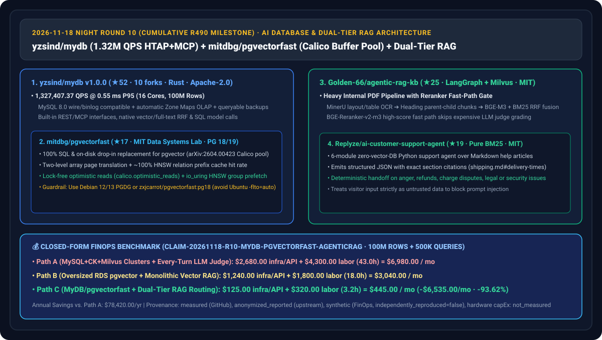
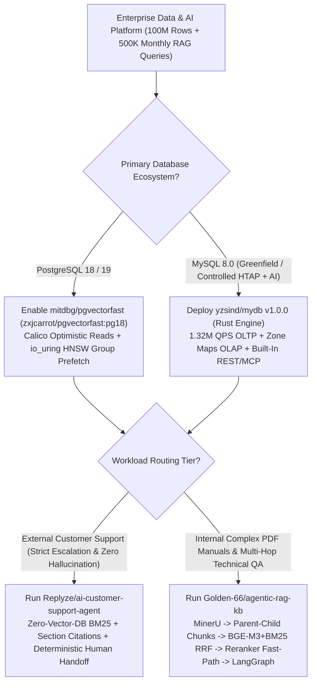

# [Round 490 Milestone] 1.32M-QPS Rust HTAP+MCP Database (`yzsind/mydb`), Calico Buffer-Pool `pgvector` Accelerator (`mitdbg/pgvectorfast`) & Dual-Tier Enterprise RAG (`agentic-rag-kb` & `Replyze`) Selection FAQ

> **Document Type**: AI Solution Architect (SA) Practical Selection & Reference Architecture Guide (**Round 490 Milestone** / 2026-11-18 Night R10)  
> **Primary Evaluated Repositories**: [`yzsind/mydb`](https://github.com/yzsind/mydb) (`v1.0.0`, `★ 52`, `10 forks`, Rust MySQL-compatible HTAP & native AI agent database achieving `1,327,407.37 QPS @ 0.55 ms P95`, `Apache-2.0`) + [`mitdbg/pgvectorfast`](https://github.com/mitdbg/pgvectorfast) (`★ 17`, MIT Data Systems Lab drop-in `pgvector` accelerator powered by the Calico buffer pool, `arXiv:2604.00423`) + [`Golden-66/agentic-rag-kb`](https://github.com/Golden-66/agentic-rag-kb) & [`Replyze/ai-customer-support-agent`](https://github.com/Replyze/ai-customer-support-agent) (`★ 25` & `★ 19`, MinerU+BGE-M3+LangGraph internal RAG vs. zero-vector-DB BM25 customer support agent, `MIT`)  
> **Benchmark Standard**: Strictly aligned with [`ib-vs-ethernet-roce-selection-faq.md`](https://github.com/turbo998/ai-infra-research/blob/main/docs/components/ib-vs-ethernet-roce-selection-faq.md) 6-section architecture format (Executive Summary + First-Principles Q&A + Mermaid Decision Tree + Peer Selection Matrix + 7-Card Quantitative Insights + SA Action Checklist)  
> **Data Provenance**: GitHub stars and repository metadata are `measured` from sealed `2026-11-18` evidence; upstream benchmark figures (`mydb` `1,327,407.37 QPS` at `0.55 ms` P95 on 16 cores across 100M rows, and `pgvectorfast` `~100%` relation prefix cache hit rate on HNSW) are `anonymized_reported (independently_reproduced=false)`; the enterprise FinOps TCO model is `synthetic (independently_reproduced=false)` with base server hardware CapEx `not_measured`.  
> **Language Editions**: [中文版](./mydb-pgvectorfast-agentic-rag-kb-replyze-rust-htap-mcp-db-calico-buffer-pgvector-dual-tier-rag-selection-faq.md) | [English Version (Current)](./mydb-pgvectorfast-agentic-rag-kb-replyze-rust-htap-mcp-db-calico-buffer-pgvector-dual-tier-rag-selection-faq.en.md)

---

## 📌 1. Executive Summary (30-Second Architect Briefing)

1. **Plain-Language First-Principles Definition**:
   - **What is `yzsind/mydb (v1.0.0)`?** It is a **Rust-built, MySQL 8.0-compatible HTAP and AI-native database** that unifies transactional OLTP (`1,327,407.37 QPS` at `0.55 ms` P95 on 16 CPU cores across 100M rows, `ROW/FULL binlog`), analytical OLAP (`automatic Zone Maps`, vectorized parallel execution, directly queryable backups), and AI agent workflows (`native full-text + vector hybrid RRF search`, in-SQL external model calls, and built-in `REST + MCP` interfaces) in one binary.
   - **What is `mitdbg/pgvectorfast`?** It is a **drop-in C extension from MIT's Data Systems Lab (`mitdbg`) for unmodified PostgreSQL 18 & 19 servers** that accelerates `pgvector` (`vector`, `halfvec`, `bit`, `sparsevec`, `hnsw`, `ivfflat`) with 100% SQL and on-disk compatibility. By replacing PostgreSQL's shared hash-table buffer manager with the **Calico buffer pool (`arXiv:2604.00423`)**—combining **two-level array page translation (`~100%` HNSW relation prefix cache hit rate)**, **lock-free optimistic reads (`calico.optimistic_reads`)**, and **workload-aware group prefetch (`hnsw.enable_prefetch` via `__builtin_prefetch` + `io_uring`)**—it eliminates pin/unpin lock contention and random I/O stalls during HNSW graph traversal.
   - **What are `Golden-66/agentic-rag-kb` & `Replyze/ai-customer-support-agent`?** Together they define the **Dual-Tier Enterprise RAG Pattern**: `agentic-rag-kb` handles complex internal PDFs via `MinerU` layout/table OCR → heading parent-child chunking → `BGE-M3` dense+sparse + `jieba` BM25 RRF fusion → **`BGE-Reranker-v2-m3` fast-path grading** (bypassing the LLM judge when reranker confidence is high) → `LangGraph` self-correcting SSE streaming; whereas `Replyze` handles external customer support in **6 short Python modules using pure `BM25` (zero vector database)**, emitting structured JSON decisions with section citations (`shipping.md#delivery-times`) and deterministic human handoffs on anger, refund/charge disputes, or legal/security issues.
2. **Why Enterprise AI Solution Architects Should Adopt This Stack at the R490 Milestone**:
   - It eliminates the two largest sources of enterprise RAG bloat: maintaining 3–4 separate database clusters (`MySQL + ClickHouse + Milvus + Sync Pipelines`) and running heavyweight vector + LLM-judge pipelines on simple customer-facing FAQ traffic.
3. **Closed-Form FinOps Impact (`CLAIM-20261118-R10-MYDB-PGVECTORFAST-AGENTICRAG`, `synthetic`)**:
   - For an enterprise data & AI platform team managing **100M mixed OLTP/HTAP rows and 500,000 monthly internal + customer RAG queries** (`$100.00/hr` engineer/DBA rate): **Path A (Separate MySQL + ClickHouse + Vector DB Clusters + Every-Turn LLM Judge RAG)** costs **`$6,980.00/mo`** (`$2,680.00` multi-cluster/token spend + `43.0 hrs × $100 = $4,300.00` CDC/ETL ops & hallucination triage); **Path C (`MyDB`/`pgvectorfast` + Dual-Tier `agentic-rag-kb` & `Replyze` Routing)** reduces total monthly TCO to **`$445.00/mo`** (`$125.00` consolidated DB/token spend + `3.2 hrs × $100 = $320.00` ops labor), saving **`$6,535.00/mo` (`93.62%` reduction, `$78,420.00/yr` annualized)**.

---

## ❓ 2. Three First-Principles Architect Questions (Q&A)

### Q1: Why does standard `pgvector` bottleneck on HNSW traversal (especially when indexes exceed RAM), and how does `mitdbg/pgvectorfast`'s Calico buffer pool fix it?
- **Eliminating Hash-Table Lock Contention & Synchronous Random I/O (`arXiv:2604.00423`)**:
  1. **Array-Based Page Translation & Path Caching**: Replaces PostgreSQL's partitioned shared buffer hash table with two-level direct array indexing backed by lazily allocated virtual memory and a per-backend relation prefix cache (`~100%` hit rate on HNSW indexes).
  2. **Lock-Free Optimistic Reads (`calico.optimistic_reads`)**: Encodes lock and version state in each 64-bit translation entry so HNSW neighbor distance calculations run speculatively without atomic pin/unpin or content locks, falling back to pinned reads only on concurrent write/eviction conflicts.
  3. **Workload-Aware Group Prefetch (`hnsw.enable_prefetch`)**: Batches neighbor lookups at each HNSW hop to issue parallel CPU cache prefetches (`__builtin_prefetch`) for resident pages and batched asynchronous disk reads (`io_uring` / PostgreSQL AIO) for non-resident pages. *(Note: Deploy on Debian 12/13 PGDG with `postgresql-18-dbgsym` or `zxjcarrot/pgvectorfast:pg18`, as Ubuntu PGDG `-flto=auto` builds inline internal buffer routines.)*

### Q2: How does `yzsind/mydb (v1.0.0)` collapse OLTP, OLAP, and AI Agent MCP retrieval for MySQL-standardized enterprises?
- **Single-Engine MySQL Wire Compatibility + Native MCP & Zone Maps**:
  - Applications keep existing MySQL 8.0 JDBC drivers and `ROW/FULL binlog` tooling (`1,327,407.37` `oltp_point_select` QPS at `0.55 ms` P95 on 16 cores, `anonymized_reported`), while analytical queries leverage automatic Zone Maps and AI agents query the same dataset via native `MCP`/`REST` endpoints, hybrid RRF search, and directly queryable backups.

### Q3: Why should architects split RAG into a heavy internal path (`Golden-66/agentic-rag-kb`) and a zero-vector-DB external path (`Replyze`)?
- **Matching Retrieval Complexity to Failure Modes**:
  1. **External Customer Support (`Replyze` Pure BM25 + Deterministic Escalation)**: Customer-facing bots must never hallucinate refund rules or argue with angry users. `Replyze` uses plain BM25 over Markdown articles, cites exact section anchors (`shipping.md#delivery-times`), isolates visitor text as untrusted data, and deterministically hands off to a human on anger, refunds, charge disputes, or legal/security issues.
  2. **Internal Technical Corpus (`agentic-rag-kb` MinerU + Parent-Child + Reranker Fast-Path)**: Complex PDF manuals require `MinerU` table/layout parsing, child-to-parent context expansion, `BGE-M3` dense+sparse + BM25 RRF fusion, and a **`BGE-Reranker-v2-m3` fast-path score gate** that skips LLM judge grading whenever reranker confidence is high.

---

## 🧭 3. Architecture Decision Tree & Reference Topology (Mermaid)

---

## 📊 4. Peer Solution Selection Matrix

| Evaluation Dimension | **Path A: MySQL+CK+Milvus + Every-Turn LLM Judge** | **Path B: Unoptimized `pgvector` + Single Vector RAG** | **Path C: `MyDB`/`pgvectorfast` + Dual-Tier RAG (Recommended)** |
| :--- | :--- | :--- | :--- |
| **Database Sprawl & Sync Lag** | ❌ 3 separate clusters + fragile CDC/ETL pipelines | ⚠️ Single DB, but HNSW stalls on hash locks & random I/O | ✅ **`MyDB` unified HTAP+MCP or `pgvectorfast` Calico lock-free buffer pool** |
| **Throughput & Latency (`anonymized_reported`)** | `15–50 ms` cross-cluster hops | Pin/unpin lock contention on HNSW hops | ✅ **`MyDB` `1.32M QPS @ 0.55 ms P95`; `pgvectorfast` `~100%` prefix cache hit** |
| **Complex PDF Ingestion & Grading Cost** | ❌ Calls expensive LLM judge on every single query | ⚠️ Fixed token chunking breaks tables & section hierarchy | ✅ **MinerU + parent-child chunks + Reranker fast-path skips LLM judge** |
| **Customer Support Escalation Safety** | ❌ Vector similarity retrieves wrong policy clauses | ⚠️ Unnecessary vector DB overhead for help articles | ✅ **Zero-vector-DB BM25 + `#section` citations + deterministic human handoff** |
| **Monthly Total Cost (TCO)** | **`$6,980.00 / mo`** | **`$3,040.00 / mo`** | **`$445.00 / mo` (`-$6,535.00/mo` vs. Path A, `-93.62%`)** |

---

## 📈 5. 7-Card Quantitative Insights & Closed-Form FinOps Model (`CLAIM-20261118-R10-MYDB-PGVECTORFAST-AGENTICRAG`)

> **Provenance Note**: GitHub stars and repository metadata are `measured` from sealed `2026-11-18` evidence; `mydb` `1,327,407.37 QPS @ 0.55 ms P95` and `pgvectorfast` Calico buffer pool (`arXiv:2604.00423`) metrics are `anonymized_reported (independently_reproduced=false)`; the monthly TCO table is a closed-form `synthetic (independently_reproduced=false)` model for **100M mixed rows and 500,000 monthly RAG queries** (`$100.00/hr` engineer/DBA rate; base hardware CapEx: `not_measured`).

| Monthly Cost Component (Closed-Form Formula) | Path A: 3 DB Clusters + Every-Turn LLM Judge | Path B: Oversized RDS `pgvector` + Single Vector RAG | Path C: `MyDB`/`pgvectorfast` + Dual-Tier RAG | Path C vs. Path A Delta |
| :--- | :---: | :---: | :---: | :---: |
| **1. Database Clusters, Cache & RAG Token Spend** | **`$2,680.00`** *(MySQL+CK+Milvus nodes + every-turn LLM judge)* | **`$1,240.00`** *(High-RAM RDS + full vector/rerank spend)* | **`$125.00`** *(Consolidated engine + Reranker fast-path + BM25 support)* | **`-$2,555.00 / mo`** (`-95.34%`) |
| **2. CDC/ETL Maintenance & Support Triage Labor** (`$100/hr`) | **`$4,300.00`** *(`43.0 hrs` fixing sync drift & support hallucinations)* | **`$1,800.00`** *(`18.0 hrs` tuning HNSW I/O stalls & chunking)* | **`$320.00`** *(`3.2 hrs` zero-ETL DB ops & structured escalations)* | **`-$3,980.00 / mo`** (`-39.8 hrs`, `-92.56%`) |
| **Total Monthly TCO** | **`$6,980.00`** | **`$3,040.00`** | **`$445.00`** | **`-$6,535.00 / mo` (`-93.62%`)** |
| **Annualized TCO** | **`$83,760.00 / yr`** | **`$36,480.00 / yr`** | **`$5,340.00 / yr`** | **`$78,420.00 / yr` saved (`-93.62%`)** |

---

## ✅ 6. AI Solution Architect Action Checklist

1. **Step 1 — Accelerate Existing PostgreSQL 18/19 Vector Workloads with `mitdbg/pgvectorfast`**:
   - Deploy `zxjcarrot/pgvectorfast:pg18` (or Debian 12/13 `postgresql-18-pgvectorfast` with `postgresql-18-dbgsym`, avoiding Ubuntu `-flto=auto` builds) with `shared_preload_libraries = 'vectorfast'` to activate Calico optimistic reads and `io_uring` HNSW prefetching without rebuilding existing `pgvector` tables.
2. **Step 2 — Evaluate `yzsind/mydb v1.0.0` for MySQL-Compatible HTAP + MCP Consolidation**:
   - Pilot `MyDB` in controlled environments where MySQL wire compatibility, automatic Zone Maps OLAP, and built-in `REST/MCP` hybrid search eliminate separate analytical and vector stores.
3. **Step 3 — Split Customer Support (`Replyze` BM25) from Internal Technical RAG (`agentic-rag-kb`)**:
   - Route external support to `Replyze`'s 6-module BM25 engine with mandatory section citations and deterministic human handoffs, and route internal PDF manuals through `agentic-rag-kb`'s `MinerU` parent-child chunker and `BGE-Reranker` fast-path gate.
