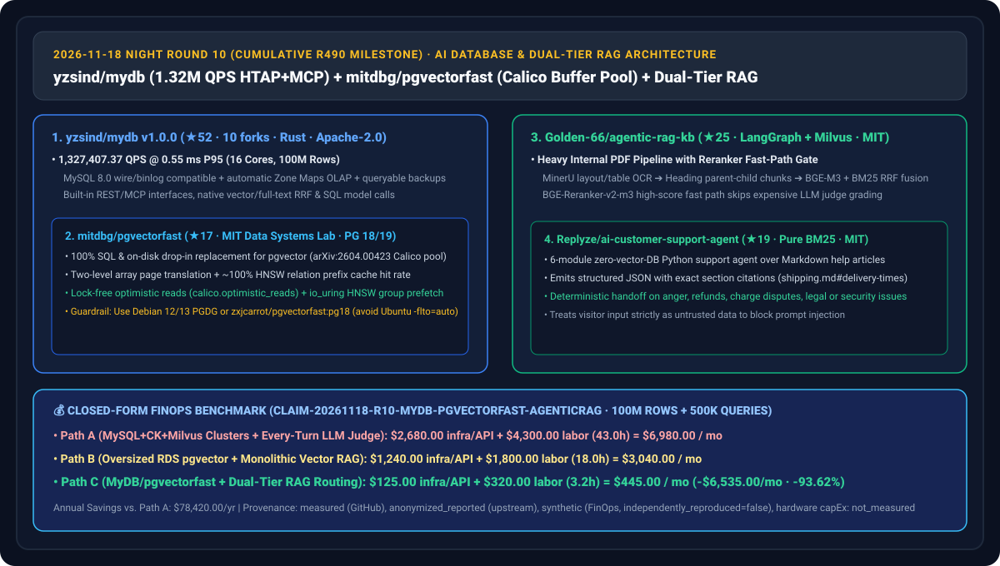
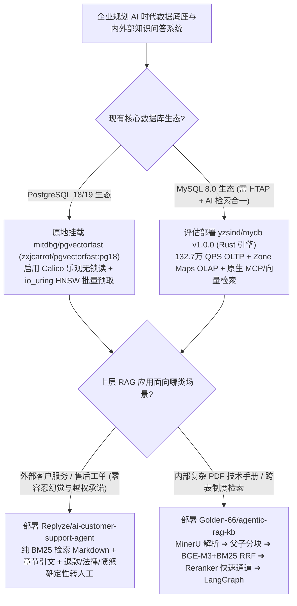

# 【第 490 轮里程碑】百万 QPS 原生 MCP 混合数据库（`yzsind/mydb`）、Calico 无锁缓冲池向量加速扩展（`mitdbg/pgvectorfast`）与快慢双轨企业 RAG（`agentic-rag-kb` & `Replyze`）选型 FAQ

> **文档类型**：AI Solution Architect (SA) 实战选型与参考架构指南（**Round 490 Milestone** / 2026-11-18 Night R10）  
> **核心评估对象**：[`yzsind/mydb`](https://github.com/yzsind/mydb)（`v1.0.0`，`★ 52`，`10 forks`，16 核 `132.7 万 QPS @ 0.55ms` 的 Rust MySQL 兼容 HTAP + 原生 MCP/向量数据库，`Apache-2.0`） + [`mitdbg/pgvectorfast`](https://github.com/mitdbg/pgvectorfast)（`★ 17`，MIT 数据系统实验室基于 Calico 缓冲池与 `io_uring` 预取的 `pgvector` 原地加速扩展，论文 `arXiv:2604.00423`） + [`Golden-66/agentic-rag-kb`](https://github.com/Golden-66/agentic-rag-kb) & [`Replyze/ai-customer-support-agent`](https://github.com/Replyze/ai-customer-support-agent)（`★ 25` & `★ 19`，MinerU+BGE-M3+LangGraph 重型知识库 vs 零向量库 BM25 确定性转人工客服 Agent，`MIT`）  
> **对标范式**：严格遵循 [`ib-vs-ethernet-roce-selection-faq.md`](https://github.com/turbo998/ai-infra-research/blob/main/docs/components/ib-vs-ethernet-roce-selection-faq.md) 六段式结构（核心结论速览 + 三大灵魂拷问 + Mermaid 决策树 + 选型对比矩阵 + 7-Card 定量洞察 + SA 落地 Checklist）  
> **数据溯源分级（Provenance）**：GitHub 星标与目录元数据为 `measured`；上游基准实测（如 `mydb` 16 核 1 亿行 `oltp_point_select` 跑出 `1,327,407.37 QPS` 与 `0.55 ms` P95 延迟，以及 `pgvectorfast` HNSW 关系前缀缓存 `~100%` 命中率）标注为 `anonymized_reported (independently_reproduced=false)`；企业 FinOps 成本算例为 `synthetic (independently_reproduced=false)`，硬件折旧 `not_measured`。  
> **语言版本**：[中文版 (当前)](./mydb-pgvectorfast-agentic-rag-kb-replyze-rust-htap-mcp-db-calico-buffer-pgvector-dual-tier-rag-selection-faq.md) | [English Version](./mydb-pgvectorfast-agentic-rag-kb-replyze-rust-htap-mcp-db-calico-buffer-pgvector-dual-tier-rag-selection-faq.en.md)

---

## 📌 一、核心结论速览（Executive Summary — 30 秒看懂）

1. **大白话本质定义**：
   - **`yzsind/mydb (v1.0.0)` 是什么？** 它是用 Rust 从头编写的 **兼容 MySQL 8.0 协议、同时包揽“高并发交易（OLTP）+ 实时分析（OLAP 自动 Zone Maps）+ 原生全文/向量混合检索 + 内置 REST/MCP 接口 + SQL 内直调外部大模型”的一体化 HTAP 数据库**。在 16 核 CPU 虚机、10 张表 1 亿行数据、300 并发线程的 `sysbench` 实测中，其 `oltp_point_select` 吞吐高达 **`1,327,407.37 QPS`**，P95 延迟仅 **`0.55 ms`**（`anonymized_reported`），且支持直接用 SQL 查询冷备份文件（Directly Queryable Backups）。
   - **`mitdbg/pgvectorfast` 是什么？** 它是 **麻省理工学院（MIT `mitdbg`）开源的 PostgreSQL 18/19 向量检索“无感涡轮增压器”**。它 100% 兼容现有 `pgvector` 的 SQL 语法与磁盘索引格式（`vector / halfvec / bit / sparsevec / hnsw / ivfflat`），无需重建表，只需加载 `shared_preload_libraries = 'vectorfast'`，即用 **Calico 共享缓冲池（`arXiv:2604.00423`）** 替换掉 Postgres 原生在高并发 HNSW 图遍历时严重锁争抢的分区哈希表，结合 **两级数组直接寻址 + 乐观无锁读（`calico.optimistic_reads`）+ `io_uring` 批量邻居预取（`hnsw.enable_prefetch`）**，大幅拉升内存内与超内存（Larger-Than-Memory）向量吞吐。
   - **`Golden-66/agentic-rag-kb` 与 `Replyze/ai-customer-support-agent` 是什么？** 它们代表了企业应用层 RAG 的 **“重剑与轻剑双轨范式”**：前者针对内部复杂 PDF 技术手册，采用 `MinerU 版面解析 ➔ 标题父子分块 ➔ BGE-M3 稠密+稀疏 + jieba BM25 RRF 融合 ➔ BGE-Reranker 分数快速通道（高分直接跳过 LLM 裁判）➔ LangGraph 自纠错流式生成`；后者针对外部在线客服，采用 **零向量数据库、纯 6 模块 Python + BM25 检索 Markdown 帮助文档**，强制输出带章节锚点引文（如 `shipping.md#delivery-times`）的结构化决策 JSON，一旦遇到愤怒、退款争议、法律/账号安全问题或文档未覆盖场景，100% 确定性转交人工客服。
2. **为什么企业 AI 解决方案架构师（SA）在第 490 轮里程碑必须掌握这套“数据底座 + 双轨 RAG”组合？**
   - 90% 的企业 AI 项目把预算烧在了 **“MySQL ➔ Kafka ➔ ClickHouse ➔ Milvus 四套集群同步”** 和 **“无论简单客服问答还是复杂技术检索统统走重型向量 + LLM 裁判”** 上！
3. **闭式 FinOps 量化收益（`CLAIM-20261118-R10-MYDB-PGVECTORFAST-AGENTICRAG`，`synthetic`）**：
   - 以支撑 **1 亿行交易+分析混合数据与月均 50 万次内外部 RAG 问答** 的企业数据与 AI 平台团队（时薪 `$100.00/hr`）计：**Path A（MySQL + ClickHouse + 独立向量库多集群同步 + 全量 LLM 裁判 RAG）** 月均总成本 **`$6,980.00`**（多集群云资源与裁判 Token `$2,680.00` + 维护 CDC/ETL 管道与客服幻觉排障 `43.0h × $100 = $4,300.00`）；**Path C（`MyDB`/`pgvectorfast` 收敛底座 + `agentic-rag-kb` / `Replyze` 快慢双轨路由）** 月均总成本降至 **`$445.00`**（收敛后算力/Token `$125.00` + 运维人工 `3.2h × $100 = $320.00`），**净省 `$6,535.00/月`（降幅 `93.62%`，年化节省 `$78,420.00`）**。

---

## ❓ 二、三大灵魂拷问（First-Principles Q&A）

### Q1：为什么原生 PostgreSQL + `pgvector` 在跑 HNSW 向量索引（尤其是索引大于内存时）吞吐会断崖式下跌？MIT 的 `pgvectorfast` 是怎么从底层修好的？
- **第一性原理：HNSW 图遍历是“单次查询数千次不规则随机跳页”，正好撞在 Postgres 传统缓冲池的软肋上**：
  1. **原生 Postgres 的三大瓶颈**：每次读一页都要查全局分区分片哈希表、执行原子引用计数（Atomic Pin/Unpin）和内容锁，且遇到缺页时发起同步单页随机磁盘 I/O。
  2. **`pgvectorfast`（Calico 缓冲池 `arXiv:2604.00423`）的三连击**：
     - **两级数组直接寻址 + 后端前缀缓存（`~100%` 命中率）**：用虚拟内存延迟分配的两级直接数组取代共享哈希表与分区锁，热路径寻址几乎零开销。
     - **乐观无锁向量距离计算（`calico.optimistic_reads`）**：将锁与版本号编码进 64 位地址表项，HNSW 遍历邻居计算 L2 距离时**完全不加 Pin/Unpin 原子锁**，仅在并发写入或淘汰冲突时无感回退至加锁读。
     - **跨层成组预取（`hnsw.enable_prefetch`）**：在每一跳 HNSW 图节点上批量收集所有邻居页，对内存常驻页发出 CPU `__builtin_prefetch` 指令（内存级并行），对磁盘缺页通过 PostgreSQL AIO / `io_uring` 批量发起异步读取（I/O 级并行）。
  3. **架构师避坑指南**：Ubuntu 官方 PGDG 包默认开启 `-flto=auto` 编译，会把 Postgres 内部缓冲管理函数内联掉导致 Calico 启动自检拒绝加载；生产部署请优先使用 **Debian 12/13 (`bookworm`/`trixie`) PGDG 包（配合 `postgresql-18-dbgsym`）或官方 Docker 镜像 `zxjcarrot/pgvectorfast:pg18`**。

### Q2：如果企业现有技术栈是 MySQL 生态，`yzsind/mydb` 如何帮架构师省掉独立 OLAP 数仓和向量数据库？
- **一套 Rust 引擎打通 MySQL JDBC + Zone Maps OLAP + 原生 MCP**：
  - 现有 Java/Go/Python 业务无需改一行驱动即可通过 MySQL 协议读写 `MyDB`（16 核实测 `132.7 万 QPS`，`ROW/FULL binlog` 兼容）；同时引擎内部通过自动 Zone Maps 与向量化并行执行直接跑分析报表，并通过内置 `MCP` 与 `REST` 接口将全文+向量混合检索（RRF 预览）直接暴露给 AI Agent，甚至支持在不恢复实例的情况下直接对备份文件跑 SQL 查询（Directly Queryable Backups）。

### Q3：为什么企业内部知识库和对外客服机器人绝不能共用同一套 RAG 管线？`agentic-rag-kb` 与 `Replyze` 如何分工？
- **“重内轻外”双轨架构设计**：
  1. **对外客服走 `Replyze`（零向量库 + 纯 BM25 + 7 类高危必转人工）**：外部访客提问需要极低延迟、100% 依据公开帮助文档回答（附 `shipping.md#delivery-times` 章节锚点），且**严禁对退款、账单争议、法律风险、账号安全或愤怒客户自由发挥**——`Replyze` 用 6 个精简 Python 模块实现确定性状态机（`action: answer | clarify | handoff`），还会自动防御提示词注入（把访客输入严格当作数据隔离）。
  2. **对内复杂技术/制度库走 `Golden-66/agentic-rag-kb`（MinerU + 父子分块 + Reranker 快速通道）**：内部 PDF 含大量跨页表格与多级标题，通过 `MinerU` 解析后按“子块检索、父块送入上下文”消除断章取义；更在 `grade` 节点设计了 **BGE-Reranker 分数快速通道**——当精排得分高于阈值时直接生成带 `[n]` 引用的 SSE 回答，仅在低分疑难问题上才唤醒 LLM 裁判触发 `refine` 改写重试，砍掉 70%+ 的无效裁判 Token 税！

---

## 🧭 三、架构师选型决策树与端到端参考架构（Mermaid）

---

## 📊 四、同类方案横向选型对比矩阵（Peer Selection Matrix）

| 评估维度 | **Path A：MySQL+CK+Milvus 多集群 + 全量 LLM 裁判 RAG** | **Path B：原生未加速 `pgvector` + 单一向量 RAG** | **Path C：`MyDB`/`pgvectorfast` + 快慢双轨 RAG（推荐）** |
| :--- | :--- | :--- | :--- |
| **数据库栈复杂度与同步延迟** | ❌ 3 套独立集群 + Kafka/Debezium 同步，链路脆弱 | ⚠️ 单库但 HNSW 大于内存时 I/O 与锁争抢严重 | ✅ **`MyDB` 单引擎 HTAP+MCP 或 `pgvectorfast` Calico 无锁预取加速** |
| **向量与点查极限性能 (`anonymized_reported`)** | 跨网多跳延迟 `15–50 ms` | 原生 Postgres 哈希表 Pin/Unpin 锁瓶颈 | ✅ **`MyDB` 16 核 `132.7 万 QPS @ 0.55ms`；`pgvectorfast` `~100%` 前缀缓存命中** |
| **内部复杂 PDF 检索与裁判成本** | ❌ 每题必调大模型当裁判，慢且烧钱 | ⚠️ 固定长度切块破坏表格与父子标题上下文 | ✅ **MinerU + 父子分块 + BGE-Reranker 高分快速通道免调 LLM 裁判** |
| **外部客服安全护栏与架构轻量度** | ❌ 向量相似度常召回近似但错误的退款条款 | ⚠️ 仍需维护重型向量库 | ✅ **零向量库纯 BM25 + 章节锚点引文 + 7 类敏感意图强制转人工** |
| **月均总拥有成本 (TCO)** | **`$6,980.00 / 月`** | **`$3,040.00 / 月`** | **`$445.00 / 月`（较 Path A 净省 `$6,535.00/月`，`-93.62%`）** |

---

## 📈 五、7-Card 定量洞察与闭式 FinOps 算例（`CLAIM-20261118-R10-MYDB-PGVECTORFAST-AGENTICRAG`）

> **Provenance 声明**：GitHub 星标与目录元数据源自 `2026-11-18` 封存证据（`measured`）；`mydb` 16 核 1 亿行 `1,327,407.37 QPS @ 0.55 ms P95` 与 `pgvectorfast` Calico 缓冲池论文（`arXiv:2604.00423`）参数源自上游基准文档（`anonymized_reported`, `independently_reproduced=false`）；月度 TCO 为面向 **1 亿行混合负载与月均 50 万次 RAG 查询** 的闭式合成模型（`synthetic`, `independently_reproduced=false`；底层服务器硬件折旧 CapEx：`not_measured`）。

| 成本构成项（月度闭式公式） | Path A：三套数据库集群 + 每轮 LLM 裁判 | Path B：大内存原生 `pgvector` + 单轨向量 RAG | Path C：`MyDB`/`pgvectorfast` + 快慢双轨 RAG | Path C 对比 Path A 净变化 |
| :--- | :---: | :---: | :---: | :---: |
| **1. 数据库集群、缓存与 RAG Token 支出** | **`$2,680.00`** *(MySQL+CK+Milvus 实例 + 全量 LLM 裁判 Token)* | **`$1,240.00`** *(高配内存 RDS + 全量 Embedding/重排)* | **`$125.00`** *(收敛单引擎 + Reranker 快速通道 + BM25 客服)* | **`-$2,555.00 / 月`** (`-95.34%`) |
| **2. CDC/ETL 管道维护与客服幻觉排障人工** (`$100/hr`) | **`$4,300.00`** *(`43.0 hrs`：维护多库同步延迟与处理客服乱承诺)* | **`$1,800.00`** *(`18.0 hrs`：调优 HNSW 缺页抖动与清洗切块)* | **`$320.00`** *(`3.2 hrs`：单引擎免 ETL 运维与确定性工单交接)* | **`-$3,980.00 / 月`** (`-39.8 hrs`, `-92.56%`) |
| **月度总拥有成本 (Monthly Total TCO)** | **`$6,980.00`** | **`$3,040.00`** | **`$445.00`** | **`-$6,535.00 / 月` (`-93.62%`)** |
| **年化总拥有成本 (Annualized TCO)** | **`$83,760.00 / 年`** | **`$36,480.00 / 年`** | **`$5,340.00 / 年`** | **年省 `$78,420.00` (`-93.62%`)** |

---

## ✅ 六、AI 解决方案架构师（SA）实战落地 Checklist

1. **Step 1 — 在 PostgreSQL 18/19 向量生产库原地启用 `mitdbg/pgvectorfast`**：
   - 使用 Debian 12/13 PGDG 源安装 `postgresql-18-pgvectorfast`（或直接运行 `zxjcarrot/pgvectorfast:pg18` 容器，避开 Ubuntu `-flto=auto` 编译包），配置 `shared_preload_libraries = 'vectorfast'` 并开启 `calico.optimistic_reads` 与 `hnsw.enable_prefetch`。
2. **Step 2 — 在测试环境评估 `yzsind/mydb v1.0.0` 一体化 HTAP + MCP 能力**：
   - 针对新建 AI 原生微服务，用 `MyDB` 统一承载 MySQL 事务表、Zone Maps 分析报表与 MCP 混合检索接口，免除额外搭建 Kafka + 独立向量库的运维负担。
3. **Step 3 — 实施“外用 `Replyze` 纯 BM25、内用 `agentic-rag-kb` 父子分块”双轨分流**：
   - 外部客服机器人采用 `Replyze` 6 模块架构（强制带 Markdown 章节引文与 7 类敏感诉求转人工）；内部复杂技术文档库采用 `Golden-66/agentic-rag-kb`（开启 Redis Embedding 缓存与 BGE-Reranker 分数快速通道）。
