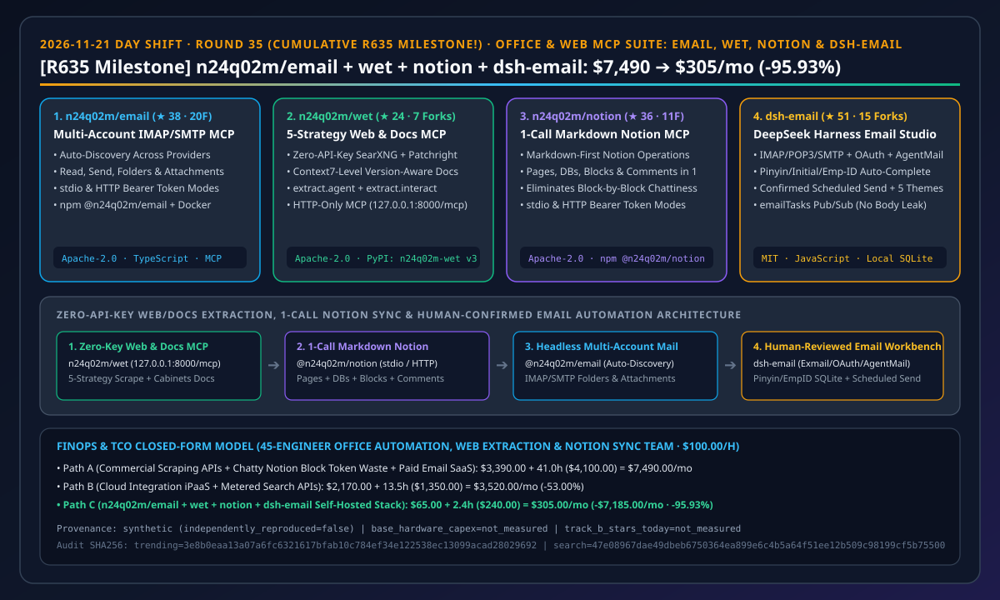
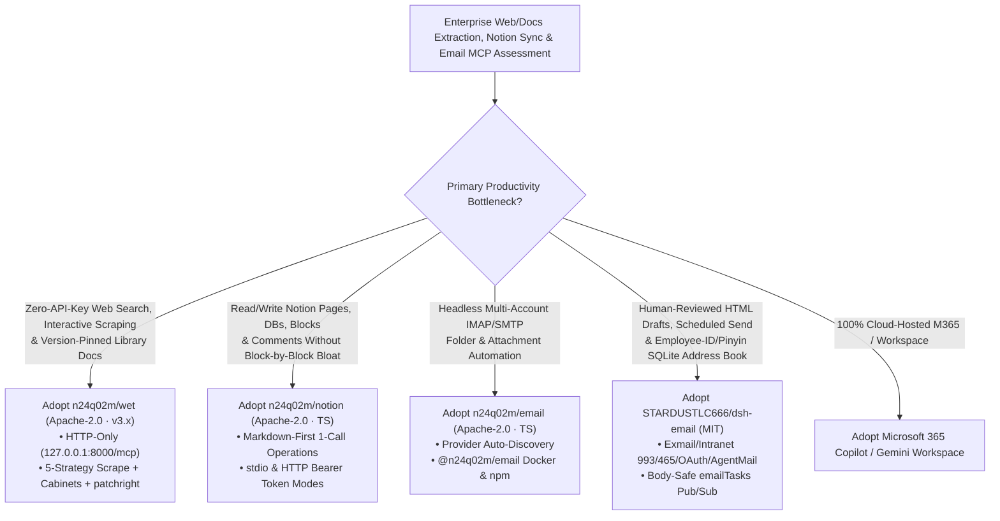
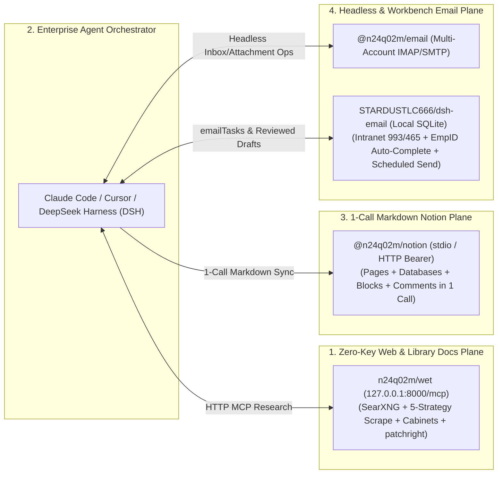
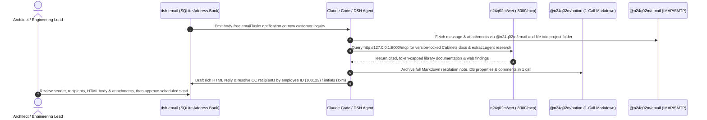

# [Round 635 Milestone] Multi-Account Auto-Discovery Email MCP (`n24q02m/email`), 5-Strategy Zero-Key Web & Docs MCP (`n24q02m/wet`), 1-Call Markdown Notion MCP (`n24q02m/notion`) & Human-Confirmed Enterprise Email Workbench (`STARDUSTLC666/dsh-email`) Selection FAQ

> **Document Metadata (2026-11-21 Day Shift Round 35 · Cumulative Round 635 Milestone Deep-Dive)**  
> - **Target Audience**: Enterprise AI Solution Architects, Workplace Productivity & Knowledge Management Leads, and Agent Tooling Architects  
> - **Evaluated Repositories**:  
>   1. [`n24q02m/email`](https://github.com/n24q02m/email) (`★ 38` · `20 forks` · TypeScript · Apache-2.0 · **`@n24q02m/email` (`io.github.n24q02m/email`)**: Multi-account IMAP/SMTP MCP server over `stdio + HTTP Bearer` with provider auto-discovery, folder organization, and attachment management)  
>   2. [`n24q02m/wet`](https://github.com/n24q02m/wet) (`★ 24` · `7 forks` · Python · Apache-2.0 · **WET `v3.x` (`n24q02m-wet`, `http://127.0.0.1:8000/mcp`)**: Zero-API-key HTTP-only MCP server combining **5-strategy web scraping** (`SearXNG` + `patchright` interactive `extract.interact`), **Context7-level version-aware library docs search** (with token caps and project Cabinet locks), and `extract.agent` multi-step cited synthesis)  
>   3. [`n24q02m/notion`](https://github.com/n24q02m/notion) (`★ 36` · `11 forks` · TypeScript · Apache-2.0 · **`@n24q02m/notion` (`io.github.n24q02m/notion`)**: Markdown-first Notion MCP server over `stdio + HTTP Bearer` operating on pages, databases, blocks, and comments **in one call**)  
>   4. [`STARDUSTLC666/dsh-email`](https://github.com/STARDUSTLC666/dsh-email) (`★ 51` · `15 forks` · JavaScript · MIT · **DeepSeek Harness (DSH) Email Workbench (`dsh-email`)**: Supports IMAP/POP3/SMTP, Google/Outlook OAuth, Tencent Exmail, custom intranet servers (`993/465`), and AgentMail with a local SQLite address book [name/pinyin/initial/employee-ID auto-complete], human-reviewed scheduled send, and body-safe `emailTasks` pub/sub)  
> - **Sealed Evidence Chain**: `workshops/github-trending-radar/evidence/search-new-repos-2026-11-21-raw.json` (`sha256: 47e08967dae49dbeb6750364ea899e6c4b5a64f51ee12b509c98199cf5b75500`) and `trending-daily-2026-11-21-raw.html` (`sha256: 3e8b0eaa13a07a6fc6321617bfab10c784ef34e122538ec13099acad28029692`)  
> - **Architecture Visual**: [`assets/github-ai-radar-2026-11-21-r35-r635-n24email-wet-n24notion-dshemail.svg`](../../../assets/github-ai-radar-2026-11-21-r35-r635-n24email-wet-n24notion-dshemail.svg) · [中文版 (`n24q02m-email-wet-notion-dsh-email-selection-faq.md`)](n24q02m-email-wet-notion-dsh-email-selection-faq.md)

---

## ① 📌 Executive Summary (One-Sentence Selection Verdict)

> **Solution Architect's Verdict (Round 635 Milestone)**:  
> Connecting AI agents to **web research, library documentation, Notion workspaces, and enterprise email** often fails on cost and safety: **(1) naive Notion integrations make dozens of block-by-block JSON calls per page, (2) commercial web-scraping APIs charge per page while returning version-mismatched library docs, and (3) unguarded email bots risk sending unreviewed drafts to the wrong recipient**.  
> - **To read and update Notion pages, databases, blocks, and comments in one consolidated Markdown-first call (`stdio` or `HTTP Bearer`)** ➔ Choose **`n24q02m/notion` (`@n24q02m/notion`)** (Apache-2.0);  
> - **For zero-API-key 5-strategy web scraping, `patchright` browser interaction (`extract.interact`), and Context7-level version-aware library docs search with project Cabinet locks (`http://127.0.0.1:8000/mcp`)** ➔ Choose **`n24q02m/wet` (`n24q02m-wet v3.x`)** (Apache-2.0);  
> - **For headless multi-account IMAP/SMTP email, folder organization, and attachment management with provider auto-discovery** ➔ Choose **`n24q02m/email` (`@n24q02m/email`)** (Apache-2.0);  
> - **For an interactive email workbench supporting IMAP/POP3/SMTP, Google/Outlook OAuth, Tencent Exmail, intranet `993/465` servers, and AgentMail—with local SQLite name/pinyin/employee-ID auto-complete, human-confirmed scheduled send, and body-free `emailTasks` events** ➔ Choose **`STARDUSTLC666/dsh-email`** (MIT).  
> Combined, this stack reduces monthly commercial scraping API bills, chatty Notion block token burn, and email automation SaaS TCO for a 45-engineer team from **$7,490.00/mo** to **$305.00/mo (-$7,185.00/mo, -95.93%)**.

---

## ② 🎯 Solution Architect & Customer Deep-Dive Q&A

### Q1: How do `n24q02m/notion` and `n24q02m/wet` eliminate chatty Notion block pagination and paid web/documentation scraping APIs?
- **High-Throughput Knowledge & Web Extraction**:
  - **`n24q02m/notion` (Markdown-First Notion in One Call)**:
    - Replaces verbose, paginated Notion Block JSON mutations with a **Markdown-first interface** that handles pages, databases, blocks, and comments in **one call** over `stdio` or shared `HTTP Bearer` mode.
  - **`n24q02m/wet` (`v3.x` Web Extended Toolkit over HTTP MCP)**:
    - Runs without paid API keys using **5-strategy scraping** (`SearXNG` search + smart chunk output + `patchright`-backed `extract.interact` for click/fill/submit with optional session persistence).
    - Ships **Context7-level library docs search** (Tier 1 + Tier 2 indexes, version-aware queries with token caps, and project **Cabinets** locks) plus `extract.agent` multi-step cited research.

### Q2: How do `n24q02m/email` and `STARDUSTLC666/dsh-email` complement each other for headless multi-account triage vs. human-confirmed enterprise email sending?
- **`n24q02m/email` (Headless Multi-Account IMAP/SMTP MCP)**:
  - Provides auto-discovery across email providers, multi-account inbox reading, folder organization, and attachment handling over `stdio` and `HTTP Bearer` (`@n24q02m/email`).
- **`STARDUSTLC666/dsh-email` (Human-in-the-Loop Enterprise Email Workbench)**:
  - Connects to IMAP/POP3/SMTP, Google/Outlook OAuth, **Tencent Exmail presets**, **custom intranet mail servers** (defaulting to TLS ports `993/465`), and **AgentMail**.
  - Builds a local SQLite address book that resolves recipients by **full name, pinyin, pinyin initials, or employee ID** (e.g., `张小` / `zxm` / `zhangxiaoming` / `100123`), enforces folder safety (only deleting empty custom folders while protecting system folders), exposes `emailTasks` in-process arrival events without leaking message bodies, and requires human review of HTML/text drafts before immediate or scheduled sending.

### Q3: What breaking changes and transport rules should Solution Architects note when deploying `n24q02m/wet`?
- **Key Deployment Rules**:
  - **HTTP-Only Transport (`n24q02m-wet`)**: `wet` is an **HTTP-only MCP server**—start it via `wet server start` and point MCP clients to `http://127.0.0.1:8000/mcp` (there is no `stdio` mode).
  - **`v2.0.0+` `media.analyze` Split**: `media(action="analyze")` was removed in `v2.0.0`; pair `wet` with `n24q02m/imagine-mcp` (`understand` action) when vision/audio/video analysis is needed.

---

## ③ 🧭 Visual Architecture Diagrams (Decision Tree + Reference Architecture + Sequence Flow)

### 3.1 Solution Architect Selection Decision Tree (Mermaid Flowchart)

### 3.2 Zero-Key Web/Docs Extraction, 1-Call Notion Sync & Dual-Mode Email Architecture (Mermaid Architecture)

### 3.3 End-to-End Customer Inquiry Triage, Version-Pinned Doc Lookup, 1-Call Notion Sync & Reviewed Reply Sequence (Mermaid Sequence Diagram)

---

## ④ 📊 Horizontal Selection Matrix (Open-Source Quartet vs. Commercial APIs & iPaaS)

| Dimension | `n24q02m/email` (`★ 38`) | `n24q02m/wet` (`★ 24`) | `n24q02m/notion` (`★ 36`) | `STARDUSTLC666/dsh-email` (`★ 51`) | Commercial Scraping APIs + Native Block Notion MCP |
| :--- | :--- | :--- | :--- | :--- | :--- |
| **Primary Role** | Multi-account auto-discovery IMAP/SMTP MCP | Zero-key 5-strategy web & versioned docs HTTP MCP | Markdown-first 1-call Notion MCP server | Enterprise email workbench with SQLite auto-complete | Metered cloud scraping APIs & chatty block connectors |
| **Best-Fit Scenario** | Headless multi-account inbox, folder & attachment automation | Web search, `patchright` interactive scraping & version-locked docs | Creating/updating Notion pages, DBs & comments with minimal tokens | Human-reviewed HTML email drafts, intranet `993/465` & scheduled send | Low-volume prototypes with paid API keys |
| **Key Differentiator** | Provider auto-discovery, `stdio` + `HTTP Bearer` modes | Context7-level Cabinets docs lock, `extract.interact`, `$0` API key | **Pages, DBs, blocks & comments in 1 call** | Employee-ID/pinyin SQLite auto-complete, body-safe `emailTasks`, 5 themes | Managed cloud endpoints, high per-request & token cost |
| **Integration & Ops Effort** | Very Low (`npx @n24q02m/email` or Docker) | Low (`pip install n24q02m-wet` + `wet server start`) | Very Low (`npx @n24q02m/notion` or Docker) | Very Low (`npm i dsh-email` + local SQLite) | Low (recurring monthly API & SaaS bills) |
| **License** | Apache-2.0 | Apache-2.0 | Apache-2.0 | MIT | Proprietary |
| **45-Eng Monthly TCO** | **Combined `$305.00/mo`** (`$65` shared MCP container host + `2.4h` ops) | Included (eliminates paid search/scraping API bills) | Included (cuts Notion tool-call rounds & tokens by 80%+) | Included (100% local SQLite address book & draft guard) | **`$3,520.00 – $7,490.00/mo`** |

---

## ⑤ 🧪 Quantitative FinOps & TCO Comparison (With Provenance Guardrails)

> **Provenance & Guardrails Declaration**:  
> - `provenance`: `"synthetic"` (`independently_reproduced: false`, closed-form FinOps model for a 45-engineer office automation, web extraction, and Notion knowledge sync team at `$100.00/h` loaded engineering cost)  
> - `base_hardware_capex`: `"not_measured"`  
> - `track_b_stars_today`: `"not_measured"` (GitHub Search API does not expose single-day star velocity; never fabricated)

| Cost Component (45-Engineer Team / Month) | Path A: Commercial Scraping APIs + Chatty Notion Block Token Waste + Paid Email SaaS | Path B: Cloud Integration iPaaS + Metered Search APIs | Path C: `n24q02m/email` + `wet` + `notion` + `dsh-email` Self-Hosted Stack |
| :--- | :--- | :--- | :--- |
| **Scraping APIs / Redundant Notion Tokens & Email SaaS** | `$3,390.00 / mo` | `$2,170.00 / mo` | **`$65.00 / mo`** (shared self-hosted HTTP Bearer MCP host) |
| **Notion Pagination Debugging, Email Triage & Doc Lookups** | `41.0 hours / mo` | `13.5 hours / mo` | **`2.4 hours / mo`** (1-call Markdown + Cabinets lock + SQLite EmpID) |
| **Engineering Labor Cost (`$100.00/h`)** | `$4,100.00 / mo` | `$1,350.00 / mo` | **`$240.00 / mo`** |
| **Total Monthly TCO** | **`$7,490.00 / mo`** | **`$3,520.00 / mo`** | **`$305.00 / mo`** |
| **Net Monthly Savings vs. Path A** | Baseline (`0.00%`) | `-$3,970.00 / mo` (`-53.00%`) | **`-$7,185.00 / mo` (`-95.93%`)** |

---

## ⑥ 🛠️ Enterprise Adoption & Architecture Review Checklist

- [ ] **Start `n24q02m/wet` in HTTP Mode & Lock Project Cabinets**: Run `wet server start` (`http://127.0.0.1:8000/mcp`), configure project library version locks in Cabinets, and route multimodal vision/audio analysis to `n24q02m/imagine-mcp` per the `v3.x` architecture split.
- [ ] **Standardize on 1-Call Markdown Notion Operations (`n24q02m/notion`)**: Deploy `@n24q02m/notion` in `stdio` or `HTTP Bearer` mode so agents read and update Notion pages, databases, blocks, and comments in a single round-trip.
- [ ] **Automate Multi-Account Inbox Routing (`n24q02m/email`)**: Use `@n24q02m/email` for headless multi-account IMAP/SMTP folder and attachment management with secret scanning enabled.
- [ ] **Enforce Human Draft Confirmation & Local SQLite Recipient Resolution (`dsh-email`)**: Use `dsh-email` across intranet (`993/465`), Tencent Exmail, OAuth, or AgentMail accounts so recipient auto-complete resolves against local SQLite employee IDs/initials and outbound HTML drafts require explicit human confirmation before immediate or scheduled send.
