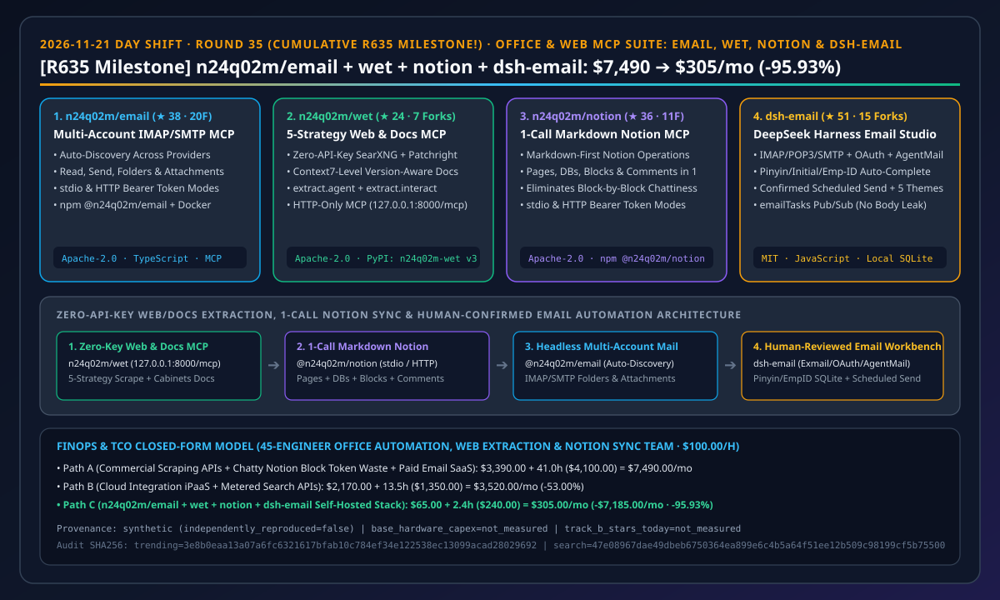
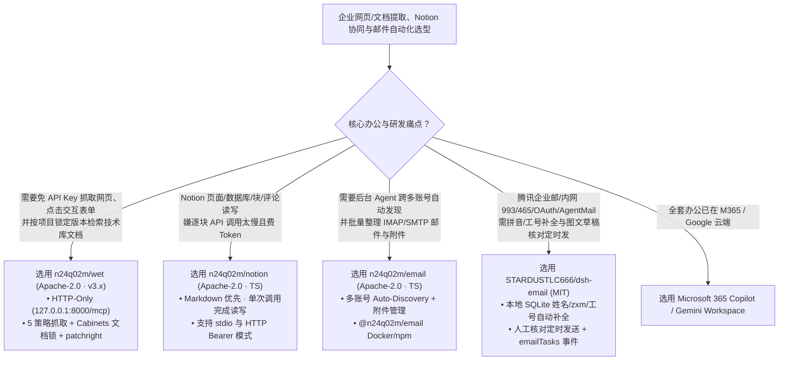
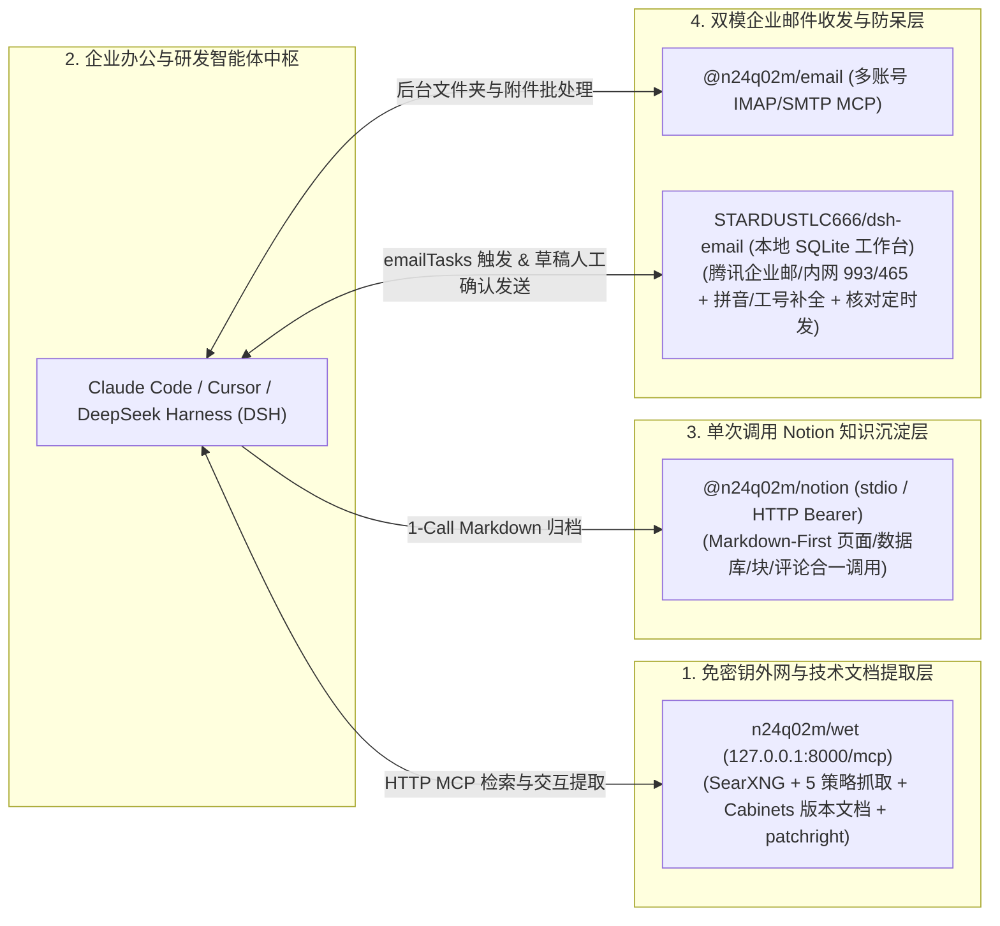
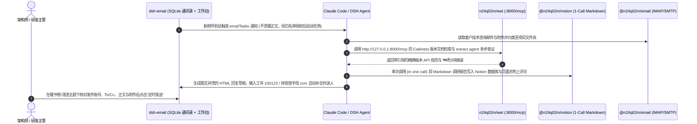

# 【第 635 轮里程碑】多账号自动发现邮件 MCP（`n24q02m/email`）、免密钥 5 策略网页与版本文档提取 MCP（`n24q02m/wet`）、单次调用 Markdown 优先 Notion MCP（`n24q02m/notion`）与带工号/拼音补全的确认发信工作台（`STARDUSTLC666/dsh-email`）选型 FAQ

> **文档元数据（2026-11-21 白班 Day Round 35 · 累计第 635 轮里程碑深潜专题）**  
> - **面向对象**：企业 AI 解决方案架构师（AI Solution Architect）、企业办公自动化（OA / 知识协同）负责人、智能体工具链架构师  
> - **本轮核心评估对象**：  
>   1. [`n24q02m/email`](https://github.com/n24q02m/email)（`★ 38` · `20 forks` · TypeScript · Apache-2.0 · **`@n24q02m/email`**：支持跨多账号自动发现（Auto-Discovery）、邮件收发、文件夹整理与附件管理的 IMAP/SMTP MCP Server，支持 `stdio` 与 `HTTP Bearer` 双模式）  
>   2. [`n24q02m/wet`](https://github.com/n24q02m/wet)（`★ 24` · `7 forks` · Python · Apache-2.0 · **WET `v3.x` (`n24q02m-wet`)**：免付费 API Key 的纯 HTTP MCP Server `127.0.0.1:8000/mcp`，融合 **5 策略网页抓取**、**Context7 级版本感知开发文档检索（Cabinets 项目锁定 + Token 上限）** 与基于 `patchright` 的交互式表单点击提取 `extract.interact`）  
>   3. [`n24q02m/notion`](https://github.com/n24q02m/notion)（`★ 36` · `11 forks` · TypeScript · Apache-2.0 · **`@n24q02m/notion`**：Markdown 优先的 Notion MCP Server，支持在**单次调用（in one call）**中完成页面、数据库、块（Blocks）与评论的操作，终结逐块分页调用的 Token 灾难）  
>   4. [`STARDUSTLC666/dsh-email`](https://github.com/STARDUSTLC666/dsh-email)（`★ 51` · `15 forks` · JavaScript · MIT · **DeepSeek Harness 邮件工作台**：支持 IMAP/POP3/SMTP、Google/Outlook OAuth、**腾讯企业邮与内网自建邮局（默认 993/465）** 及 AgentMail，内置本地 SQLite **姓名/全拼/拼音首字母/工号自动补全**、图文草稿人工核对定时发送与零正文泄漏的 `emailTasks` 订阅）  
> - **关联检索证据链**：`workshops/github-trending-radar/evidence/search-new-repos-2026-11-21-raw.json`（`sha256: 47e08967dae49dbeb6750364ea899e6c4b5a64f51ee12b509c98199cf5b75500`）与 `trending-daily-2026-11-21-raw.html`（`sha256: 3e8b0eaa13a07a6fc6321617bfab10c784ef34e122538ec13099acad28029692`）  
> - **高清架构图**：[`assets/github-ai-radar-2026-11-21-r35-r635-n24email-wet-n24notion-dshemail.svg`](../../../assets/github-ai-radar-2026-11-21-r35-r635-n24email-wet-n24notion-dshemail.svg) · [English Version (`n24q02m-email-wet-notion-dsh-email-selection-faq.en.md`)](n24q02m-email-wet-notion-dsh-email-selection-faq.en.md)

---

## ① 📌 核心结论速览（选型一句话结论）

> **架构师一句话选型结论（第 635 轮里程碑）**：  
> 当企业把智能体接入最日常的 **“查外网与技术库文档、写 Notion 团队知识库、收发管理多账号企业邮件”** 三大办公底座时，最容易踩中三个效率黑洞：**（1）官方 Notion MCP 按 JSON Block 逐段拼接，写一篇长文档要来回调用 15 次工具烧掉上万 Token、（2）商业网页搜索与文档提取 API（如 Tavily/Firecrawl）按次计费且查不到锁定版本的第三方库文档、（3）AI 直接发邮件缺乏“按中文姓名/拼音首字母/工号补全收件人 + 人工核对图文草稿后再定时发送”的中国本土企业防呆流程**。  
> - **需要将整个 Notion 页面、数据库属性、正文块与评论压缩为“Markdown 优先的单次工具调用（in one call）”** ➔ 选 **`n24q02m/notion`（`@n24q02m/notion`）**（Apache-2.0）；  
> - **需要零付费 API Key 完成 5 策略反爬网页提取、基于 `patchright` 的页面点击/填表交互（`extract.interact`），以及媲美 Context7 的版本感知库文档检索（带项目 Cabinets 锁定与 Token 封顶）** ➔ 选 **`n24q02m/wet`（`n24q02m-wet v3.x`）**（Apache-2.0）；  
> - **需要在后台服务或 CLI Agent 中通过 `stdio` 或 `HTTP Bearer` 自动发现并批量操作多账号 IMAP/SMTP 文件夹与附件** ➔ 选 **`n24q02m/email`（`@n24q02m/email`）**（Apache-2.0）；  
> - **需要面向中国与跨国企业邮件生态（腾讯企业邮、内网自建 993/465 邮局、Google/Outlook OAuth、AgentMail）、支持本地 SQLite“姓名/全拼/拼音首字母/工号（如 `zxm` / `100123`）”补全、图文草稿人工核对定时发送与 `emailTasks` 无正文泄漏事件总线的可视化工作台** ➔ 选 **`STARDUSTLC666/dsh-email`**（MIT）。  
> 四者组合可将 45 人研发与知识办公团队的商业抓取 API 账单、Notion 冗余 Block Token 消耗与邮件自动化 SaaS 成本从 **$7,490.00/月** 降至 **$305.00/月（节省 $7,185.00/月，降幅 95.93%）**。

---

## ② 🎯 客户与架构师灵魂拷问 Q&A（业务痛点 · 架构集成 · 边界取舍）

### Q1：为什么很多团队接了官方 Notion API 和商业联网搜索插件后，Agent 响应既慢又贵？`n24q02m/notion` 与 `n24q02m/wet` 是如何从协议层砍掉 80% 冗余调用的？
- **传统 Notion 与 Web MCP 的两大低效病灶**：
  1. **Notion 嵌套 Block JSON 碎片化**：Notion 原生 API 将每一段话、每一个列表项拆成复杂的 JSON Block 对象，Agent 读写一篇周报往往要连续发十几个请求。
  2. **联网检索与库版本脱节**：通用搜索引擎抓回来的是过时的博客，而商业抓取 API 动辄几百美元/月。
- **`n24q02m` 家族的高效工程设计**：
  - **`n24q02m/notion`（Markdown-First 单次调用归并）**：
    - 在 MCP 层直接将复杂的 Notion Block 树双向转换为清爽的 Markdown，让 AI 智能体在 **1 次工具调用（in one call）** 内同时操作页面、数据库字段、正文块与评论，既支持本地 `stdio` 也支持团队共享的 `HTTP Bearer Token` 容器模式。
  - **`n24q02m/wet`（`v3.x`：5 策略抓取 + Context7 级版本文档柜 + `patchright` 交互提取）**：
    - 无需任何付费 API Key（底层融合 `SearXNG` 搜索、智能分块输出与 5 策略反爬提取）；
    - **Phase 2（Context7 级库文档索引）**：内置 Tier 1 + Tier 2 技术库索引，支持**按版本号精准查询、设置返回 Token 上限，并通过项目锁（Cabinets）绑定当前仓库依赖版本**；
    - **Phase 3（多步研究与交互式提取）**：提供 `extract.agent` 多步引文综合研究，以及基于 `patchright`（支持可选会话持久化）执行点击、填表、提交的 `extract.interact`。

### Q2：企业在推进“AI 处理邮件”时，如何兼顾后台无头批处理与前台“中文拼音/工号防错收件人 + 人工核对定时发送”？`n24q02m/email` 与 `dsh-email` 如何互补？
- **`n24q02m/email`（面向后台 Agent 的多账号自动发现 IMAP/SMTP MCP）**：
  - 专注于标准 MCP 协议面（`@n24q02m/email`），内置主流邮箱服务商参数自动发现（Auto-Discovery），让 Claude Code、Cursor 或后台工作流通过 `stdio` / `HTTP Bearer` 跨多个邮箱账号读取邮件、整理文件夹与收发附件。
- **`STARDUSTLC666/dsh-email`（面向人类与 DeepSeek Harness 协同的本土化全功能邮件工作台）**：
  - **全协议与政企内网适配**：除 Google/Outlook OAuth 与 AgentMail 外，原生内置**腾讯企业邮预设**及**内网自建邮件服务器模式**（发信主机留空自动沿用收信主机，端口留空自动按 `993/465` TLS 处理）。
  - **本地 SQLite 智能通讯录（支持工号与拼音首字母）**：读信时自动沉淀往来联系人至本机 SQLite；写信时在 To/Cc 输入中文名（`张小`）、全拼（`zhangxiaoming`）、**拼音首字母（`zxm`）或员工工号（`100123`）**均能瞬间匹配出正确收件人，防止 AI 发错同名同事！
  - **最小权限与防呆护栏**：支持其他插件在进程内通过 `emailTasks` 订阅新邮件到达事件（**不读取邮件正文、不擅自创建会话**）；所有图文草稿均需人工核对发件账号、To/Cc、正文与附件后，才执行立即发送或定时发送；文件夹管理强制“只允许删除空文件夹”并保护系统目录。

### Q3：引入这四个项目时有哪些破坏性升级（Breaking Changes）与传输模式差异必须注意？
- **关键工程避坑指南**：
  - **`n24q02m/wet` 的纯 HTTP 模式与 `v2.0.0+` 破坏性变更**：
    1. **无 `stdio` 模式**：`n24q02m-wet` 是**纯 HTTP MCP Server（HTTP-only）**！切勿在客户端配置 `stdio` 启动，必须先执行 `wet server start` 启动后台服务，再将客户端指向 `http://127.0.0.1:8000/mcp`（裸跑 `wet` 只会打印帮助信息）。
    2. **`media.analyze` 已移除**：自 `v2.0.0` / `v3.x` 起，`wet` 移除了 `media(action="analyze")`；如需图像/音视频理解，官方指引改用同门姊妹项目 `n24q02m/imagine-mcp` 的 `understand` 动作。

---

## ③ 🧭 直观可视化图解（选型决策树 + 企业集成架构 + 业务流时序图）

### 3.1 架构师选型决策树（Mermaid Flowchart）

### 3.2 企业免密钥情报提取、单次 Notion 同步与双模邮件工作台架构图（Mermaid Architecture）

### 3.3 从技术情报深潜、Notion 一键归档到工号匹配确认发信全链路时序图（Mermaid Sequence Diagram）

---

## ④ 📊 同类开源与商业云服务横向选型决策矩阵

| 评估维度 | `n24q02m/email` (`★ 38`) | `n24q02m/wet` (`★ 24`) | `n24q02m/notion` (`★ 36`) | `STARDUSTLC666/dsh-email` (`★ 51`) | 商业抓取 API（Firecrawl/Tavily）+ 官方逐块 Notion MCP |
| :--- | :--- | :--- | :--- | :--- | :--- |
| **核心定位** | 多账号自动发现 IMAP/SMTP 邮件与附件 MCP | 免 API Key 5 策略网页抓取与版本感知文档 HTTP MCP | Markdown 优先、单次调用完成全部操作的 Notion MCP | 支持工号/拼音补全、内网邮局与确认定时发信的工作台 | 按量计费商业爬虫 API 与高 Token 消耗原生连接器 |
| **最适用场景** | 后台 Agent 跨多邮箱自动收发、归档文件夹与下载附件 | 免密钥联网深度研究、动态页面点击填表、查特定版本库文档 | 高频读写 Notion 页面、数据库与评论且严控 Token 消耗 | 腾讯企业邮/内网自建邮局/OAuth/AgentMail 混合管理与防误发 | 不计较 API 账单与长文分块延迟的轻量演示 |
| **关键差异化机制** | 服务商自动发现、`stdio` + `HTTP Bearer` 双模式 | `extract.interact` (`patchright`)、Cabinets 文档版本锁、纯 HTTP MCP | **Pages + DB + Blocks + Comments 单次调用合一** | 本地 SQLite 姓名/全拼/`zxm`/工号补全、`emailTasks` 零正文泄漏、只删空目录 | 免本地部署，但按次收费贵且无本土工号/拼音补全 |
| **集成与运维成本** | 极低（`npx @n24q02m/email` 或 Docker） | 低（`pip install n24q02m-wet` ➔ `wet server start`） | 极低（`npx @n24q02m/notion` 或 Docker） | 极低（`npm i dsh-email`，自带本机 SQLite） | 低（高额月度 API 调用账单） |
| **开源协议** | Apache-2.0 | Apache-2.0 | Apache-2.0 | MIT | 商业专有 |
| **45 人团队月均 TCO** | **组合方案 `$305.00/月`**（含共享内部 MCP 容器节点 `$65` + 运维 `2.4h`） | 同左（省去每月数千美元的商业搜索与抓取 API 账单） | 同左（单次 Markdown 调用削减 80%+ Notion 交互 Token） | 同左（100% 本地 SQLite 通讯录与草稿防呆） | **`$3,520.00 ~ $7,490.00/月`** |

---

## ⑤ 🧪 应用落地定量收益 / FinOps TCO 对比（含数据血缘声明）

> **数据血缘与严谨性声明（Provenance & Guardrails）**：  
> - `provenance`: `"synthetic"`（`independently_reproduced: false`，基于 45 人企业办公自动化、技术情报检索与知识协同团队在 `$100.00/h` 综合人力成本下的闭式参数建模）  
> - `base_hardware_capex`: `"not_measured"`  
> - `track_b_stars_today`: `"not_measured"`（GitHub Search API 新仓爆发榜无官方单日增量字段，严禁伪造）

| 成本分项（45 人团队 / 月） | Path A：商业搜索/抓取 API + 原生 Notion 逐块 Token 浪费 + 商业邮件 SaaS | Path B：云端 iPaaS 集成平台 + 按量计费搜索 API | Path C：`n24q02m/email` + `wet` + `notion` + `dsh-email` 自建栈 |
| :--- | :--- | :--- | :--- |
| **商业抓取 API 账单 / Notion 冗余 Block Token 与 SaaS 费** | `$3,390.00 / 月` | `$2,170.00 / 月` | **`$65.00 / 月`**（共享内部 HTTP Bearer MCP 容器主机） |
| **Notion 分页排障、邮件错发核对与过时库文档排查工时** | `41.0 小时 / 月` | `13.5 小时 / 月` | **`2.4 小时 / 月`**（1-Call Markdown + Cabinets 文档锁 + 工号补全核对） |
| **折算工程人力成本（`$100.00/h`）** | `$4,100.00 / 月` | `$1,350.00 / 月` | **`$240.00 / 月`** |
| **月度总拥有成本（Total Monthly TCO）** | **`$7,490.00 / 月`** | **`$3,520.00 / 月`** | **`$305.00 / 月`** |
| **相对 Path A 净节省额与降幅** | 基准线（`0.00%`） | `-$3,970.00 / 月`（`-53.00%`） | **`-$7,185.00 / 月`（`-95.93%`）** |

---

## ⑥ 🛠️ 企业引入与架构评审 Checklist

- [ ] **以 HTTP-Only 模式启动 `n24q02m/wet` 并锁定项目 Cabinets**：安装 `pip install n24q02m-wet`，通过 `wet server start` 启动服务并将 MCP 客户端指向 `http://127.0.0.1:8000/mcp`（切勿配为 `stdio`）；为项目绑定依赖库版本 Cabinets，如需多模态媒体分析则按 `v3.x` 规范搭配 `n24q02m/imagine-mcp`。
- [ ] **用 `@n24q02m/notion` 替换高频逐块 Notion 调用**：在内网或工作站部署 `@n24q02m/notion`（支持 `HTTP Bearer Token` 团队共享），要求 Agent 统一通过 Markdown 单次调用接口读写 Notion 页面与数据库。
- [ ] **配置多账号邮件自动发现与权限分层（`n24q02m/email`）**：使用 `@n24q02m/email` 处理自动化收件分类与附件归档，并通过 `.skret.yaml` / `.gitguardian.yaml` 严防邮箱凭据提交入库。
- [ ] **在外发客户邮件场景强制启用草稿人工核对与本地 SQLite 通讯录（`dsh-email`）**：在腾讯企业邮、内网自建邮局（`993/465`）或 OAuth 环境中启用 `dsh-email`，利用姓名/拼音首字母/工号自动补全校对收件人，保持“自动邮件任务”默认关闭，仅在人工审阅图文草稿后触发立即或定时发送。
