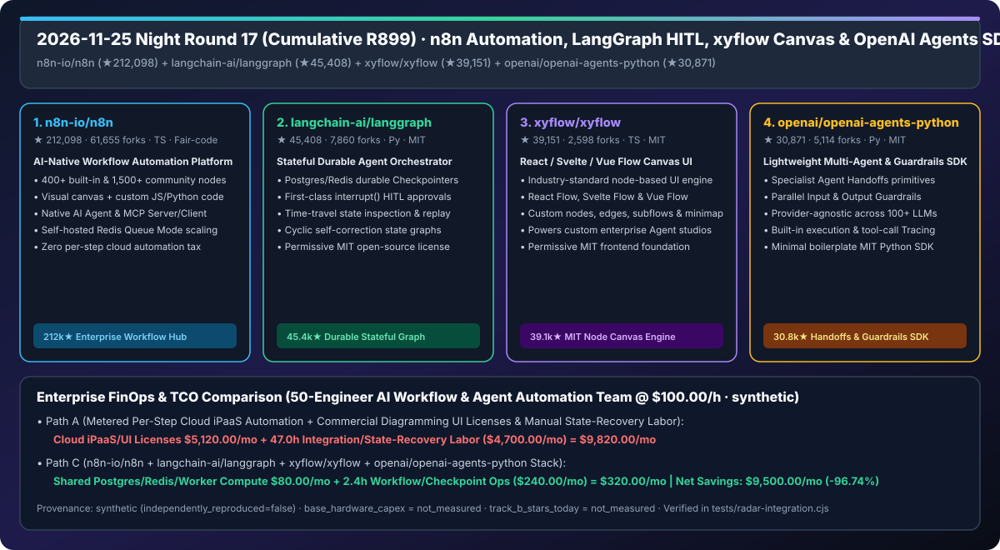
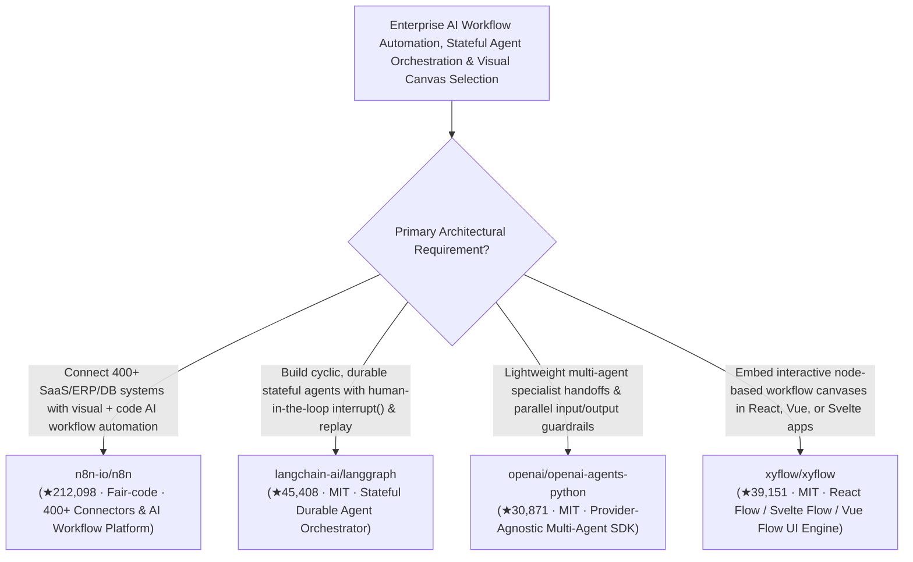
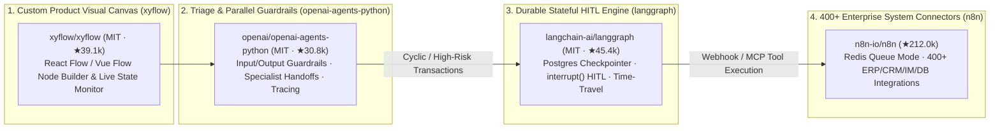

# 212k-Star AI-Native Workflow Automation Platform (`n8n-io/n8n`), Stateful Durable Agent Orchestrator (`langchain-ai/langgraph`), Node-Based Canvas UI Engine (`xyflow/xyflow`) & Lightweight Multi-Agent Handoffs/Guardrails SDK (`openai/openai-agents-python`) Selection & Integration Architecture FAQ

> **Document Type**: Enterprise AI Solution Architect Selection Decision Guide (GitHub Trending AI Radar — 2026-11-25 Night Round 17 / Cumulative Round 899)
> **Covered Repositories**: [`n8n-io/n8n`](https://github.com/n8n-io/n8n) (`★ 212,098`, `61,655 forks`, `Fair-code`: AI-native workflow automation platform combining visual building with custom JS/Python code and 400+ [1,500+ community] enterprise integrations) · [`langchain-ai/langgraph`](https://github.com/langchain-ai/langgraph) (`★ 45,408`, `7,860 forks`, `MIT`: low-level stateful agent orchestration framework with durable checkpointing, human-in-the-loop `interrupt()`, and time-travel debugging) · [`xyflow/xyflow`](https://github.com/xyflow/xyflow) (`★ 39,151`, `2,598 forks`, `MIT`: React Flow, Svelte Flow, and Vue Flow open-source libraries for building interactive node-based workflow canvases) · [`openai/openai-agents-python`](https://github.com/openai/openai-agents-python) (`★ 30,871`, `5,114 forks`, `MIT`: lightweight, provider-agnostic multi-agent framework supporting 100+ LLMs with first-class Agent Handoffs, parallel Input/Output Guardrails, and Tracing)
> **Core Enterprise Scenario**: Designing an end-to-end **Enterprise Agentic Workflow & Orchestration Stack**—combining custom visual DAG/agent canvases (`xyflow`), low-latency multi-agent triage & guardrails (`openai-agents-python`), durable long-running human-in-the-loop state graphs (`langgraph`), and 400+ enterprise SaaS/ERP/CRM integrations (`n8n`).

---

## 1. 📌 Executive Summary (One-Line Selection Verdict)

1. **Need a self-hostable workflow automation engine with 400+ built-in enterprise SaaS/DB connectors, visual + code nodes, and native AI/MCP integration without per-step cloud billing** ➔ Choose **[`n8n-io/n8n`](https://github.com/n8n-io/n8n) (`★ 212,098`, `61,655 forks`, `Fair-code`)**.
   - **Plain-English Mechanism**: Eliminates writing custom OAuth refreshers, webhook listeners, and retry queues for hundreds of third-party SaaS apps while supporting native AI Agent and MCP tool nodes.
2. **Need durable state persistence, cyclic self-correction loops, time-travel replay, and multi-day Human-in-the-Loop (`interrupt()`) approvals for mission-critical agents** ➔ Choose **[`langchain-ai/langgraph`](https://github.com/langchain-ai/langgraph) (`★ 45,408`, `7,860 forks`, `MIT`)**.
   - **Plain-English Mechanism**: Persists every graph step to PostgreSQL/Redis checkpoints so long-running workflows can pause indefinitely for human approval and resume deterministically without losing state.
3. **Need a minimal, fast Python SDK for multi-specialist agent triage (`Handoffs`), parallel safety validation (`Guardrails`), and built-in tracing across 100+ LLM providers** ➔ Choose **[`openai/openai-agents-python`](https://github.com/openai/openai-agents-python) (`★ 30,871`, `5,114 forks`, `MIT`)**.
   - **Plain-English Mechanism**: Provides clean primitives (`Agent`, `Handoffs`, `Guardrails`, `Tracing`) with minimal boilerplate and full provider-agnostic LLM compatibility.
4. **Need to embed an interactive, customizable node-and-edge workflow canvas directly inside your own React, Vue, or Svelte enterprise frontend** ➔ Choose **[`xyflow/xyflow`](https://github.com/xyflow/xyflow) (`★ 39,151`, `2,598 forks`, `MIT`)**.
   - **Plain-English Mechanism**: Powers React Flow, Svelte Flow, and Vue Flow—giving frontend teams production-ready zooming, panning, custom nodes, mini-maps, and edge routing under a permissive `MIT` license.

---

## 2. 🎯 Architect & Customer Deep-Dive Q&A

### Q1: How should architects partition responsibilities between `n8n`, `LangGraph`, `OpenAI Agents SDK`, and `xyflow` vs. commercial per-step cloud iPaaS (Zapier / Make / Logic Apps)?

- **Four Complementary Architectural Layers (Path C)**:
  1. **Custom Product Visual Canvas Layer ➔ `xyflow/xyflow`**: Renders node-based workflow builders and live execution state inside React/Vue/Svelte apps.
  2. **Real-Time Multi-Agent Triage & Parallel Guardrails Layer ➔ `openai/openai-agents-python`**: Handles low-latency specialist handoffs and concurrent input/output safety guardrails.
  3. **Durable Cyclic State & Human-in-the-Loop Layer ➔ `langchain-ai/langgraph`**: Executes stateful cyclic graphs with PostgreSQL checkpointing and `interrupt()` approval pauses.
  4. **Enterprise SaaS/ERP/Webhook Execution Layer ➔ `n8n-io/n8n`**: Connects agents to 400+ external enterprise systems via self-hosted Redis Queue Mode workers.
- **When to choose Commercial Cloud iPaaS vs. Path C?**
  - Choose **Power Automate / Logic Apps / Zapier Cloud** for low-volume office automations where zero infrastructure management outweighs per-step fees.
  - Choose **Path C** when cyclic AI agents and high-frequency webhooks execute hundreds of thousands of steps per month (where per-step SaaS pricing explodes) or when building proprietary `MIT`-licensed agent products (`xyflow` + `LangGraph` + `OpenAI Agents SDK`).

### Q2: How do these four components integrate in production?

1. **Interactive Canvas to Execution Graph (`xyflow` → `LangGraph` / `OpenAI Agents`)**:
   - Users inspect or configure workflows in a React Flow (`xyflow`) UI, which serializes node/edge JSON to the backend orchestrator.
2. **Triage, Durable Approval & SaaS Action (`OpenAI Agents` → `LangGraph` → `n8n`)**:
   - `openai-agents-python` runs input guardrails and specialist triage; high-value transactions enter a `LangGraph` state machine that pauses via `interrupt()` for manager approval in the `xyflow` UI, and upon approval triggers an `n8n` webhook to update ERP/CRM records.

### Q3: What are the licensing and operational guardrails?

- **Architect Redlines**:
  1. **Respect `n8n`'s Fair-Code license vs. `MIT` libraries**: Use self-hosted `n8n` for internal enterprise automation and integration; for commercial multi-tenant SaaS products sold to external customers, build the customer-facing canvas and runtime on `MIT`-licensed `xyflow`, `LangGraph`, and `OpenAI Agents SDK`.
  2. **Deploy `n8n` in Redis Queue Mode and `LangGraph` with PostgreSQL Checkpointers**: Never run in-memory state savers or single-process webhook listeners in production.

---

## 3. 🧭 Visual Architecture Diagrams (Mermaid Decision Tree + Architecture + Sequence)



### 3.1 Architect Selection Decision Tree



### 3.2 End-to-End Enterprise Integration Architecture



### 3.3 End-to-End Execution Sequence

```mermaid
sequenceDiagram
    participant User as Customer / Approver (xyflow Portal)
    participant OAgent as openai-agents-python (Triage & Guardrails)
    participant LGraph as langchain-ai/langgraph (Durable HITL)
    participant N8N as n8n-io/n8n (400+ Connectors)

    User->>OAgent: 1. Submit high-value contract modification & refund request
    OAgent->>OAgent: 2. Run parallel InputGuardrail & handoff to Finance Specialist Agent
    OAgent->>LGraph: 3. Enter durable workflow; LangGraph checkpoints state to Postgres & triggers interrupt()
    LGraph-->>User: 4. Highlight pending approval node in xyflow (React Flow) UI
    User->>LGraph: 5. Manager approves; LangGraph resumes from exact Postgres checkpoint
    LGraph->>N8N: 6. Trigger n8n webhook to execute ERP reversal, CRM update & notification
```

---

## 4. 📊 Horizontal Selection Matrix

| Dimension | `n8n-io/n8n` (`★ 212,098`) | `langchain-ai/langgraph` (`★ 45,408`) | `xyflow/xyflow` (`★ 39,151`) | `openai/openai-agents-python` (`★ 30,871`) | Metered Per-Step Cloud iPaaS + Commercial Canvas SDK (Path A) | Custom Polling Scripts + Hand-Rolled Canvas UI (Path B) |
| :--- | :--- | :--- | :--- | :--- | :--- | :--- |
| **Primary Role** | 400+ connector AI workflow automation platform | Durable stateful & HITL agent graph runtime | React/Vue/Svelte node-based canvas UI library | Lightweight multi-agent handoffs & guardrails SDK | Per-step metered cloud iPaaS & proprietary UI kits | Ad-hoc state scripts & custom SVG/DOM wiring |
| **Key Differentiator** | **1,500+ community connectors + visual/code + MCP nodes** | **Postgres Checkpointer + `interrupt()` HITL + Time-Travel** | **Industry-standard `MIT` node canvas for React/Svelte/Vue** | **Minimal 4-primitive design + parallel guardrails + 100+ LLMs** | Managed hosting, but runaway per-step fees on cyclic agent loops | Lost state on crash; months wasted building canvas pan/zoom |
| **License** | `Fair-code` (Sustainable Use) | **`MIT`** | **`MIT`** | **`MIT`** | Proprietary SaaS | Unstandardized |
| **Monthly TCO (50-Eng Team)** | **`$320.00/mo` combined** (`$80.00` Postgres/Redis/Workers + `2.4h` ops) | Included in `$320.00/mo` stack | Included in `$320.00/mo` stack | Included in `$320.00/mo` stack | **`$9,820.00/mo`** (`$5,120.00` per-step cloud iPaaS & UI licenses + `47.0h` glue/recovery labor) | `~$3,580.00/mo` (custom OAuth connector maintenance & lost-state incidents) |

---

## 5. 🧪 Quantitative FinOps & TCO Comparison (50-Engineer AI Automation & Agent Team)

> **📊 Provenance & Closed-Form Schema**:
> - **provenance**: `synthetic` (`independently_reproduced = false`; `base_hardware_capex = not_measured`; `track_b_stars_today = not_measured`).
> - **Closed-Form Formula**:
>   - **Path A (Metered Per-Step Cloud iPaaS Automation + Commercial Diagramming UI Licenses & Manual State-Recovery/Integration Labor)**: **`$5,120.00`** monthly per-step iPaaS and commercial UI license fees + **`47.0h × $100.00/h = $4,700.00`** integration and state-recovery engineering labor = **`$9,820.00/mo`**.
>   - **Path C (`n8n-io/n8n` + `langchain-ai/langgraph` + `xyflow/xyflow` + `openai/openai-agents-python` Stack)**: **`$80.00`** shared PostgreSQL/Redis/Worker container compute + **`2.4h × $100.00/h = $240.00`** workflow and checkpoint ops = **`$320.00/mo`**.
>   - **Net Savings vs. Path A**: **`-$9,500.00/mo`** (**`96.74%`** TCO reduction).

| Evaluation Path | Cloud iPaaS Per-Step Fees / UI Licenses & Compute | Integration, State-Recovery & Canvas Engineering (`$100/h`) | Monthly Total TCO | Net Savings vs. Path A | Key Architectural Outcome |
| :--- | :---: | :---: | :---: | :---: | :--- |
| **Path A: Metered Per-Step Cloud iPaaS + Commercial Canvas SDK** | `$5,120.00` | `47.0h` (`$4,700.00`) | **`$9,820.00`** | Baseline | Runaway per-step billing on cyclic agent workflows |
| **Path B: Custom SaaS Connectors + Ad-Hoc State Polling** | `$1,580.00` | `20.0h` (`$2,000.00`) | **`$3,580.00`** | `-$6,240.00` (`-63.54%`) | Fragile OAuth maintenance; lost state on approval waits |
| **Path C: `n8n` + `langgraph` + `xyflow` + `openai-agents`** | **`$80.00`** | **`2.4h` (`$240.00`)** | **`$320.00`** | **`-$9,500.00` (`-96.74%`)** | **Unlimited self-hosted steps + durable HITL checkpoints + `MIT` canvas** |

- 🔗 **7-Card 4:5 Visual Benchmark Deck**: [`workshops/github-trending-radar/cards.en.html`](../cards.en.html) · [`cards.html`](../cards.html)

---

## 6. 🛠️ Enterprise Adoption & Architecture Review Checklist

- [ ] **Separate Internal Automation (`n8n` Fair-code) from Commercial SaaS Code (`xyflow` + `LangGraph` + `OpenAI Agents` `MIT`)**: Ensure external multi-tenant software offerings rely on the `MIT` stack while `n8n` powers internal enterprise integrations.
- [ ] **Use PostgreSQL Checkpointers in `LangGraph`**: Replace in-memory savers with durable database checkpointers for production HITL workflows.
- [ ] **Enable Parallel `InputGuardrail` in `OpenAI Agents SDK`**: Block prompt injection and PII leaks concurrently before specialist handoffs.
- [ ] **Run `n8n` in Redis Queue Mode with Encrypted Credentials**: Configure `EXECUTIONS_MODE=queue` and `N8N_ENCRYPTION_KEY` for high-concurrency webhook handling.
