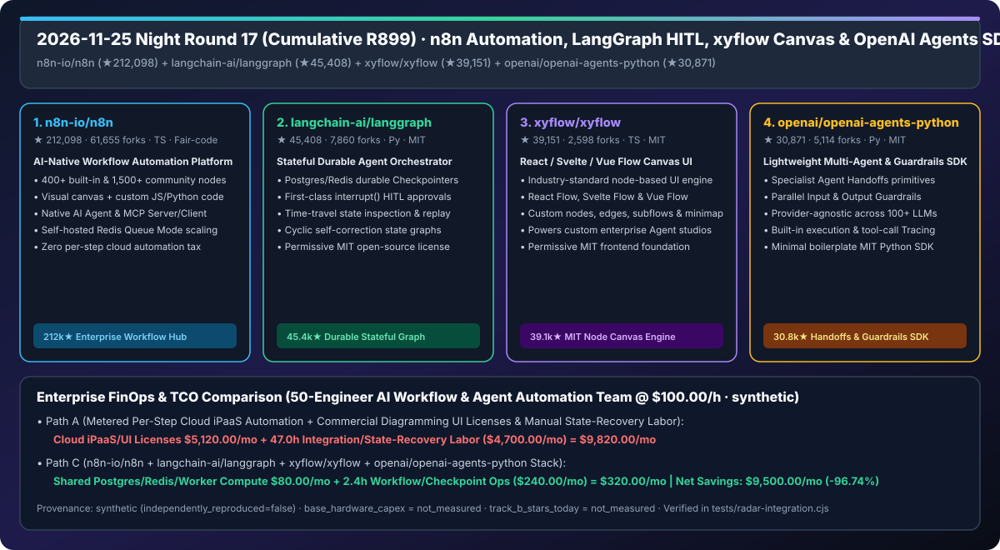
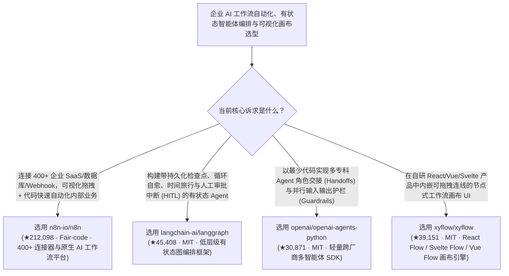
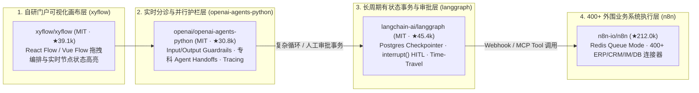
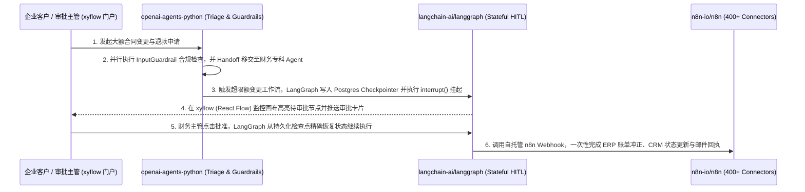

# 21 万星 AI 原生企业工作流自动化平台（`n8n-io/n8n`）、有状态持久化与人机回环智能体编排内核（`langchain-ai/langgraph`）、工业级节点画布前端引擎（`xyflow/xyflow`）与轻量级多智能体交接护栏 SDK（`openai/openai-agents-python`）选型与集成架构 FAQ

> **文档类型**：企业 AI 解决方案架构师（AI Solution Architect）选型决策指南（GitHub Trending AI 雷达 2026-11-25 Night Round 17 / 累计第 899 轮）
> **覆盖项目**：[`n8n-io/n8n`](https://github.com/n8n-io/n8n)（`★ 212,098`、`61,655 forks`、`Fair-code`：21.2 万星 AI 原生工作流与智能体自动化平台，支持将可视化节点编排与自定义 JS/Python 代码结合，内置 400+ [社区 1,500+] SaaS/数据库/企业系统连接器与原生 AI Agent/MCP 节点）· [`langchain-ai/langgraph`](https://github.com/langchain-ai/langgraph)（`★ 45,408`、`7,860 forks`、`MIT`：4.5 万星低层级有状态智能体编排框架，提供持久化状态检查点 [Checkpointer]、人机审批中断 [`interrupt()` / HITL]、时间旅行重放与循环状态图控制）· [`xyflow/xyflow`](https://github.com/xyflow/xyflow)（`★ 39,151`、`2,598 forks`、`MIT`：3.9 万星 React Flow / Svelte Flow / Vue Flow 节点式 UI 开源引擎，用于构建企业自研可视化 Agent 编排画布、DAG 审批流与实时状态拓扑监控界面）· [`openai/openai-agents-python`](https://github.com/openai/openai-agents-python)（`★ 30,871`、`5,114 forks`、`MIT`：3.0 万星 OpenAI 官方轻量级多智能体工作流 SDK [跨厂商兼容 100+ LLM]，以极简原语实现智能体角色交接 [Handoffs]、并行输入输出护栏 [Guardrails] 与全链路执行追踪 [Tracing]）
> **核心场景**：当企业架构师规划“跨业务系统的自动化 AI 工作流 + 核心交易级有状态 Agent + 自研行业画布”时，最常被问到的四个选型问题是：**“连接企业 CRM/ERP/飞书/钉钉/数据库等上百个外围系统的自动化流程用谁最快（`n8n`）？涉及严格状态回滚、长周期断点续跑与人工审批（HITL）的核心复杂 Agent 用哪套状态机（`langgraph`）？如果场景是快速搭建带护栏（Guardrails）的多专科智能体分诊与交接（Handoffs），哪套轻量 SDK 最简洁（`openai-agents-python`）？如果业务部门要求在中台前端内嵌一套自有品牌的拖拽式工作流画布，用什么前端库底座（`xyflow`）？”** 本文给出四者的边界与协同架构。

---

## 一、📌 核心结论速览（选型一句话结论）

1. **需要打通企业内部 400+ 个 SaaS、数据库、Webhook 与消息队列，让业务与 IT 团队通过“可视化拖拽 + 少量 JS/Python 代码”快速上线定时或事件驱动的 AI 自动化流水线** ➔ 选 **[`n8n-io/n8n`](https://github.com/n8n-io/n8n)（`★ 212,098`，`61,655 forks`）**。
   - **通俗原理**：相当于企业自托管的“AI 版 Zapier + Power Automate”，不仅做好了上百种企业软件的 OAuth 鉴权与分页拉取连接器，还原生内置了 AI Agent、向量检索与 MCP 工具节点。
2. **需要开发高可靠、带循环反思、中途必须挂起等待财务/经理人工点击审批（Human-in-the-Loop）后再从断点精确恢复执行的复杂有状态智能体** ➔ 选 **[`langchain-ai/langgraph`](https://github.com/langchain-ai/langgraph)（`★ 45,408`，`7,860 forks`，`MIT`）**。
   - **通俗原理**：不替你写死黑盒 Prompt，而是把 Agent 的每一步执行都建模为显式状态图（StateGraph），每走完一个节点自动把完整状态快照存入 Postgres/Redis（Checkpointer）；哪怕进程重启或等待人工审批三天，也能原样接着往下跑，并支持回退到任意历史步修改状态重跑（Time-Travel）。
3. **想用最少样板代码在 Python 后端实现“前台接待 Agent 识别意图 → 并行跑合规护栏（Guardrails）→ 一键把会话上下文移交（Handoff）给退款/技术支持专科 Agent”** ➔ 选 **[`openai/openai-agents-python`](https://github.com/openai/openai-agents-python)（`★ 30,871`，`5,114 forks`，`MIT`）**。
   - **通俗原理**：只保留四个极简核心原语——`Agent`、`Handoffs`（智能体交接）、`Guardrails`（与主模型并行运行的输入输出安全校验）和 `Tracing`，且底层并非只能调 OpenAI，原生支持对接 100+ 种私有/云端大模型。
4. **需要为企业自研 AI 平台或行业 SaaS 产品开发一套“可自由拖拽节点、连线、缩放、小地图导航与节点实时高亮”的前端可视化工作流画布** ➔ 选 **[`xyflow/xyflow`](https://github.com/xyflow/xyflow)（`★ 39,151`，`2,598 forks`，`MIT`，含 React Flow / Svelte Flow / Vue Flow）**。
   - **通俗原理**：不要从零手写 SVG/Canvas 连线与碰撞检测！直接用 `MIT` 协议的 `xyflow` 作为前端画布渲染引擎，将用户在前端连好的节点 JSON 图谱提交给后端的 `LangGraph` 或 `OpenAI Agents SDK` 执行。

---

## 二、🎯 客户与架构师灵魂拷问 Q&A（深度架构拆解）

### Q1：同样是做“工作流与多智能体编排”，`n8n` vs `LangGraph` vs `OpenAI Agents SDK` vs 微软 Power Automate / Azure Logic Apps 怎么划清边界？

- **四层协同而非互相替代**：
  1. **外围系统连接与事件触发层 ➔ `n8n-io/n8n`**：擅长“连接一切外围系统”（收到邮件/Webhook/CRM 变更 → 触发流程 → 写回 ERP/发送企微通知）。不要在 Python 代码里手写几百个第三方 SaaS 的 OAuth 刷新与重试逻辑，交给 `n8n` 最省力。
  2. **轻量多专科智能体分诊与并行护栏层 ➔ `openai/openai-agents-python`**：当单次请求属于“客服分诊 + 多角色 Handoff + 实时输入输出合规拦截”，且不需要复杂的图循环或跨天挂起时，`OpenAI Agents SDK` 代码量比 `LangGraph` 少 60% 以上，开发速度最快。
  3. **长周期有状态事务、循环修正与人工审批（HITL）内核 ➔ `langchain-ai/langgraph`**：当业务涉及复杂循环（如“生成 SQL → 沙箱校验报错 → 自动修补重试最多 3 次”）、或者金额大于 5 万必须调用 `interrupt()` 挂起线程等待人工审批时，必须用 `LangGraph` 的持久化 Checkpointer。
  4. **自研产品前端节点画布层 ➔ `xyflow/xyflow`**：当企业需要把 `LangGraph` 的执行拓扑或自定义业务编排嵌进自己的 React/Vue 业务系统供客户拖拽配置时，用 `xyflow` 构建前端 UI。
- **何时选云托管 Power Automate / Azure Logic Apps vs 自建本套栈（Path C）？**
  - 若企业流程仅在 Office 365 / Dynamics 365 内部流转且执行频次低，直接用 Power Automate 最省心。
  - **何时采用本轮自建四件套（Path C）？** 当企业每天有数十万次高频 Webhook 与多步循环 AI 推理（按 Action Step 计费的商业自动化云服务会产生天价账单），或者需要在自研产品中免费内嵌 `MIT` 协议的节点画布（`xyflow`）与有状态编排引擎（`LangGraph` + `OpenAI Agents SDK`）时，Path C 可节省 **96%+** 的按步自动化税与前端画布研发人力。

### Q2：这四个开源项目如何串成一条端到端企业生产架构？

1. **前端画布与状态可视化（`xyflow/xyflow`）**：
   - 在企业内部运营门户中使用 `React Flow` (`xyflow`) 渲染可视化编排画布，实时高亮当前正在执行的 Agent 节点与等待人工审批的节点。
2. **中台智能体双擎运行时（`openai-agents-python` + `langgraph`）**：
   - 实时对话与多角色分诊走 `openai/openai-agents-python`，开启并行 `InputGuardrail` 与 `OutputGuardrail`；遇到跨系统长事务与审批节点时，转入 `langchain-ai/langgraph` 状态图并持久化至 PostgreSQL。
3. **外围 400+ 企业系统执行连接器（`n8n-io/n8n`）**：
   - 当 `LangGraph` 或 `OpenAI Agents` 需要读写 SAP、Salesforce、ServiceNow、Jira 或发送多渠道通知时，直接调用自托管 `n8n` 暴露的内部受控 Webhook / MCP 端点，由 `n8n` 完成外部系统的鉴权、限流与写入。

### Q3：`n8n` 的许可证与生产高可用部署有哪些架构红线？

- **架构师避坑红线**：
  1. **严格遵守 `n8n` 的 Fair-Code（Sustainable Use License）边界**：企业内部自托管 `n8n` 自动化内部业务流程完全免费合规；但**严禁将 `n8n` 包装为多租户商业 SaaS 或向外部客户直接收费提供托管版 `n8n`**——若需面向外部客户交付多租户商业产品，前端画布应使用 `MIT` 协议的 `xyflow/xyflow`，后端编排使用 `MIT` 协议的 `LangGraph` 与 `OpenAI Agents SDK`。
  2. **`n8n` 生产环境必须开启 Queue Mode（Redis + 多 Worker）**：单进程默认模式不能承受高并发 Webhook 洪峰，生产部署应配置 PostgreSQL + Redis BullMQ 队列拆分为 Webhook 接收层与独立 Worker 执行池。

---

## 三、🧭 直观可视化图解（Mermaid 决策树 + 集成架构 + 时序图）

### 3.1 架构师选型决策树

### 3.2 企业端到端生产集成参考架构图

### 3.3 客户工单进线、并行护栏校验、人工挂起审批与跨系统自动执行时序图

---

## 四、📊 同类开源与商业云服务横向选型决策矩阵

| 对比维度 | `n8n-io/n8n` (`★ 212,098`) | `langchain-ai/langgraph` (`★ 45,408`) | `xyflow/xyflow` (`★ 39,151`) | `openai/openai-agents-python` (`★ 30,871`) | 按执行步数（Per-Step/Operation）计费的商业自动化云 + 商业画布授权 (Path A) | 手写脆弱状态轮询脚本 + 从零手搓 Canvas 连线前端 (Path B) |
| :--- | :--- | :--- | :--- | :--- | :--- | :--- |
| **核心能力定位** | 400+ 连接器可视化与代码混合自动化平台 | 有状态持久化、循环与 HITL 智能体编排 | React/Vue/Svelte 节点式可视化画布组件库 | 轻量多智能体 Handoffs 与 Guardrails SDK | 按步/按任务跳数计费的商业 iPaaS 与云工作流 | 散装 `while` 循环脚本 + 自写前端连线逻辑 |
| **核心技术突破** | **1,500+ 生态连接器 + 原生 AI Agent/MCP 节点** | **持久化 Checkpointer + `interrupt()` 断点续跑** | **开箱即用高性能无限画布、自定义节点与边** | **极简 4 原语 + 并行 Guardrails + 兼容 100+ LLM** | 免运维，但高频循环 AI 工作流按 Step 计费极其昂贵 | 进程重启即丢状态；手搓前端连线缩放耗时数月且极易卡顿 |
| **开源协议** | `Fair-code` (Sustainable Use) | **`MIT`** | **`MIT`** | **`MIT`** | 闭源商业 SaaS | 无标准底座 |
| **月度 TCO（50 人团队）** | **四件套合建仅 `$320.00/月`**（`$80.00` Postgres/Redis/Worker 算力 + `2.4h` 维护） | 同左（`MIT` 协议零按节点调用费） | 同左（免除商业前端流程图组件昂贵按席位授权费） | 同左（零框架锁定、直接对接任意模型网关） | **`$9,820.00/月`**（`$5,120.00` 按步云自动化账单与商业 UI 授权 + `47.0h` 外围接口对接与画布维护） | 约 `$3,580.00/月`（大量手写第三方 OAuth 连接器与修复状态丢失事故工时） |

---

## 五、🧪 应用落地定量收益/TCO 对比与 7-Card 报告

> **📊 数据来源与闭式核算声明（Provenance & Closed-Form Schema）**：
> - **provenance**: `synthetic`（基于 50 人企业 AI 自动化中台与智能体应用研发团队月度工作负载模型：`independently_reproduced = false`；硬件采购基线 `base_hardware_capex = not_measured`；Track B 单日增量 `track_b_stars_today = not_measured`）。
> - **核算公式**：
>   - **Path A（按执行步数 [Per-Step/Operation] 计费的商业云端 iPaaS 自动化平台 + 商业流程图 UI 组件授权 + 手工编写长事务状态恢复与外围接口胶水代码）**：月度按步云自动化账单与商业组件订阅费 **`$5,120.00`** + 外部系统接口维护、长事务中断人工重跑与画布定制工时 **`47.0h × $100.00/h = $4,700.00`** = **`$9,820.00/月`**。
>   - **Path C（自建 `n8n-io/n8n` + `langchain-ai/langgraph` + `xyflow/xyflow` + `openai/openai-agents-python` 全栈智能体自动化与编排架构）**：内网 PostgreSQL/Redis 与 `n8n` Worker 容器算力分摊 **`$80.00`** + 状态图与连接器日常巡检人工 **`2.4h × $100.00/h = $240.00`** = **`$320.00/月`**。
>   - **净节省（Net Savings vs Path A）**：**`-$9,500.00/月`**（成本降低 **`96.74%`**）。

| 评估方案 | 云端按步自动化账单 / 组件授权与算力成本 | 接口开发、状态恢复与画布维护人工（`$100/h`） | 月度总 TCO | 相对 Path A 净节省 | 核心业务交付收益 |
| :--- | :---: | :---: | :---: | :---: | :--- |
| **Path A：按步计费商业 iPaaS 云平台 + 商业画布组件** | `$5,120.00` | `47.0h` (`$4,700.00`) | **`$9,820.00`** | Baseline | 循环 Agent 每步触发计费导致账单失控 |
| **Path B：手写几百个 SaaS 连接器 + 裸写状态轮询** | `$1,580.00` | `20.0h` (`$2,000.00`) | **`$3,580.00`** | `-$6,240.00` (`-63.54%`) | 审批挂起一旦重启即丢失上下文；第三方 API 鉴权维护极重 |
| **Path C：`n8n` + `langgraph` + `xyflow` + `openai-agents`** | **`$80.00`** | **`2.4h` (`$240.00`)** | **`$320.00`** | **`-$9,500.00` (`-96.74%`)** | **无限步数自托管连接器 + 持久化 HITL 状态图 + `MIT` 节点画布** |

- 🔗 **关联 7-Card 4:5 视觉评测报告**：[`workshops/github-trending-radar/cards.html`](../cards.html) · [`cards.en.html`](../cards.en.html)

---

## 六、🛠️ 企业引入与架构评审 Checklist

- [ ] **严格区分内部自动化（`n8n` Fair-code）与对外商业产品代码（`xyflow` + `LangGraph` + `OpenAI Agents` `MIT`）**：对外商业化 SaaS 交付件统一基于 3 个 `MIT` 项目构建，内部系统集成交由自托管 `n8n`。
- [ ] **为 `LangGraph` 配置生产级持久化 Checkpointer（PostgreSQL）**：严禁在生产多副本环境中使用仅限单机内存的 `MemorySaver`。
- [ ] **在 `OpenAI Agents SDK` 入口启用并行 `InputGuardrail`**：在主模型生成完成前异步阻断越狱指令与敏感数据泄露。
- [ ] **将自托管 `n8n` 部署为 Redis Queue Mode 并加密凭据库（`N8N_ENCRYPTION_KEY`）**：确保第三方系统 API 密钥落盘加密且高并发任务平滑削峰。
