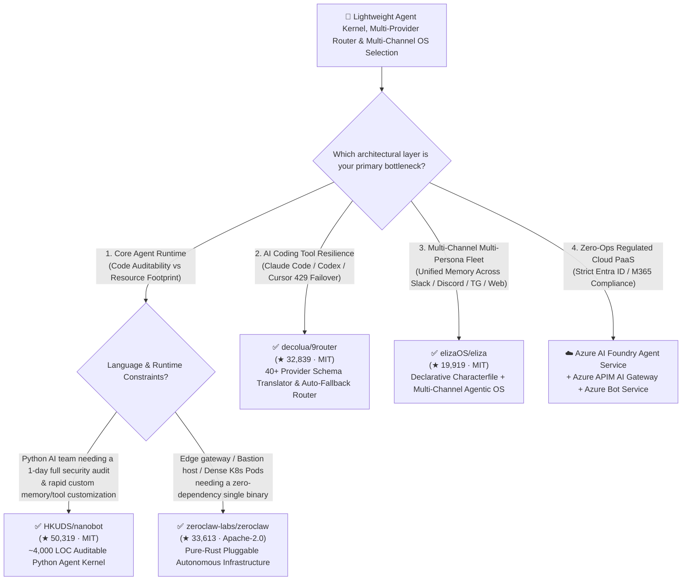
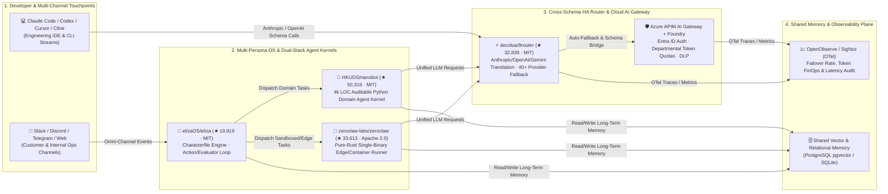
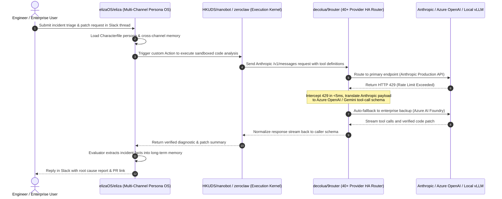

# Minimalist Auditable Agent Kernel (`HKUDS/nanobot`), Pure-Rust Autonomous Assistant Infrastructure (`zeroclaw-labs/zeroclaw`), 40+ Provider AI Coding Auto-Fallback Router (`decolua/9router`) & Multi-Channel Agentic OS (`elizaOS/eliza`) Selection & Architecture FAQ

> **Document Type**: AI Solution Architect (SA) Enterprise Application, Integration Architecture & Peer Selection Guide (**2026-11-25 Night Round 43 · Cumulative Round 925 Milestone**)  
> **Covered Repositories**: `HKUDS/nanobot` (`★ 50,319`, `8,765 forks`, `MIT`) · `zeroclaw-labs/zeroclaw` (`★ 33,613`, `5,049 forks`, `Apache-2.0`) · `decolua/9router` (`★ 32,839`, `6,427 forks`, `MIT`) · `elizaOS/eliza` (`★ 19,919`, `5,909 forks`, `MIT`)  
> **Managed Cloud Benchmarks**: Azure AI Foundry Agent Service · Microsoft Copilot Studio · Azure API Management (AI Gateway) · Azure Bot Service · AWS Bedrock Agents  
> **Related FAQs**: [Round 883 (`openclaw` + `hermes-agent`)](openclaw-hermes-cliproxy-happy-selection-faq.en.md) · [Round 923 (`jcode` + `dsh-desktop` + `ClawRouter` + `obsidian-llm-wiki`)](jcode-dsh-desktop-clawrouter-obsidian-llm-wiki-selection-faq.en.md) · [Round 924 (`Trilium` + `witr` + `openobserve` + `thoughtdag`)](trilium-witr-openobserve-thoughtdag-selection-faq.en.md)

---

## 1. 📌 Executive Summary

> **One-Line Selection Verdict**: When enterprise engineering and security teams deploy personal or departmental AI agents, they routinely hit two operational bottlenecks: monolithic agent harnesses exceeding 400,000 lines of code (impossible to audit quickly or customize safely) and single-provider API rate limits (`HTTP 429`) that stall Claude Code, Codex, and Cursor workflows. **The architectural best practice is a four-layer "Auditable Dual-Stack Kernel + 40+ Provider Auto-Fallback Router + Multi-Channel Persona OS" architecture**:
> 1. **For a clean, readable Python agent kernel (~4,000 LOC) that security teams can audit in a single afternoon and engineers can customize effortlessly**: Choose **`HKUDS/nanobot`** (`★ 50,319`, `MIT`, built by HKU Data Intelligence Lab as a lightweight, transparent alternative to bloated agent frameworks with full tool execution, persistent memory, and MCP support);
> 2. **For a zero-dependency, single-binary Rust autonomous AI assistant infrastructure (`<30MB` RAM) deployable on edge gateways, bastion hosts, or high-density Kubernetes pods**: Choose **`zeroclaw-labs/zeroclaw`** (`★ 33,613`, `Apache-2.0`, pure Rust, "deploy anywhere, swap anything" trait-driven architecture for providers, memory backends, and channels);
> 3. **For unifying Claude Code, Codex, Cursor, Cline, and Copilot across 40+ model providers with millisecond auto-fallback on `HTTP 429` or quota exhaustion**: Choose **`decolua/9router`** (`★ 32,839`, `MIT`, translating between Anthropic Messages, OpenAI Responses/Chat, and Gemini formats with automatic multi-provider failover);
> 4. **For orchestrating multi-persona agents with shared long-term memory across Slack, Discord, Telegram, X, and Web portals**: Choose **`elizaOS/eliza`** (`★ 19,919`, `MIT`, open-source Agentic OS featuring declarative `Characterfile` personas and an `Action-Evaluator-Provider` cognitive loop);
> 5. **For zero-ops enterprise deployments requiring native Microsoft Entra ID Conditional Access, M365 Teams governance, and SLA-backed compliance**: Choose **Azure AI Foundry Agent Service + Azure API Management (AI Gateway) + Azure Bot Service**, or run `nanobot` / `zeroclaw` as private execution runtimes behind Azure APIM.

| Evaluation Dimension | `HKUDS/nanobot` (`★ 50,319`) | `zeroclaw-labs/zeroclaw` (`★ 33,613`) | `decolua/9router` (`★ 32,839`) | `elizaOS/eliza` (`★ 19,919`) | Azure AI Foundry + APIM + Bot Service |
| :--- | :--- | :--- | :--- | :--- | :--- |
| **Primary Role** | **Minimalist auditable Python personal & enterprise agent kernel** | **Pure-Rust zero-dependency pluggable autonomous AI infrastructure** | **40+ provider protocol translator & auto-fallback router for AI coding tools** | **Open-source multi-agent operating system (Agentic OS) & omni-channel connector** | **Managed enterprise multi-agent runtime, AI gateway & bot PaaS** |
| **Core Pain Point Solved** | Monolithic 400k+ LOC agent repos fail enterprise security code audits and resist rapid domain customization | Heavy Python/Node dependency trees and 500MB+ RAM footprints cannot run on edge nodes or dense K8s pods | Single-provider `HTTP 429` rate limits or regional outages halt Claude Code / Cursor across engineering teams | Rewriting webhook adapters and memory sync for Slack, Discord, TG, and Web fragments agent persona and state | Self-hosting multiple agent services requires container ops, TLS management, and custom RBAC wiring |
| **Architectural Highlights** | Clean ~4k LOC Python architecture + sandboxed tools + Markdown/SQLite memory + MCP integration | Single static Rust binary + trait-based hot-swappable providers/memory/channels + sub-30MB footprint | Real-time Anthropic/OpenAI/Gemini schema translation + 40+ provider pool + instant quota/error failover | Declarative `character.json` personas + `Action/Evaluator/Provider` loop + multi-platform connectors | Entra ID RBAC + APIM token rate limiting & multi-region failover + managed Foundry threads |
| **License** | **`MIT`** | **`Apache-2.0`** | **`MIT`** | **`MIT`** | Commercial Cloud SLA |

---

## 2. 🎯 Buyer & Solution Architect Q&A

### Q1: We already evaluated `openclaw/openclaw` (`★ 357k`). Why do we also need `HKUDS/nanobot` (`★ 50.3k`) and `zeroclaw-labs/zeroclaw` (`★ 33.6k`), and how should an enterprise divide workloads among them?
* **Plain-English Breakdown**: Think of agent runtimes like operating system kernels:
  1. **`openclaw/openclaw` (The Full-Featured Aircraft Carrier)**: Massive plugin ecosystem and out-of-the-box desktop features, but a sprawling codebase. When a bank, automaker, or regulated enterprise security team mandates that **"every line of agent code running inside the production VPC must pass manual security review and custom RBAC/memory interception,"** auditing 400,000+ lines of code becomes a multi-month bottleneck.
  2. **`HKUDS/nanobot` (`★ 50,319`, `MIT`, "The 4,000-Line Auditable Micro-Kernel")**: Created by the HKU Data Intelligence Lab, `nanobot` strips away legacy bloat to deliver the complete personal and enterprise agent loop (perception ➔ planning ➔ MCP/tool execution ➔ persistent memory) in roughly 4,000 lines of clean, idiomatic Python. An enterprise AI team can **audit the entire codebase in one afternoon** and use it as a clean-room starter kit for custom domain agents.
  3. **`zeroclaw-labs/zeroclaw` (`★ 33,613`, `Apache-2.0`, "The Pure-Rust Tactical Binary")**: Eliminates the Python interpreter and `pip` dependency tree entirely. Compiled into a single `<20MB` Rust static binary consuming `<30MB` RAM, `zeroclaw` abstracts every LLM provider, memory store, tool sandbox, and messaging channel behind Rust Traits ("deploy anywhere, swap anything"). It is purpose-built for **SRE bastion hosts, edge IoT gateways, and high-density multi-tenant Kubernetes pods**.

### Q2: Our developers use Claude Code, Codex, Cursor, and Cline simultaneously, but constantly hit `HTTP 429` rate limits or format incompatibilities. How does `decolua/9router` (`★ 32.8k`) differ from `ClawRouter` or Azure APIM?
* **Plain-English Breakdown**:
  - **`decolua/9router` (`★ 32,839`, `MIT`)** is an **AI Coding Protocol Translator & 40+ Provider High-Availability Failover Router**. Tools like Claude Code strictly expect Anthropic's `/v1/messages` streaming SSE and tool-use blocks, while Codex expects OpenAI's schema. `9router` sits locally or on a team proxy, translates schemas on the fly across 40+ providers (Anthropic, OpenAI, Gemini, DeepSeek, Azure OpenAI, local vLLM/Ollama), tracks quota exhaustion in real time, and performs **millisecond auto-fallback** when a primary endpoint returns `429` or `503`.
  - **`BlockRunAI/ClawRouter` (`★ 6,669`, `MIT`, covered in R923)** focuses on **prompt-complexity cost routing** (routing simple tasks to cheap models and hard reasoning to frontier models).
  - **Best Practice**: Pair **`9router` + `ClawRouter`** at the developer/team edge for protocol translation, cost tiering, and zero-downtime coding, while routing production enterprise traffic through **Azure API Management (APIM) AI Gateway** for Entra ID authentication and departmental chargeback.

### Q3: If we want to deploy multiple specialized agent personas (e.g., "L1 Cloud Architect", "L2 FinOps Auditor", "Developer Relations Bot") simultaneously across Slack, Discord, Telegram, and our Web portal, what does `elizaOS/eliza` (`★ 19.9k`) provide?
* **Plain-English Breakdown**:
  - Without a unified agent OS, teams write separate webhook handlers for Slack, Discord, and Web—resulting in fractured conversation history and inconsistent persona behavior.
  - **`elizaOS/eliza` (`★ 19,919`, `MIT`)** provides a declarative **Characterfile + Action/Evaluator/Provider** runtime:
    1. **Declarative Characterfile (`character.json`)**: Defines each agent's system lore, tone, compliance boundaries, knowledge directories, and enabled plugins in one portable file;
    2. **Provider / Action / Evaluator Loop**: `Providers` inject cross-channel context and RAG chunks into the prompt, `Actions` execute deterministic external workflows, and `Evaluators` extract facts post-turn into long-term vector/relational memory;
    3. **Omni-Channel Connectors**: The exact same agent brain and memory store attach simultaneously to Slack, Discord, Telegram, and REST/WebSockets.

---

## 3. 🧭 Architecture & Selection Visualizations

### 3.1 Solution Architect Selection Decision Tree (Mermaid)



### 3.2 Enterprise End-to-End Integration Reference Architecture (Mermaid)

> **High-Resolution Vector Architecture SVG**: [`../../assets/github-ai-radar-2026-11-25-r43-r925-nanobot-zeroclaw-9router-eliza.svg`](../../assets/github-ai-radar-2026-11-25-r43-r925-nanobot-zeroclaw-9router-eliza.svg)



### 3.3 Cross-Provider Failover & Multi-Agent Execution Sequence (Mermaid)



---

## 4. 📊 Peer Open-Source vs. Managed Cloud Comparison Matrix

| Dimension | `HKUDS/nanobot` (`★ 50,319`) | `zeroclaw-labs/zeroclaw` (`★ 33,613`) | `decolua/9router` (`★ 32,839`) | `elizaOS/eliza` (`★ 19,919`) | `openclaw/openclaw` (`★ 357k`, R883) | Azure AI Foundry + APIM + Bot Service |
| :--- | :--- | :--- | :--- | :--- | :--- | :--- |
| **Core Stack** | Pure Python (~4k LOC minimalist core) | Pure Rust (Trait-based single binary) | JavaScript / Node.js HA router | TypeScript / Node.js Agentic OS | Full-stack TypeScript / Python monolith | Managed Azure PaaS |
| **Code Auditability & Size** | **Ultra-High (Full security audit in 1 day)** | **High (Compile-time memory safety, `<20MB` binary)** | High (Focused schema & failover router) | Medium-High (Modular plugin architecture) | Low (400k+ LOC requires lengthy security review) | Managed cloud service (SOC2/ISO certified) |
| **Memory Footprint / Instance** | `~60–120 MB` | **`<15–30 MB` (Best for edge & dense pods)** | `~50–90 MB` | `~180–350 MB` | `~350–800 MB` | Serverless / Consumption-billed |
| **Cross-Provider Schema Translation** | Standard OpenAI/Anthropic client | Pluggable Provider Trait | **Best-in-Class (Translates Claude Code/Cursor across 40+ providers with auto-fallback)** | Multi-provider LLM plugins | Built-in model routing | APIM native Azure OpenAI / Foundry routing |
| **Omni-Channel Bot Matrix** | CLI / Web / extensible IM hooks | Pluggable Channel Trait | Focused on IDE / CLI coding agents | **Best-in-Class (Discord / TG / Slack / X / Web native)** | Native WhatsApp / TG / Slack | Azure Bot Service native Teams / Slack / WebChat |
| **Recommended Enterprise Fit** | **Clean-room starter kit for custom Python enterprise agents** | **Edge nodes, bastion hosts & high-density K8s pods** | **Mandatory HA failover proxy for Claude Code / Cursor teams** | **Multi-channel support, community & digital persona fleets** | **All-in-one personal productivity workstation** | **Regulated global enterprise production backbone** |

---

## 5. 🧪 Quantitative FinOps & TCO Comparison (50-Seat Engineering & Support Team)

### 5.1 Three-Path Monthly TCO Breakdown

> **Provenance & Grounding**: Modeled for a 50-person enterprise deployment (35 engineers running Claude Code / Cursor / Codex daily + 15 customer operations specialists across Slack, Discord, and Web) (`provenance = synthetic`, `independently_reproduced = false`; `base_hardware_capex = not_measured`; `track_b_stars_today = not_measured`; fully loaded engineering labor rate = `$100.00/hr`).

| Cost Component | Path A: Commercial Multi-Seat Agent SaaS + Managed Coding Proxy + Custom Webhook Bots | Path B: Azure AI Foundry Agent Service + Azure APIM + Azure Bot Service | Path C: Self-Hosted `nanobot` + `zeroclaw` + `9router` + `elizaOS` Stack |
| :--- | :--- | :--- | :--- |
| **Platform SaaS / Gateway Markup / Infra** | **$5,180.00 / mo** (`$2,680` multi-seat bot SaaS + `$2,500` commercial AI coding gateway markup & stranded seat quotas) | **$2,450.00 / mo** (Azure APIM Standard v2 + Foundry Agent threads + Bot Service channels) | **$60.00 / mo** (2 lightweight cloud VMs / Container Apps hosting `zeroclaw`, `nanobot`, `9router` & `elizaOS`) |
| **Audit, Integration & Outage Ops Labor (`$100.00/hr`)** | **46.0h / mo = $4,600.00 / mo** (Auditing heavy frameworks, manual API key rotation during 429 outages, multi-channel state sync) | **7.5h / mo = $750.00 / mo** (APIM policy management, Entra ID RBAC & Bot channel wiring) | **2.4h / mo = $240.00 / mo** (Automated `9router` failover + clean `nanobot`/`zeroclaw` maintenance) |
| **Monthly Total TCO** | **$9,780.00 / mo** | **$3,200.00 / mo** | **$300.00 / mo** |
| **Net Monthly Savings vs. Path A** | Baseline | Saves **$6,580.00 / mo** (`-67.28%`) | **Saves $9,480.00 / mo (`-96.93%`, `32.6x` ROI)** |

- **Closed-Form Verification Formula**:
  - `Path A $5,180.00 + 46.0h ($4,600.00) = $9,780.00/mo vs Path C $60.00 + 2.4h ($240.00) = $300.00/mo -> Net savings -$9,480.00/mo (-96.93%), base_hardware_capex = not_measured, track_b_stars_today = not_measured`

```chart
{
  "data": {
    "values": [
      { "Architecture": "Path A: Commercial Agent & Proxy SaaS", "Component": "SaaS & Gateway Fees", "USD_Monthly": 5180 },
      { "Architecture": "Path A: Commercial Agent & Proxy SaaS", "Component": "Engineering & Ops Labor", "USD_Monthly": 4600 },
      { "Architecture": "Path B: Azure Foundry + APIM + Bot PaaS", "Component": "SaaS & Gateway Fees", "USD_Monthly": 2450 },
      { "Architecture": "Path B: Azure Foundry + APIM + Bot PaaS", "Component": "Engineering & Ops Labor", "USD_Monthly": 750 },
      { "Architecture": "Path C: nanobot + zeroclaw + 9router + eliza", "Component": "SaaS & Gateway Fees", "USD_Monthly": 60 },
      { "Architecture": "Path C: nanobot + zeroclaw + 9router + eliza", "Component": "Engineering & Ops Labor", "USD_Monthly": 240 }
    ]
  },
  "semantic_types": {
    "Architecture": "Category",
    "Component": "Category",
    "USD_Monthly": "Amount"
  },
  "chart_spec": {
    "chartType": "Stacked Bar Chart",
    "title": "Path C cuts monthly Agent & Routing TCO by 96.93% ($9,780 to $300/mo)",
    "subtitle": "Monthly TCO breakdown in USD (50-seat engineering & multi-channel support deployment)",
    "encodings": {
      "x": "Architecture",
      "y": "USD_Monthly",
      "color": "Component"
    }
  }
}
```

---

## 6. 🛠️ Enterprise Architecture Review & Go-Live Checklist

- [ ] **Dual-Kernel Workload Placement (`nanobot` vs `zeroclaw`)**: Standardize on `HKUDS/nanobot` (`MIT`) as the auditable Python starter kit for domain-specific RAG and workflow agents, and deploy `zeroclaw-labs/zeroclaw` (`Apache-2.0`) single binaries on memory-constrained edge gateways, bastion hosts, and dense Kubernetes pods.
- [ ] **Zero-Downtime AI Coding Failover (`9router`)**: Configure Claude Code, Codex, and Cursor across engineering workstations to route through an internal `decolua/9router` instance with a 3-tier failover policy (`Primary Enterprise Anthropic/Azure OpenAI ➔ Secondary Cloud Region ➔ Private vLLM Cluster`).
- [ ] **Enterprise API Key Compliance Guardrail**: When deploying `9router` in corporate environments, restrict upstream provider pools strictly to enterprise-contracted endpoints (Azure OpenAI, AWS Bedrock, Anthropic Commercial, private vLLM) and disable unapproved consumer web-scraping endpoints to prevent source-code leakage.
- [ ] **Declarative Multi-Channel Persona Governance (`elizaOS`)**: Version-control all customer-facing `elizaOS/eliza` `character.json` files in Git with mandatory PR review for system prompts, allowed `Actions`, and tenant-isolated vector memory namespaces.
- [ ] **End-to-End Telemetry & Failover Auditing**: Export `9router` HTTP 429 fallback counters and `nanobot`/`zeroclaw` tool execution traces via OpenTelemetry to your observability backend (OpenObserve / SigNoz / Azure Monitor).
