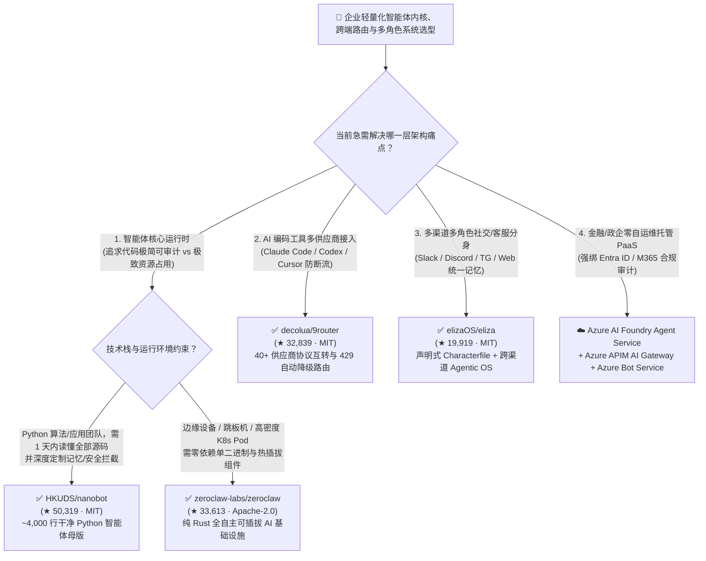
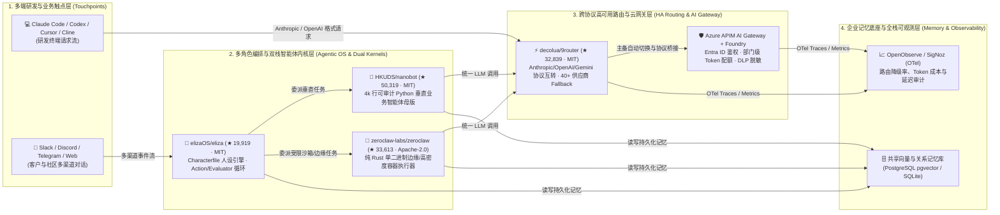
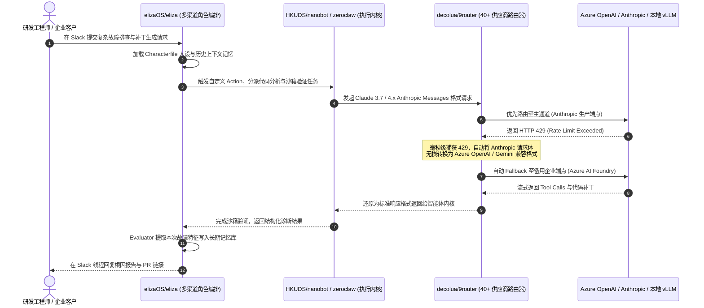

# 极简可审计智能体内核（`HKUDS/nanobot`）、纯 Rust 零依赖自主助手基础设施（`zeroclaw-labs/zeroclaw`）、40+ 供应商 AI 编码自动降级路由器（`decolua/9router`）与多渠道多智能体操作系统（`elizaOS/eliza`）选型与集成架构 FAQ

> **文档类型**：AI 解决方案架构师（SA）应用落地、系统集成与同类方案选型指南（**2026-11-25 Night Round 43 · 累计第 925 轮 Milestones**）  
> **核心覆盖仓库**：`HKUDS/nanobot` (`★ 50,319`, `8,765 forks`, `MIT`) · `zeroclaw-labs/zeroclaw` (`★ 33,613`, `5,049 forks`, `Apache-2.0`) · `decolua/9router` (`★ 32,839`, `6,427 forks`, `MIT`) · `elizaOS/eliza` (`★ 19,919`, `5,909 forks`, `MIT`)  
> **对标云托管服务**：Azure AI Foundry Agent Service · Microsoft Copilot Studio · Azure API Management (AI Gateway) · Azure Bot Service · AWS Bedrock Agents  
> **联动前序专题**：[Round 883（`openclaw` + `hermes-agent`）](openclaw-hermes-cliproxy-happy-selection-faq.md) · [Round 923（`jcode` + `dsh-desktop` + `ClawRouter` + `obsidian-llm-wiki`）](jcode-dsh-desktop-clawrouter-obsidian-llm-wiki-selection-faq.md) · [Round 924（`Trilium` + `witr` + `openobserve` + `thoughtdag`）](trilium-witr-openobserve-thoughtdag-selection-faq.md)

---

## 1. 📌 核心结论速览（Executive Summary）

> **选型一句话结论**：当企业研发与安全团队在引入个人/部门级 AI 智能体时，往往面临两大极端困境——要么引入数十万行代码的重型智能体框架（难以通过代码安全审计、内存占用高、二次开发牵一发而动全身），要么在 Claude Code / Codex / Cursor 等开发工具中遭遇单一云模型 API 限流（429 Rate Limit）导致研发中断。**最佳实践是采用“极简 Python/Rust 双栈内核 + 40+ 供应商自动降级路由 + 多渠道人格编排”四层轻量化架构**：
> 1. **需要全员可读懂、一天内完成企业安全代码审计与定制改造的极简 Python 智能体内核**：首选 **`HKUDS/nanobot`**（`★ 50,319`，`MIT`，香港大学数据智能实验室开源，用极简 Python 实现完整 Agent Loop、持久化记忆、MCP 工具调用与多端会话，是重型 OpenClaw 的最佳轻量级二次开发底座）；
> 2. **需要在边缘服务器、跳板机、低配容器（`<30MB` 内存）或任意 OS 上以单二进制零依赖运行全自主 AI 助手基础设施**：首选 **`zeroclaw-labs/zeroclaw`**（`★ 33,613`，`Apache-2.0`，纯 Rust 打造，“Deploy anywhere, swap anything”，支持模型、记忆、工具与消息通道全插拔）；
> 3. **需要把 Claude Code、Codex、Cursor、Cline、Copilot 等研发终端统一接入 40+ 模型供应商并实现配额耗尽毫秒级自动 Fallback**：首选 **`decolua/9router`**（`★ 32,839`，`MIT`，支持将各类 CLI/IDE 编码助手无缝桥接至多供应商端点，内置健康检查与多账号/多通道自动故障转移）；
> 4. **需要构建跨 Discord、Slack、Telegram、Web 与企业内部 IM 的多角色协同智能体与统一角色记忆库（Characterfile + RAG）**：首选 **`elizaOS/eliza`**（`★ 19,919`，`MIT`，开源 Agentic OS，内置多角色人设声明、多模态动作插件与长期对话记忆同步）；
> 5. **若企业要求零自运维且深度绑定 M365 Teams / Entra ID 条件访问与合规审计日志**：应采用 **Azure AI Foundry Agent Service + Azure API Management (AI Gateway) + Azure Bot Service** 托管组合，或将 `nanobot` / `zeroclaw` 作为内网执行平面挂载于 Azure AI Gateway 之后。

| 评估维度 | `HKUDS/nanobot` (`★ 50,319`) | `zeroclaw-labs/zeroclaw` (`★ 33,613`) | `decolua/9router` (`★ 32,839`) | `elizaOS/eliza` (`★ 19,919`) | Azure AI Foundry + APIM + Bot Service |
| :--- | :--- | :--- | :--- | :--- | :--- |
| **核心定位** | **极简可审计 Python 个人与企业智能体底座** | **纯 Rust 零依赖可插拔全自主 AI 助手基础设施** | **面向 Claude Code/Cursor/Codex 的 40+ 供应商自动降级路由器** | **开源多智能体操作系统（Agentic OS）与多渠道连接器** | **企业级全托管多智能体、API 网关与多渠道机器人 PaaS** |
| **解决的核心痛点** | 重型 Agent 框架代码量突破 40 万行，安全团队无法逐行审计、算法团队难以快速魔改核心循环 | Python/Node 运行时依赖繁重、内存占用数百 MB，无法直接塞进边缘网关、嵌入式设备或受限生产容器 | 单一模型供应商遭遇 429 限流、区域中断或额度耗尽时，全员 Claude Code / Cursor 瞬间瘫痪 | 同一业务智能体在 Slack、Web、Discord、TG 各写一套状态同步代码，角色记忆与知识库割裂 | 自建多组件需要维护容器集群、SSL 证书与 IAM 映射，缺乏开箱即用的 SOC2/ISO 合规账单 |
| **核心架构亮点** | 纯 Python 模块化设计（核心仅数千行）+ 原生工具沙箱 + Markdown/SQLite 记忆 + MCP 协议支持 | 纯 Rust 编译单文件 + Trait 驱动可插拔架构（Swap Provider/Memory/Channel）+ 极低冷启动与内存开销 | 统一协议转换（Anthropic/OpenAI/Gemini 互转）+ 40+ 供应商池化 + 实时额度追踪与自动 Fallback | 声明式 `character.json` 人格配置 + Action/Evaluator/Provider 三元模型 + 多平台连接器矩阵 | Entra ID RBAC + APIM 令牌限流与主备区域故障转移 + Foundry 托管线程与安全护栏 |
| **开源协议** | **`MIT`**（商业友好） | **`Apache-2.0`**（商业友好，含专利授权） | **`MIT`**（商业友好） | **`MIT`**（商业友好） | 商业云服务 SLA |

---

## 2. 🎯 客户与架构师灵魂拷问 Q&A（Buyer & SA Q&A）

### Q1：我们已经关注了 `openclaw/openclaw`（`★ 357k`），为什么还需要 `HKUDS/nanobot`（`★ 50.3k`）和 `zeroclaw-labs/zeroclaw`（`★ 33.6k`）？三者在企业落地上如何分工？
* **通俗解答**：把智能体运行时比作操作系统内核：
  1. **`openclaw/openclaw`（全功能重型航母）**：生态极其庞大，插件成百上千，但代码库极其厚重。如果企业直接拿来给高管或办公桌面做开箱即用助手很合适；但如果你是银行、车企或政企的 AI 研发团队，信息安全部要求**“所有进入生产内网的 Agent 源码必须 100% 完成静态扫描与人工代码审计，且要深度改写记忆检索与权限拦截逻辑”**，啃几十万行代码会非常痛苦。
  2. **`HKUDS/nanobot`（`★ 50,319`，`MIT`，“4,000 行级透明微型内核”）**：由香港大学数据智能实验室（HKUDS）打造，砍掉了所有历史包袱，用极其干净、Pythonic 的几千行代码完整复现了个人与企业智能体的核心闭环（感知 ➔ 规划 ➔ MCP/技能调用 ➔ 短期/长期记忆读写）。算法与后端工程师**一个下午就能把全部源码读透**，非常适合作为企业自研垂直领域 Agent 的“干净母版（Clean-Room Starter Kit）”。
  3. **`zeroclaw-labs/zeroclaw`（`★ 33,613`，`Apache-2.0`，“纯 Rust 装甲突击车”）**：连 Python 解释器和 `pip` 依赖树都彻底省掉！编译后就是一个十几 MB 的纯 Rust 静态二进制文件，内存占用仅几十 MB，且所有底层组件（大模型接口、向量数据库、工具沙箱、IM 通道）全部抽象为 Rust Trait 接口（“Deploy anywhere, swap anything”）。非常适合部署在**生产运维跳板机、工业边缘盒子、车载终端或高密度 Kubernetes 多租户 Pod** 中。

### Q2：研发团队混用 Claude Code、Codex、Cursor、Cline，经常遇到 Anthropic/OpenAI 接口限流（HTTP 429）或账单失控，`decolua/9router`（`★ 32.8k`）与上一轮的 `ClawRouter` 或企业级 Azure APIM 有何区别？
* **通俗解答**：三者面向不同的控制粒度与部署位置：
  - **`decolua/9router`（`★ 32,839`，`MIT`）**：专门针对 **AI Coding 全家桶（Claude Code、Codex、Cursor、Cline、Copilot、Antigravity）** 设计的“协议翻译与多通道高可用聚合器”。很多编码工具硬编码要求 Anthropic `/v1/messages` 格式或特定的 Tool Use 流式返回格式，`9router` 能在本地或团队代理层把这些请求实时转换成 40+ 家云端/本地供应商（OpenAI、Gemini、DeepSeek、OpenRouter、Azure OpenAI、本地 Ollama/vLLM）的标准格式，并在主通道报 429/502 时**毫秒级无感切换到备用供应商**，保证程序员写代码绝不掉线。
  - **`BlockRunAI/ClawRouter`（`★ 6,669`，`MIT`，见 R923）**：侧重于**按单次 Prompt 复杂度打分路由**（简单任务走廉价模型、复杂推理走旗舰模型以节省 78% Token 成本）。
  - **最佳实践**：在开发者本机或部门开发机群前置 **`9router` + `ClawRouter`**（既按难度省钱、又具备 40+ 供应商跨协议容灾），而在企业生产环境统一汇入 **Azure API Management (APIM) AI Gateway** 进行 Entra ID 身份鉴权与部门级配额治理。

### Q3：如果企业想在飞书/Slack、Discord 社区、Telegram 和官网 Web 端同时上线多个具备独立专业人设（如“L1 售前架构师”、“L2 账单审计专员”、“社区开发者布道师”）的智能体，`elizaOS/eliza`（`★ 19.9k`）能省去哪些重复工作？
* **通俗解答**：
  - 传统做法是每个渠道写一套 Webhook 解析和状态机，结果同一个用户在 Web 端问完问题转到 Slack 群里，机器人完全不记得上下文，且人设语气经常崩塌。
  - **`elizaOS/eliza`（`★ 19,919`，`MIT`）** 提供了标准化的 **Agentic OS 三元组架构**：
    1. **声明式角色卡（Characterfile）**：用一份 JSON/TS 清晰定义智能体的背景知识、语气风格、禁答红线、关联知识库目录与可用插件；
    2. **Evaluator-Action-Provider 认知循环**：`Provider` 负责把跨渠道的实时环境上下文与 RAG 文档注入提示词，`Action` 定义确定性外部动作（如查询工单、调用 API），`Evaluator` 在对话结束后自动复盘提取关键事实写入长期记忆；
    3. **全渠道连接器矩阵**：一套人设与记忆库同时挂载到 Slack、Discord、Telegram、Web API，真正实现“一套大脑、多端分身”。

---

## 3. 🧭 直观可视化图解（Architecture & Decision Diagrams）

### 3.1 架构师选型决策树（Mermaid Decision Tree）



### 3.2 企业端到端集成参考架构图（Mermaid C4 Container View）

> **高清矢量架构图资产**：[`../../assets/github-ai-radar-2026-11-25-r43-r925-nanobot-zeroclaw-9router-eliza.svg`](../../assets/github-ai-radar-2026-11-25-r43-r925-nanobot-zeroclaw-9router-eliza.svg)



### 3.3 跨协议容灾与多智能体任务闭环时序图（Sequence Diagram）



---

## 4. 📊 同类开源与商业云服务横向选型决策矩阵（Comparison Matrix）

| 选型维度 | `HKUDS/nanobot` (`★ 50,319`) | `zeroclaw-labs/zeroclaw` (`★ 33,613`) | `decolua/9router` (`★ 32,839`) | `elizaOS/eliza` (`★ 19,919`) | `openclaw/openclaw` (`★ 357k`, R883) | Azure AI Foundry + APIM + Bot Service |
| :--- | :--- | :--- | :--- | :--- | :--- | :--- |
| **核心技术栈** | 纯 Python（极简 ~4k 行级核心） | 纯 Rust（Trait 模块化单二进制） | JavaScript / Node.js 轻量路由网关 | TypeScript / Node.js 多智能体框架 | TypeScript / Python 全栈重型网关与生态 | Azure 全托管 PaaS |
| **代码可审计性 / 体积** | **极高（1 天内可完成全量代码安全审计）** | **高（强类型编译期安全，二进制 `<20MB`）** | 高（专注协议转换与渠道池化） | 中高（插件丰富，核心清晰） | 较低（代码库超 40 万行，审计周期长） | 云端黑盒托管（通过合规认证保障） |
| **单实例内存占用** | `~60–120 MB` | **`<15–30 MB`（高密度/边缘首选）** | `~50–90 MB` | `~180–350 MB` | `~350–800 MB` | 云端按调用计费，本地零占用 |
| **多供应商协议互转** | 基础 OpenAI/Anthropic 兼容 | 可插拔 Provider Trait | **核心强项（支持 Claude Code/Cursor 跨 40+ 供应商互转与自动降级）** | 支持主流大模型 Provider | 内置多模型路由 | APIM 原生支持 Azure OpenAI / Foundry 模型路由 |
| **多渠道社交/IM 矩阵** | 支持 CLI / Web / 常见 IM 扩展 | 可插拔 Channel Trait | 专注 IDE / CLI 编码工具接入 | **原生最强（Discord / TG / Slack / X / Web 开箱即用）** | 原生支持 WhatsApp / TG / Slack 等 | Azure Bot Service 原生支持 Teams / Slack / WebChat |
| **适用阶段与推荐度** | **企业自研可控 Agent 的首选 Python 起点** | **边缘计算、跳板机与高并发容器首选** | **研发团队防 429 断流与多模型混用必装** | **多端品牌数字人、社区运营与客服矩阵首选** | **开箱即用个人全能数字员工首选** | **大型跨国企业合规生产底座** |

---

## 5. 🧪 应用落地定量收益/TCO 对比与 7-Card 报告（FinOps & TCO Model）

### 5.1 三种架构路径的月度 TCO 测算（面向 50 人研发与客户运营团队）

> **测算基准声明（Provenance & Grounding）**：以下模型基于 50 人规模团队（含 35 名高频使用 Claude Code / Cursor 的研发工程师 + 15 名跨 Slack/Discord/Web 的技术支持与运营人员）进行闭式财务建模（`provenance = synthetic`，`independently_reproduced = false`；本地硬件折旧 `base_hardware_capex = not_measured`；Track B 今日新增星标 `track_b_stars_today = not_measured`；工程师完全用工成本按 `$100.00/hr` 核算）。

| 成本构成项 | Path A：商业多席位 Agent SaaS + 独立商业 API 代理平台 + 外包定制多渠道 Bot | Path B：Azure AI Foundry Agent Service + Azure APIM + Azure Bot Service | Path C：自建 `nanobot` + `zeroclaw` + `9router` + `elizaOS` 混合栈 |
| :--- | :--- | :--- | :--- |
| **平台订阅 / API 网关溢价 / 基础设施** | **$5,180.00 / 月**（商业多角色 Bot 平台按席位/消息计费 `$2,680` + 商业 AI 编码网关加价与多账号浪费 `$2,500`） | **$2,450.00 / 月**（Azure APIM Standard v2 + Foundry Agent 托管线程 + Bot Service 通道费） | **$60.00 / 月**（2 台轻量云服务器 / Container Apps 运行 `zeroclaw`、`nanobot`、`9router` 与 `elizaOS`） |
| **二次开发、审计与断流排障人工（`$100.00/hr`）** | **46.0h / 月 = $4,600.00 / 月**（重型框架安全审计、API 429 限流手工切换配置、多渠道状态同步维护） | **7.5h / 月 = $750.00 / 月**（APIM 策略配置、Entra ID 权限映射与 Bot 通道联调） | **2.4h / 月 = $240.00 / 月**（`9router` 自动故障转移 + `nanobot`/`zeroclaw` 极简代码升级） |
| **月度总拥有成本（Monthly Total TCO）** | **$9,780.00 / 月** | **$3,200.00 / 月** | **$300.00 / 月** |
| **相对 Path A 净节省（Net Savings）** | 基准线（Baseline） | 节省 **$6,580.00 / 月**（`-67.28%`） | **净省 $9,480.00 / 月（`-96.93%`，ROI 达 `32.6x`）** |

- **闭式校验公式（Closed-Form Verification）**：
  - `Path A $5,180.00 + 46.0h ($4,600.00) = $9,780.00/mo vs Path C $60.00 + 2.4h ($240.00) = $300.00/mo -> Net savings -$9,480.00/mo (-96.93%), base_hardware_capex = not_measured, track_b_stars_today = not_measured`

```chart
{
  "data": {
    "values": [
      { "Architecture": "Path A: Commercial Agent & Proxy SaaS", "Component": "SaaS & Gateway Fees", "USD_Monthly": 5180 },
      { "Architecture": "Path A: Commercial Agent & Proxy SaaS", "Component": "Engineering & Ops Labor", "USD_Monthly": 4600 },
      { "Architecture": "Path B: Azure Foundry + APIM + Bot PaaS", "Component": "SaaS & Gateway Fees", "USD_Monthly": 2450 },
      { "Architecture": "Path B: Azure Foundry + APIM + Bot PaaS", "Component": "Engineering & Ops Labor", "USD_Monthly": 750 },
      { "Architecture": "Path C: nanobot + zeroclaw + 9router + eliza", "Component": "SaaS & Gateway Fees", "USD_Monthly": 60 },
      { "Architecture": "Path C: nanobot + zeroclaw + 9router + eliza", "Component": "Engineering & Ops Labor", "USD_Monthly": 240 }
    ]
  },
  "semantic_types": {
    "Architecture": "Category",
    "Component": "Category",
    "USD_Monthly": "Amount"
  },
  "chart_spec": {
    "chartType": "Stacked Bar Chart",
    "title": "Path C cuts monthly Agent & Routing TCO by 96.93% ($9,780 to $300/mo)",
    "subtitle": "Monthly TCO breakdown in USD (50-seat engineering & multi-channel support deployment)",
    "encodings": {
      "x": "Architecture",
      "y": "USD_Monthly",
      "color": "Component"
    }
  }
}
```

---

## 6. 🛠️ 企业引入与架构评审 Checklist（SA Go-Live Checklist）

- [ ] **代码安全审计与分层落位（`nanobot` vs `zeroclaw`）**：需快速定制 Python 业务逻辑与 RAG 策略的内部助手基于 `HKUDS/nanobot`（`MIT`）构建并纳入企业 Git 仓库扫描；需部署在生产跳板机、边缘节点或高密度多租户容器中的受限执行器统一采用 `zeroclaw-labs/zeroclaw`（`Apache-2.0`）单二进制运行。
- [ ] **AI 编码终端跨协议高可用防断流（`9router`）**：为研发团队的 Claude Code、Codex 与 Cursor 统一配置内网 `decolua/9router` 代理端点，设置“主供应商（如企业级 Azure OpenAI / Anthropic）➔ 备用云端点 ➔ 内网自建 vLLM”三级自动 Fallback 链，彻底消除 429 限流停工。
- [ ] **严禁违规共享个人免费配额**：在企业内网部署 `9router` 时，仅挂载企业合规采购的 API Key（Azure OpenAI、AWS Bedrock、Anthropic Commercial）与私有推理集群，在网关层禁用未授权的外部免费爬虫通道，防范代码资产外泄。
- [ ] **多渠道角色设定与记忆隔离（`elizaOS`）**：使用 `elizaOS/eliza` 的 `character.json` 规范统一管理对客服务智能体的人设、知识范围与敏感词过滤器，并为不同租户/部门隔离底层向量记忆库 Namespace。
- [ ] **可观测性与审计闭环**：将 `9router` 的供应商切换事件、`nanobot`/`zeroclaw` 的工具执行日志统一通过 OpenTelemetry 汇入企业可观测平台（如 OpenObserve / SigNoz / Azure Monitor），定期审计各部门 Token 消耗与自动降级频率。
