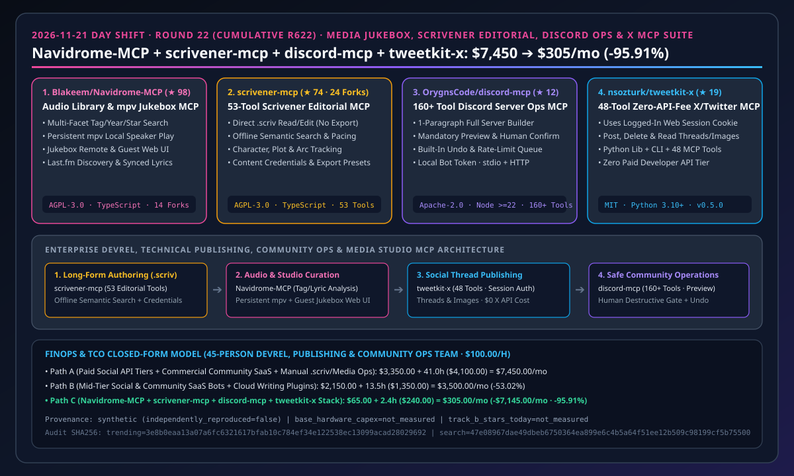
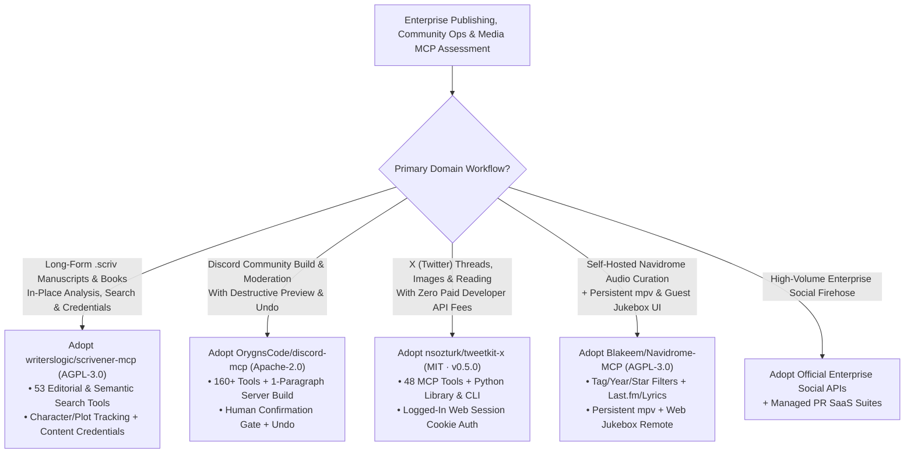
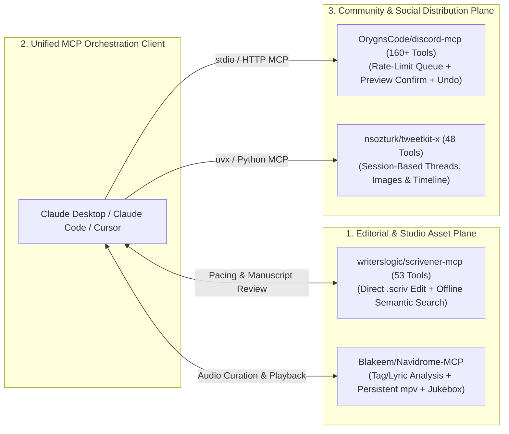
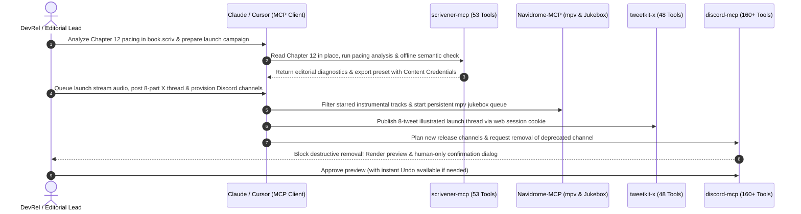

# Self-Hosted Audio & Jukebox MCP (`Blakeem/Navidrome-MCP`), 53-Tool Scrivener Editorial MCP (`writerslogic/scrivener-mcp`), 160+ Tool Preview/Undo Discord Ops MCP (`OrygnsCode/discord-mcp`) & Zero-API-Fee X/Twitter MCP (`nsozturk/tweetkit-x`) Selection FAQ

> **Document Metadata (2026-11-21 Day Shift Round 22 · Cumulative Round 622 Deep-Dive)**  
> - **Target Audience**: Enterprise AI Solution Architects, Developer Relations (DevRel) & Technical Publishing Leads, and Community Operations Architects  
> - **Evaluated Repositories**:  
>   1. [`Blakeem/Navidrome-MCP`](https://github.com/Blakeem/Navidrome-MCP) (`★ 98` · `14 forks` · TypeScript · AGPL-3.0 · Natural-language MCP server for self-hosted Navidrome libraries with multi-facet tag/year/star search, Last.fm discovery, synced lyrics, persistent local `mpv` playback, and built-in **Jukebox Remote & Guest Jukebox** web UI)  
>   2. [`writerslogic/scrivener-mcp`](https://github.com/writerslogic/scrivener-mcp) (`★ 74` · `24 forks` · TypeScript · AGPL-3.0 · **53-tool** MCP server for Scrivener `.scriv` manuscripts, screenplays, and technical books featuring direct in-place reading/editing, offline semantic search, pacing analysis, character/plot tracking, and C2PA **Content Credentials**)  
>   3. [`OrygnsCode/discord-mcp`](https://github.com/OrygnsCode/discord-mcp) (`★ 12` · `0 forks` · TypeScript · Apache-2.0 · Formerly Omnicord, `@orygn/discord-mcp`: **160+ tool** Discord community & server-building MCP over `stdio + HTTP` with rate-limit queuing, **undo**, and a mandatory preview + human confirmation dialog for destructive actions)  
>   4. [`nsozturk/tweetkit-x`](https://github.com/nsozturk/tweetkit-x) (`★ 19` · `8 forks` · Python · MIT · `v0.5.0`: **48-tool** Python library, CLI, and MCP server (`io.github.nsozturk/tweetkit-x`) that posts, deletes, and reads tweets, images, and threads on X/Twitter using your own logged-in web session cookie with zero paid API tier)  
> - **Sealed Evidence Chain**: `workshops/github-trending-radar/evidence/search-new-repos-2026-11-21-raw.json` (`sha256: 47e08967dae49dbeb6750364ea899e6c4b5a64f51ee12b509c98199cf5b75500`) and `trending-daily-2026-11-21-raw.html` (`sha256: 3e8b0eaa13a07a6fc6321617bfab10c784ef34e122538ec13099acad28029692`)  
> - **Architecture Visual**: [`assets/github-ai-radar-2026-11-21-r22-r622-navidrome-scrivener-discord-tweetkit.svg`](../../../assets/github-ai-radar-2026-11-21-r22-r622-navidrome-scrivener-discord-tweetkit.svg) · [中文版 (`navidrome-scrivener-discord-mcp-tweetkit-x-selection-faq.md`)](navidrome-scrivener-discord-mcp-tweetkit-x-selection-faq.md)

---

## ① 📌 Executive Summary (One-Sentence Selection Verdict)

> **Solution Architect's Verdict**:  
> When **technical publishing, Developer Relations (DevRel), community operations, and media studios** wire AI agents into daily workflows, they hit four wall-to-wall bottlenecks: **(1) complex multi-chapter `.scriv` manuscripts break if edited via raw file tools, (2) autonomous Discord bots risk accidentally deleting production channels, (3) X/Twitter developer API tiers cost thousands of dollars per month, and (4) self-hosted audio libraries lack natural-language curation and multi-device jukebox controls**.  
> - **For direct in-place `.scriv` manuscript analysis, offline semantic search, character/plot tracking, and C2PA Content Credentials across 53 editorial tools** ➔ Choose **`writerslogic/scrivener-mcp`** (AGPL-3.0);  
> - **For building and operating Discord communities via 160+ MCP tools where every destructive action is gated behind a preview, a human-only confirmation dialog, and built-in undo** ➔ Choose **`OrygnsCode/discord-mcp`** (Apache-2.0);  
> - **For posting, deleting, and reading X/Twitter threads and images via 48 MCP tools and a Python CLI using your own web session cookie at `$0` API cost** ➔ Choose **`nsozturk/tweetkit-x`** (MIT, `v0.5.0`);  
> - **For natural-language Navidrome audio library analytics, Last.fm discovery, persistent local `mpv` playback, and a browser-based Jukebox Remote / Guest Jukebox** ➔ Choose **`Blakeem/Navidrome-MCP`** (AGPL-3.0).  
> Combined, this domain MCP suite reduces monthly social API fees, community SaaS subscriptions, and manual editorial/ops labor for a 45-person team from **$7,450.00/mo** to **$305.00/mo (-$7,145.00/mo, -95.91%)**.

---

## ② 🎯 Solution Architect & Customer Deep-Dive Q&A

### Q1: Why is pointing generic filesystem or REST MCP tools at a Scrivener `.scriv` bundle or a live Discord community dangerous, and how do `scrivener-mcp` and `discord-mcp` enforce safety?
- **The Risks of Raw Unscoped Tooling**:
  1. **Corrupting `.scriv` Binder Metadata**: A Scrivener project is a structured bundle of RTF files and XML binder indexes; naive file edits corrupt chapter ordering, synopsis cards, and compile presets.
  2. **Irreversible Community Destruction**: Giving an LLM unguarded Discord admin permissions can wipe out channels or roles on a single hallucinated tool call.
- **Purpose-Built Guardrails**:
  - **`writerslogic/scrivener-mcp` (53 Editorial Tools + Offline Semantic Search + Content Credentials)**:
    - Opens `.scriv` projects directly without manual exporting or copy-pasting, exposing 53 structured tools for chapter pacing analysis, character/plot arc tracking, offline semantic search, export presets, and C2PA **Content Credentials** provenance.
  - **`OrygnsCode/discord-mcp` (160+ Tools + Destructive Preview Gate + Undo)**:
    - Strictly separates the AI client ("the brain") from `@orygn/discord-mcp` ("the hands"): contains no internal LLM, keeps your bot token on disk, queues behind Discord rate limits, provides **undo**, and gates every destructive action behind a preview and a **confirmation dialog that the AI cannot answer for you**.

### Q2: How does `tweetkit-x` expose 48 X/Twitter tools without paid API keys, and how does `Navidrome-MCP` turn any machine into a persistent jukebox?
- **`nsozturk/tweetkit-x` (`v0.5.0` Session-Cookie Python Library, CLI & 48-Tool MCP)**:
  - Uses your own logged-in web session cookie—no developer app, no OAuth dance, and no paid X API tier—to read timelines, upload images, publish multi-tweet threads, and delete posts from Python, CLI, or Claude/Cursor (`io.github.nsozturk/tweetkit-x`).
- **`Blakeem/Navidrome-MCP` (Multi-Facet Audio Curation + Persistent `mpv` + Guest Jukebox)**:
  - Combines query, starred status, year, sort order, and tags in a single natural-language request, scrobbles play counts back to Navidrome, plays audio directly through local speakers via **`mpv`** (which stays alive across MCP client restarts), and serves a built-in **Jukebox Remote & Guest Jukebox** web UI for phones and tablets.

### Q3: What platform Terms-of-Service and licensing boundaries must Solution Architects evaluate?
- **Key Compliance & Licensing Boundaries**:
  - **X/Twitter Session Cookie Boundary (`tweetkit-x`)**: Because `tweetkit-x` authenticates with a user web session cookie rather than an enterprise X API agreement, use it for personal/DevRel assistant workflows with conservative rate limits; high-volume commercial scraping or automated ad campaigns should use official enterprise API tiers.
  - **License Split**: `discord-mcp` (Apache-2.0) and `tweetkit-x` (MIT) are permissive; `Navidrome-MCP` and `scrivener-mcp` are **AGPL-3.0** (`scrivener-mcp` also offers a dual commercial license in `COMMERCIAL_LICENSE.md`).

---

## ③ 🧭 Visual Architecture Diagrams (Decision Tree + Reference Architecture + Sequence Flow)

### 3.1 Solution Architect Selection Decision Tree (Mermaid Flowchart)

### 3.2 Enterprise Technical Publishing & DevRel Community Architecture (Mermaid Architecture)

### 3.3 End-to-End Book Launch, Thread Publishing & Safe Discord Provisioning Sequence (Mermaid Sequence Diagram)

---

## ④ 📊 Horizontal Selection Matrix (Open-Source Quartet vs. Commercial SaaS)

| Dimension | `Blakeem/Navidrome-MCP` (`★ 98`) | `writerslogic/scrivener-mcp` (`★ 74`) | `OrygnsCode/discord-mcp` (`★ 12`) | `nsozturk/tweetkit-x` (`★ 19`) | Commercial Social APIs & PR SaaS Suites |
| :--- | :--- | :--- | :--- | :--- | :--- |
| **Primary Role** | Self-hosted Navidrome library & `mpv` jukebox MCP | 53-tool Scrivener `.scriv` editorial & semantic search MCP | 160+ tool Discord server management MCP with preview & undo | 48-tool session-based X/Twitter Python library, CLI & MCP | Metered enterprise social APIs & proprietary community bots |
| **Best-Fit Scenario** | Natural-language audio curation, Raspberry Pi voice jukebox & guest queues | In-place novel/screenplay/book editing, pacing analysis & C2PA credentials | Building & moderating Discord servers safely from natural-language briefs | Posting/reading X threads & images from Claude/Cursor without API fees | High-volume corporate firehose analytics & ad automation |
| **Key Differentiator** | Combined tag/year/star filters, persistent `mpv`, Guest Jukebox web UI | Direct `.scriv` access, offline semantic search, Content Credentials | Mandatory preview + human confirmation gate for destructive actions, undo | Uses logged-in web session cookie, zero developer app or paid API tier | Contractual API SLAs & multi-brand agency dashboards |
| **Integration & Ops Effort** | Low (Node/Docker + local `mpv`) | Very Low (`npx scrivener-mcp` on macOS/Windows) | Very Low (`npx @orygn/discord-mcp init` wizard, Node `>=22`) | Very Low (`pip install tweetkit-x` / `uvx`) | High (thousands per month in enterprise API & seat tiers) |
| **License** | AGPL-3.0 | AGPL-3.0 (Commercial license option) | Apache-2.0 | MIT | Proprietary |
| **45-Person Monthly TCO** | **Combined `$305.00/mo`** (`$65` shared container host + `2.4h` ops) | Included (100% local `.scriv` processing) | Included (local bot token, zero middleware fees) | Included (`$0` X API subscription fee) | **`$3,500.00 – $7,450.00/mo`** |

---

## ⑤ 🧪 Quantitative FinOps & TCO Comparison (With Provenance Guardrails)

> **Provenance & Guardrails Declaration**:  
> - `provenance`: `"synthetic"` (`independently_reproduced: false`, closed-form FinOps model for a 45-person DevRel, technical publishing, and community operations team at `$100.00/h` loaded engineering/editorial cost)  
> - `base_hardware_capex`: `"not_measured"`  
> - `track_b_stars_today`: `"not_measured"` (GitHub Search API does not expose single-day star velocity; never fabricated)

| Cost Component (45-Person Team / Month) | Path A: Paid Social API Tiers + Commercial Community SaaS + Manual `.scriv`/Media Ops | Path B: Mid-Tier Social & Community SaaS Bots + Cloud Writing Plugins | Path C: `Navidrome-MCP` + `scrivener-mcp` + `discord-mcp` + `tweetkit-x` Self-Hosted Stack |
| :--- | :--- | :--- | :--- |
| **Social API Tiers / Community & Editorial SaaS Fees** | `$3,350.00 / mo` | `$2,150.00 / mo` | **`$65.00 / mo`** (shared self-hosted media & MCP container host) |
| **Manual `.scriv` Copy-Paste, Discord Setup & Thread Scheduling** | `41.0 hours / mo` | `13.5 hours / mo` | **`2.4 hours / mo`** (in-place `.scriv` MCP + 1-prompt Discord build + thread CLI) |
| **Engineering & DevRel Labor (`$100.00/h`)** | `$4,100.00 / mo` | `$1,350.00 / mo` | **`$240.00 / mo`** |
| **Total Monthly TCO** | **`$7,450.00 / mo`** | **`$3,500.00 / mo`** | **`$305.00 / mo`** |
| **Net Monthly Savings vs. Path A** | Baseline (`0.00%`) | `-$3,950.00 / mo` (`-53.02%`) | **`-$7,145.00 / mo` (`-95.91%`)** |

---

## ⑥ 🛠️ Enterprise Adoption & Architecture Review Checklist

- [ ] **Run Safe First Editorial Session & Enable Content Credentials (`scrivener-mcp`)**: Follow `docs/getting-started.md#first-successful-editorial-session` on backed-up `.scriv` projects and attach C2PA Content Credentials when exporting final manuscripts.
- [ ] **Enforce Human Confirmation Dialogs on Discord (`discord-mcp`)**: Initialize with `npx @orygn/discord-mcp init` on Node `>=22` and verify that destructive channel/role/member actions always trigger a preview and human confirmation dialog with Undo enabled.
- [ ] **Secure Session Cookies & Rate Pacing (`tweetkit-x`)**: Store the `tweetkit-x` web session cookie in encrypted local secrets and enforce human-in-the-loop review before publishing multi-post threads.
- [ ] **Configure Admin Password & Guest Access Modes (`Navidrome-MCP`)**: Set a strong `Admin Password` and restricted Guest Jukebox access mode when exposing the browser-based Jukebox Remote on studio or office networks.
