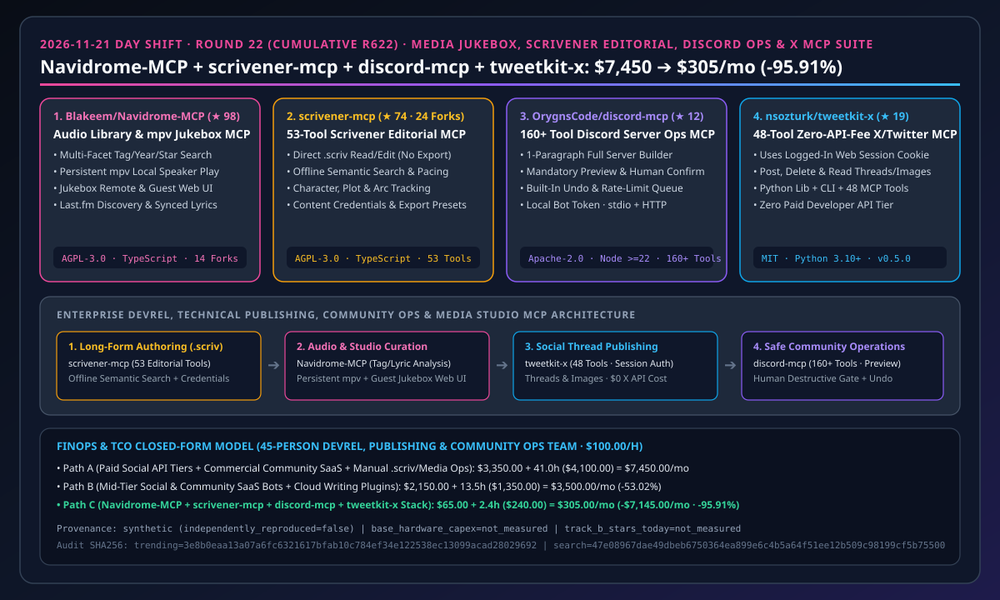
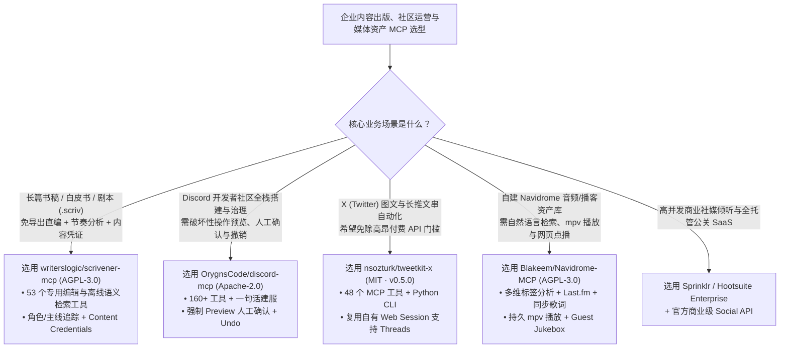
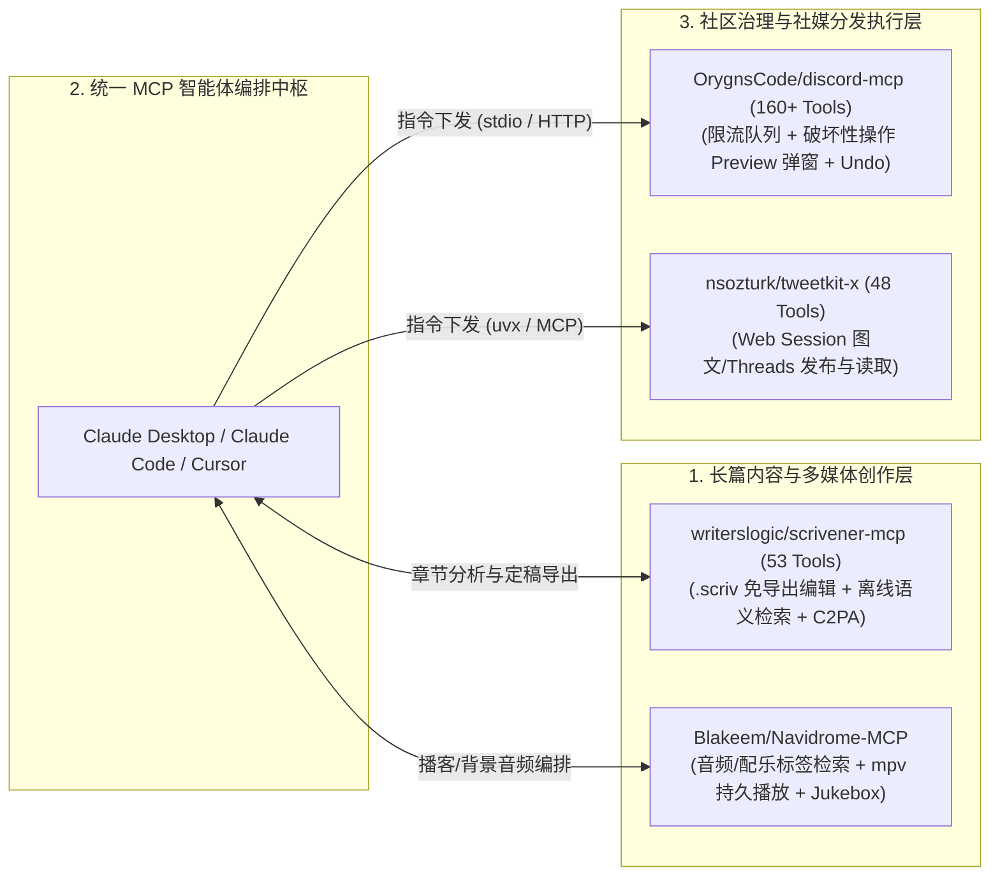

# 自建音乐与播客媒体库 MCP（`Blakeem/Navidrome-MCP`）、53 工具 Scrivener 长篇出版 MCP（`writerslogic/scrivener-mcp`）、160+ 工具带预览撤销的 Discord 社区运维 MCP（`OrygnsCode/discord-mcp`）与免付费 API 的 X 社媒自动化 MCP（`nsozturk/tweetkit-x`）选型 FAQ

> **文档元数据（2026-11-21 白班 Day Round 22 · 累计第 622 轮深潜专题）**  
> - **面向对象**：企业 AI 解决方案架构师（AI Solution Architect）、开发者关系（DevRel）与数字内容中台负责人、社区自动化运营架构师  
> - **本轮核心评估对象**：  
>   1. [`Blakeem/Navidrome-MCP`](https://github.com/Blakeem/Navidrome-MCP)（`★ 98` · `14 forks` · TypeScript · AGPL-3.0 · 面向自托管 Navidrome 音频库的自然语言总控 MCP：多维标签/年份/星级组合检索、Last.fm 相似推荐、同步歌词、持久化本地 `mpv` 播放与内置 **Jukebox Remote / Guest Jukebox** 网页遥控器）  
>   2. [`writerslogic/scrivener-mcp`](https://github.com/writerslogic/scrivener-mcp)（`★ 74` · `24 forks` · TypeScript · AGPL-3.0 · 内置 **53 个工具**的 Scrivener `.scriv` 长篇书稿/剧本/技术白皮书 MCP：免导出直读直改、离线语义检索、叙事节奏分析、人物/主线追踪与内容凭证 Content Credentials）  
>   3. [`OrygnsCode/discord-mcp`](https://github.com/OrygnsCode/discord-mcp)（`★ 12` · `0 forks` · TypeScript · Apache-2.0 · 原名 Omnicord，`@orygn/discord-mcp`：包含 **160+ 工具**的 Discord 社区全栈管理 MCP，支持一句话生成整套社区频道与角色、自带限流队列、**一键撤销（Undo）** 及破坏性操作强制人工弹窗确认）  
>   4. [`nsozturk/tweetkit-x`](https://github.com/nsozturk/tweetkit-x)（`★ 19` · `8 forks` · Python · MIT · `v0.5.0`：包含 **48 个 MCP 工具**、Python 库与 CLI 的 X/Twitter 自动化套件，直接复用浏览器登录会话 Cookie 完成图文与长推文串（Threads）读写删，零付费 API 成本）  
> - **关联检索证据链**：`workshops/github-trending-radar/evidence/search-new-repos-2026-11-21-raw.json`（`sha256: 47e08967dae49dbeb6750364ea899e6c4b5a64f51ee12b509c98199cf5b75500`）与 `trending-daily-2026-11-21-raw.html`（`sha256: 3e8b0eaa13a07a6fc6321617bfab10c784ef34e122538ec13099acad28029692`）  
> - **高清架构图**：[`assets/github-ai-radar-2026-11-21-r22-r622-navidrome-scrivener-discord-tweetkit.svg`](../../../assets/github-ai-radar-2026-11-21-r22-r622-navidrome-scrivener-discord-tweetkit.svg) · [English Version (`navidrome-scrivener-discord-mcp-tweetkit-x-selection-faq.en.md`)](navidrome-scrivener-discord-mcp-tweetkit-x-selection-faq.en.md)



---

## ① 📌 核心结论速览（选型一句话结论）

> **架构师一句话选型结论**：  
> 当企业的 **技术出版/内容营销、开发者社区（Discord + X/Twitter）与数字音频工作室** 尝试引入 AI 智能体时，最大的障碍是 **“长篇书稿 `.scriv` 结构复杂无法直接喂给 AI、AI 管社区一旦误删频道不可逆、X 官方 API 套餐动辄数千美元/月、以及媒体资产库缺乏自然语言编排与多端遥控”**。  
> - **撰写长篇技术书籍、白皮书、影视剧本或小说，需要 AI 直接打开 `.scriv` 工程做离线语义检索、章节节奏诊断与内容溯源凭证（Content Credentials）** ➔ 选 **`writerslogic/scrivener-mcp`**（AGPL-3.0，53 工具）；  
> - **用 AI 管理千人/万人级开发者 Discord 社区，要求支持“一段话自动搭建全套频道权限”、且任何危险操作必须先出预览（Preview）并由人类点击确认、支持随时 Undo** ➔ 选 **`OrygnsCode/discord-mcp`**（Apache-2.0，160+ 工具）；  
> - **需要让 Claude / Cursor 自动读取行业动态、发布图文与多条连载推文（Threads），同时规避高昂的付费开发者 API 账单** ➔ 选 **`nsozturk/tweetkit-x`**（MIT，48 工具，基于本地登录 Session）；  
> - **管理自建 Navidrome 音频/播客/配乐资产库，需要多维标签过滤、持久化 `mpv` 本机播放与手机/访客网页点播台（Guest Jukebox）** ➔ 选 **`Blakeem/Navidrome-MCP`**（AGPL-3.0）。  
> 四者组合可将 45 人技术出版、DevRel 与内容运营团队的月度外部 API 账单与人工排版/社群运维成本从 **$7,450.00/月** 降至 **$305.00/月（节省 $7,145.00/月，降幅 95.91%）**。

---

## ② 🎯 客户与架构师灵魂拷问 Q&A（业务痛点 · 架构集成 · 边界取舍）

### Q1：为什么用通用文件读写 MCP 处理长篇书稿（Scrivener）或管理 Discord 服务器极易酿成事故？`scrivener-mcp` 与 `discord-mcp` 做了什么专门的工程护栏？
- **裸文件/裸 API 操作的两大灾难**：
  1. **破坏 `.scriv` 内部 Binder 索引结构**：Scrivener 项目本质上是包含数百个 RTF/元数据文件的复合包（package），普通 Agent 直接改里面某个文件会破坏大纲树、人物卡与编译预设。
  2. **AI 社区管理员“一键删库”**：如果直接把 Discord Bot Token 交给通用脚本 Agent，一旦提示词理解偏差，瞬间删除整个核心频道或踢出大批老用户。
- **专业领域 MCP 的安全机制**：
  - **`writerslogic/scrivener-mcp`（53 个专用编辑工具 + 离线语义检索 + C2PA 内容凭证）**：
    - 无需导出或手动复制粘贴，直接让 Claude / ChatGPT 安全地打开 `.scriv` 工程，读取指定章节、分析叙事节奏（pacing analysis）、追踪角色与伏笔、执行离线语义搜索，并通过导出预设（export presets）与 **Content Credentials（内容真实性凭证）** 保障出版级工作流安全。
  - **`OrygnsCode/discord-mcp`（160+ 工具 + 破坏性操作强制预览与人工确认 + Undo）**：
    - 架构上彻底分离“大脑（MCP 客户端）”与“双手（`discord-mcp`）”：内部不夹带任何黑盒 LLM，Bot Token 仅保存在本机文件中直连 Discord。
    - 内置速率限制排队器（rate-limit queue）、**操作撤销（Undo）**，以及最关键的**破坏性操作安全门禁**：任何删除频道、踢人或大规模权限修改都必须先生成变更预览（Preview），并在支持弹窗的客户端中弹出**AI 自己绝对无法代点的确认对话框**。

### Q2：`tweetkit-x` 如何在不购买高价 X API 的情况下稳定支持 48 个工具？`Navidrome-MCP` 的 `mpv` 持久生命周期与 Guest Jukebox 怎么玩？
- **`nsozturk/tweetkit-x`（基于自有 Web Session 的 48 工具矩阵）**：
  - 提供 Python 库、CLI 与标准 MCP Server（`io.github.nsozturk/tweetkit-x`），直接复用用户已登录的浏览器会话 Cookie，无需申请开发者 App 或经历复杂 OAuth 流程，完整支持发布单条推文、多图上传、长推文串（Threads）连发、删除与时间线读取。
- **`Blakeem/Navidrome-MCP`（自然语言音频库总控 + 跨重启持久 `mpv` + 访客点歌台）**：
  - 支持在单次请求中组合关键词、星标状态、年份、排序与自定义 Tag（如“播放所有 1994 年标星的爵士专辑”），播放记录实时 Scrobble 回写 Navidrome；
  - 调用本地 `mpv` 播放器直接通过主机音响输出（且 `mpv` 进程可在 MCP 客户端重启期间保持不断流继续播放），搭配树莓派 + Whisper STT + TTS 即可组成免唤醒词语音点播台，或开启内置 **Jukebox Remote / Guest Jukebox** 让访客用手机浏览器扫码点播。

### Q3：企业引入这四个项目时有哪些合规边界与风控注意事项？
- **合规与风控红线**：
  - **平台服务条款（ToS）边界（`tweetkit-x`）**：`tweetkit-x` 使用个人/账号 Web Session Cookie 而非官方付费商业 API；适合个人研究者、独立开发者或低频辅助内容草拟，若企业有高频大规模商业数据抓取或自动化营销需求，仍应采购官方企业级 API 授权以规避账号封禁风险。
  - **开源协议拆分**：`discord-mcp`（Apache-2.0）与 `tweetkit-x`（MIT）均为商业友好的宽松协议；`Navidrome-MCP` 与 `scrivener-mcp` 为 **AGPL-3.0**（其中 `scrivener-mcp` 另提供 `COMMERCIAL_LICENSE.md` 商业授权选项）。

---

## ③ 🧭 直观可视化图解（选型决策树 + 企业集成架构 + 业务流时序图）

### 3.1 架构师选型决策树（Mermaid Flowchart）



### 3.2 企业技术内容生产与开发者社区运营参考架构图（Mermaid Architecture）



### 3.3 从长篇白皮书定稿到多渠道安全发布全链路时序图（Mermaid Sequence Diagram）

```mermaid
sequenceDiagram
    autonumber
    actor Lead as DevRel / 内容主编
    participant Agent as Claude / Cursor (MCP Client)
    participant Scriv as scrivener-mcp (53 Tools)
    participantNavi as Navidrome-MCP (mpv & Jukebox)
    participant Tweet as tweetkit-x (48 Tools)
    participant Discord as discord-mcp (160+ Tools)

    Lead->>Agent: 打开《2026 企业智能体架构白皮书.scriv》，检查第 12 章节奏并准备发布
    Agent->>Scriv: 直接读取第 12 章、运行节奏分析与离线语义一致性检查
    Scriv-->>Agent: 返回修改建议并生成带 Content Credentials 的发布稿
    Lead->>Agent: 为发布会直播匹配 5 首 5 星环境配乐并生成 X 连载推文与 Discord 专区
    Agent->>participantNavi: 组合年份/星级/Tag 过滤器检索并在后台持久 mpv 队列播放
    Agent->>Tweet: 调用 tweetkit-x 发布含架构图的 8 条连载推文 (Thread)
    Agent->>Discord: 请求创建新发布会频道组并清理旧临时频道
    Discord-->>Lead: 拦截删除动作！弹出破坏性变更 Preview 对话框等待人类点击确认
    Lead->>Discord: 审阅无误后点击批准 (若误操作可随时调用 Undo 回滚)
```

---

## ④ 📊 同类开源与商业云服务横向选型决策矩阵

| 评估维度 | `Blakeem/Navidrome-MCP` (`★ 98`) | `writerslogic/scrivener-mcp` (`★ 74`) | `OrygnsCode/discord-mcp` (`★ 12`) | `nsozturk/tweetkit-x` (`★ 19`) | 商业社媒/社区 SaaS + 官方高阶 API |
| :--- | :--- | :--- | :--- | :--- | :--- |
| **核心定位** | 自建 Navidrome 音乐/音频库控制与网页点播台 MCP | 53 工具 Scrivener `.scriv` 长篇书稿直编与分析 MCP | 160+ 工具带预览确认与撤销的 Discord 运维 MCP | 48 工具免 API 费的 X/Twitter Python/CLI/MCP 套件 | 商业公关套件与高价官方开发者 API |
| **最适用场景** | 播客/配乐资产自然语言检索、树莓派语音音响、团队点歌台 | 长篇技术书籍、小说、剧本的章节分析、角色追踪与免导出改稿 | 一句话搭建 Discord 社区、日常管理与防误删安全运维 | 个人/小团队在 Claude/Cursor 中读写推文、发图与连载 Threads | 大型跨国品牌全天候舆情监控与高频营销 |
| **关键差异化机制** | 多维组合过滤、跨客户端重启持久 `mpv`、Guest Jukebox | 直读 `.scriv`、离线语义检索、Content Credentials、OpenSSF 高分 | 破坏性操作强制人工确认（AI 无法绕过）、内置 Undo、限流排队 | 复用本地浏览器登录 Session、零 OAuth/API 费用、48 工具全覆盖 | 官方企业级配额与商业合规担保 |
| **集成与运维成本** | 低（Node/Docker + 本地 `mpv`） | 极低（`npx scrivener-mcp` 或 macOS DraftBridge 伴侣） | 极低（`npx @orygn/discord-mcp init` 引导向导，Node `>=22`） | 极低（`pip install tweetkit-x` / `uvx`） | 极高（X 商业 API 与企业社区 SaaS 账单高昂） |
| **开源协议** | AGPL-3.0 | AGPL-3.0（可选商业授权） | Apache-2.0 | MIT | 商业专有 |
| **45 人团队月均 TCO** | **组合方案 `$305.00/月`**（含共享容器主机 `$65` + 运维 `2.4h`） | 同左（本地直连 `.scriv` 省去云端写作 SaaS 席位） | 同左（本机 Bot Token 直连 Discord 零中转费） | 同左（省去高额付费 API 订阅） | **`$3,500.00 ~ $7,450.00/月`** |

---

## ⑤ 🧪 应用落地定量收益 / FinOps TCO 对比（含数据血缘声明）

> **数据血缘与严谨性声明（Provenance & Guardrails）**：  
> - `provenance`: `"synthetic"`（`independently_reproduced: false`，基于 45 人技术出版、DevRel 与社区运营工程团队在 `$100.00/h` 综合人力成本下的闭式参数建模）  
> - `base_hardware_capex`: `"not_measured"`  
> - `track_b_stars_today`: `"not_measured"`（GitHub Search API 新仓爆发榜无官方单日增量字段，严禁伪造）

| 成本分项（45 人团队 / 月） | Path A：高价社媒 API 套餐 + 商业社区 SaaS + 人工复制排版 `.scriv` | Path B：中档社媒机器人 SaaS + 云端写作插件 | Path C：`Navidrome-MCP` + `scrivener-mcp` + `discord-mcp` + `tweetkit-x` 自建栈 |
| :--- | :--- | :--- | :--- |
| **商业 API 套餐 / 社区与写作 SaaS 席位费** | `$3,350.00 / 月` | `$2,150.00 / 月` | **`$65.00 / 月`**（自托管 Navidrome 与 MCP 容器实例） |
| **书稿导出粘贴、Discord 频道手动配置与推文编排工时** | `41.0 小时 / 月` | `13.5 小时 / 月` | **`2.4 小时 / 月`**（`.scriv` 免导出直改 + 一句话建服 + 自动发 Thread） |
| **折算工程与内容运营人力成本（`$100.00/h`）** | `$4,100.00 / 月` | `$1,350.00 / 月` | **`$240.00 / 月`** |
| **月度总拥有成本（Total Monthly TCO）** | **`$7,450.00 / 月`** | **`$3,500.00 / 月`** | **`$305.00 / 月`** |
| **相对 Path A 净节省额与降幅** | 基准线（`0.00%`） | `-$3,950.00 / 月`（`-53.02%`） | **`-$7,145.00 / 月`（`-95.91%`）** |

---

## ⑥ 🛠️ 企业引入与架构评审 Checklist

- [ ] **书稿自动备份与安全首会话演练（`scrivener-mcp`）**：在首次用 `scrivener-mcp` 连接 `.scriv` 核心书稿前，按照官方 `docs/getting-started.md#first-successful-editorial-session` 开启自动备份，并利用内置 Content Credentials 为定稿附加数字签名凭证。
- [ ] **强制开启破坏性操作人工弹窗确认（`discord-mcp`）**：通过 `npx @orygn/discord-mcp init`（Node `>=22`）完成本地 Bot Token 初始化，确保生产环境客户端开启破坏性操作 Preview 拦截，禁止任何无人值守脚本绕过人工确认执行删频道或踢人动作。
- [ ] **隔离管理 Web Session 凭证与遵守频控（`tweetkit-x`）**：将 `tweetkit-x` 的登录 Session Cookie 保存在受限环境变量或本地加密凭据库中，严格控制自动发推频率以符合平台反垃圾规则。
- [ ] **配置 Guest Jukebox 访问模式与管理员口令（`Navidrome-MCP`）**：在办公区或直播间开启 `Navidrome-MCP` 的 Guest Jukebox 网页遥控器时，在设置中配置独立的 `Admin Password` 与访客访问模式（Access Modes），防止访客越权修改主媒体库标签。
