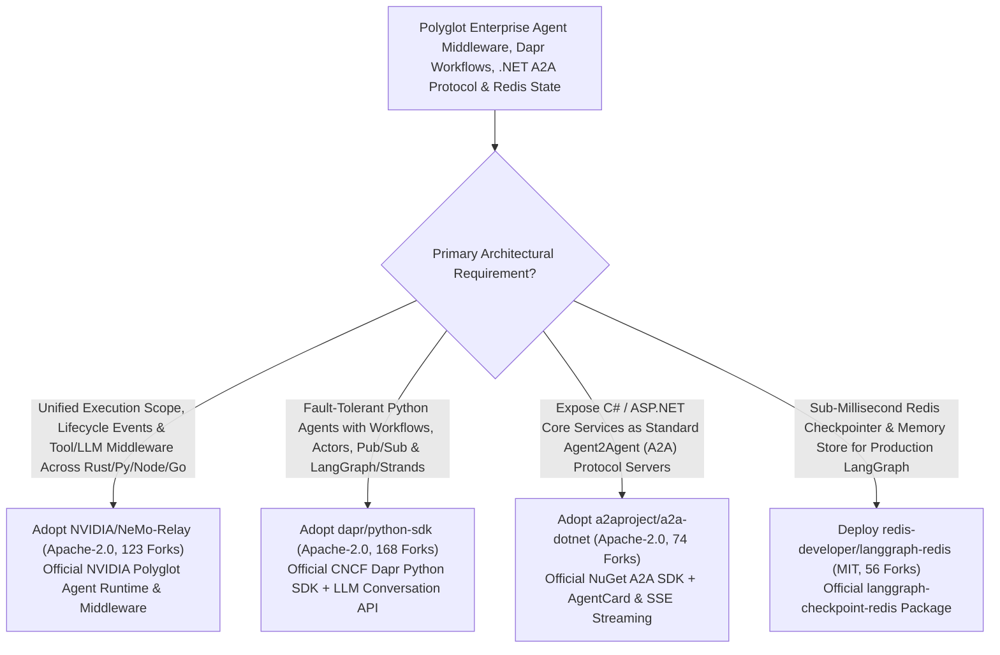
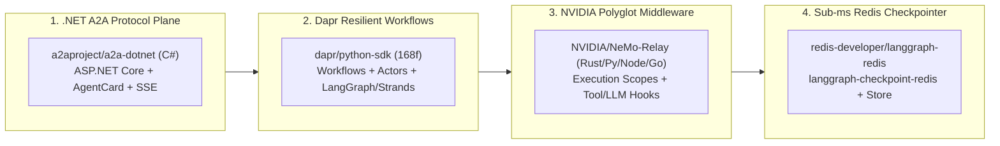
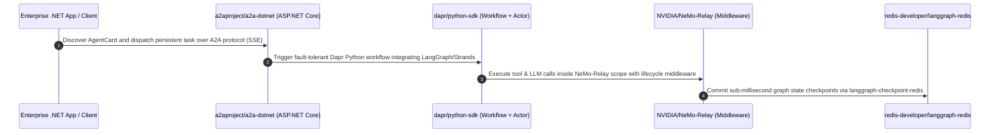

# Official NVIDIA Multi-Language Agent Middleware (`NVIDIA/NeMo-Relay`), Official CNCF Dapr Python Agent SDK (`dapr/python-sdk`), Official A2A Protocol .NET SDK (`a2aproject/a2a-dotnet`) & Official Redis LangGraph Checkpointer (`redis-developer/langgraph-redis`) Selection & Architecture FAQ

> **2026-11-21 Nightly Continuous Research Shift · Night Round 98 (Cumulative Round 698)**  
> **Audit Claim ID**: `CLAIM-20261121-R98-R698-NEMORELAY-DAPRPYTHON-A2ADOTNET-LANGGRAPHREDIS`  
> **Linked Daily Digests**: [`2026-11-21.en.md`](../daily/2026-11-21.en.md) · [`2026-11-21.md`](../daily/2026-11-21.md)  
> **Architecture Visual**: [`assets/github-ai-radar-2026-11-21-r98-r698-nemorelay-daprpython-a2adotnet-langgraphredis.svg`](../../../assets/github-ai-radar-2026-11-21-r98-r698-nemorelay-daprpython-a2adotnet-langgraphredis.svg)

---

## ① 📌 Executive Summary (One-Sentence Selection Verdict)

> **One-Sentence Verdict**: To standardize polyglot enterprise agent systems across Rust, Python, Node.js, Go, and C#/.NET with deterministic tool/LLM middleware, resilient Dapr workflows and actors, native Agent2Agent (A2A) protocol interoperability, and sub-millisecond Redis state checkpointing, combine **`NVIDIA/NeMo-Relay` (Apache-2.0, `★ 255` / `123 forks` official NVIDIA multi-language agent runtime and middleware for Rust, Python, Node.js, and Go) + `dapr/python-sdk` (Apache-2.0, `★ 273` / `168 forks` official CNCF Dapr Python SDK with durable workflows, actors, LLM Conversation API, and LangGraph/Strands integrations) + `a2aproject/a2a-dotnet` (Apache-2.0, `★ 270` / `74 forks` official Agent2Agent Protocol .NET SDK with ASP.NET Core hosting and SSE streaming) + `redis-developer/langgraph-redis` (MIT, `★ 244` / `56 forks` official Redis checkpointer and memory store `langgraph-checkpoint-redis`)**—reducing 45-engineer monthly TCO from **`$8,410.00/mo` to `$310.00/mo` (`-$8,100.00/mo`, `-96.31%`)**.

---

## ② 🎯 Solution Architect & Enterprise Buyer Q&A

### Q1: Why should Enterprise Solution Architects anchor polyglot multi-agent architectures on these four official vendor/foundation repositories?
- **Four First-Party Distributed Agent Foundations**:
  1. **Polyglot Execution Scope & Tool/LLM Call Middleware (`NVIDIA/NeMo-Relay`, `★ 255`, `123 forks`, Apache-2.0, Rust/Python/Node/Go)**: Built by **NVIDIA** and published across Crates.io (`nemo-relay`), PyPI (`nemo-relay`), npm (`nemo-relay-node`), and Go (`go/`). Provides a unified multi-language agent runtime and library for execution scope management, lifecycle events, and deterministic middleware across every tool and LLM invocation.
  2. **Cloud-Native Durable Workflows & Actors for AI Agents (`dapr/python-sdk`, `★ 273`, `168 forks`, Apache-2.0, Python)**: Maintained by **CNCF Dapr**. equips Python AI agents with production-grade distributed primitives—durable workflows, virtual actors, state stores, pub/sub, the native **Dapr LLM Conversation API**, and first-class integrations with **LangGraph** and **Strands** for fault-tolerant execution.
  3. **Official C#/.NET Agent2Agent (A2A) Protocol SDK (`a2aproject/a2a-dotnet`, `★ 270`, `74 forks`, Apache-2.0, C#)**: Maintained by the **A2A Project (`a2a-protocol.org`)** and published on NuGet as `A2A`. Enables enterprise .NET and ASP.NET Core applications to run as standard A2AServers with AgentCard capability discovery, stateless messaging, persistent task lifecycle management, and real-time SSE streaming.
  4. **Official Sub-Millisecond Redis Checkpointer for LangGraph (`redis-developer/langgraph-redis`, `★ 244`, `56 forks`, MIT, Python)**: Maintained by **Redis** (`langgraph-checkpoint-redis` on PyPI). Provides a production-hardened Redis checkpointer and cross-thread memory store for LangGraph, eliminating PostgreSQL/SQLite state bottlenecks under high concurrency.

### Q2: How do Solution Architects wire these four components into a polyglot enterprise architecture?
- **Cross-Platform A2A & Workflow Plane**: Enterprise C#/.NET line-of-business systems expose A2A agent endpoints via `a2aproject/a2a-dotnet` (ASP.NET Core), collaborating seamlessly with Python agent services orchestrated by `dapr/python-sdk` workflows and actors.
- **Middleware & High-Speed State Plane**: Every LLM and tool call across Rust, Python, Node.js, and Go services passes through `NVIDIA/NeMo-Relay` lifecycle middleware, while LangGraph execution graphs persist checkpoints and long-term memory in `redis-developer/langgraph-redis`.

### Q3: What operational best practices should Solution Architects enforce?
- **Checkpoint TTL & Memory Eviction Policies (`redis-developer/langgraph-redis`)**: Configure explicit TTLs on ephemeral thread checkpoints while persisting long-term user/org facts in the Redis Store.
- **Dapr Sidecar mTLS & Resiliency Policies (`dapr/python-sdk`)**: Enforce Dapr resiliency specs (circuit breakers, retries) and mutual TLS between A2A and Dapr agent microservices.

---

## ③ 🧭 Visual Architecture & Decision Diagrams

### 3.1 Selection Decision Tree

### 3.2 End-to-End Enterprise Integration Architecture

### 3.3 Operational Sequence Diagram

---

## ④ 📊 Cross-Option Selection Matrix

| Dimension | `NVIDIA/NeMo-Relay` (`★ 255`, `123f`) | `dapr/python-sdk` (`★ 273`, `168f`) | `a2aproject/a2a-dotnet` (`★ 270`, `74f`) | `langgraph-redis` (`★ 244`, `56f`) | Custom Polyglot Glue + Per-Node Metered Cloud Orchestrators |
| :--- | :--- | :--- | :--- | :--- | :--- |
| **Primary Role** | Official NVIDIA Rust/Py/Node/Go agent middleware | Official CNCF Dapr Python SDK for durable agents | Official A2A Protocol C#/.NET SDK (`NuGet: A2A`) | Official Redis checkpointer & store for LangGraph | Proprietary per-step cloud orchestrators & custom RPC glue |
| **Best Fit** | Enforcing uniform tool/LLM middleware across 4 languages | Resilient microservice agents with Dapr Workflows/Actors | Integrating enterprise .NET/ASP.NET Core into A2A meshes | Low-latency state persistence & memory for LangGraph | Single-language prototypes paying per-node execution fees |
| **Integration Cost** | Low (native Crates, PyPI, npm & Go packages) | Low (`pip install dapr` with standard K8s sidecars) | Very Low (`dotnet add package A2A` + ASP.NET Core DI) | Very Low (`pip install langgraph-checkpoint-redis`) | High (months of custom .NET/Python interop & retry code) |
| **License** | **Apache-2.0** | **Apache-2.0** | **Apache-2.0** | **MIT** | Proprietary |
| **45-Eng Monthly TCO** | **Included in `$310.00/mo` stack** | **Included in `$310.00/mo` stack** | **Included in `$310.00/mo` stack** | **Included in `$310.00/mo` stack** | **`$8,410.00/mo`** (`$4,010` SaaS + `$4,400` labor) |

---

## ⑤ 🧪 Quantitative FinOps & TCO Comparison

> **Provenance Metadata**: Synthetic enterprise FinOps model for a 45-engineer organization (`provenance: synthetic`, `independently_reproduced: false`); `base_hardware_capex = not_measured` (excludes baseline Kubernetes and Redis cluster amortization), `track_b_stars_today = not_measured` (sealed in [`trending-daily-2026-11-21-audit.json`](../evidence/trending-daily-2026-11-21-audit.json)).

| Cost Path | Monthly Per-Node Managed Orchestration SaaS & Failed-Workflow Rerun Token Spend | Monthly Custom .NET/Python Interop Coding, Duplicate Middleware & Crash Triage (`$100/hr`) | Total Monthly TCO | Net Savings vs Path A |
| :--- | :--- | :--- | :--- | :--- |
| **Path A: Metered Managed Graph Orchestrator + Crash Rerun Tokens + Custom Polyglot Glue** | `$4,010.00` | `44.0h` (`$4,400.00`) | **`$8,410.00`** | — |
| **Path C: `NVIDIA/NeMo-Relay` + `dapr/python-sdk` + `a2a-dotnet` + `langgraph-redis`** | `$70.00` | `2.4h` (`$240.00`) | **`$310.00`** | **`-$8,100.00/mo` (`-96.31%`)** |

---

## ⑥ 🛠️ Enterprise Architecture Review Checklist

- [ ] **Unified Tool & LLM Middleware (`NVIDIA/NeMo-Relay`)**: Standardize execution scope isolation, telemetry emission, and guardrails in `NeMo-Relay` across Rust, Python, Node.js, and Go agent services.
- [ ] **Durable Workflow Recovery (`dapr/python-sdk`)**: Back long-running Python agents with Dapr Workflows and the Dapr LLM Conversation API so pod restarts resume from the last completed activity.
- [ ] **Standardized AgentCard & SSE Endpoints (`a2aproject/a2a-dotnet`)**: Host .NET agent capabilities via `a2a-dotnet` ASP.NET Core extensions with authenticated AgentCard discovery.
- [ ] **Sub-Millisecond Checkpoint Persistence (`redis-developer/langgraph-redis`)**: Configure `langgraph-checkpoint-redis` with connection pooling and TTL policies for production LangGraph deployments.
