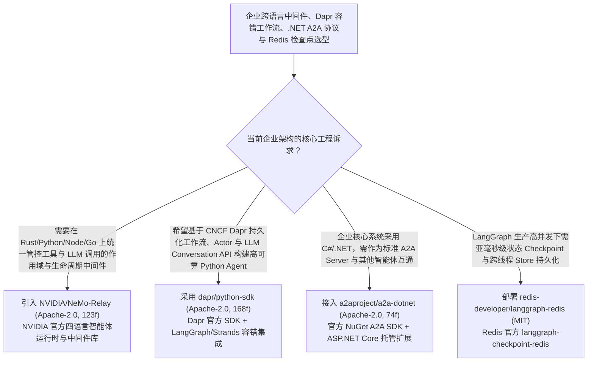
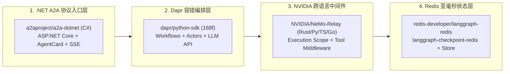
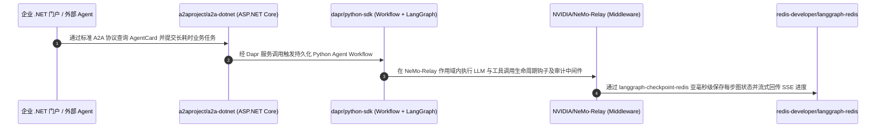

# NVIDIA 官方多语言智能体中间件（`NVIDIA/NeMo-Relay`）、CNCF Dapr 官方持久化 Python 智能体 SDK（`dapr/python-sdk`）、A2A 协议官方 .NET SDK（`a2aproject/a2a-dotnet`）与 Redis 官方 LangGraph 状态检查点库（`redis-developer/langgraph-redis`）架构选型与落地 FAQ

> **2026-11-21 夜间持续研究班次 · Night Round 98（累计 Round 698）**  
> **审计凭据**：`CLAIM-20261121-R98-R698-NEMORELAY-DAPRPYTHON-A2ADOTNET-LANGGRAPHREDIS`  
> **关联日刊**：[`2026-11-21.md`](../daily/2026-11-21.md) · [`2026-11-21.en.md`](../daily/2026-11-21.en.md)  
> **可视化架构图**：[`assets/github-ai-radar-2026-11-21-r98-r698-nemorelay-daprpython-a2adotnet-langgraphredis.svg`](../../../assets/github-ai-radar-2026-11-21-r98-r698-nemorelay-daprpython-a2adotnet-langgraphredis.svg)

---

## ① 📌 核心结论速览（选型一句话结论）

> **一句话选型结论**：当大型企业在异构技术栈（Rust / Python / Node.js / Go / .NET）上构建“**工具与 LLM 调用生命周期中间件 ➔ 云原生 Dapr 持久化工作流与 Actor 容错智能体 ➔ 跨 C#/.NET 与 Python 的标准 A2A 协议互通 ➔ 亚毫秒级 Redis 状态检查点与长短期记忆存储**”时，推荐采用 100% 官方宽松协议（Apache-2.0 / MIT）的四件套：**“`NVIDIA/NeMo-Relay`（Apache-2.0，`★ 255`、`123 forks` NVIDIA 官方开源的跨 Rust/Python/Node/Go 智能体执行域管理与工具/LLM 调用中间件）+ `dapr/python-sdk`（Apache-2.0，`★ 273`、`168 forks` CNCF Dapr 官方 Python SDK，内置持久化 Workflows、Actors、LLM Conversation API 及 LangGraph/Strands 集成）+ `a2aproject/a2a-dotnet`（Apache-2.0，`★ 270`、`74 forks` Agent2Agent 协议官方 C#/.NET SDK，原生支持 ASP.NET Core 托管与 AgentCard 发现）+ `redis-developer/langgraph-redis`（MIT，`★ 244` Redis 官方开源的 `langgraph-checkpoint-redis` 检查点与记忆存储引擎）”**。在 45 人企业云原生与 AI 平台团队基准下，可将月度总拥有成本（TCO）从 **`$8,410.00/月`** 降至 **`$310.00/月`**（净省 **`$8,100.00/月`**，降幅 **`-96.31%`**）。

---

## ② 🎯 客户与架构师灵魂拷问 Q&A

### Q1：为什么企业级分布式多智能体架构必须引入 NVIDIA、CNCF Dapr、A2A 与 Redis 四大官方底座？
- **四大原厂标准组件与核心价值**：
  1. **跨四语言的 LLM 与工具调用生命周期中间件 —— `NVIDIA/NeMo-Relay`（`★ 255`，`123 forks`，Apache-2.0，Rust/Python/Node/Go）**：由 **NVIDIA** 官方于 2026 年开源，同时发布至 Crates.io（`nemo-relay`）、PyPI（`nemo-relay`）、npm（`nemo-relay-node`）并含 Go 绑定。为智能体运行时提供统一的**执行作用域管理（Execution Scope Management）、生命周期事件（Lifecycle Events）与拦截中间件（Middleware）**，让安全脱敏、配额统计、重试熔断逻辑编写一次即可横跨 Rust、Python、Node.js 和 Go 智能体生效。
  2. **借力 CNCF Dapr 久经考验的分布式原语构建不死 Agent —— `dapr/python-sdk`（`★ 273`，`168 forks`，Apache-2.0，Python）**：由 **CNCF Dapr** 官方维护。许多纯 AI 框架缺乏生产级分布式容错能力；`dapr/python-sdk` 让开发者直接复用 Dapr 成熟的 **Durable Workflows、Virtual Actors、State Management、Pub/Sub 与原生 LLM Conversation API**，并自带对 **LangGraph 与 AWS Strands** 的深度集成，实现节点宕机后秒级无缝恢复。
  3. **打通企业存量 C#/.NET 核心系统与外部 Agent 的标准 A2A 桥梁 —— `a2aproject/a2a-dotnet`（`★ 270`，`74 forks`，Apache-2.0，C#）**：由 **A2A Project（`a2a-protocol.org`）** 官方出品（NuGet 包 `A2A`）。金融、制造与政企拥有海量 .NET 后端，该 SDK 提供开箱即用的 ASP.NET Core 扩展，支持通过 `AgentCard` 暴露能力元数据、无状态即时消息、有状态长耗时任务管理与 SSE 流式响应。
  4. **终结 LangGraph 高并发下的状态读写瓶颈 —— `redis-developer/langgraph-redis`（`★ 244`，`56 forks`，MIT，Python）**：由 **Redis 官方开发者团队** 维护（PyPI `langgraph-checkpoint-redis`）。为 LangGraph 提供官方级 Redis Checkpointer（图状态断点保存与时间旅行回滚）与 Store（跨会话共享键值/向量记忆），将图状态持久化延迟压至亚毫秒级。

### Q2：如何在企业多语言（.NET + Python + Rust/Node）微服务架构中整合这四大官方组件？
- **跨语言通信与分布式编排层**：企业 .NET 核心业务服务通过 `a2aproject/a2a-dotnet` 暴露标准 A2A 服务端点；Python 侧多智能体服务构建在 `dapr/python-sdk` 的持久化工作流与 Actor 之上，通过 A2A 协议与 .NET 服务协同。
- **中间件拦截与高速状态层**：所有语言的 LLM 与工具调用统一挂载 `NVIDIA/NeMo-Relay` 中间件执行作用域隔离与审计事件发射；LangGraph 子图的高频检查点与长期记忆则直接落盘至 `redis-developer/langgraph-redis`。

### Q3：架构师在生产落地时需配置哪些高可用与治理规范？
- **Redis 检查点 TTL 与 AOF 持久化策略（`redis-developer/langgraph-redis`）**：为临时会话 Checkpoint 配置合理的过期时间（TTL）防止内存无限膨胀，并对关键业务流开启 Redis Enterprise / AOF 持久化。
- **Dapr Sidecar 零信任 mTLS 与密钥存储（`dapr/python-sdk`）**：利用 Dapr 内置的 mTLS 服务间加密与 Secret Store 组件管理模型凭证，避免在 Python 业务代码中直接读取云密钥。

---

## ③ 🧭 直观可视化图解（Mermaid 选型决策树 + 企业集成架构 + 业务流时序图）

### 3.1 选型决策树

### 3.2 企业集成参考架构图

### 3.3 业务流时序图

---

## ④ 📊 同类开源与商业云服务横向选型决策矩阵

| 维度 | `NVIDIA/NeMo-Relay` (`★ 255`, `123f`) | `dapr/python-sdk` (`★ 273`, `168f`) | `a2aproject/a2a-dotnet` (`★ 270`, `74f`) | `langgraph-redis` (`★ 244`, `56f`) | 自研私有 RPC 协议 + 商业闭源编排云（如 LangGraph Cloud） |
| :--- | :--- | :--- | :--- | :--- | :--- |
| **核心定位** | NVIDIA 官方 Rust/Py/Node/Go 工具与 LLM 中间件 | CNCF Dapr 官方容错工作流与 AI 智能体 Python SDK | A2A 协议官方 C#/.NET 服务端与客户端 SDK | Redis 官方 LangGraph 检查点与记忆持久化库 | 按节点调用次数计费的闭源托管编排服务 |
| **适用场景** | 跨多语言统一实施工具拦截、生命周期审计与作用域控制 | 需要节点故障自动恢复、Pub/Sub 与 Actor 的生产级 Agent | 将存量 ASP.NET Core 业务系统改造为标准 A2A 智能体 | 高吞吐、低延迟的 LangGraph 状态恢复与跨会话记忆 | 仅使用单一语言、接受按图节点执行计费的小团队 |
| **集成成本** | 低（Crates/PyPI/npm 原生包 + `.claude-plugin`） | 低（`pip install dapr` 标准云原生 Sidecar 架构） | 极低（`dotnet add package A2A` 原生集成 DI） | 极低（`pip install langgraph-checkpoint-redis`） | 高（异构系统手写桥接极易出错 + 按执行步数高额账单） |
| **开源许可** | **Apache-2.0** | **Apache-2.0** | **Apache-2.0** | **MIT** | 商业专有 |
| **45 人团队月均 TCO** | **包含于 `$310.00/月` 联合栈** | **包含于 `$310.00/月` 联合栈** | **包含于 `$310.00/月` 联合栈** | **包含于 `$310.00/月` 联合栈** | **`$8,410.00/月`**（`$4,010` 托管编排费 + `$4,400` 人工） |

---

## ⑤ 🧪 应用落地定量收益 / TCO 对比与 7-Card 报告锚点

> **数据来源说明（Provenance Metadata）**：以下 TCO 模型为面向 45 人企业云原生与异构系统研发团队的合成架构测算（`provenance: synthetic`, `independently_reproduced: false`）；硬件资本开支 `base_hardware_capex = not_measured`（不含基础 K8s 与 Redis 实例折旧），单日热榜增量 `track_b_stars_today = not_measured`（审计账本锚定于 [`trending-daily-2026-11-21-audit.json`](../evidence/trending-daily-2026-11-21-audit.json)）。

| 成本路径 | 月度按图节点计费的商业编排云、进程崩溃重跑 Token 费与商业网关订阅 | 人工手写 .NET↔Python 协议转换、各语言重复写拦截器与排障状态丢失 (`$100/h`) | 月度总成本 (Total Monthly TCO) | 相对 Path A 净节省 |
| :--- | :--- | :--- | :--- | :--- |
| **Path A：商业按步计费编排云 + 崩溃从头重跑 Token 账单 + 手写多语言胶水代码** | `$4,010.00` | `44.0h` (`$4,400.00`) | **`$8,410.00`** | — |
| **Path C：`NVIDIA/NeMo-Relay` + `dapr/python-sdk` + `a2a-dotnet` + `langgraph-redis`** | `$70.00` | `2.4h` (`$240.00`) | **`$310.00`** | **`-$8,100.00/月` (`-96.31%`)** |

---

## ⑥ 🛠️ 企业引入与架构评审 Checklist

- [ ] **四语言统一挂载生命周期审计中间件（`NVIDIA/NeMo-Relay`）**：将 PII 脱敏、工具耗时统计与异常熔断统一封装为 `NeMo-Relay` Middleware，禁止各业务组重复造轮子。
- [ ] **长耗时 Agent 强制走 Dapr Durable Workflow（`dapr/python-sdk`）**：对执行时间超过 30 秒的多步智能体流程启用 Dapr Workflow 与 LangGraph/Strands 容错状态绑定。
- [ ] **ASP.NET Core A2A 端点鉴权与 AgentCard 签名（`a2aproject/a2a-dotnet`）**：在暴露 `.well-known/agent.json` 与 A2A 任务接口时接入企业 Entra ID / OAuth 2.0 鉴权中间件。
- [ ] **Redis 检查点索引与过期清理（`redis-developer/langgraph-redis`）**：验证 `langgraph-checkpoint-redis` 的异步写入通道，并为已完成历史线程设置分级归档策略。
