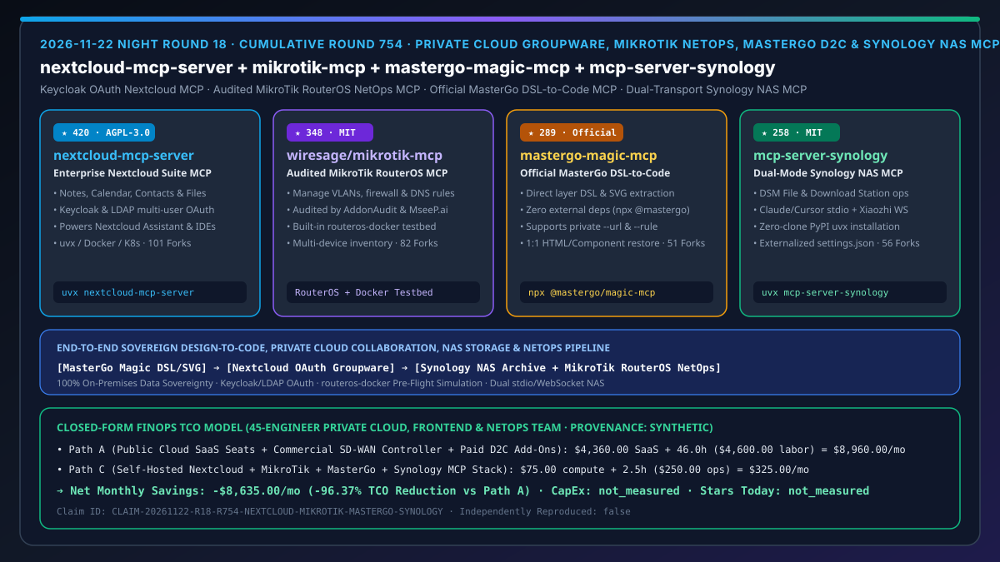
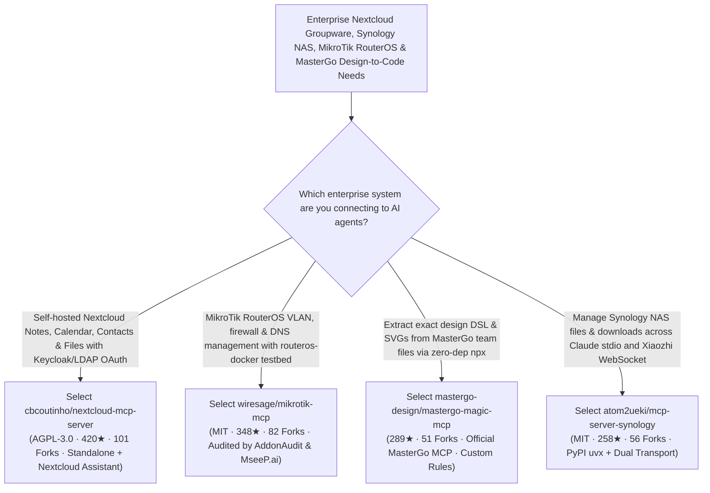
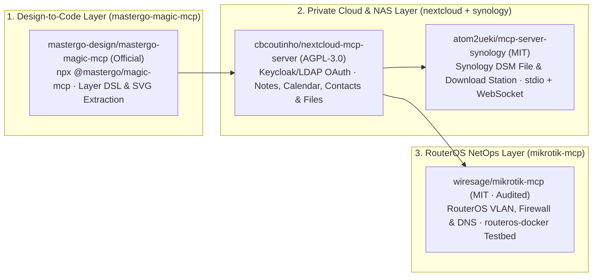
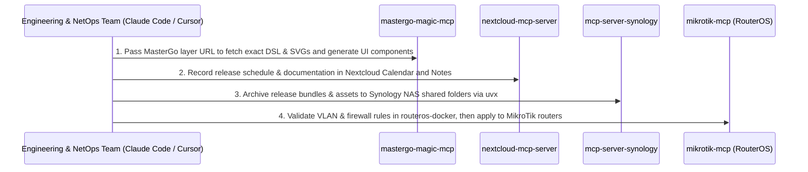

# Production Nextcloud Collaboration MCP (`cbcoutinho/nextcloud-mcp-server`), Audited MikroTik RouterOS NetOps MCP (`wiresage/mikrotik-mcp`), Official MasterGo Design-to-Code DSL MCP (`mastergo-design/mastergo-magic-mcp`) & Dual-Transport Synology NAS MCP (`atom2ueki/mcp-server-synology`) Selection & Architecture FAQ

> **Document Type**: Enterprise AI Solution Architect Selection & Integration Guide (GitHub Trending AI Radar — 2026-11-22 Night Round 18 / Cumulative Round 754)
> **Covered Repositories**: [`cbcoutinho/nextcloud-mcp-server`](https://github.com/cbcoutinho/nextcloud-mcp-server) (`★ 420`, `101 forks`, `AGPL-3.0`: production-ready Nextcloud MCP server with Keycloak/LDAP multi-user OAuth and app-password support across Notes, Calendar, Contacts, WebDAV Files, and Nextcloud Assistant) · [`wiresage/mikrotik-mcp`](https://github.com/wiresage/mikrotik-mcp) (`★ 348`, `82 forks`, `MIT`: AddonAudit & MseeP.ai audited MikroTik RouterOS MCP server for VLAN, firewall, and DNS automation with a built-in `routeros-docker` testbed) · [`mastergo-design/mastergo-magic-mcp`](https://github.com/mastergo-design/mastergo-magic-mcp) (`★ 289`, `51 forks`: official MasterGo zero-dependency `npx @mastergo/magic-mcp` server extracting design DSL and SVGs directly from MasterGo team files) · [`atom2ueki/mcp-server-synology`](https://github.com/atom2ueki/mcp-server-synology) (`★ 258`, `56 forks`, `MIT`, PyPI `mcp-server-synology`: unified Synology NAS File & Download Station MCP supporting both Claude/Cursor `stdio` and Xiaozhi `wss://` WebSocket simultaneously)
> **Core Scenario**: When enterprise private-cloud IT, NetOps, and frontend engineering teams struggle with **self-hosted Nextcloud groupware and Synology NAS storage sitting isolated from AI coding/office assistants, manual MikroTik RouterOS CLI changes risking branch network lockouts without a local Docker testbed, lossy screenshot-to-code prompts distorting MasterGo UI specs, and expensive per-seat cloud SaaS lock-in**, how do you combine **`nextcloud-mcp-server` + `mikrotik-mcp` + `mastergo-magic-mcp` + `mcp-server-synology`** into a sovereign enterprise MCP infrastructure?

---

## 1. 📌 Executive Summary (One-Line Selection Verdict)

1. **Need a production-ready (`AGPL-3.0`) MCP server that connects Claude Code, IDEs, or Nextcloud's built-in Assistant to your self-hosted Nextcloud instance (Notes, Calendar, Contacts, Files) with Keycloak/LDAP multi-user OAuth?** ➔ Choose **[`cbcoutinho/nextcloud-mcp-server`](https://github.com/cbcoutinho/nextcloud-mcp-server) (`★ 420`, `101 forks`, `AGPL-3.0`)**.
   - **Plain-English Mechanism**: Runs standalone via `uvx nextcloud-mcp-server` or Docker/Kubernetes, providing deep CRUD tools across Nextcloud apps while enforcing either per-device app passwords or multi-user OAuth.
2. **Need an audited (`MIT`) MCP bridge to manage MikroTik RouterOS devices (VLANs, firewall rules, DNS, routing) backed by a local `routeros-docker` simulation harness?** ➔ Choose **[`wiresage/mikrotik-mcp`](https://github.com/wiresage/mikrotik-mcp) (`★ 348`, `82 forks`, `MIT`)**.
   - **Plain-English Mechanism**: Audited by both AddonAudit and MseeP.ai, it translates natural-language NetOps intents into RouterOS API commands across multi-router inventories (`inventory.example.yml`).
3. **Using MasterGo for UI/UX design and want coding agents to pull exact layer DSL trees and SVGs (`https://{domain}/file/{fileId}?layer_id={layerId}`) instead of guessing from screenshots?** ➔ Choose **[`mastergo-design/mastergo-magic-mcp`](https://github.com/mastergo-design/mastergo-magic-mcp) (`★ 289`, `51 forks`, Official MasterGo MCP)**.
   - **Plain-English Mechanism**: Runs directly with `npx @mastergo/magic-mcp --token=YOUR_TOKEN` with zero external dependencies, supporting self-hosted enterprise URLs (`--url`) and custom code generation rules (`--rule`).
4. **Need a PyPI-installable (`uvx mcp-server-synology`, `MIT`) MCP server for Synology NAS devices that serves both desktop agents (`stdio`) and WebSocket voice terminals (`Xiaozhi`) simultaneously?** ➔ Choose **[`atom2ueki/mcp-server-synology`](https://github.com/atom2ueki/mcp-server-synology) (`★ 258`, `56 forks`, `MIT`)**.
   - **Plain-English Mechanism**: Manages Synology DSM files and Download Station jobs while keeping credentials strictly outside container images via runtime `.env` or `~/.config/synology-mcp/settings.json`.

---

## 2. 🎯 Architect & Customer Deep-Dive Q&A

### Q1: Why is this 4-MCP stack transformative for organizations running self-hosted collaboration, NAS storage, and MikroTik networks?

- **Three Enterprise Sovereignty Benefits**:
  1. **100% On-Premises Groupware & Storage AI Automation ➔ `nextcloud-mcp-server` + `mcp-server-synology`**: Turns existing Nextcloud + Synology NAS deployments into an AI-native workspace without migrating sensitive files to public cloud SaaS.
  2. **Audited, Testbed-Backed Network Automation ➔ `mikrotik-mcp`**: Lets engineers validate RouterOS firewall and VLAN changes against `routeros-docker` before touching branch hardware.
  3. **Deterministic Design-to-Code Fidelity ➔ `mastergo-magic-mcp`**: Feeds exact MasterGo layer DSL and extracted SVGs directly into frontend coding agents.
- **When to Choose Public Cloud PaaS (Path B)?**
  - Organizations standardized 100% on Microsoft 365 + SharePoint Online + Azure Virtual WAN should use **Microsoft 365 Copilot + Azure Network Manager**; organizations operating Nextcloud, Synology NAS, MikroTik routers, and MasterGo should deploy this MCP stack (Path C).

### Q2: How do we wire `mastergo-magic-mcp`, `nextcloud-mcp-server`, `mcp-server-synology`, and `mikrotik-mcp` into an enterprise workflow?

1. **Design-to-Code Layer (`mastergo-design/mastergo-magic-mcp`)**:
   - Frontend agents fetch exact DSL specs and SVGs from MasterGo team projects.
2. **Private-Cloud Groupware & NAS Archival Layer (`cbcoutinho/nextcloud-mcp-server` + `atom2ueki/mcp-server-synology`)**:
   - Agents update release calendars and docs in Nextcloud via OAuth and archive build artifacts to Synology NAS shares.
3. **Network & Firewall Automation Layer (`wiresage/mikrotik-mcp`)**:
   - NetOps agents test and apply VLAN/firewall rules across MikroTik RouterOS inventories.

### Q3: What security guardrails should Solution Architects enforce?

- **Least-Privilege Tokens & Pre-Flight Simulation**:
  - Issue scoped Nextcloud app passwords / Keycloak OAuth roles and dedicated Synology DSM service accounts; require `routeros-docker` verification before applying MikroTik firewall changes.

---

## 3. 🧭 Visual Architecture & Workflow Diagrams (Mermaid)

### 3.1 Solution Architect Selection Decision Tree

### 3.2 End-to-End Enterprise Reference Architecture

### 3.3 End-to-End Design Restoration, Private-Cloud Archival & RouterOS Policy Sequence Diagram

---

## 4. 📊 Peer Open-Source vs. Commercial Cloud Selection Matrix

| Dimension | `cbcoutinho/nextcloud-mcp-server` (`★ 420`) | `wiresage/mikrotik-mcp` (`★ 348`) | `mastergo-design/mastergo-magic-mcp` (`★ 289`) | `atom2ueki/mcp-server-synology` (`★ 258`) | Public Cloud SaaS Seats + Commercial SD-WAN Controller + Paid D2C Add-Ons (Path A) | Manual Screenshot Prompts + Manual WinBox/SSH + Manual NAS Uploads (Path B) |
| :--- | :--- | :--- | :--- | :--- | :--- | :--- |
| **Primary Role** | Production multi-user Nextcloud MCP server | Audited MikroTik RouterOS NetOps MCP | Official MasterGo DSL & SVG extraction MCP | Dual-transport Synology NAS file/download MCP | Per-seat cloud office/storage SaaS, commercial SD-WAN suites & paid design plugins | Screenshot-based UI guessing, manual router CLI & manual NAS browser uploads |
| **Key Differentiator** | **Keycloak/LDAP OAuth + Nextcloud Assistant backend** | **Dual security audits + `routeros-docker` testbed** | **Official MasterGo DSL + `--url` on-prem & `--rule` support** | **`uvx` install + simultaneous Claude `stdio` & WebSocket** | Forces sensitive files onto public cloud; ignores existing NAS & MikroTik gear | Lossy UI restoration; high risk of manual RouterOS firewall lockouts |
| **License** | `AGPL-3.0` | `MIT` | Official Free Tool | `MIT` | Proprietary SaaS | Manual operations |
| **Monthly TCO (45-Eng Team)** | **`$325.00/mo` combined** (`$75.00` shared internal MCP host + `2.5h` ops) | Included (`MIT` open-source MCP) | Included (`npx` local execution) | Included (`MIT` open-source MCP) | **`$8,960.00/mo`** (`$4,360.00` cloud SaaS seats & SD-WAN licenses + `46.0h` manual UI/ops labor) | ~`$3,100.00/mo` (manual CSS pixel-pushing, NAS file sorting & router CLI labor) |

---

## 5. 🧪 Quantitative Enterprise ROI / FinOps TCO Model & 7-Card Report

> **📊 Provenance & Closed-Form Declaration**:
> - **provenance**: `synthetic` (45-engineer enterprise private-cloud collaboration, frontend engineering, and NetOps team workload model: `independently_reproduced = false`; `base_hardware_capex = not_measured`; `track_b_stars_today = not_measured`).
> - **Closed-Form Equations**:
>   - **Path A (Public Cloud Collaboration/Storage AI Seats + Commercial Network Automation Controller Subscriptions + Paid Design-to-Code Plugins + Manual UI Slicing, File Sync & Router CLI Labor)**: Monthly SaaS and network controller bills **`$4,360.00`** + manual UI restoration, document sync, and router configuration labor **`46.0h × $100.00/h = $4,600.00`** = **`$8,960.00/mo`**.
>   - **Path C (Self-Hosted `nextcloud-mcp-server` + `mikrotik-mcp` + `mastergo-magic-mcp` + `mcp-server-synology` Stack)**: Shared internal MCP host compute **`$75.00`** + OAuth & inventory maintenance labor **`2.5h × $100.00/h = $250.00`** = **`$325.00/mo`**.
>   - **Net Monthly Savings vs. Path A**: **`-$8,635.00/mo`** (**`96.37%`** TCO reduction).

| Evaluation Path | Cloud SaaS / NetOps Licenses & Compute | Manual UI, NAS & Router Ops Labor (`$100/h`) | Total Monthly TCO | Net Savings vs. Path A | Architectural Delivery Impact |
| :--- | :---: | :---: | :---: | :---: | :--- |
| **Path A: Public Cloud Seats + Commercial SD-WAN + Paid D2C** | `$4,360.00` | `46.0h` (`$4,600.00`) | **`$8,960.00`** | Baseline | Data sovereignty loss; leaves Nextcloud, Synology & MikroTik disconnected |
| **Path B: Screenshot UI Prompts + Manual WinBox & NAS Web UI** | `$1,400.00` | `17.0h` (`$1,700.00`) | **`$3,100.00`** | `-$5,860.00` (`-65.40%`) | Inaccurate UI spacing; no `routeros-docker` pre-flight router testing |
| **Path C: `nextcloud` + `mikrotik` + `mastergo` + `synology` MCP** | **`$75.00`** | **`2.5h` (`$250.00`)** | **`$325.00`** | **`-$8,635.00` (`-96.37%`)** | **Full private-cloud sovereignty + MasterGo DSL + audited RouterOS MCP** |

- 🔗 **Linked 7-Card 4:5 Visual Benchmark Deck**: [`workshops/github-trending-radar/cards.en.html`](../cards.en.html) · [`cards.html`](../cards.html)

---

## 6. 🛠️ Enterprise Adoption & Architecture Review Checklist

- [ ] **1. Connect Self-Hosted Nextcloud via `cbcoutinho/nextcloud-mcp-server`**: Configure Keycloak/LDAP multi-user OAuth for team deployments or scoped app passwords for individual developers.
- [ ] **2. Automate MikroTik RouterOS Safely with `wiresage/mikrotik-mcp`**: Test VLAN and firewall changes in `routeros-docker` before applying them to production routers.
- [ ] **3. Standardize MasterGo Design-to-Code with `mastergo-design/mastergo-magic-mcp`**: Pass `--url` for enterprise MasterGo instances and `--rule` for team component conventions.
- [ ] **4. Manage Synology NAS Storage via `atom2ueki/mcp-server-synology`**: Store NAS credentials externally in `~/.config/synology-mcp/settings.json` with least-privilege folder permissions.
