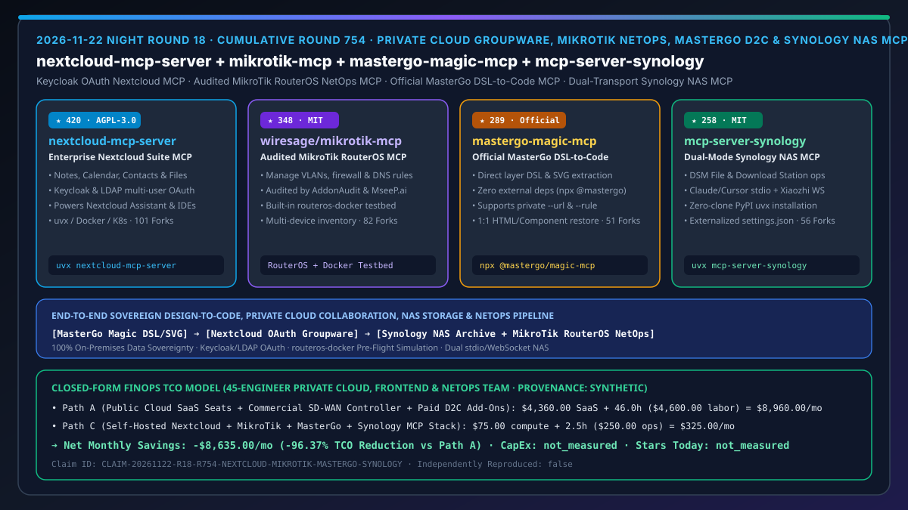
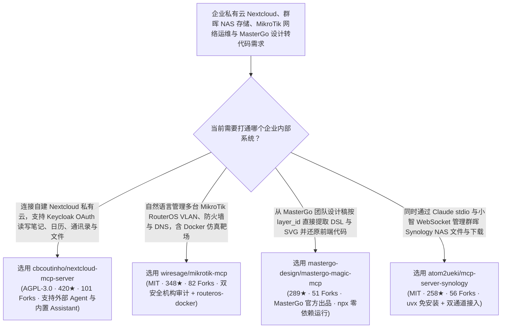
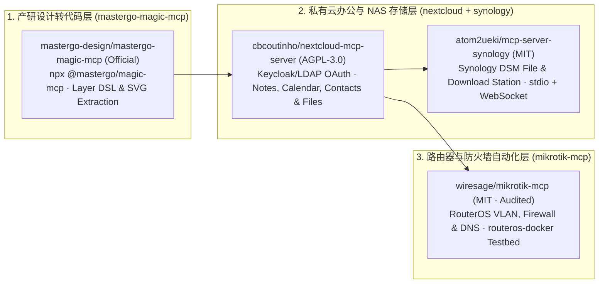
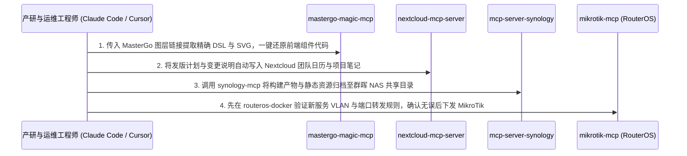

# Nextcloud 企业私有云协同 MCP（`cbcoutinho/nextcloud-mcp-server`）、MikroTik RouterOS 路由器与防火墙自动化 MCP（`wiresage/mikrotik-mcp`）、MasterGo 官方设计稿 DSL 转代码 MCP（`mastergo-design/mastergo-magic-mcp`）与群晖 Synology NAS 双模存储管理 MCP（`atom2ueki/mcp-server-synology`）选型与集成架构 FAQ

> **文档类型**：企业 AI 解决方案架构师（AI Solution Architect）选型决策指南（GitHub Trending AI 雷达 2026-11-22 Night Round 18 / 累计第 754 轮）
> **覆盖项目**：[`cbcoutinho/nextcloud-mcp-server`](https://github.com/cbcoutinho/nextcloud-mcp-server)（`★ 420`、`101 forks`、`AGPL-3.0`，支持 Keycloak/LDAP 多用户 OAuth 与单用户应用密码的生产级 Nextcloud 笔记/日历/通讯录/文件全栈 MCP，同时可作为 Nextcloud 内置 AI 助手后端）· [`wiresage/mikrotik-mcp`](https://github.com/wiresage/mikrotik-mcp)（`★ 348`、`82 forks`、`MIT`，通过 AddonAudit 与 MseeP.ai 安全审计、自带 `routeros-docker` 仿真靶场的 MikroTik RouterOS 网络 VLAN/防火墙/DNS 管理 MCP）· [`mastergo-design/mastergo-magic-mcp`](https://github.com/mastergo-design/mastergo-magic-mcp)（`★ 289`、`51 forks`，MasterGo 官方出品、零外部依赖直接通过 `npx @mastergo/magic-mcp` 提取设计稿 DSL 与 SVG 并还原前端代码的 MCP）· [`atom2ueki/mcp-server-synology`](https://github.com/atom2ueki/mcp-server-synology)（`★ 258`、`56 forks`、`MIT`，同时支持 Claude/Cursor `stdio` 与小智 WebSocket 的群晖 Synology NAS 文件与下载管理 MCP）
> **核心场景**：当企业私有云办公、网络基础设施运维与前端研发团队面临**“自建 Nextcloud 私有云中的日历/笔记/通讯录/网盘无法像 M365 Copilot 一样被 AI 统一读写、分支机构大量的 MikroTik RouterOS 路由器配置 VLAN 与防火墙规则容易敲错 CLI 缺少 `routeros-docker` 预演、国内产研团队使用 MasterGo 设计稿时截图喂给大模型严重走样、以及公司群晖 Synology NAS 海量归档文件无法直接通过对话检索管理”**四大痛点时，如何组合**`nextcloud-mcp-server` + `mikrotik-mcp` + `mastergo-magic-mcp` + `mcp-server-synology`** 打造自主可控的企业私有办公、网络与设计研发 MCP 矩阵？

---

## 一、📌 核心结论速览（选型一句话结论）

1. **想把企业自建的 Nextcloud 开源私有云变成“私有化 Microsoft 365 Copilot”——让 Claude Code、IDE 或 Nextcloud 内置 Assistant 通过 Keycloak/LDAP 多用户 OAuth 安全读写笔记、日历、联系人与网盘文件** ➔ 选 **[`cbcoutinho/nextcloud-mcp-server`](https://github.com/cbcoutinho/nextcloud-mcp-server)（`★ 420`，`101 forks`，`AGPL-3.0`）**。
   - **通俗原理**：通过 `uvx nextcloud-mcp-server run --transport stdio` 或容器化独立部署，打通 Nextcloud 各大核心应用 API，既支持个人 App Password 快速接入，也支持企业级 Keycloak/LDAP OAuth 多租户鉴权。
2. **想让网络运维（NetOps）与安全工程师用自然语言安全管控多台 MikroTik RouterOS 路由器（配置 VLAN、核查防火墙规则、修改 DNS/DHCP），并在下发真机前先在本地 `routeros-docker` 容器靶场验证** ➔ 选 **[`wiresage/mikrotik-mcp`](https://github.com/wiresage/mikrotik-mcp)（`★ 348`，`82 forks`，`MIT`）**。
   - **通俗原理**：已通过 AddonAudit 与 MseeP.ai 第三方安全审计，支持通过 `inventory.yml` 纳管多台 RouterOS 设备，将晦涩的 RouterOS 命令转化为标准化 MCP 工具。
3. **国内设计研发团队使用 MasterGo 进行 UI 协同，想让前端编码 Agent 直接按 `layer_id` 拉取精确的设计稿 DSL 数据与矢量 SVG，1:1 还原为符合团队规范（`--rule`）的前端组件** ➔ 选 **[`mastergo-design/mastergo-magic-mcp`](https://github.com/mastergo-design/mastergo-magic-mcp)（`★ 289`，`51 forks`，MasterGo 官方出品）**。
   - **通俗原理**：零外部依赖，一行 `npx @mastergo/magic-mcp --token=YOUR_TOKEN --url=API_URL` 即可启动，彻底告别“贴截图猜像素间距”的低精度还原。
4. **想让桌面端 Claude/Cursor（通过 `stdio`）以及语音硬件终端（通过小智 WebSocket `wss://`）同时安全操作企业群晖 Synology NAS 上的共享文件夹与离线下载任务** ➔ 选 **[`atom2ueki/mcp-server-synology`](https://github.com/atom2ueki/mcp-server-synology)（`★ 258`，`56 forks`，`MIT`）**。
   - **通俗原理**：直接 `uvx mcp-server-synology` 免克隆即用，将凭证严格隔离在容器外的运行时环境或 `~/.config/synology-mcp/settings.json` 中，杜绝镜像硬编码泄露。

---

## 二、🎯 客户与架构师灵魂拷问 Q&A（深度架构拆解）

### Q1：这套“企业私有基础设施与研发协同四剑客（Nextcloud + Synology + MikroTik + MasterGo）”解决了什么核心架构问题？

- **四大存量资产 AI 化改造价值**：
  1. **私有云办公与 NAS 存储无缝协同 ➔ `nextcloud-mcp-server` + `mcp-server-synology`**：许多注重数据主权的企业采用“Nextcloud 协同办公 + 群晖 Synology NAS 冷热存储”架构，这两款 MCP 让企业无需把文档上传到公有云 SaaS 即可获得全套 AI 助理体验。
  2. **分支机构网络与防火墙变更先仿真后执行 ➔ `mikrotik-mcp`**：利用仓库自带的 `routeros-docker` 靶场先行验证 Agent 生成的 VLAN 与防火墙变更指令，杜绝锁死远程路由器。
  3. **本土化 UI 设计稿直通代码仓库 ➔ `mastergo-magic-mcp`**：MasterGo 官方维护的 DSL 解析协议，支持私有化部署域名（`--url=API_URL`）与团队自定义代码规则（`--rule`）。
- **何时直接用云厂商托管方案（Path B）？**
  - 若企业全员使用公有云 Microsoft 365 + SharePoint Online + Azure Virtual WAN，直接使用 **Microsoft 365 Copilot + Azure Network Manager**；若企业采用自托管 Nextcloud、群晖 NAS、MikroTik 路由设备与 MasterGo 设计平台，则采用本轮开源/官方 MCP 栈（Path C）。

### Q2：典型企业级“设计还原 (`mastergo-magic-mcp`) + 私有云协同 (`nextcloud-mcp`) + NAS 归档 (`synology-mcp`) + 网络运维 (`mikrotik-mcp`)”生产架构怎么搭？

1. **产研设计转代码层（`mastergo-design/mastergo-magic-mcp`）**：
   - 前端工程师在 IDE 中输入 MasterGo 团队项目图层链接，MCP 自动拉取 DSL 与 SVG 生成组件代码。
2. **私有云办公与 NAS 存储底座层（`cbcoutinho/nextcloud-mcp-server` + `atom2ueki/mcp-server-synology`）**：
   - 通过 Keycloak OAuth 接入 `nextcloud-mcp-server` 读写日程与项目笔记，归档大文件则通过 `mcp-server-synology` 自动流转至群晖 NAS。
3. **分支网络与边界防火墙管控层（`wiresage/mikrotik-mcp`）**：
   - NetOps 团队通过 `mikrotik-mcp` 巡检各节点 RouterOS 状态并在 `routeros-docker` 验证策略。

### Q3：如何防范 Agent 误删群晖 NAS 文件或配错 MikroTik 防火墙？

- **最小权限账户 + 仿真靶场双重护栏**：
  - 在 Nextcloud 与群晖 DSM 中为 MCP 创建受限专属账号與 App Password；MikroTik 生产变更强制先在 `routeros-docker` 容器验证通过后再由人工审批执行。

---

## 三、🧭 直观可视化图解（Mermaid 决策树 + 集成架构 + 时序图）

### 3.1 架构师选型决策树

### 3.2 企业端到端生产集成参考架构图

### 3.3 MasterGo 设计还原、Nextcloud/群晖归档与 MikroTik 网络策略联动时序图

---

## 四、📊 同类开源与商业云服务横向选型决策矩阵

| 对比维度 | `cbcoutinho/nextcloud-mcp-server` (`★ 420`) | `wiresage/mikrotik-mcp` (`★ 348`) | `mastergo-design/mastergo-magic-mcp` (`★ 289`) | `atom2ueki/mcp-server-synology` (`★ 258`) | 公有云全家桶按人头订阅 + 商业 SD-WAN 控制器 + 商业 D2C 插件 (Path A) | 手工导设计图 + 手敲 WinBox/SSH 命令 + 手动拖拽网盘 (Path B) |
| :--- | :--- | :--- | :--- | :--- | :--- | :--- |
| **核心能力定位** | Nextcloud 全应用生产级多租户 MCP | MikroTik RouterOS 网络与防火墙自动化 MCP | MasterGo 官方设计稿 DSL 与 SVG 提取 MCP | 群晖 Synology NAS 双模（stdio+WS）管理 MCP | 昂贵的公有云办公/存储全家桶席位与商业网络管理订阅 | 靠肉眼量设计稿像素、手动登录多台路由器与 NAS 网页端 |
| **核心技术突破** | **支持 Keycloak/LDAP OAuth 多用户与内置 Assistant** | **双安全审计背书 + `routeros-docker` 本地仿真靶场** | **官方 DSL 直读 + 支持私有化 API URL 与自定义规则** | **`uvx` 即装即用 + 同时支持桌面 Agent 与语音端 WebSocket** | 数据被迫离开本地机房上公有云；存量群晖与 MikroTik 无法接入 | 截图还原 UI 走样严重；手敲路由器防火墙极易断网锁死 |
| **开源协议** | `AGPL-3.0` | `MIT` | 官方免费工具 | `MIT` | 闭源商业 SaaS | 内部零散脚本 |
| **月度 TCO（45 人团队）** | **组合仅 `$325.00/月`**（`$75.00` 内部 MCP 容器宿主 + `2.5h` 维护） | 同左（`MIT` 免费开源） | 同左（`npx` 本地零成本运行） | 同左（`MIT` 免费开源） | **`$8,960.00/月`**（`$4,360.00` 公有云办公/存储/网管席位 + `46.0h` 人工搬运与切图） | 约 `$3,100.00/月`（大量人工切图还原、手动归档 NAS 与逐台配路由工时） |

---

## 五、🧪 应用落地定量收益/TCO 对比与 7-Card 报告

> **📊 数据来源与闭式核算声明（Provenance & Closed-Form Schema）**：
> - **provenance**: `synthetic`（基于 45 人企业私有云协同、前端产研与网络基础设施团队月度工作负载模型：`independently_reproduced = false`；硬件采购基线 `base_hardware_capex = not_measured`；Track B 单日增量 `track_b_stars_today = not_measured`）。
> - **核算公式**：
>   - **Path A（采购公有云协作与存储按人头 AI 附加包 + 商业网络自动化控制面板订阅 + 商业设计转代码插件 + 工程师手工切图、跨网盘搬运与逐台配置 RouterOS 人工）**：月度商业 SaaS 席位与网管订阅账单 **`$4,360.00`** + 前端手动切图还原、私有云文档整理与网络变更排障人工 **`46.0h × $100.00/h = $4,600.00`** = **`$8,960.00/月`**。
>   - **Path C（自建 `nextcloud-mcp-server` + `mikrotik-mcp` + `mastergo-magic-mcp` + `mcp-server-synology` 企业存量设施 MCP 栈）**：共享内部 MCP 网关容器开销 **`$75.00`** + OAuth 凭证与设备清单维护人工 **`2.5h × $100.00/h = $250.00`** = **`$325.00/月`**。
>   - **净节省（Net Savings vs Path A）**：**`-$8,635.00/月`**（成本降低 **`96.37%`**）。

| 评估方案 | 云服务/网管订阅与算力成本 | 切图还原、归档与网络运维人工（`$100/h`） | 月度总 TCO | 相对 Path A 净节省 | 关键架构交付指标 |
| :--- | :---: | :---: | :---: | :---: | :--- |
| **Path A：公有云协作席位 + 商业网管面板 + 手工切图** | `$4,360.00` | `46.0h` (`$4,600.00`) | **`$8,960.00`** | Baseline | 私有数据被迫上云；存量群晖 NAS 与 MikroTik 成为信息孤岛 |
| **Path B：手工操作 Nextcloud/群晖网页 + 手敲 WinBox + 截图喂 AI** | `$1,400.00` | `17.0h` (`$1,700.00`) | **`$3,100.00`** | `-$5,860.00` (`-65.40%`) | 截图转代码间距失真；缺少 `routeros-docker` 路由器变更预演 |
| **Path C：`nextcloud` + `mikrotik` + `mastergo` + `synology` MCP** | **`$75.00`** | **`2.5h` (`$250.00`)** | **`$325.00`** | **`-$8,635.00` (`-96.37%`)** | **100% 私有云数据主权 + 官方 MasterGo DSL + 路由仿真靶场** |

- 🔗 **关联 7-Card 4:5 视觉评测报告**：[`workshops/github-trending-radar/cards.html`](../cards.html) · [`cards.en.html`](../cards.en.html)

---

## 六、🛠️ 企业引入与架构评审 Checklist

- [ ] **1. 部署 `cbcoutinho/nextcloud-mcp-server` 激活私有云办公资产**：生产多用户环境启用 Keycloak/LDAP OAuth 模式，个人桌面端使用受限 App Password。
- [ ] **2. 使用 `wiresage/mikrotik-mcp` 规范分支路由器自动化运维**：所有防火墙与 VLAN 变更先在 `routeros-docker` 容器验证通过后再对生产设备执行。
- [ ] **3. 前端团队接入 `mastergo-design/mastergo-magic-mcp`**：配置团队项目权限与 `--rule` 自定义代码生成规范，实现设计稿 DSL 像素级还原。
- [ ] **4. 通过 `atom2ueki/mcp-server-synology` 纳管群晖 NAS 存储**：使用 `~/.config/synology-mcp/settings.json` 外部化配置管理共享归档目录。
