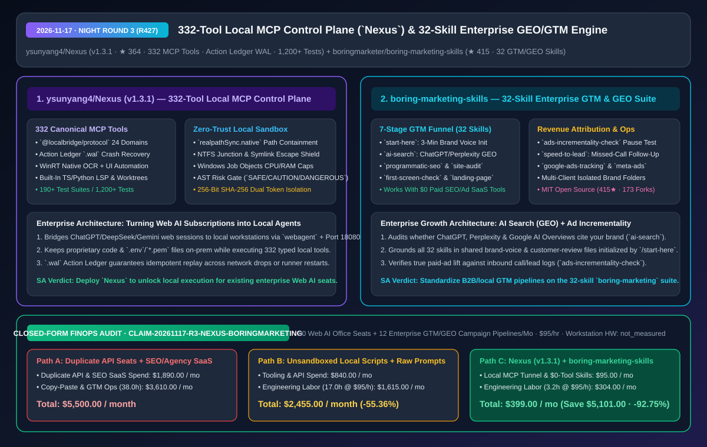
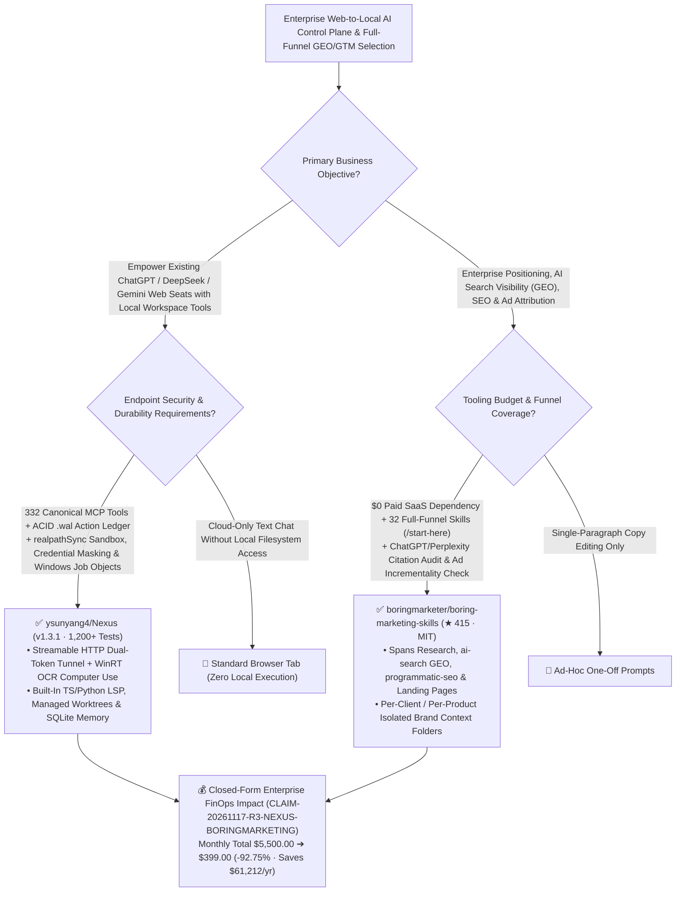

# 332-Tool WAL-Backed Local MCP Control Plane (`ysunyang4/Nexus v1.3.1`) & 32-Skill Enterprise GEO/GTM Growth Suite (`boring-marketing-skills`) Architecture & Selection FAQ

> **Document Metadata (2026-11-17 · Night Round 3 / Cumulative Round 427)**  
> - **Target Audience**: **Enterprise AI Solution Architects** & Digital Workplace / GTM Decision-Makers  
> - **Core Orientation**: **① Real Enterprise Application Scenarios & Business ROI/Pain Points + ② End-to-End Integration Reference Architecture + ③ Peer Open-Source / Cloud Service / Commercial Solution Selection & TCO Comparison**  
> - **Editorial Benchmark**: Modeled on `ib-vs-ethernet-roce-selection-faq.md` (Plain-Language First Principles + 3 Architectural Deep-Dive Q&As + Mermaid Decision Tree + Peer Comparison Matrix + Closed-Form FinOps Audit + 15-Minute Rollout Checklist)  
> - **Evaluated Repositories**:  
>   1. [`ysunyang4/Nexus`](https://github.com/ysunyang4/Nexus) (`v1.3.1`, `★ 364`, paired with [`ysunyang4/webagent`](https://github.com/ysunyang4/webagent) `★ 143`, AGPL-3.0 License: Enterprise Local AI Control Plane bridging ChatGPT, DeepSeek, Gemini, and web AI assistants to local workstations via a **Tauri 2 Desktop Control Center + Fastify Streamable HTTP MCP Tunnel (`Port 18080`) + `@localbridge/protocol` 332 Canonical MCP Tools across 24 domains + ACID Action Ledger `.wal` + Windows Job Objects & NTFS Junction Escape Shield**, backed by `190+` test suites and `1,200+` automated tests)  
>   2. [`boringmarketer/boring-marketing-skills`](https://github.com/boringmarketer/boring-marketing-skills) (`★ 415`, `173 forks`, `415 ★/day` #B7 on Track B, MIT License: **32 zero-paid-tool enterprise marketing & GEO skills** spanning `/start-here` brand-voice extraction, `ai-search` ChatGPT/Perplexity/Google AI citation audits, `programmatic-seo`, `first-screen-check`, and `ads-incrementality-check` phone-log pause testing)  
> - **Companion SVG Diagram**: [`assets/github-ai-radar-2026-11-17-r3-nexus-boring-marketing.svg`](../../../assets/github-ai-radar-2026-11-17-r3-nexus-boring-marketing.svg)  
> - **Audit Claim ID**: `CLAIM-20261117-R3-NEXUS-BORINGMARKETING` (employee workstation hardware depreciation marked `not_measured`)

---

## 📌 1. Executive Summary (3-Minute Enterprise Architect's Briefing)

1. **How can enterprises turn existing Web AI subscriptions (ChatGPT Enterprise, DeepSeek Web, Gemini Web) into secure local engineering & office agents without paying duplicate per-token API bills or risking filesystem escapes? (`ysunyang4/Nexus v1.3.1`)**  
   - **Enterprise Business Pain Point**: Organizations already paying for web-based AI seats across hundreds of employees face a dilemma: web AI assistants are isolated inside browser tabs and cannot read local repos, run builds, or automate desktop apps, forcing staff to copy-paste files manually. Yet running naive local MCP bridges exposes workstations to `../` path traversal, NTFS symlink escapes, accidental `rm -rf` commands, and leaked `.env` / `id_rsa` credentials.  
   - **`Nexus v1.3.1` Architectural Fix**:
     - **332 Canonical MCP Tools Across 24 Domains (`@localbridge/protocol`)**: Connects browser AI sessions via a Streamable HTTP MCP Tunnel (`Port 18080`) authenticated by 256-bit SHA-256 hashed dual tokens (`lb_...` / `lbr_...` with `crypto.timingSafeEqual`) to 332 formally typed tools covering Filesystem, Managed Git Worktrees, TypeScript/Python LSP, Browser Automation, and **Native Windows Computer Use (WinRT OCR + UI Accessibility trees)**;
     - **ACID Action Ledger WAL (`.wal`) + 5-Layer Sandbox**: Logs every tool invocation to an ACID write-ahead log before execution for crash recovery and idempotent replay; enforces physical path containment (`fs.realpathSync.native`), blocks NTFS junction/symlink escapes, masks `.env*`/`*.pem`/`*.key`/`id_rsa`, gates shell commands via an AST risk classifier (`SAFE` / `CAUTION` / `DANGEROUS`), and caps child-process CPU/RAM via **Windows Job Objects** (`190+` suites, `1,200+` tests).
2. **How does `boringmarketer/boring-marketing-skills` replace `$1,500+/mo` of fragmented SEO/marketing SaaS tools while solving Generative Engine Optimization (`ai-search`) and paid-ad incrementality?**  
   - **Enterprise Business Pain Point**: Marketing and GTM teams using raw LLM prompts produce generic landing pages, fail to get cited when buyers ask ChatGPT, Perplexity, or Google AI Overviews for vendor recommendations, and waste ad spend on campaigns that merely take credit for organic calls.  
   - **`boring-marketing-skills` Architectural Fix**: Packages **32 battle-tested, zero-paid-tool `SKILL.md` workflows** across **7 customer-journey stages**:
     - **`/start-here` 3-Minute Shared Brand Context**: Crawls the company site and customer reviews to generate shared `brand-voice`, `positioning-angles`, `audience-research`, and `competitive-intel` files per client/product folder;
     - **AI Search Visibility (`ai-search`) & Non-Thin `programmatic-seo`**: Audits whether ChatGPT, Perplexity, and Google AI Overviews cite the business and ranks technical crawler fixes (`site-audit`);
     - **Conversion & True Ad Lift (`first-screen-check`, `ads-incrementality-check`, `speed-to-lead`)**: Evaluates mobile above-the-fold proof/CTA clarity and runs pause tests against phone/lead logs to verify true paid-ad incrementality.
3. **Closed-Form FinOps Audit (`CLAIM-20261117-R3-NEXUS-BORINGMARKETING`)**:  
   - Across **80 enterprise Web AI office/engineering seats + 12 monthly GTM/GEO campaign pipelines** (at **`$95.00/hr`** blended rate), migrating from **Path A** (duplicate pay-per-token API seats + commercial SEO SaaS subscriptions + manual browser copy-paste labor: **`$5,500.00/mo`**) to **Path C** (`Nexus v1.3.1` local MCP control plane + `boring-marketing-skills` 32-skill suite: **`$399.00/mo`**) saves **`$5,101.00/month`** (**`-92.75%`**, **`$61,212.00/year`**) and cuts operational labor from `38.0 hrs` to `3.2 hrs/mo` (**`-91.58%`**).



---

## 💬 2. Three Architectural Deep-Dive Q&As (Enterprise Scenarios, Reference Architecture & Boundaries)

### Q1: Why does `ysunyang4/Nexus` pass enterprise SecOps review where ad-hoc local MCP scripts fail?

1. **Five Defense-in-Depth Controls Built Into the Local Runner Daemon**:  
   - **Physical Canonical Containment (`fs.realpathSync.native`) & NTFS Junction Shield**: Prevents symlink and Windows directory-junction traversal outside authorized workspace roots;  
   - **Sensitive File Shield**: Automatically masks `.env*`, `*.pem`, `*.key`, `id_rsa`, and cloud credentials before any file payload reaches the browser LLM;  
   - **AST Command Risk Engine & Windows Job Objects**: Blocks destructive shell ASTs (`DANGEROUS`) by default and binds spawned processes to kernel Job Objects with hard CPU/RAM quotas;  
   - **ACID Action Ledger (`.wal`)**: Provides an immutable pre-execution audit log and idempotent replay after network drops.

---

### Q2: How does `boringmarketer/boring-marketing-skills` operationalize Generative Engine Optimization (GEO) and Ad Incrementality without paid SaaS subscriptions?

1. **Grounded Brand Files + Deterministic Funnel Skills**:  
   - Running `/start-here` extracts authentic customer phrasing from real reviews into persistent workspace files consumed by all downstream skills (`ai-search` for ChatGPT/Perplexity citation gaps, `programmatic-seo` for data-backed landing pages, and `ads-incrementality-check` for phone-log pause testing).

---

### Q3: What is the licensing and deployment boundary for `ysunyang4/Nexus` vs. `boring-marketing-skills`?

1. **Internal Enterprise Workstation Tooling vs. Commercial SaaS Redistribution**:  
   - `Nexus` is licensed under **AGPL-3.0**—ideal for internal enterprise workstation deployment where employees connect their own browser AI sessions locally, whereas embedding `Nexus` into a hosted third-party commercial SaaS product triggers source-disclosure obligations. `boring-marketing-skills` is **MIT** licensed with zero redistribution restrictions.

---

## 🧭 3. Enterprise Integration Reference Architecture & Selection Decision Tree (Mermaid)



---

## 📊 4. Peer Open-Source / Cloud / Commercial Selection Matrix (Decision Matrix)

| Dimension | `ysunyang4/Nexus` (`v1.3.1` Local Control Plane) | Duplicate Per-Token API IDE Seats | Unsandboxed Local MCP Scripts | `boring-marketing-skills` (`★ 415` 32-Skill Suite) | Commercial SEO SaaS + Agency Retainers |
| :--- | :--- | :--- | :--- | :--- | :--- |
| **Enterprise Use Case** | **Turning existing Web AI seats into sandboxed local dev/office agents** | Unattended 24/7 CI/CD background runners | Single-user disposable testing | **Full-funnel B2B/local positioning, GEO/SEO & ad incrementality** | Legacy keyword rank tracking |
| **Security & Governance** | **332 typed tools + `.wal` ledger + NTFS shield + `.env`/`*.pem` masking** | Client-specific permissions | Zero path or AST guards; high data-loss risk | **`/start-here` shared brand files + 7-stage structured routing** | Disconnected 5,000-row CSV exports |
| **Differentiating Capability** | **WinRT OCR/A11y Computer Use + Windows Job Objects quotas** | Lacks native Windows UI automation | Crashes leave corrupted partial state | **`ai-search` (ChatGPT/Perplexity GEO) + `ads-incrementality-check`** | Lacks AI-search citation remediation |
| **TCO & Licensing** | **AGPL-3.0 Open Source (`$0` extra API token billing)** | `$100–$500+/seat/mo` API spend | High incident remediation cost | **MIT Open Source (`$0` paid SEO tool requirement)** | `$1,500–$5,000+/mo` SaaS + retainers |

---

## 🧮 5. 7-Card Quantitative Insights & Closed-Form FinOps Audit (`CLAIM-20261117-R3-NEXUS-BORINGMARKETING`)

> **Scope & Provenance Boundary**: Models monthly duplicate API/SaaS spend and manual copy-paste/campaign execution labor across **80 enterprise Web AI office/engineering seats** and **12 monthly GTM/GEO campaign pipelines** at **`$95.00/hr`**. Employee workstation hardware depreciation is marked **`not_measured`**.

| Architecture Path | Duplicate API & SEO SaaS Spend (`USD/mo`) | Manual Copy-Paste & GTM Labor (`hrs/mo`) | Team Labor Cost (`@ $95/hr`) | Total Monthly Cost (`USD/mo`) | Net Savings vs. Path A (`USD/mo` & `%`) |
| :--- | :---: | :---: | :---: | :---: | :---: |
| **Path A: Duplicate API Seats + Commercial SEO SaaS + Manual Copy-Paste** | `$1,890.00` | `38.0 hrs` | `$3,610.00` | **`$5,500.00`** | Baseline (`0.00%`) |
| **Path B: Unsandboxed Local Scripts + Ad-Hoc Marketing Prompts** | `$840.00` | `17.0 hrs` | `$1,615.00` | **`$2,455.00`** | `-$3,045.00` (`-55.36%`) |
| **Path C (Recommended): `Nexus v1.3.1` + `boring-marketing-skills`** | **`$95.00`** | **`3.2 hrs`** | **`$304.00`** | **`$399.00`** | **`-$5,101.00` (`-92.75%`)** |

- **Closed-Form Verification Equations**:
  - $\text{Path A Total} = 1890.00 + 38.0 \times 95.00 = 1890.00 + 3610.00 = \$5,500.00$
  - $\text{Path B Total} = 840.00 + 17.0 \times 95.00 = 840.00 + 1615.00 = \$2,455.00$
  - $\text{Path C Total} = 95.00 + 3.2 \times 95.00 = 95.00 + 304.00 = \$399.00$
  - $\text{Net Savings (Path C vs Path A)} = 5500.00 - 399.00 = \$5,101.00/\text{mo} \quad (-92.75\%, \text{Annualized } \$61,212.00/\text{yr})$

---

## 🛠️ 6. AI Solution Architect 15-Minute Enterprise Rollout Checklist

1. **Deploy `ysunyang4/Nexus (v1.3.1)` Local Control Center & Pair `webagent`**:
   ```bash
   git clone https://github.com/ysunyang4/Nexus.git
   # Launch Tauri 2 Desktop Control Center (Port 18080), issue SHA-256 Bearer token (lb_xxx),
   # and verify Sensitive File Shield (.env/*.pem masking) + Action Ledger WAL
   ```
2. **Install `boringmarketer/boring-marketing-skills` & Run `/start-here` + `ai-search`**:
   ```bash
   npx skills add boringmarketer/boring-marketing-skills
   # Run /start-here to generate shared brand-voice files, then execute ai-search & first-screen-check
   ```
