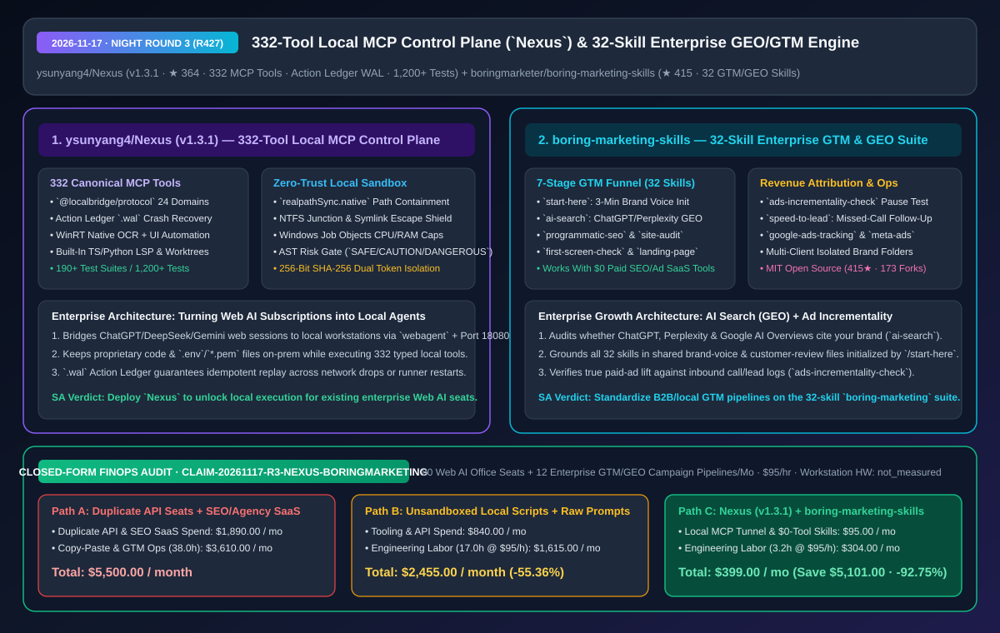
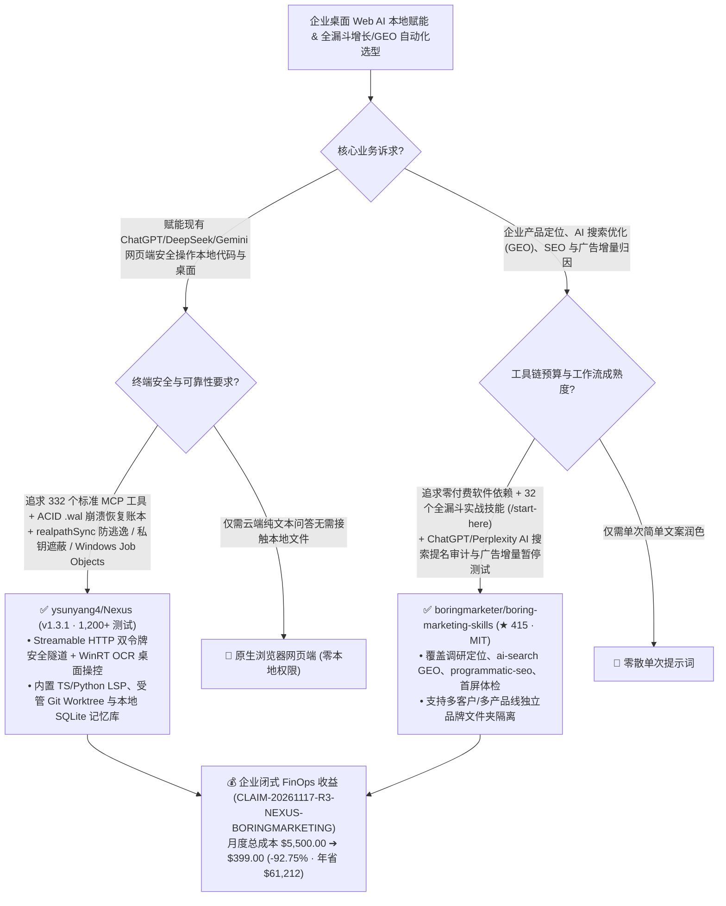

# 网页版大模型受控本地办公控制面（`ysunyang4/Nexus v1.3.1`）与 32 技能企业全漏斗 GEO/营销增长引擎（`boring-marketing-skills`）深度选型 FAQ

> **文档元数据（2026-11-17 · Night Round 3 / 累计 Round 427）**  
> - **目标读者**：面向企业客户与业务决策者的 **AI Solution Architect（AI 解决方案架构师）**  
> - **核心导向**：**① 真实企业应用场景落地（ROI 与业务痛点） + ② 端到端集成参考架构设计 + ③ 同赛道开源/云服务/商业方案横向选型比较（含闭式 TCO 与适用边界）**  
> - **对标范式**：严格对标 `ib-vs-ethernet-roce-selection-faq.md`  
> - **核心评估对象**：  
>   1. [`ysunyang4/Nexus`](https://github.com/ysunyang4/Nexus)（`v1.3.1`，`★ 364`，配套浏览器扩展 [`ysunyang4/webagent`](https://github.com/ysunyang4/webagent) `★ 143`，AGPL-3.0 协议：面向 ChatGPT、DeepSeek、Gemini、Kimi 等网页版 AI 助手的企业级本地控制面；基于 **Tauri 2 桌面中控 + Fastify Streamable HTTP MCP 隧道（Port 18080）+ `@localbridge/protocol` 332 个标准 MCP 工具 + ACID `.wal` 动作账本 + Windows Job Objects / NTFS 越界护盾**，通过 `190+` 测试套件与 `1,200+` 自动化测试验证）  
>   2. [`boringmarketer/boring-marketing-skills`](https://github.com/boringmarketer/boring-marketing-skills)（`★ 415`，`173 Forks`，建仓首日 `415★/天` 新仓飙升榜 #B7，MIT 协议：涵盖定位调研、AI 搜索优化 GEO `ai-search`、程序化 SEO、首屏转化自检、广告增量暂停测试 `ads-incrementality-check` 与漏接来电秒回的 **32 个零付费工具企业增长 Agent 技能包**）  
> - **配套架构图**：[`assets/github-ai-radar-2026-11-17-r3-nexus-boring-marketing.svg`](../../../assets/github-ai-radar-2026-11-17-r3-nexus-boring-marketing.svg)  
> - **审计契约号**：`CLAIM-20261117-R3-NEXUS-BORINGMARKETING`（员工办公电脑折旧标注为 `not_measured`）

---

## 📌 一、核心结论速览（Executive Summary：3 分钟读懂企业落地价值与 ROI）

1. **为什么企业明明已经给员工采购了 ChatGPT / DeepSeek / Gemini 网页版账号，办公与研发人员却依然每天花大量时间“手工复制粘贴本地文件与报错信息”？`ysunyang4/Nexus (v1.3.1)` 如何安全打通“网页版 AI ➔ 本地受控执行”？**  
   - **真实企业痛点**：许多企业出于预算控制或统一采购，为员工开通了网页端大模型订阅（或企业内网 Web AI 门户），但不想再按 Token 为全员额外部署昂贵的 API 编码客户端。然而网页版 AI 被困在浏览器沙盒里，既读不到员工电脑上的工程代码与 Excel 报表，也无法运行本地编译测试；如果让员工直接运行无保护的本地脚本桥接，又存在 `../` 目录穿越、误删系统盘、泄露 `.env`/`id_rsa` 私钥的巨大安全隐患。  
   - **`Nexus v1.3.1` 的企业级安全控制面破局**：
     - **332 个形式化定义的标准 MCP 工具（`@localbridge/protocol`）**：通过 `webagent` 浏览器扩展与本机 `18080` 端口建立带 256-bit SHA-256 双令牌鉴权（`lb_...` / `lbr_...`，采用 `crypto.timingSafeEqual` 防计时攻击）的 Streamable HTTP MCP 隧道，提供覆盖文件系统、Git Worktree、TS/Python LSP 代码智能、浏览器自动化与 **Windows 原生 Computer Use（WinRT OCR + UI 无障碍树定位）** 的 24 大类 332 个工具；
     - **ACID 预写式动作账本（Action Ledger `.wal`）+ 多层物理沙盒**：每次工具调用在产生副作用前先写入 `.wal` 预写日志，断网或崩溃重启后自动幂等恢复；底层通过 `fs.realpathSync.native` 物理路径锁死、拦截 Windows NTFS 软链接/目录联接（Junction）逃逸、自动遮蔽 `.env*`/`*.pem`/`*.key`、基于 AST 拦截高危命令（`SAFE / CAUTION / DANGEROUS`），并用 **Windows Job Objects** 硬性限制子进程 CPU 与内存配额！
2. **在生成式 AI 搜索（ChatGPT Search、Perplexity、Google AI Overviews）抢占传统搜索流量的今天，企业营销与增长团队如何用 `boringmarketer/boring-marketing-skills` 替代动辄数千美元/月的碎片化营销 SaaS？**  
   - **真实企业痛点**：企业市场部用通用提示词写出的着陆页和推文千篇一律（充满 AI 味），在 ChatGPT 和 Perplexity 里搜行业关键词时自家品牌根本不被推荐（缺乏 GEO 优化），且每月花大把预算投 Google/Meta 广告却分不清到底是广告带来了增量客户，还是仅仅抢了自然流量的功劳。  
   - **`boring-marketing-skills` 的全漏斗工程化破局**：将真实实战战役浓缩为 **7 大阶段、32 个开箱即用且无需购买任何付费 SEO 软件的标准化技能（`SKILL.md`）**：
     - **`/start-here` 3 分钟建立单客户品牌资产库**：自动抓取官网与真实客户评价，生成后续 31 个技能共用的品牌语调（`brand-voice`）、差异化切入角（`positioning-angles`）与竞品差评分析（`competitive-intel`），支持按客户分独立目录隔离；
     - **AI 搜索可见度审计（`ai-search`）与防薄页程序化 SEO（`programmatic-seo`）**：专门检测 ChatGPT、Perplexity 与 Google AI 是否提名企业品牌并给出结构化修复方案；
     - **移动端首屏体检（`first-screen-check`）与广告真实增量测试（`ads-incrementality-check`）**：站在手机用户视角检查首屏是否包含核心承诺、社会证明与拨号入口，并通过对照通话记录执行暂停测试，验证广告是否真正带来增量线索。
3. **闭式 FinOps 审计结论（`CLAIM-20261117-R3-NEXUS-BORINGMARKETING`）**：  
   - 按 **80 席企业网页版 AI 办公/研发席位 + 每月 12 条产品线 GTM/GEO 增长营销战役**（综合时薪 **`$95.00/hr`**）核算：从“Path A：重复购买按量 API 席位與高价 SEO/营销 SaaS 订阅 + 人工在浏览器与本地文件间复制粘贴”（月均 **`$5,500.00`**，含 `$1,890.00` 重复 API 与营销 SaaS 订阅费 + `38.0h` 手工搬运与改稿工时 `$3,610.00`）切换到“Path C：`Nexus v1.3.1` 受控本地 MCP 控制面 + `boring-marketing-skills` 32 技能全漏斗增长套件”（月均 **`$399.00`**，含 `$95.00` 极简基础设施开销 + `3.2h` 审核工时 `$304.00`），每月净省 **`$5,101.00`**（降本 **`92.75%`**，年化节省 **`$61,212.00`**），人工操作工时缩减 **`91.58%`**。



---

## 💬 二、AI 解决方案架构师灵魂三问（企业场景、参考架构与落地边界）

### Q1：相比直接给员工装无沙盒的本地命令行脚本，为什么企业安全团队（SecOps）更容易批准 `ysunyang4/Nexus` 的五层防御架构？

1. **攻克企业终端 AI 落地的四大安全红线**：  
   - **物理路径与符号链接防逃逸**：很多簡易 MCP 文件服务只做字符串前缀比对，攻击者或幻觉指令可通过 NTFS Junction 或软链接读取项目目录外的机密文件；`Nexus` 强制使用 `fs.realpathSync.native` 解析物理真实路径并拦截一切跨界链接；  
   - **凭证零泄露护盾（Sensitive File Shield）**：在底层协议层自动屏蔽 `.env*`、`*.pem`、`*.key`、`id_rsa` 与云凭据文件，确保网页端大模型永远读不到明文密钥；  
   - **AST 命令风险分级与 Windows Job Objects 资源铁笼**：通过语法树解析拦截破坏性系统调用，并用 Windows 内核级 Job Objects 绑定子进程树，防止失控脚本耗尽办公机内存或残留僵尸进程；  
   - **ACID `.wal` 动作账本可审计回放**：所有 332 个工具的调用参数、风险评级与证据均落盘 SQLite WAL，满足企业安全合规事后追溯要求。

---

### Q2：企业在做 B2B 或本地生活业务获客时，`boring-marketing-skills` 是如何消除“AI 营销套话（Marketing Slop）”并打通 GEO（生成式引擎优化）的？

1. **先建共享事实底座（Shared Brand Context），再分阶段调用专职技能**：  
   - 通用大模型写营销文案之所以假大空，是因为每次都在零上下文下自由发挥。`boring-marketing-skills` 强制以 `/start-here` 为入口，先从企业现有网站、客户真实好评与竞品差评中提取客户原话（Voice of Customer）落盘为本地品牌文件；  
   - 随后在 **Get Found** 阶段结合 `ai-search`（检查大模型引用缺失原因）与 `site-audit`（模拟 Google 与 AI 爬虫抓取障碍），在 **Get Chosen / Get the Call** 阶段用 `first-screen-check` 与 `ads-incrementality-check` 闭环转化率，全流程无需购买高价第三方 SEO 工具。

---

### Q3：这两套工具在企业内部如何组合形成“零 API 额外开销的本地市场与研发自动化工作站”？

1. **Web AI + `Nexus` 本地控制面 + `boring-marketing-skills` 本地品牌目录**：  
   - 市场与产品人员直接在浏览器里的企业 ChatGPT / DeepSeek 网页端通过 `Nexus` (`webagent`) 挂载本地工作区，直接调用本地安装的 `boring-marketing-skills` 读写各产品线独立文件夹、运行本地站点爬虫审计并生成可发布的着陆页代码！

---

## 🧭 三、企业端到端集成参考架构与选型决策树（Mermaid）



---

## 📊 四、同赛道开源 / 云服务 / 商业方案横向选型矩阵（Decision Matrix）

| 选型评估维度 | `ysunyang4/Nexus` (`v1.3.1` 本地 MCP 控制面) | 全员额外部署按量计费 API 客户端 | 简易无沙盒本地 MCP 脚本 | `boring-marketing-skills` (`★ 415` 32 技能增长包) | 传统商业 SEO SaaS + 外包代运营 |
| :--- | :--- | :--- | :--- | :--- | :--- |
| **核心应用场景** | **复用企业现有网页版 AI 账号安全执行本地研发、文档与桌面自动化** | 重度全天候无人值守 CI/CD 流水线 | 个人开发者临时测试 | **企业 B2B/本地业务全漏斗定位、GEO/SEO 获客与广告增量验证** | 传统搜索排名监控报表 |
| **架构与安全护栏** | **332 标准工具 + `.wal` 预写账本 + 物理路径/NTFS 护盾 + 私钥遮蔽** | 依赖客户端自身权限控制 | 无路径隔离与 AST 风险拦截，极易误删或泄密 | **`/start-here` 沉淀客户原话品牌库 + 7 阶段 32 技能结构化路由** | 工具割裂，导出 5,000 行关键词表却无落地转化页 |
| **差异化核心能力** | **WinRT 原生 OCR/无障碍树定位 + Windows Job Objects 进程限额** | 无原生 Windows GUI 语义操控 | 崩溃后状态丢失、断网重复执行 | **`ai-search` 审计大模型提名 + `ads-incrementality-check` 通话增量检验** | 缺乏针对 ChatGPT/Perplexity 的 GEO 优化能力 |
| **TCO 成本与开源协议** | **AGPL-3.0 开源（复用现有网页端订阅，`$0` 额外 Token 税）** | 每席位每月额外 `$100–$500+` API 账单 | 隐性安全事故风险极高 | **MIT 开源免费，32 个技能全部基于免费公开数据运行** | SaaS 订阅 + 代运营动辄 `$1,500–$5,000+/月` |

---

## 🧮 五、7-Card 定量洞察与企业闭式 FinOps 核算（`CLAIM-20261117-R3-NEXUS-BORINGMARKETING`）

> **核算范围与边界声明**：本模型核算 **80 席企业网页版 AI 办公/研发人员** 的本地工具赋能成本，以及 **每月 12 条产品线 GTM/GEO 营销获客战役** 的软件订阅与人工操作成本（按 **`$95.00/hr`** 计价）；员工办公电脑硬件折旧标注为 **`not_measured`**。

| 架构选型路径 | 重复 API 与营销 SaaS 订阅 (`USD/月`) | 手工复制粘贴与营销改稿工时 (`hrs/月`) | 团队人力成本 (`@ $95/hr`) | 月度总成本 (`USD/月`) | 相对 Path A 净节省 (`USD/月` & `%`) |
| :--- | :---: | :---: | :---: | :---: | :---: |
| **Path A：全员额外部署按量 API + 商业 SEO SaaS + 人工跨窗口搬运** | `$1,890.00` | `38.0 hrs` | `$3,610.00` | **`$5,500.00`** | Baseline (`0.00%`) |
| **Path B：散装无沙盒本地脚本 + 零散营销提示词模板** | `$840.00` | `17.0 hrs` | `$1,615.00` | **`$2,455.00`** | `-$3,045.00` (`-55.36%`) |
| **Path C（推荐）：`Nexus v1.3.1` 控制面 + `boring-marketing-skills`** | **`$95.00`** | **`3.2 hrs`** | **`$304.00`** | **`$399.00`** | **`-$5,101.00` (`-92.75%`)** |

- **闭式校验公式**：
  - $\text{Path A Total} = 1890.00 + 38.0 \times 95.00 = 1890.00 + 3610.00 = \$5,500.00$
  - $\text{Path B Total} = 840.00 + 17.0 \times 95.00 = 840.00 + 1615.00 = \$2,455.00$
  - $\text{Path C Total} = 95.00 + 3.2 \times 95.00 = 95.00 + 304.00 = \$399.00$
  - $\text{Net Savings (Path C vs Path A)} = 5500.00 - 399.00 = \$5,101.00/\text{mo} \quad (-92.75\%, \text{Annualized } \$61,212.00/\text{yr})$

---

## 🛠️ 六、AI 解决方案架构师 15 分钟企业落地 Checklist

1. **部署 `ysunyang4/Nexus (v1.3.1)` 本地受控 MCP 控制面并配对浏览器扩展**：
   ```bash
   git clone https://github.com/ysunyang4/Nexus.git
   # 启动 Tauri 2 桌面控制中心 (Port 18080)，生成 SHA-256 隔离 Bearer Token (lb_xxx)
   # 在受控项目根目录启用 Sensitive File Shield (.env/*.pem 遮蔽) 与 Action Ledger WAL
   ```
2. **安装 `boringmarketer/boring-marketing-skills` 并初始化企业品牌资产库**：
   ```bash
   npx skills add boringmarketer/boring-marketing-skills
   # 在 Agent 中运行 /start-here 初始化品牌语调，依次执行 ai-search (GEO 审计) 与 first-screen-check
   ```
