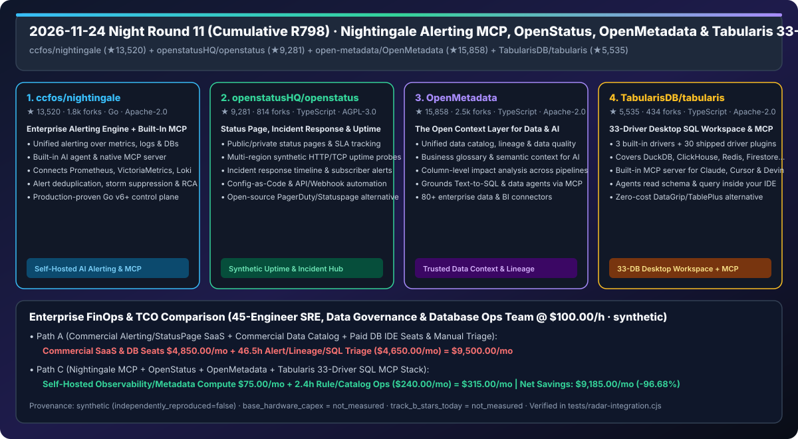
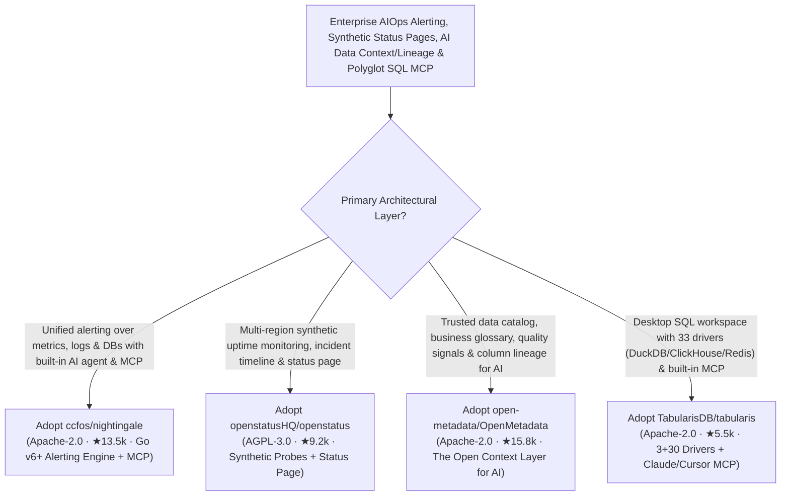
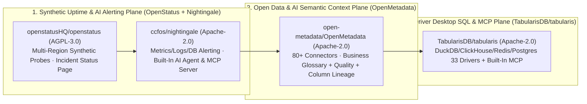
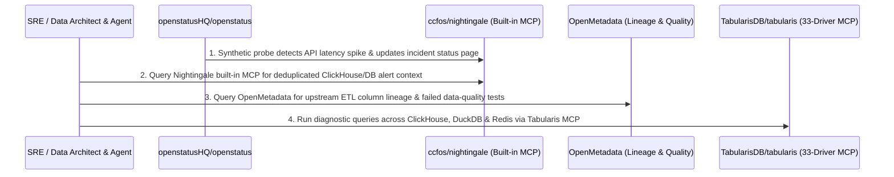

# AI-Native Enterprise Alerting Engine (`ccfos/nightingale`), Synthetic Uptime & Status Page Platform (`openstatusHQ/openstatus`), Open Data & AI Context Layer (`open-metadata/OpenMetadata`) & 33-Driver Desktop SQL Workspace with MCP (`TabularisDB/tabularis`) Selection & Architecture FAQ

> **Document Type**: Enterprise AI Solution Architect Decision & Selection Guide (GitHub Trending AI Radar · 2026-11-24 Night Round 11 / Cumulative Round 798)
> **Covered Repositories**: [`ccfos/nightingale`](https://github.com/ccfos/nightingale) (`★ 13,520`, `1,803 forks`, Go, `Apache-2.0`: open-source, self-hosted alerting engine for metrics, logs, and databases across Prometheus, VictoriaMetrics, ClickHouse, and Loki, featuring a **built-in AI agent and native MCP server**) · [`openstatusHQ/openstatus`](https://github.com/openstatusHQ/openstatus) (`★ 9,281`, `814 forks`, TypeScript, `AGPL-3.0`: open-source status page, incident response timeline, and multi-region synthetic uptime monitoring platform) · [`open-metadata/OpenMetadata`](https://github.com/open-metadata/OpenMetadata) (`★ 15,858`, `2,543 forks`, TypeScript/Java, `Apache-2.0`: **The Open Context Layer for Data and AI** unifying technical metadata, data quality signals, column-level lineage, and business semantics across 80+ connectors) · [`TabularisDB/tabularis`](https://github.com/TabularisDB/tabularis) (`★ 5,535`, `434 forks`, TypeScript, `Apache-2.0`: open-source desktop SQL workspace with 3 built-in database drivers + 30 shipped driver plugins — including DuckDB, ClickHouse, Redis, and Firestore — and a **built-in MCP server** for Claude, Cursor, and Devin)
> **Core Enterprise Scenario**: How should enterprise SRE, observability, and data platform architects combine **AI/MCP-enabled unified alerting (`nightingale`)**, **multi-region synthetic status pages (`openstatus`)**, **column-level lineage and business semantics (`OpenMetadata`)**, and **33-driver desktop SQL + MCP querying (`tabularis`)**?

---

## 1. 📌 Executive Summary (One-Line Selection Verdicts)

1. **Need an open-source, self-hosted enterprise alerting engine over existing metrics, logs, and databases (Prometheus, VictoriaMetrics, ClickHouse, Loki) with a built-in AI agent and MCP server** ➔ Choose **[`ccfos/nightingale`](https://github.com/ccfos/nightingale) (`★ 13,520`, `1,803 forks`, `Apache-2.0`)**.
   - **Plain-Language Mechanism**: Centralizes alert rules, deduplication, and storm suppression across heterogeneous observability backends and exposes active incidents and telemetry directly to AI SRE agents via its built-in MCP server.
2. **Need an open-source PagerDuty/Atlassian Statuspage alternative that unifies multi-region synthetic HTTP/TCP uptime probes, incident timelines, and customer-facing status pages** ➔ Choose **[`openstatusHQ/openstatus`](https://github.com/openstatusHQ/openstatus) (`★ 9,281`, `814 forks`, `AGPL-3.0`)**.
   - **Plain-Language Mechanism**: Combines Config-as-Code synthetic monitoring with automated incident communication and SLA reporting.
3. **Need a unified open context layer that gives data users and AI agents verified business semantics, data quality signals, and column-level lineage across 80+ data warehouses, lakes, and BI tools** ➔ Choose **[`open-metadata/OpenMetadata`](https://github.com/open-metadata/OpenMetadata) (`★ 15,858`, `2,543 forks`, `Apache-2.0`)**.
   - **Plain-Language Mechanism**: Grounds Text-to-SQL and data troubleshooting agents in governed business glossaries, quality assertions, and upstream/downstream lineage graphs.
4. **Need a single open-source desktop SQL workspace supporting 33 database engines (3 built-in + 30 shipped plugins including DuckDB, ClickHouse, Redis, Firestore, Postgres) with a built-in MCP server so Claude, Cursor, and Devin can query schemas in-place** ➔ Choose **[`TabularisDB/tabularis`](https://github.com/TabularisDB/tabularis) (`★ 5,535`, `434 forks`, `Apache-2.0`)**.
   - **Plain-Language Mechanism**: Eliminates configuring 15 separate database MCP servers by letting coding agents reuse the exact database connections already open in the engineer's desktop SQL IDE.

---

## 2. 🎯 Architect & Customer Q&A (Deep Technical Breakdown)

### Q1: How do these four platforms form a closed-loop AIOps and DataOps architecture, and when should enterprises choose them over commercial cloud suites (Datadog, Atlassian Statuspage, Microsoft Purview, DataGrip)?

- **Closed-Loop Integration**:
  1. **External Uptime + Internal Alerting (`OpenStatus` + `Nightingale`)**: `OpenStatus` detects external endpoint degradation across regions while `Nightingale` correlates internal metrics/logs and exposes the incident context via MCP.
  2. **Lineage & Semantic Blast-Radius Analysis (`OpenMetadata`)**: The AI agent queries `OpenMetadata` to trace which upstream ETL pipeline or data-quality failure caused the alert and which downstream executive dashboards are impacted.
  3. **Polyglot Database Inspection (`Tabularis`)**: Engineers and coding agents inspect live schemas and run diagnostic queries across ClickHouse, DuckDB, Redis, and Postgres through `Tabularis`'s built-in 33-driver MCP server.

### Q2: What are the key operational guardrails?

- **Key Guardrails**:
  1. **Enforce Read-Only Production Profiles in `Tabularis` MCP**: Bind production database connections in `TabularisDB/tabularis` to read-only credentials before exposing its MCP server to coding agents.
  2. **Gate AI Root-Cause Analysis Behind `Nightingale` Deduplication**: Trigger LLM analysis only on deduplicated root alerts in `ccfos/nightingale` rather than raw per-pod alert storms.

---

## 3. 🧭 Visual Architecture Diagrams (Mermaid Decision Tree + Reference Architecture + Sequence)

### 3.1 Solution Architect Selection Decision Tree

### 3.2 End-to-End Enterprise Reference Architecture

### 3.3 End-to-End Incident Detection, Lineage Triage & Polyglot SQL Verification Sequence

---

## 4. 📊 Comparative Selection Matrix (OSS vs. Commercial SaaS & Disconnected Tools)

| Dimension | `ccfos/nightingale` (`★ 13.5k`) | `openstatusHQ/openstatus` (`★ 9.2k`) | `open-metadata/OpenMetadata` (`★ 15.8k`) | `TabularisDB/tabularis` (`★ 5.5k`) | Commercial Datadog/Statuspage + Paid Catalog + Paid DB IDE (Path A) | Ad-Hoc Alert Scripts + Ungoverned SQL + 10 Separate DB MCPs (Path B) |
| :--- | :--- | :--- | :--- | :--- | :--- | :--- |
| **Primary Role** | Unified alerting engine with built-in AI & MCP | Open-source status page & synthetic uptime platform | Open context, catalog, quality & lineage layer for AI | 33-driver desktop SQL workspace with built-in MCP | High-cost commercial observability, status, catalog & IDE seats | Uncoordinated alert scripts and fragmented DB clients |
| **Key Differentiator** | **Native AI agent & MCP over Prometheus/VM/Loki/ClickHouse** | **Config-as-Code multi-region synthetic probes + status page** | **Unifies technical schema, business semantics & column lineage** | **3+30 shipped DB drivers with one built-in MCP for Claude/Cursor** | Expensive per-host, per-subscriber, and per-seat SaaS contracts | Alert storms lack lineage context; configuring 10 DB MCPs is brittle |
| **License** | `Apache-2.0` | `AGPL-3.0` | `Apache-2.0` | `Apache-2.0` | Proprietary SaaS | Internal Scripts |
| **Monthly TCO (45-Eng Team)** | **Combined `$315.00/mo`** (`$75.00` self-hosted container compute + `2.4h` ops) | Included (self-hosted status & probes) | Included (`Apache-2.0` open catalog) | Included (free desktop SQL workspace) | **`$9,500.00/mo`** (`$4,850.00` commercial SaaS/IDE seats + `46.5h` manual alert/lineage triage) | `~$3,310.00/mo` (high manual alert-noise & multi-DB config labor) |

---

## 5. 🧪 Quantitative Enterprise ROI / TCO Model & 7-Card Report

> **📊 Provenance & Closed-Form Declaration**:
> - **provenance**: `synthetic` (45-engineer SRE, data governance, and database operations team workload at `$100.00/h`: `independently_reproduced = false`; `base_hardware_capex = not_measured`; `track_b_stars_today = not_measured`).
> - **Closed-Form Equations**:
>   - **Path A (Commercial Alerting/Statuspage SaaS + Commercial Data Catalog + Paid DB IDE Seats & Manual Incident/Lineage Triage)**: Monthly commercial SaaS & DB IDE seat fees **`$4,850.00`** + manual alert triage, status-page updates & cross-DB lineage lookup labor **`46.5h × $100.00/h = $4,650.00`** = **`$9,500.00/mo`**.
>   - **Path C (Self-Hosted `ccfos/nightingale` + `openstatusHQ/openstatus` + `open-metadata/OpenMetadata` + `TabularisDB/tabularis` Stack)**: Self-hosted observability & metadata container compute **`$75.00`** + alert rule & metadata connector maintenance **`2.4h × $100.00/h = $240.00`** = **`$315.00/mo`**.
>   - **Net Savings vs. Path A**: **`-$9,185.00/mo`** (**`96.68%`** cost reduction).

| Option | Commercial SaaS / Seats / Compute | Alert, Lineage & SQL Triage Labor (`$100/h`) | Monthly Total TCO | Net Savings vs. Path A | Key Architectural Outcome |
| :--- | :---: | :---: | :---: | :---: | :--- |
| **Path A: Commercial Alerting/Status + Paid Catalog + Paid DB IDE** | `$4,850.00` | `46.5h` (`$4,650.00`) | **`$9,500.00`** | Baseline | High per-seat/event fees; disconnected alerting and data lineage |
| **Path B: Basic Alert Scripts + Ungoverned SQL + Scattered DB MCPs** | `$1,410.00` | `19.0h` (`$1,900.00`) | **`$3,310.00`** | `-$6,190.00` (`-65.16%`) | Lacks built-in alerting MCP, column lineage & unified 33-driver SQL MCP |
| **Path C: `Nightingale` + `OpenStatus` + `OpenMetadata` + `Tabularis`** | **`$75.00`** | **`2.4h` (`$240.00`)** | **`$315.00`** | **`-$9,185.00` (`-96.68%`)** | **AI/MCP alerting + synthetic status page + AI data lineage + 33-DB SQL MCP** |

- 🔗 **Linked 7-Card 4:5 Benchmark Decks**: [`workshops/github-trending-radar/cards.en.html`](../cards.en.html) · [`cards.html`](../cards.html)

---

## 6. 🛠️ Enterprise Adoption & Architecture Review Checklist

- [ ] **Deduplicate Before AI Triage in `Nightingale`**: Configure alert grouping and inhibition rules in `ccfos/nightingale` so the built-in AI agent and MCP server analyze root incidents rather than raw alert floods.
- [ ] **Isolate `OpenStatus` Hosting Plane**: Deploy `openstatusHQ/openstatus` outside the primary production VPC so external status pages remain reachable during core cluster outages.
- [ ] **Ground Data Agents in `OpenMetadata`**: Require Text-to-SQL and analytics agents to resolve business glossary definitions and column-level lineage in `open-metadata/OpenMetadata` before executing queries.
- [ ] **Read-Only Guardrails in `Tabularis` MCP**: Enforce read-only database user credentials on production connections shared with Claude, Cursor, and Devin via `TabularisDB/tabularis`.
