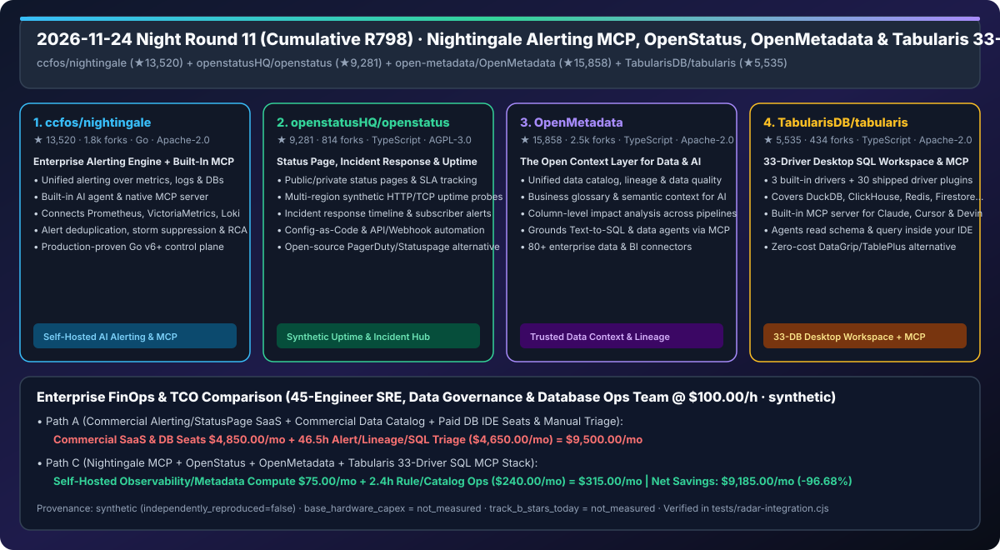
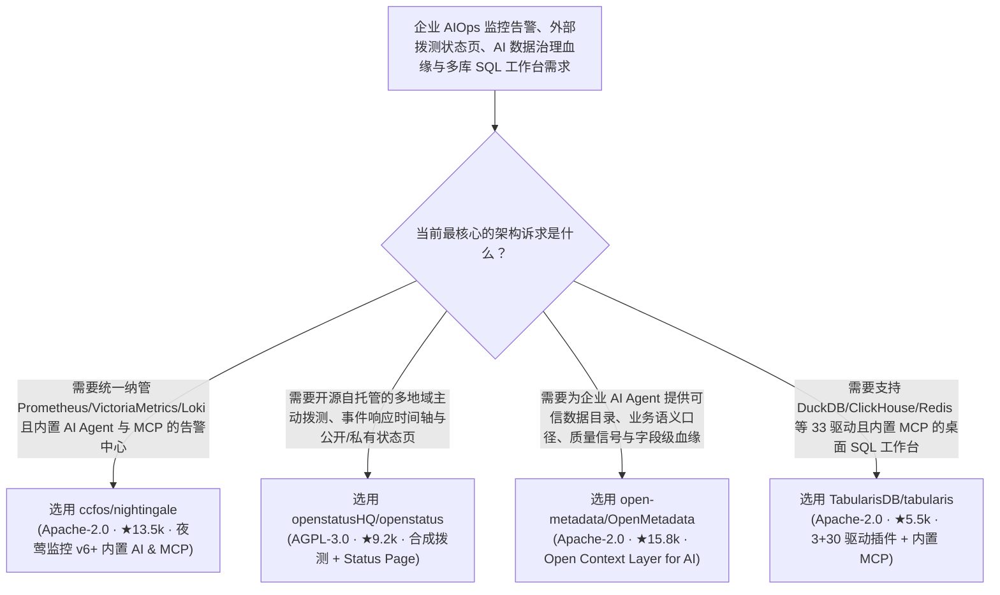
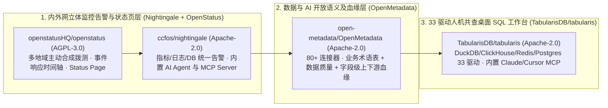
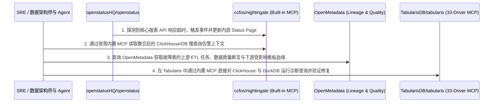

# 内置 AI 与 MCP 的夜莺企业级告警引擎（`ccfos/nightingale`）、开源多地域拨测与状态页平台（`openstatusHQ/openstatus`）、数据与 AI 开放语义血缘层（`open-metadata/OpenMetadata`）与内置 MCP 的 33 驱动桌面 SQL 工作台（`TabularisDB/tabularis`）选型与集成架构 FAQ

> **文档类型**：企业 AI 解决方案架构师（AI Solution Architect）选型决策指南（GitHub Trending AI 雷达 2026-11-24 Night Round 11 / 累计第 798 轮）
> **覆盖项目**：[`ccfos/nightingale`](https://github.com/ccfos/nightingale)（`★ 13,520`、`1,803 forks`、`Apache-2.0`，开源自托管企业级监控告警引擎“夜莺 v6+”，统一接入指标、日志与数据库监控，且**原生内置 AI Agent 与 MCP Server**）· [`openstatusHQ/openstatus`](https://github.com/openstatusHQ/openstatus)（`★ 9,281`、`814 forks`、`AGPL-3.0`，开源服务状态页 Status Page、多地域主动合成拨测与故障事件响应协同平台）· [`open-metadata/OpenMetadata`](https://github.com/open-metadata/OpenMetadata)（`★ 15,858`、`2,543 forks`、`Apache-2.0`，面向数据与 AI 的开放上下文层 **The Open Context Layer for AI**，打通技术元数据、数据质量信号、字段级血缘与业务术语表）· [`TabularisDB/tabularis`](https://github.com/TabularisDB/tabularis)（`★ 5,535`、`434 forks`、`Apache-2.0`，自带 3 个内置驱动 + **30 个随包驱动插件**——涵盖 DuckDB、ClickHouse、Redis、Firestore、Postgres 等——并**内置 MCP Server** 的开源桌面 SQL 工作台）
> **核心场景**：当企业 SRE 运维团队与数据平台团队构建 AIOps 故障自愈与可信数据助手时，如何解决**“商业 PagerDuty/Datadog/Atlassian Statuspage 按席位与指标量收费高昂、告警风暴触发后缺乏 MCP 接口供 AI 自动查血缘定界、数据 Agent 写出的 SQL 不懂企业表字段业务口径、以及开发者本地连接 DuckDB/ClickHouse/Redis 等多种异构库需要装一堆收费客户端且无法直接把连接共享给 Claude/Cursor”**四大痛点？

---

## 一、📌 核心结论速览（选型一句话结论）

1. **想在不替换现有 Prometheus、VictoriaMetrics、ClickHouse、Elasticsearch 或 Loki 存储的前提下，搭建一套自带告警降噪、自愈回调，且原生内置 AI Agent 与 MCP Server 的企业级统一告警中心** ➔ 选 **[`ccfos/nightingale`](https://github.com/ccfos/nightingale)（`★ 13,520`，`1,803 forks`，`Apache-2.0`）**。
   - **通俗原理**：中国互联网与金融企业广泛采用的“夜莺监控（Nightingale v6+）”，不仅能把分散在多个时序库与日志库里的告警规则统一收口治理，最新版本更直接内建了 AI 智能体与 MCP Server，让外部排障 Agent 能直接读取实时活跃告警、历史抑制记录与监控曲线完成秒级根因初筛。
2. **想用开源自托管方案替代昂贵的 Atlassian Statuspage + Pingdom，实现全球多节点 HTTP/TCP 主动合成拨测、SLA 可用性统计与故障时间轴公告发布** ➔ 选 **[`openstatusHQ/openstatus`](https://github.com/openstatusHQ/openstatus)（`★ 9,281`，`814 forks`，`AGPL-3.0`）**。
   - **通俗原理**：将“外部真实用户体验拨测（Synthetic Monitoring）”、“内部 Incident 响应升级”与“面向客户的透明状态页（Status Page）”合三为一，支持通过代码配置（Config-as-Code）与 Webhook 同夜莺告警联动。
3. **想让企业内部的 Text-to-SQL、数据分析 Agent 与研发助手彻底告别“对着物理表名瞎猜业务含义”，为所有 AI 智能体提供经过校验的业务术语口径、数据质量水位与字段级上下游血缘（Lineage）** ➔ 选 **[`open-metadata/OpenMetadata`](https://github.com/open-metadata/OpenMetadata)（`★ 15,858`，`2,543 forks`，`Apache-2.0`）**。
   - **通俗原理**：定位为 **The Open Context Layer for AI**，内置 80+ 数据源连接器（数仓、湖仓、BI、消息队列），把冷冰冰的技术表结构与业务语义词汇表、数据质量断言、Owner 责任人及字段级血缘连成一体，让 AI 在生成查询或分析数据故障影响面时有据可依。
4. **想在开发者桌面上用一个开源免费的客户端同时连接 Postgres、MySQL、DuckDB、ClickHouse、Redis、Firestore 等 33 种数据源，且无需重复配密码就能通过内置 MCP Server 让 Claude、Cursor 和 Devin 直接读取当前连接 Schema 并跑查询** ➔ 选 **[`TabularisDB/tabularis`](https://github.com/TabularisDB/tabularis)（`★ 5,535`，`434 forks`，`Apache-2.0`）**。
   - **通俗原理**：提供 3 个内置驱动 + 30 个开箱即用的驱动插件，人类工程师在桌面 GUI 里看表查数，而 Claude、Cursor 与 Devin 通过 `Tabularis` 内置的 MCP Server 直接复用同一个应用内的连接上下文，省去为每种冷门数据库单独寻找和配置第三方 MCP Server 的繁琐工作。

---

## 二、🎯 客户与架构师灵魂拷问 Q&A（深度架构拆解）

### Q1：在企业级 AIOps 与数据治理架构中，这四个开源项目如何串联成闭环？何时选它们 vs 商业云服务（Datadog / Microsoft Purview / DataGrip）？

- **端到端闭环联动**：
  1. **外部感知与内部告警（`OpenStatus` + `Nightingale`）**：`OpenStatus` 从外网多地域探测端点延迟与可用性，`Nightingale` 聚合内网指标/日志/DB 告警并通过内置 MCP 触发 SRE Agent。
  2. **上下游影响面与语义定界（`OpenMetadata`）**：当某个数据表或数仓任务告警时，Agent 查询 `OpenMetadata` 的字段级血缘（Column-level Lineage）与数据质量测试结果，精准识别受影响的下游高管报表。
  3. **人机共查异构数据库（`Tabularis`）**：工程师与编码 Agent 通过 `Tabularis` 内置的 33 驱动工作台与 MCP Server，在 DuckDB/ClickHouse/Redis/Postgres 中现场验证数据修复结果。
- **何时选云托管方案（Path A）？**
  - 若企业已全面构建于 Microsoft Fabric + Azure Monitor 生态并需要跨 M365 文档的合规脱敏标签，优先选用 **Microsoft Purview + Azure Monitor**；若面对多云异构开源栈（Prometheus + VictoriaMetrics + ClickHouse + DuckDB）且希望免除昂贵的按席位 SaaS 账单，则采用本轮四合一开源栈（Path C）。

### Q2：这套架构的生产落地红线是什么？

- **架构师落地红线**：
  1. **`Tabularis` 生产库只读连接保护**：在将 `TabularisDB/tabularis` 的内置 MCP Server 暴露给 Claude/Cursor 时，凡涉及生产环境的连接配置，必须在数据库驱动层启用 Read-Only 事务模式或绑定只读账号，防止 AI 误执行 `DROP`/`DELETE`。
  2. **告警风暴下的 AI 调用熔断**：在 `ccfos/nightingale` 中启用内置 AI Agent 辅助排障时，必须先经过夜莺的告警聚合与静默去重规则，仅对聚合后的根告警（Root Alert）触发大模型分析，杜绝底层网络抖动引发万级并发 LLM 调用。

---

## 三、🧭 直观可视化图解（Mermaid 决策树 + 集成架构 + 时序图）

### 3.1 架构师选型决策树

### 3.2 企业端到端生产集成参考架构图

### 3.3 拨测告警触发、夜莺 MCP 诊断、OpenMetadata 血缘定界与 Tabularis 现场查库时序图

---

## 四、📊 同类开源与商业云服务横向选型决策矩阵

| 对比维度 | `ccfos/nightingale` (`★ 13.5k`) | `openstatusHQ/openstatus` (`★ 9.2k`) | `open-metadata/OpenMetadata` (`★ 15.8k`) | `TabularisDB/tabularis` (`★ 5.5k`) | 商业 Datadog/PagerDuty + 商业数据目录 + 付费 DB IDE (Path A) | 零散脚本告警 + 无血缘裸查库 + 手配多个单库 MCP (Path B) |
| :--- | :--- | :--- | :--- | :--- | :--- | :--- |
| **核心能力定位** | 内置 AI Agent 与 MCP 的统一告警引擎 | 开源合成拨测、故障响应与状态页平台 | 面向数据与 AI 的开放上下文与血缘平台 | 3+30 驱动插件且内置 MCP 的桌面 SQL 工作台 | 按主机/事件/席位高额计费的商业监控与治理全家桶 | 缺乏风暴抑制的脚本与各自孤立的单数据库工具 |
| **核心技术突破** | **兼容主流开源监控栈，原生内置 AI 与 MCP Server** | **Config-as-Code 合成拨测与状态页一体化** | **连接技术元数据、数据质量与字段级血缘服务 AI** | **单应用支持 DuckDB/ClickHouse/Redis 等 33 驱动并直通 MCP** | 商业状态页与商业数据目录年费动辄数十万美元 | 告警无血缘支撑难以评估业务影响；配 10 种数据库 MCP 极繁琐 |
| **开源协议** | `Apache-2.0` | `AGPL-3.0` | `Apache-2.0` | `Apache-2.0` | 闭源商业 SaaS | 内部脚本 |
| **月度 TCO（45 人团队）** | **组合仅 `$315.00/月`**（`$75.00` 自托管容器算力 + `2.4h` 维护） | 同左（自托管免按订阅者收费） | 同左（开源免除高昂目录许可费） | 同左（全员免费桌面端） | **`$9,500.00/月`**（`$4,850.00` 商业监控/目录/IDE 席位 + `46.5h` 人工排障与查血缘） | 约 `$3,310.00/月`（大量告警误报排查与异构库连接维护工时） |

---

## 五、🧪 应用落地定量收益/TCO 对比与 7-Card 报告

> **📊 数据来源与闭式核算声明（Provenance & Closed-Form Schema）**：
> - **provenance**: `synthetic`（基于 45 人企业 SRE 可观测性、数据治理与数据库运维团队月度工作负载模型：`independently_reproduced = false`；硬件采购基线 `base_hardware_capex = not_measured`；Track B 单日增量 `track_b_stars_today = not_measured`）。
> - **核算公式**：
>   - **Path A（采购商业告警/Statuspage SaaS + 采购商业数据目录平台 + 全员采购商业多库 SQL 客户端席位 + 人工排查告警风暴与翻找代码梳理字段血缘）**：月度商业 SaaS 与软件席位费 **`$4,850.00`** + 告警分拣、手动更新状态页与人工追查数据血缘人工 **`46.5h × $100.00/h = $4,650.00`** = **`$9,500.00/月`**。
>   - **Path C（自建 `ccfos/nightingale` + `openstatusHQ/openstatus` + `open-metadata/OpenMetadata` + `TabularisDB/tabularis` 开源栈）**：内网自托管夜莺、OpenMetadata 与 OpenStatus 容器开销 **`$75.00`** + 告警规则与元数据采集器维护人工 **`2.4h × $100.00/h = $240.00`** = **`$315.00/月`**。
>   - **净节省（Net Savings vs Path A）**：**`-$9,185.00/月`**（成本降低 **`96.68%`**）。

| 评估方案 | 商业 SaaS / 软件席位 / 容器成本 | 告警排障、血缘梳理与查库人工（`$100/h`） | 月度总 TCO | 相对 Path A 净节省 | 关键架构交付指标 |
| :--- | :---: | :---: | :---: | :---: | :--- |
| **Path A：商业监控状态页 + 商业数据目录 + 付费 DB IDE** | `$4,850.00` | `46.5h` (`$4,650.00`) | **`$9,500.00`** | Baseline | 按席位与事件量计费高昂；监控与数据血缘割裂 |
| **Path B：基础告警脚本 + 无血缘裸写 SQL + 多套散装客户端** | `$1,410.00` | `19.0h` (`$1,900.00`) | **`$3,310.00`** | `-$6,190.00` (`-65.16%`) | 缺乏内置 MCP 告警诊断、字段级血缘与 33 驱动统一工作台 |
| **Path C：`Nightingale` + `OpenStatus` + `OpenMetadata` + `Tabularis`** | **`$75.00`** | **`2.4h` (`$240.00`)** | **`$315.00`** | **`-$9,185.00` (`-96.68%`)** | **夜莺 AI/MCP 告警 + 合成拨测状态页 + AI 数据血缘层 + 33 驱动 SQL MCP** |

- 🔗 **关联 7-Card 4:5 视觉评测报告**：[`workshops/github-trending-radar/cards.html`](../cards.html) · [`cards.en.html`](../cards.en.html)

---

## 六、🛠️ 企业引入与架构评审 Checklist

- [ ] **夜莺告警聚合后再触发 AI 诊断**：在 `ccfos/nightingale` 中配置分组聚合、抑制与静默策略，仅将高优先级聚合事件通过内置 MCP 路由给排障 Agent。
- [ ] **OpenStatus 状态页与内网监控网络解耦**：将 `openstatusHQ/openstatus` 拨测探针与状态页部署在独立于核心生产集群的故障域，防止生产网络中断导致状态页自身不可达。
- [ ] **Text-to-SQL 强制接地 `OpenMetadata` 语义层**：规定所有内部数据分析 Agent 在生成 SQL 前，必须先查询 `open-metadata/OpenMetadata` 校验指标口径、表 Owner 与数据质量健康度。
- [ ] **`Tabularis` 33 驱动 MCP 生产只读门禁**：在开发者桌面 `TabularisDB/tabularis` 中为生产环境数据源勾选只读权限，确保 Claude/Cursor/Devin 通过 MCP 仅能执行 `SELECT`/`EXPLAIN` 操作。
