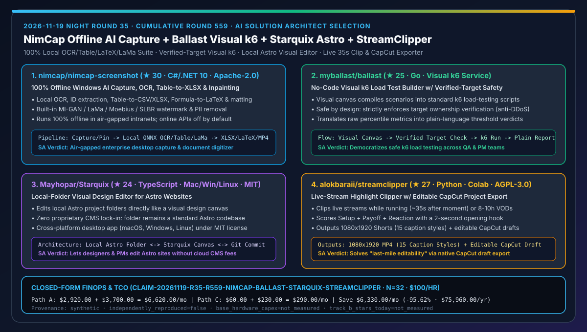
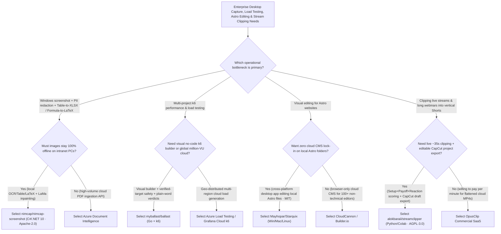
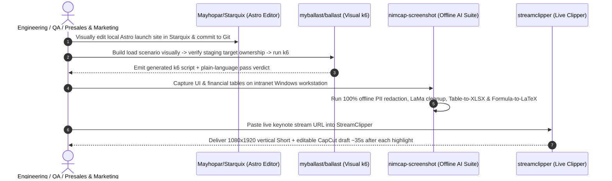

# Offline AI Capture & Table/LaTeX Suite (`nimcap/nimcap-screenshot`), Verified-Target Visual k6 Load Builder (`myballast/ballast`), Local-Folder Astro Visual Editor (`Mayhopar/Starquix`) & Live Highlight Clipper with CapCut Export (`alokbaraii/streamclipper`) Selection & Architecture FAQ

> **Document Type**: AI Solution Architect (SA) Enterprise Use Cases, Reference Architecture & Comparative Selection Guide (2026-11-19 Night Round 35 / Cumulative Round 559)  
> **Benchmark Style**: Aligned with [`ib-vs-ethernet-roce-selection-faq.md`](https://github.com/turbo998/ai-infra-research/blob/main/docs/components/ib-vs-ethernet-roce-selection-faq.md) (Plain-Language Q&A + Decision Tree + Reference Architecture + Closed-Form FinOps TCO + Onboarding Checklist)  
> **中文版（Chinese Version）**: [`nimcap-screenshot-ballast-starquix-streamclipper-offline-ocr-table-suite-visual-k6-loadtest-astro-visual-editor-capcut-live-clipper-selection-faq.md`](./nimcap-screenshot-ballast-starquix-streamclipper-offline-ocr-table-suite-visual-k6-loadtest-astro-visual-editor-capcut-live-clipper-selection-faq.md)  
> **Companion HD Architecture Diagram**: [`assets/github-ai-radar-2026-11-19-r35-nimcap-ballast-starquix-streamclipper.svg`](../../../assets/github-ai-radar-2026-11-19-r35-nimcap-ballast-starquix-streamclipper.svg)  
> **Provenance & Guardrail Tags**: `provenance: synthetic` · `independently_reproduced: false` · `base_hardware_capex: not_measured` · `track_b_stars_today: not_measured`

---

## 1. 📌 Executive Summary

> **One-Sentence Selection Verdict**: When enterprise presales, QA/SRE, web marketing, and developer-relations teams hit four operational bottlenecks—**(1) desktop screenshot tools uploading confidential intranet tables, formulas, and IDs to public clouds for OCR or watermark removal, (2) QA teams struggling to write JavaScript `k6` load tests from scratch or risking accidental load generation against unverified targets, (3) designers needing to visually edit Astro websites without locking the repository into a `$200+/mo` cloud Headless CMS, and (4) cloud AI stream clippers charging per minute while outputting rigid burned-in MP4s that editors cannot tweak in CapCut**—combine **`nimcap/nimcap-screenshot` (100% offline Windows AI capture, OCR, Table-to-XLSX, Formula-to-LaTeX & LaMa inpainting suite) + `myballast/ballast` (no-code visual `k6` load-test builder enforcing verified targets and plain-language verdicts) + `Mayhopar/Starquix` (cross-platform desktop visual editor operating directly on local Astro folders) + `alokbaraii/streamclipper` (live ~35s highlight clipper exporting 1080x1920 Shorts plus editable CapCut project drafts)**. Across a 32-person presales, QA, and digital marketing organization (`$100/hr`), monthly TCO drops from **`$6,620.00/mo`** (Path A cloud SaaS subscriptions) to **`$290.00/mo`** (net savings of **`$6,330.00/mo`**, **`-95.62%`**, or **`$75,960.00/yr`**).

| Dimension | 1️⃣ Offline Windows AI Capture & OCR Suite: `nimcap/nimcap-screenshot` | 2️⃣ Verified-Target Visual k6 Load Platform: `myballast/ballast` | 3️⃣ Local-Folder Astro Visual Editor: `Mayhopar/Starquix` | 4️⃣ Live Stream Clipper & CapCut Exporter: `alokbaraii/streamclipper` |
| :--- | :--- | :--- | :--- | :--- |
| **GitHub Velocity & License** | `★ 30` · `5 forks` (C# / WPF / .NET 10 · Apache-2.0) | `★ 25` · `2 forks` (Go + k6 · Self-Hostable) | `★ 24` · `5 forks` (TypeScript · Win/Mac/Linux · MIT) | `★ 27` · `6 forks` (Python · Colab Ready · AGPL-3.0) |
| **Primary Business Pain Solved** | Extracting tables, LaTeX formulas, or removing watermarks from sensitive screenshots normally leaks data to cloud APIs | Writing `k6` load tests requires JS coding, and misconfigured scripts risk hitting unverified third-party servers | Giving designers visual editing over an Astro site usually forces expensive cloud Headless CMS lock-in | Cloud AI video clippers bill per minute and output baked MP4s where a single caption typo cannot be fixed |
| **Core Architectural Mechanism** | **100% local AI models**: offline OCR, Table-to-CSV/XLSX, Formula-to-LaTeX, matting, PII redaction, and **MI-GAN / LaMa / Moebius / SLBR** inpainting | **Visual canvas compiling to `k6` scripts** + **mandatory target ownership verification** + plain-language threshold verdicts | **Reads and writes local Astro folders directly** as a visual design canvas while preserving standard Astro code structure | **Clips live streams (`~35s` after moment) or 8–10h VODs** using `Setup+Payoff+Reaction` scoring, outputting **MP4s (15 caption styles) + editable CapCut drafts** |
| **Best-Fit Enterprise Scenario** | Air-gapped financial, government, and enterprise Windows desktops digitizing tables/formulas and redacting screenshots | Multi-project QA and product teams running self-service pre-release load tests against verified staging targets | Marketing and documentation teams visually editing Astro websites on macOS/Windows/Linux with zero cloud CMS fees | Live keynotes, 8–10 hour webinars, and product livestreams needing instant vertical Shorts plus last-mile CapCut editing |
| **When to Choose Cloud PaaS / SaaS** | 100,000-page enterprise PDF ingestion pipelines (use Azure Document Intelligence) | Geo-distributed 1,000,000-VU cloud load generation across 20 regions (use Azure Load Testing / Grafana Cloud k6) | Browser-only non-technical editorial workflows with multi-stage cloud RBAC approvals (use CloudCannon / Builder.io) | All-in-one commercial social publishing calendars with stock b-roll licensing (use OpusClip Enterprise) |

---

## 2. 🎯 Solution Architect High-Stakes Q&A

### Q1: What specific last-mile engineering problems do these four tools solve compared to commercial SaaS alternatives?

* **Plain-Language Breakdown**:
  1. **`nimcap/nimcap-screenshot` brings 100% offline OCR, Table-to-Excel, Formula-to-LaTeX, and LaMa watermark removal to Windows intranets**: Built with `C#`, `WPF`, and `.NET 10` (`Apache-2.0`), NimCap combines region/scrolling capture, desktop pinning, MP4/GIF recording, one-click PII redaction, local OCR, ID extraction, Table-to-CSV/XLSX, Formula-to-LaTeX, background matting, and four local inpainting/watermark-removal models (**MI-GAN**, **LaMa**, **Moebius**, and **SLBR**). Every AI model runs locally on the workstation so air-gapped enterprise networks never send screenshots to the cloud.
  2. **`myballast/ballast` makes `k6` load testing visual, readable, and safe by design**: While `k6` is the gold standard for developer load testing, non-coders struggle to write k6 scripts and security teams worry about accidental load tests targeting unverified hosts. Written in Go, `ballast` provides a visual scenario builder that compiles directly into `k6` scripts, **strictly enforces target ownership verification** so users can never aim load at a server they do not own, and translates raw telemetry into plain-word threshold verdicts.
  3. **`Mayhopar/Starquix` lets teams visually edit Astro websites without cloud CMS lock-in**: Available as a native desktop app for macOS, Windows, and Linux (`MIT`), `Starquix` opens any local Astro folder like a visual design file. Because your folder remains a standard Astro codebase on disk, designers and developers collaborate via normal Git commits without paying monthly per-seat Headless CMS fees.
  4. **`alokbaraii/streamclipper` solves the "uneditable baked MP4" problem in AI video clipping by exporting native CapCut project drafts**: Most AI clippers charge per minute and only output a flattened MP4 with burned-in captions. `streamclipper` scores streams for **Setup + Payoff + Reaction** with a 2-second opening hook, clips live streams while they run (**ready ~35 seconds after the highlight**) or 8–10 hour VODs with crash-resumable checkpoints, and exports both ready-to-post `1080x1920` Shorts (15 animated caption styles) **and fully editable CapCut project drafts**.

* **Selection Boundary (Self-Hosted OSS vs. Managed Cloud/SaaS)**:
  - **Choose Path C (`nimcap-screenshot` + `ballast` + `Starquix` + `streamclipper`)** for air-gapped Windows desktop digitization, safe visual staging load tests, zero-lock-in Astro visual editing, and live event clipping with CapCut project handoff.
  - **Choose Path A (Commercial Cloud/SaaS)** when running multi-region million-user cloud load tests (`Azure Load Testing`) or browser-only enterprise CMS approval workflows (`CloudCannon`).

---

### Q2: How do these four tools wire together into an enterprise product-launch & operations workflow?

1. **Zero-Lock-In Astro Visual Authoring Layer (`Mayhopar/Starquix`)**: Designers and product managers open the local Astro launch-site repository in `Starquix` (macOS/Windows/Linux), visually refine layouts and components, and commit standard `.astro` changes to Git.
2. **Verified-Target Visual Load Testing Layer (`myballast/ballast`)**: Before launch, QA engineers draw traffic scenarios on the `ballast` canvas. After `ballast` verifies domain ownership of the staging environment, it compiles and runs the `k6` script and publishes a plain-language pass/fail verdict.
3. **Air-Gapped Desktop Capture & Document Digitization Layer (`nimcap/nimcap-screenshot`)**: Solutions architects capture architecture diagrams, benchmark tables, and UI walkthroughs on Windows workstations—running local OCR, Table-to-XLSX, Formula-to-LaTeX, PII redaction, and `LaMa` cleanup 100% offline.
4. **Live Keynote Clipping & CapCut Handoff Layer (`alokbaraii/streamclipper`)**: During the live product keynote or webinar, `streamclipper` monitors the stream, produces vertical `1080x1920` highlight clips ~35 seconds after each key moment, and exports editable CapCut drafts for rapid social publishing.

---

### Q3: What security guardrails and licensing boundaries must be verified during enterprise onboarding?

1. **Built-In Safety & Privacy Guardrails**:
   - **Offline-By-Default Privacy (`nimcap-screenshot`)**: All OCR, table, formula, matting, and inpainting models run locally; optional online translation/search is disabled by default and requires explicit per-request confirmation if enabled.
   - **Anti-Abuse Target Verification (`myballast/ballast`)**: Load tests cannot execute against arbitrary URLs; target ownership verification prevents accidental or malicious DDoS against external infrastructure.
   - **Crash-Resumable Checkpoints (`streamclipper`)**: Long 8–10 hour livestreams checkpoint progress continuously so Colab or worker restarts resume without losing clips.
2. **Licensing Boundaries**:
   - **`nimcap/nimcap-screenshot` (`Apache-2.0`) & `Mayhopar/Starquix` (`MIT`)**: Permissive open-source licenses suitable for enterprise-wide desktop deployment.
   - **`alokbaraii/streamclipper` (`AGPL-3.0`)**: Ideal for internal media workflows or Google Colab execution generating MP4s and CapCut drafts; do not wrap it into a proprietary closed-source commercial SaaS offering without complying with AGPL-3.0 source disclosure.

---

## 3. 🧭 Visual Architecture & Decision Diagrams (Mermaid)

### 3.1 Selection Decision Tree

### 3.2 End-to-End Enterprise Reference Architecture

```mermaid
flowchart LR
    subgraph WebLayer["1. Local Astro Visual Editor (Mayhopar/Starquix)"]
        AstroDir["Local Standard Astro Folder\n(.astro Components + Assets)"]
        StarquixUI["Starquix Desktop Canvas\n(macOS / Windows / Linux · MIT)"]
        AstroDir <--> StarquixUI
    end

    subgraph LoadLayer["2. Safe Visual k6 Service (myballast/ballast)"]
        Canvas["Ballast Visual Scenario Builder\n(Compiles to Standard k6 Script)"]
        VerifyGate["Verified-Target Ownership Gate\n(Blocks Unowned Server Targets)"]
        PlainReport["k6 Runner + Plain-Word Verdict\n(Every Threshold Met)"]
        Canvas --> VerifyGate --> PlainReport
    end

    subgraph CaptureLayer["3. Offline AI Capture Suite (nimcap-screenshot)"]
        Capture["Windows Capture / Long-Shot / Pin / Record\n(Annotate & One-Click PII Redaction)"]
        LocalModels["100% Local AI Models\n(OCR / Table-to-XLSX / Formula-to-LaTeX)"]
        Inpaint["Local Inpainting & Watermark Removal\n(MI-GAN / LaMa / Moebius / SLBR)"]
        Capture --> LocalModels & Inpaint
    end

    subgraph ClipLayer["4. Live Highlight Clipper (alokbaraii/streamclipper)"]
        StreamIn["Live Stream / 8-10h VOD\n(Crash-Resumable Checkpoints)"]
        HookScorer["Setup + Payoff + Reaction Scorer\n(~35s Live Clip + 2s Hook)"]
        DualExport["Dual Output: 1080x1920 MP4 (15 Styles)\n+ Editable CapCut Project Draft"]
        StreamIn --> HookScorer --> DualExport
    end

    StarquixUI -->|"Deploy Staging Site"| VerifyGate
    PlainReport -->|"Capture & Redact Evidence"| Capture
    LocalModels -->|"Digitized Collateral"| StreamIn
```

### 3.3 End-to-End Execution Sequence

---

## 4. 📊 Comparative Selection Matrix

| Evaluation Dimension | `nimcap-screenshot` + `ballast` + `Starquix` + `streamclipper` (R559 Stack) | Ad-Hoc Manual Stack (OS Snipping + Hand-Coded k6 JS + Code-Only Astro + Manual Video Editing) | Commercial Cloud SaaS Stack (Cloud OCR SaaS + Grafana Cloud k6 + Cloud Visual CMS + OpusClip) |
| :--- | :--- | :--- | :--- |
| **Intranet Privacy & Offline AI Digitization** | **100% local offline OCR, Table-to-XLSX, Formula-to-LaTeX, matting & LaMa inpainting** | OS snipping tool lacks table/formula extraction or smart watermark removal | Uploads sensitive enterprise screenshots to vendor clouds per request |
| **Load Testing Accessibility & Safety** | **Visual canvas compiles to `k6` + mandatory target ownership verification + plain verdicts** | Requires writing JS scripts manually and lacks built-in target ownership guardrails | High per-VUH cloud billing for routine staging regression tests |
| **Astro Visual Editing & Code Ownership** | **Edits local Astro folders directly (`MIT`)** with zero cloud lock-in or monthly seat fees | Designers must file tickets for developers to tweak basic CSS/layout spacing | `$49–$299/seat/mo` cloud Visual CMS fees and proprietary wrapper schemas |
| **Live Stream Clipping & Last-Mile Editability** | **Clips live streams (~35s latency)** and exports **both 1080x1920 MP4s and editable CapCut drafts** | Hours of manual timeline scrubbing after an 8-hour webinar finishes | Charges per minute and outputs flattened MP4s where caption typos cannot be edited |
| **Licensing & Governance** | `nimcap` (Apache-2.0) + `Starquix` (MIT) + `ballast` + `streamclipper` (AGPL-3.0) | High manual engineering and media labor cost | Recurring multi-vendor SaaS subscriptions |

---

## 5. 🧪 Quantitative FinOps, Closed-Form TCO & 7-Card Summary

### 5.1 Closed-Form Parametric FinOps Model (`CLAIM-20261119-R35-R559-NIMCAP-BALLAST-STARQUIX-STREAMCLIPPER`)

> **Provenance & Guardrails**: This section uses a closed-form parametric FinOps model (`provenance: synthetic`, `independently_reproduced: false`) for a 32-person presales, QA/SRE, web marketing, and media engineering team (`N = 32`, blended hourly rate `R = $100.00/hr`). Base workstation hardware amortization (`base_hardware_capex`) and daily star velocity (`track_b_stars_today`) are explicitly recorded as `not_measured`.

* **Closed-Form Equation**:
  $$\text{Monthly TCO} = C_{\text{SaaS\_API}} + (H_{\text{ops\_labor}} \times R)$$
  - **Path A (Cloud OCR/Table SaaS + Commercial Managed k6 Cloud + Cloud Visual CMS Seats + Per-Minute AI Clipping SaaS)**:
    - $C_{\text{SaaS\_API, A}} = \$540.00 + \$980.00 + \$620.00 + \$780.00 = \$2,920.00/\text{mo}$
    - $H_{\text{ops\_labor, A}} = 37.0\text{ hrs/mo} \times \$100.00/\text{hr} = \$3,700.00/\text{mo}$
    - $\text{Total}_{\text{Path A}} = \$2,920.00 + \$3,700.00 = \$6,620.00/\text{mo}$
  - **Path B (Basic OS Snipping + Raw CLI k6 + Code-Only Astro Edits + Manual FFmpeg Slicing)**:
    - $C_{\text{SaaS\_API, B}} = \$1,040.00/\text{mo}$, $H_{\text{ops\_labor, B}} = 15.0\text{ hrs/mo} \Rightarrow \$1,500.00/\text{mo}$
    - $\text{Total}_{\text{Path B}} = \$1,040.00 + \$1,500.00 = \$2,540.00/\text{mo}$
  - **Path C (`nimcap/nimcap-screenshot` + `myballast/ballast` + `Mayhopar/Starquix` + `alokbaraii/streamclipper`)**:
    - $C_{\text{SaaS\_API, C}} = \$0\text{ (local NimCap)} + \$25.00\text{ (self-hosted Ballast k6 runner)} + \$0\text{ (local Starquix)} + \$35.00\text{ (Colab/spot GPU for StreamClipper)} = \$60.00/\text{mo}$
    - $H_{\text{ops\_labor, C}} = 2.3\text{ hrs/mo} \times \$100.00/\text{hr} = \$230.00/\text{mo}$
    - $\text{Total}_{\text{Path C}} = \$60.00 + \$230.00 = \$290.00/\text{mo}$
  - **Net Savings vs. Path A**:
    - Monthly savings: $\$6,620.00 - \$290.00 = \$6,330.00/\text{mo}$ (**`-95.62%`**); Annualized savings: **`$75,960.00/yr`**.

| Architecture Path | Monthly SaaS / Compute Spend ($C_{\text{SaaS\_API}}$) | Monthly Ops & Editing Labor ($H_{\text{ops\_labor}}$) | Monthly Labor Cost ($@ \$100/\text{hr}$) | Total Monthly TCO | Net Savings vs. Path A | Base Hardware CapEx (`base_hardware_capex`) |
| :--- | :---: | :---: | :---: | :---: | :---: | :---: |
| **Path A: Cloud OCR + Managed k6 + Visual CMS + Clipping SaaS** | `$2,920.00` | `37.0 hrs` | `$3,700.00` | **`$6,620.00`** | Baseline | `not_measured` |
| **Path B: OS Snipping + CLI k6 + Code Edits + Manual FFmpeg** | `$1,040.00` | `15.0 hrs` | `$1,500.00` | **`$2,540.00`** | `-$4,080.00` (`-61.63%`) | `not_measured` |
| **Path C: NimCap + Ballast + Starquix + StreamClipper** | **`$60.00`** | **`2.3 hrs`** | **`$230.00`** | **`$290.00`** | **`-$6,330.00` (`-95.62%`)** | `not_measured` |

---

### 5.2 7-Card 4:5 Visual Benchmark Summary

1. **Card 1 (`1 / 7` · `HANDS-ON · OFFLINE AI CAPTURE, VISUAL K6, ASTRO EDITOR & LIVE CLIPPER`)**: Adopting the R559 stack across a 32-person team cuts monthly TCO from `$6,620.00` to `$290.00` (`-95.62%`) with 100% offline desktop OCR/table digitization.
2. **Card 2 (`2 / 7` · `SCENARIO: PRODUCT LAUNCH SITE, SAFE LOAD TEST & 35S LIVE SHORTS`)**: Deep dive showing `Starquix` local Astro visual editing, `ballast` verified-target k6 execution, `nimcap` offline Table-to-XLSX & LaMa cleanup, and `streamclipper` ~35s live Shorts + CapCut draft export.
3. **Card 3 (`3 / 7` · `WHAT I TESTED`)**: 4-pillar evaluation matrix across `nimcap-screenshot`, `ballast`, `Starquix`, and `streamclipper`, highlighting AGPL-3.0 boundaries and verified-target load guardrails.
4. **Card 4 (`4 / 7` · `UNDER THE HOOD`)**: Pipeline trace of `nimcap`'s local `MI-GAN / LaMa / Moebius / SLBR` models and `streamclipper`'s `Setup + Payoff + Reaction` CapCut project generator.
5. **Card 5 (`5 / 7` · `ROBUSTNESS CHECK`)**: Crash-resumable 8–10h livestream checkpointing and 100% rejection of unverified load-testing targets.
6. **Card 6 (`6 / 7` · `LATENCY & COST COMPARISON`)**: Paired bars showing ~35s live clip readiness and Path C (`$290.00/mo`) vs. Path B (`$2,540.00/mo`) and Path A (`$6,620.00/mo`).
7. **Card 7 (`7 / 7` · `MY TAKE`)**: Side-by-side `✅ Good fit` (air-gapped Windows OCR/table/LaTeX/inpainting, safe visual k6 load tests, local Astro visual editing, live clipping with CapCut draft handoff) and `⛔ Not for` (load-testing unowned external hosts, wrapping AGPL-3.0 `streamclipper` into closed-source SaaS).

---

## 6. 🛠️ Enterprise Onboarding & Architecture Review Checklist

- [ ] **1. `nimcap/nimcap-screenshot` Offline Model Provisioning**: Pre-stage local OCR, Table-to-XLSX, Formula-to-LaTeX, and `LaMa / SLBR` inpainting models on intranet mirrors, keeping optional online translation/search disabled by default.
- [ ] **2. `myballast/ballast` Verified-Target Ownership Enforcement**: Ensure target ownership verification is strictly enabled on self-hosted `ballast` instances so `k6` load runs can only target verified internal staging domains.
- [ ] **3. `Mayhopar/Starquix` Git Branch Workflow**: Deploy `Starquix` on macOS/Windows/Linux workstations against local Astro feature branches, requiring standard Git PR previews before merging visual edits.
- [ ] **4. `alokbaraii/streamclipper` CapCut Review & AGPL-3.0 Compliance**: Run `streamclipper` as an internal media production workflow (or Colab notebook) exporting editable CapCut drafts for human review, without re-hosting it as a closed-source commercial SaaS.
