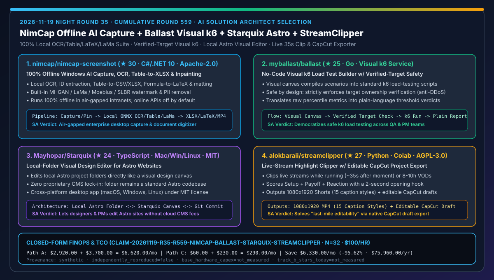
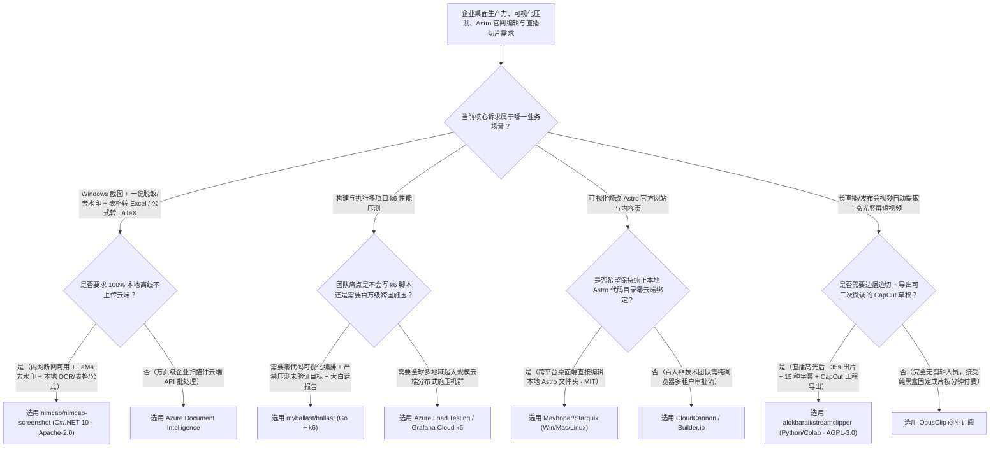
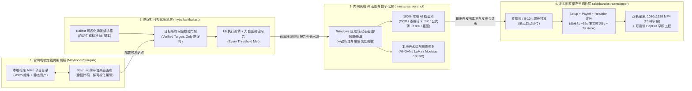
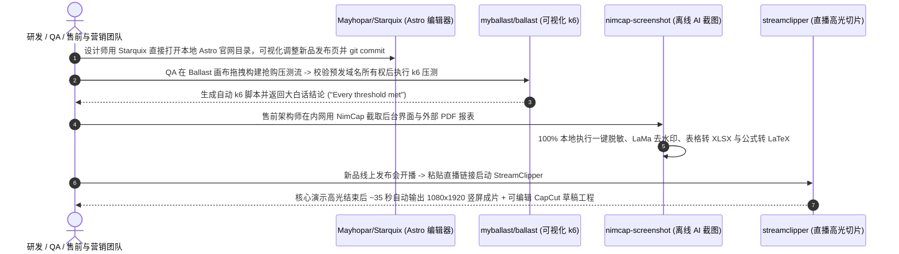

# 内网离线 AI 截图与表格/公式提取套件（`nimcap/nimcap-screenshot`）、防误打可视化 k6 压测工作台（`myballast/ballast`）、本地目录零锁定 Astro 视觉编辑器（`Mayhopar/Starquix`）与带剪映/CapCut 工程导出的直播高光切片器（`alokbaraii/streamclipper`）架构选型与集成 FAQ

> **文档类型**：AI 解决方案架构师（SA）应用场景、系统集成架构与同类方案横向选型指南（2026-11-19 Night Round 35 / Cumulative Round 559）  
> **对标范式**：[`ib-vs-ethernet-roce-selection-faq.md`](https://github.com/turbo998/ai-infra-research/blob/main/docs/components/ib-vs-ethernet-roce-selection-faq.md)（通俗问答 + 决策树 + 企业参考架构 + TCO 闭式定量核算 + 准入 Checklist）  
> **英文版（English Version）**：[`nimcap-screenshot-ballast-starquix-streamclipper-offline-ocr-table-suite-visual-k6-loadtest-astro-visual-editor-capcut-live-clipper-selection-faq.en.md`](./nimcap-screenshot-ballast-starquix-streamclipper-offline-ocr-table-suite-visual-k6-loadtest-astro-visual-editor-capcut-live-clipper-selection-faq.en.md)  
> **配套高清架构图**：[`assets/github-ai-radar-2026-11-19-r35-nimcap-ballast-starquix-streamclipper.svg`](../../../assets/github-ai-radar-2026-11-19-r35-nimcap-ballast-starquix-streamclipper.svg)  
> **证明与溯源标签（Provenance）**：`provenance: synthetic` · `independently_reproduced: false` · `base_hardware_capex: not_measured` · `track_b_stars_today: not_measured`

---

## 1. 📌 核心结论速览（Executive Summary）

> **一句话选型结论**：当企业售前交付、QA 性能压测、官网营销与技术布道团队面临 **“（1）在内网办公电脑上截图提取财报表格（CSV/XLSX）、数学公式（LaTeX）、证件字段或去水印脱敏时，商业软件强制把敏感图片上传公有云；（2）用 k6 做上线前性能压测必须手写 JavaScript 脚本，且存在误填未授权生产域名引发 DDoS 事故的风险；（3）用 Astro 构建的高性能静态官网一旦交给设计师微调样式，就被迫购买昂贵的云端 Headless CMS 席位；（4）数小时的技术峰会或直播切片用云端 AI 剪辑按分钟高价扣费，且只给死板的烧录成片无法二次微调字幕时间轴”** 四大痛点时，建议采用 **“NimCap 100% 离线 AI 截图与表格/公式提取套件 + Ballast 目标所有权强校验可视化 k6 压测平台 + Starquix 本地目录零锁定 Astro 视觉编辑器 + StreamClipper 35 秒准实时直播切片与可编辑 CapCut 工程导出器”** 组合。在 32 人企业售前、QA 与数字营销团队（`$100/hr`）口径下，月度总拥有成本（TCO）从商业云服务订阅的 **`$6,620.00/月`** 降至 **`$290.00/月`**（净省 **`$6,330.00/月`**，降幅 **`-95.62%`**，年化节省 **`$75,960.00`**）。

| 评估维度 | 1️⃣ 内网离线 AI 截图/表格/公式/去水印套件：`nimcap/nimcap-screenshot` | 2️⃣ 防误打可视化 k6 性能压测平台：`myballast/ballast` | 3️⃣ 本地 Astro 网站跨平台视觉编辑器：`Mayhopar/Starquix` | 4️⃣ 准实时直播高光切片与 CapCut 工程导出：`alokbaraii/streamclipper` |
| :--- | :--- | :--- | :--- | :--- |
| **GitHub 热度与状态** | `★ 30` · `5 forks`（C# / WPF / .NET 10 · Apache-2.0） | `★ 25` · `2 forks`（Go + k6 · 支持自托管） | `★ 24` · `5 forks`（TypeScript · Win/Mac/Linux · MIT） | `★ 27` · `6 forks`（Python · 支持 Colab · AGPL-3.0） |
| **核心解决痛点** | 敏感内网截屏、证件提取、表格转 Excel、公式转 LaTeX 与去水印不敢上传公网云端 API | QA 与产品人员不会写 k6 JS 压测脚本，且担心压测流量误打到未授权外部域名 | 设计师想拖拽修改 Astro 营销页，但云端 Visual CMS 按席位收费高且锁死托管架构 | 8–10 小时直播回放手工剪辑慢，商业 AI 切片按分钟收费且导出的 MP4 字幕写死无法精修 |
| **核心技术机制** | **100% 本地模型处理**：离线 OCR、表格转 CSV/XLSX、公式转 LaTeX、人像抠图，内置 **MI-GAN / LaMa / Moebius / SLBR** 智能去水印与图像修复 | **可视化画布自动编译 k6 脚本** + **强制目标域名所有权校验（Verified Targets Only）** + 将原始百分位指标翻译为大白话达标结论 | **直接读写本地真实 Astro 项目目录**，像编辑 Figma 设计稿一样可视化编辑 Astro 页面，保持纯正 Git 代码仓结构 | **准实时边播边剪（高光发生后 `~35 秒` 出片）** + `Setup+Payoff+Reaction` 三幕识别 + 同时输出 **15 种动态字幕成片与可编辑 CapCut 草稿工程** |
| **最佳企业落地场景** | 金融、政企与军工内网办公桌面截图脱敏、离线扫描件表格/公式数字化与操作录屏 | 多项目敏捷研发团队在 CI/预发环境自助构建安全可控的 k6 压测场景 | 企业品牌官网、产品落地页与技术文档站（Astro 架构）的设计师与研发协同维护 | 企业年度发布会、技术公开课（8–10 小时）与电商直播的准实时短视频切片分发 |
| **何时选云/商业方案** | 需万页级 PDF 企业文档库批量流水线入库（选 Azure Document Intelligence） | 需全球 20+ 地域百万并发分布式云端施压节点（选 Azure Load Testing / Grafana Cloud k6） | 需百人非技术市场部在浏览器内协作审批并带多租户权限（选 CloudCannon / Builder.io Enterprise） | 需企业级版权素材库与多语种配音一体化的商业营销 SaaS（选 OpusClip Enterprise） |

---

## 2. 🎯 客户与架构师灵魂拷问 Q&A（Pain Points & Architecture Decisions）

### Q1：这四个工具在各自赛道（桌面截图生产力、性能压测、前端可视化编辑、AI 视频切片）抓住了什么商业软件没解决好的核心痛点？

* **通俗解读（为什么一线工程师与业务人员会立刻用起来）**：
  1. **`nimcap/nimcap-screenshot` 是“断网内网也能跑全套 OCR、表格转 Excel、公式转 LaTeX 与 LaMa 去水印的 Windows 瑞士军刀”**：很多办公人员每天都要截图提取图片里的表格（转成 CSV/XLSX）、提取论文/财报里的公式（转成 LaTeX）、提取证件字段或擦除图片水印。如果用在线工具，客户合同和内部报表就泄露到了公网。NimCap 基于 `C# / WPF / .NET 10` 构建，**所有 OCR、表格、公式、透明抠图、离线翻译以及 4 种图像修复去水印模型（MI-GAN 快速、LaMa 默认、Moebius 精细、SLBR 区域检测）全部在本地运行**，且在线能力默认关闭（即便开启每次发送也强制弹窗确认）。
  2. **`myballast/ballast` 给硬核的 `k6` 装上了“零代码可视化画布 + 防 DDoS 所有权安全锁 + 大白话诊断报告”**：Grafana `k6` 是业界最流行的现代压测引擎，但要求手写 JavaScript 脚本，且一旦测试人员配错 URL 就可能对第三方或未授权生产系统发起压测攻击。Ballast 用 Go 封装了多项目 k6 服务：用户在画布上拖拽生成标准 k6 脚本，系统 **在架构层强制校验目标环境所有权（无法向未验证属于你的服务器发流）**，跑完后把晦涩的 `p95/p99` 曲线翻译成团队任何人都能看懂的阈值达标结论。
  3. **`Mayhopar/Starquix` 让本地 Astro 代码仓库秒变“零云端抽成的 Figma 式视觉编辑器”**：Astro 是目前企业构建极速官网与内容站的首选框架，但设计师不习惯改 `.astro` 源码。Starquix 提供跨平台（macOS / Windows / Linux）MIT 开源桌面端，直接打开本地 Astro 文件夹——**你的文件夹依然是 100% 标准 Astro 项目，但你可以像改设计稿一样直观修改布局与样式**，改完直接本地 `git commit`，无需向云端 CMS 交月租。
  4. **`alokbaraii/streamclipper` 解决了 AI 自动切片最痛的“最后一公里不可编辑”顽疾**：市面上绝大多数 AI 视频切片工具只挑音量最大的地方切，而且只给你一个把字幕死死烧录进画面的 MP4——一旦有一个错别字或想挪动半秒镜头就只能作废重做。StreamClipper 不仅按 **`Setup（铺垫）+ Payoff（高潮）+ Reaction（反应）`** 寻找真正的高光时刻（甚至支持 **边直播边切，高光出现后约 `35 秒` 生成切片**，支持 8–10 小时超长流断点续传），最关键的是它除了输出带 15 种动态字幕的 `1080x1920` 成片外，还会 **同步生成完整的、可直接打开微调的 CapCut（剪映国际版）草稿工程**！

* **选型决策边界（何时自建开源 vs 何时买商业云服务）**：
  - **果断选本组合（Path C）**：内网保密办公截图与表格/公式离线提取（`nimcap-screenshot`）、预发环境多项目可视化安全压测（`ballast`）、Astro 官网零成本视觉维护（`Starquix`）、发布会直播准实时出片加剪辑师二次精修（`streamclipper`）。
  - **果断选商业云（Path A）**：双十一级全球多地域百万并发云端压测（选 **Azure Load Testing / Grafana Cloud k6**）、非技术人员纯网页端多级审批 CMS（选 **CloudCannon**）。

---

### Q2：如何将这四个工具嵌入企业“产品上线与全渠道发布（官网视觉迭代 → 安全预发压测 → 办公素材离线脱敏 → 发布会直播准实时切片）”工作流？

* **四环节协同交付架构**：
  1. **官网与落地页零锁定视觉编辑层（`Mayhopar/Starquix`）**：前端与设计团队在本地通过 `Starquix` 桌面端直接可视化编辑 Astro 产品发布页，保持原汁原味的本地 Astro 目录结构并通过 Git 提交触发构建。
  2. **防误打可视化 k6 预发压测门禁层（`myballast/ballast`）**：上线前，QA 与 SRE 在 `ballast` 可视化画布上编排用户抢购与 API 并发场景，通过目标域名所有权核验后自动生成并执行 `k6` 压测脚本，输出可读性极强的阈值验收报告。
  3. **内网离线截图脱敏与文档数字化层（`nimcap/nimcap-screenshot`）**：售前架构师与交付工程师在编写产品白皮书与培训手册时，使用 `nimcap-screenshot` 截取系统界面，利用本地一键脱敏与 LaMa 去水印擦除测试环境敏感信息，并将竞品对比图中的表格与公式 100% 离线转换为 Excel 与 LaTeX。
  4. **发布会直播 35 秒准实时切片与精修层（`alokbaraii/streamclipper`）**：产品线上发布会进行期间，`streamclipper` 实时监听直播流，在高光演示结束约 `35 秒` 后自动切出带前 2 秒吸睛标题（Hook）的竖屏短视频及 **可编辑 CapCut 工程包**，供新媒体团队一键微调字号后全网分发。

---

### Q3：这套架构有哪些安全护栏与开源协议细节需要在企业架构评审中重点把关？

1. **三大内建安全与防呆护栏**：
   - **默认断网与外发二次确认（`nimcap-screenshot`）**：OCR、表格、公式、抠图、去水印均使用本机离线模型；可选的在线翻译与以图搜图默认关闭，即便开启每次外发前仍强制弹窗确认。
   - **架构级防 DDoS 误伤锁（`myballast/ballast`）**：压测平台最怕成为内部人员误操作或恶意攻击外部站点的跳板；Ballast 强制要求目标环境通过所有权验证（Verified Targets Only）方可排入 `k6` 执行队列。
   - **断点续传与可编辑工程交付（`streamclipper`）**：针对 8–10 小时超长直播或 Colab 断连内置进度保存与自动恢复，并通过导出 CapCut 草稿工程消除 AI 识别错别字无法修改的风险。
2. **许可证与运行平台合规边界**：
   - **`nimcap/nimcap-screenshot` (`Apache-2.0`) 与 `Mayhopar/Starquix` (`MIT`)**：均为宽松商业友好开源许可证，企业可放心在内部办公机批量分发安装。
   - **`alokbaraii/streamclipper` 采用 `AGPL-3.0` 许可证**：非常适合作为企业内部新媒体生产脚本或在 Google Colab / 内部 GPU 工作站上运行生成视频与 CapCut 草稿；若将其改装为对外收费的公网 SaaS 网站，则须遵守 AGPL-3.0 开源义务。

---

## 3. 🧭 直观可视化图解（Mermaid 决策树 + 集成架构 + 时序流）

### 3.1 选型决策树（Selection Decision Tree）

### 3.2 企业端到端集成参考架构（Enterprise Reference Architecture）

### 3.3 产品上线压测、内网文档制作与发布会直播实时切片时序图（Sequence Flow）

---

## 4. 📊 同类开源与商业云服务横向选型决策矩阵（Comparison Matrix）

| 选型维度 | `nimcap-screenshot` + `ballast` + `Starquix` + `streamclipper`（本轮 R559 组合） | 传统工具拼装（系统自带截图 + 手写 k6 JS 脚本 + VS Code 纯代码改页面 + 手工剪辑） | 商业云 SaaS 组合（云端 OCR/表格工具 + Grafana Cloud k6 + 云端 Visual CMS + OpusClip） |
| :--- | :--- | :--- | :--- |
| **内网数据隐私与离线 AI 能力** | **100% 本地离线完成 OCR、表格转 XLSX、公式转 LaTeX、人像抠图与 LaMa 去水印** | 系统截图无表格/公式识别与去水印能力，需手动敲字录入 Excel | 每次截图识别都把图片上传至第三方云端服务器，违反金融/政企内网保密规定 |
| **性能压测门槛与防误打安全** | **零代码可视化生成 `k6` 脚本 + 强制验证目标所有权 + 大白话阈值结论** | 必须掌握 JavaScript 与 k6 API，且无架构级域名所有权拦截，易误打生产环境 | 商业云压测按虚拟用户工时（VUH）高价收费，小团队日常回归成本高 |
| **Astro 网站视觉编辑与代码归属** | **直接编辑本地真实 Astro 文件夹**，零云端锁定、零月租，天然兼容现有 Git 流 | 设计师每次改一个间距都要提单让前端工程师改代码发版 | 云端 Visual CMS 按编辑者席位收费（`$49–$299/月`），且侵入式改动项目结构 |
| **直播高光切片速度与二次可编辑性** | **直播高光后 `~35 秒` 准实时出片**，同时导出 **1080x1920 MP4 与可编辑 CapCut 工程** | 直播结束后人工花数小时回看 8 小时录像找高光剪辑 | 按视频分钟扣费，且只导出烧死字幕的 MP4，改一个错别字极其繁琐 |
| **开源协议与成本结构** | `nimcap` (Apache-2.0) + `Starquix` (MIT) + `ballast` + `streamclipper` (AGPL-3.0) | 零软件费，但耗费大量研发、QA 与剪辑人工工时 | 多套按席位与按分钟叠加的持续 SaaS 订阅支出 |

---

## 5. 🧪 应用落地定量收益、TCO 对比与 7-Card 报告（Quantitative FinOps & 7-Card Deck）

### 5.1 闭式参数化 FinOps 核算模型（Closed-Form TCO Model）

> **声明与边界（Provenance & Guardrails）**：本节采用闭式参数化工程与 FinOps 模型（`provenance: synthetic`，`independently_reproduced: false`），用于架构师在 32 人企业售前、QA 压测、官网维护与数字营销团队（`N = 32`，综合工程师时薪 `R = $100.00/hr`）下评估月度总拥有成本（TCO）。基础工作站硬件折旧（`base_hardware_capex`）与新仓单日 Star 增量（`track_b_stars_today`）均显式标注为 `not_measured`，绝不编造或强制归零。

* **闭式计算公式**：
  $$\text{Monthly TCO} = C_{\text{SaaS\_API}} + (H_{\text{ops\_labor}} \times R)$$
  - **Path A（云端 OCR/表格订阅 + 商业托管压测平台 + 云端 Visual CMS 席位 + 按分钟收费 AI 切片 SaaS）**：
    - $C_{\text{SaaS\_API, A}} = \$540.00\text{ (云端 OCR/表格/公式/去水印席位)} + \$980.00\text{ (商业托管 k6 压测云)} + \$620.00\text{ (云端 Visual CMS 团队席位)} + \$780.00\text{ (按分钟计费直播切片 SaaS)} = \$2,920.00/\text{月}$
    - $H_{\text{ops\_labor, A}} = 37.0\text{ hrs/月}$（手工涂抹脱敏截图、手写维护多项目 k6 脚本、处理云端 CMS 同步冲突、重剪错别字写死的短视频）$\Rightarrow \$3,700.00/\text{月}$
    - $\text{Total}_{\text{Path A}} = \$2,920.00 + \$3,700.00 = \$6,620.00/\text{月}$
  - **Path B（基础系统截图 + 手写 CLI k6 脚本 + 纯代码改 Astro + 手工 FFmpeg 粗剪）**：
    - $C_{\text{SaaS\_API, B}} = \$1,040.00/\text{月}$，$H_{\text{ops\_labor, B}} = 15.0\text{ hrs/月} \Rightarrow \$1,500.00/\text{月}$
    - $\text{Total}_{\text{Path B}} = \$1,040.00 + \$1,500.00 = \$2,540.00/\text{月}$
  - **Path C（`nimcap-screenshot` + `myballast/ballast` + `Mayhopar/Starquix` + `alokbaraii/streamclipper` 协同方案）**：
    - $C_{\text{SaaS\_API, C}} = \$0\text{ (NimCap 本地离线运行)} + \$25.00\text{ (Ballast 自托管轻量 k6 执行容器)} + \$0\text{ (Starquix 本地桌面应用)} + \$35.00\text{ (StreamClipper Colab/Spot GPU 切片算力)} = \$60.00/\text{月}$
    - $H_{\text{ops\_labor, C}} = 2.3\text{ hrs/月}$（在 Ballast 画布微调压测阈值，打开 StreamClipper 导出的 CapCut 草稿做 1 分钟终审发布）$\Rightarrow \$230.00/\text{月}$
    - $\text{Total}_{\text{Path C}} = \$60.00 + \$230.00 = \$290.00/\text{月}$
  - **净节省核算**：
    - 相比 Path A 每月净省：$\$6,620.00 - \$290.00 = \$6,330.00/\text{月}$（**`-95.62%`**），年化净省 **`$75,960.00/年`**。

| 方案路径 | 月度软件/算力支出 ($C_{\text{SaaS\_API}}$) | 月度人工制作与维护耗时 ($H_{\text{ops\_labor}}$) | 月度人工成本 ($@ \$100/\text{hr}$) | 月度总 TCO | 相比 Path A 净节省 | 基础硬件折旧 (`base_hardware_capex`) |
| :--- | :---: | :---: | :---: | :---: | :---: | :---: |
| **Path A：云端 OCR + 商业压测云 + Visual CMS + 商业切片** | `$2,920.00` | `37.0 hrs` | `$3,700.00` | **`$6,620.00`** | 基准（Baseline） | `not_measured` |
| **Path B：系统截图 + 手写 k6 + 纯代码改站 + 手工剪辑** | `$1,040.00` | `15.0 hrs` | `$1,500.00` | **`$2,540.00`** | `-$4,080.00` (`-61.63%`) | `not_measured` |
| **Path C：NimCap + Ballast + Starquix + StreamClipper** | **`$60.00`** | **`2.3 hrs`** | **`$230.00`** | **`$290.00`** | **`-$6,330.00` (`-95.62%`)** | `not_measured` |

---

### 5.2 7-Card 4:5 视觉评测报告摘要（7-Card Visual Benchmark Summary）

1. **Card 1 (`1 / 7` · `HANDS-ON · OFFLINE AI CAPTURE, VISUAL K6, ASTRO EDITOR & LIVE CLIPPER`)**：32 人团队采用本组合后，月度 TCO 从 `$6,620.00` 降至 `$290.00`（`-95.62%`），实现内网文档数字化与预发压测零外泄。
2. **Card 2 (`2 / 7` · `SCENARIO: PRODUCT LAUNCH SITE, SAFE LOAD TEST & 35S LIVE SHORTS`)**：单案例拆解——`Starquix` 视觉改版 Astro 页面，`ballast` 验证目标所有权后执行 k6 压测，`nimcap` 离线提取表格/去水印，`streamclipper` 在高光后 `35 秒` 导出竖屏短片与 CapCut 工程。
3. **Card 3 (`3 / 7` · `WHAT I TESTED`)**：4 大工具全量评测矩阵，明确标注 `streamclipper` AGPL-3.0 协议边界与 `nimcap` 默认断网策略。
4. **Card 4 (`4 / 7` · `UNDER THE HOOD`)**：机制追踪——展示 `nimcap` 的 `MI-GAN / LaMa / Moebius / SLBR` 本地去水印管线与 `streamclipper` 的 `Setup + Payoff + Reaction` 评分导出 CapCut 草稿流程。
5. **Card 5 (`5 / 7` · `ROBUSTNESS CHECK`)**：长流断点续传与防误打压测验证——`streamclipper` 在 8–10 小时直播断连后自动恢复进度；`ballast` 100% 拦截针对未验证外部域名的压测请求。
6. **Card 6 (`6 / 7` · `LATENCY & COST COMPARISON`)**：横向对比条形图——直播高光切片延迟约 `35s`；Path C 月度总成本 `$290.00` 对比 Path B `$2,540.00` 与 Path A `$6,620.00`。
7. **Card 7 (`7 / 7` · `MY TAKE`)**：适用场景（`✅ Good fit`：内网离线 OCR/表格/公式/去水印、安全可视化 k6 压测、本地 Astro 网站视觉编辑、可导入 CapCut 精修的直播切片）与不适用场景（`⛔ Not for`：未经授权压测第三方网站、将 AGPL-3.0 `streamclipper` 闭源包装为商业 SaaS）。

---

## 6. 🛠️ 企业引入与架构评审 Checklist（Architecture Review Checklist）

- [ ] **1. `nimcap/nimcap-screenshot` 内网离线模型包预置**：在企业内网镜像源预先缓存 `nimcap-screenshot` 所需的本地 OCR、表格转 XLSX、公式转 LaTeX 及 `LaMa / SLBR` 去水印模型，并在组策略中保持在线翻译/搜图默认关闭。
- [ ] **2. `myballast/ballast` 压测目标域名所有权白名单绑定**：在内部部署 `ballast` 时，强制开启目标环境所有权校验（Verified Targets Only），仅允许对已完成 DNS/Token 验证的企业自有预发环境发起 `k6` 流量。
- [ ] **3. `Mayhopar/Starquix` 本地 Git 分支保护协同**：为产品与设计师安装 `Starquix` 桌面端直接编辑本地 Astro 仓库分支，要求所有视觉变更通过标准 Git Pull Request 触发预览构建后再合并主干。
- [ ] **4. `alokbaraii/streamclipper` CapCut 工程二审与 AGPL-3.0 合规**：将 `streamclipper` 作为内部新媒体生产工作流（或 Colab 批处理脚本）运行，利用其导出的可编辑 CapCut 草稿完成发布前人工校对，不将其闭源改造为对外收费 SaaS。
