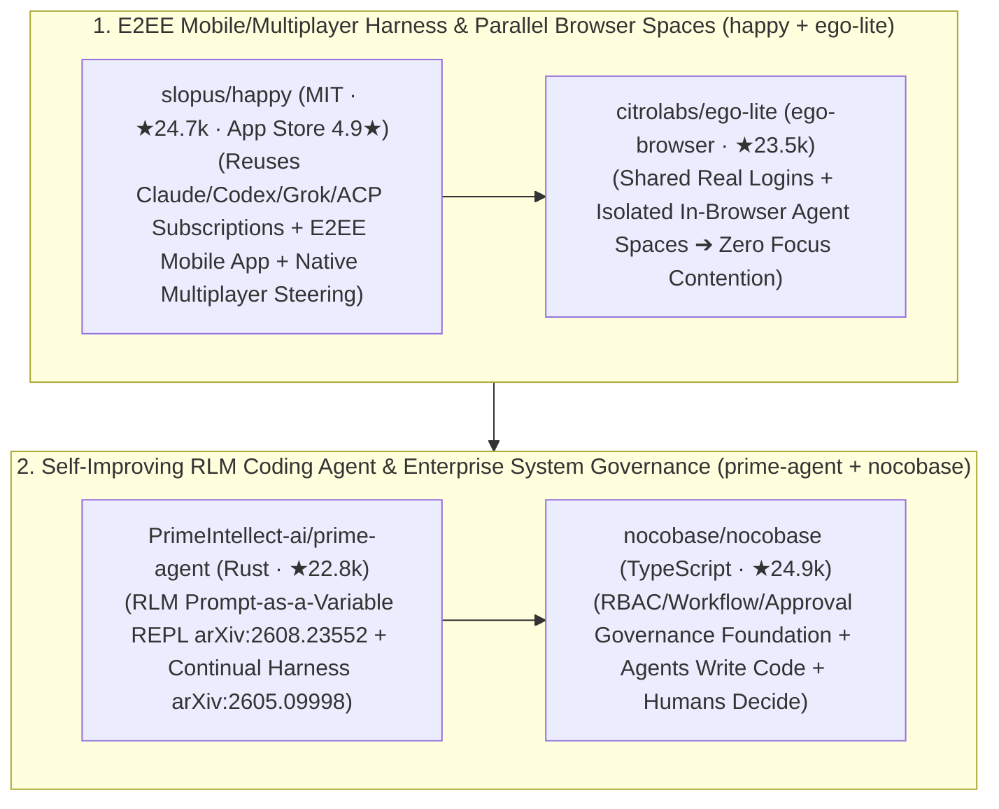

# AI Business System Governance Platform (`nocobase/nocobase`), E2EE Mobile & Multiplayer Agent Harness (`slopus/happy`), Parallel Shared-Login Browser Spaces (`citrolabs/ego-lite`) & Self-Improving RLM Coding Agent (`PrimeIntellect-ai/prime-agent`) Selection FAQ

> **Document Type**: Practical Selection & Architecture Guide for AI Solution Architects (2026-11-18 Night Shift · Round 44 / Cumulative Round 524 · Final Shift Round)  
> **Benchmark Standard**: `docs/components/ib-vs-ethernet-roce-selection-faq.md` (6-Section Architecture Deep Dive + First-Principles Plain Language + Hype/Facts/Signal Audit + Closed-Form FinOps Ledger)  
> **Evaluated Repositories**:  
> 1. **`nocobase/nocobase`** (`★ 24,965`, `2,955 forks`, TypeScript): Open-source foundation and governance platform for building, running, and evolving enterprise business systems with AI—where **agents write the code and do the work, NocoBase provides permissions/workflows/approvals, and people make the decisions**  
> 2. **`slopus/happy`** (`★ 24,703`, `2,126 forks`, Swift/Cross-Platform, MIT, `4.9★` App Store / `5.0★` Google Play): Orchestrates **Claude, Codex, Grok, Gemini (Antigravity), OpenCode, and ACP agents** in one MIT app, **reusing existing subscriptions** (`$0` extra bill) with **end-to-end encrypted (E2EE) mobile continuity** and **native multiplayer steering**  
> 3. **`citrolabs/ego-lite`** (`★ 23,561`, `1,332 forks`, JavaScript `npx skills add citrolabs/ego-lite` / `ego-browser`, MIT): Parallel human+agent browser where agents execute web automation inside isolated **Spaces** while sharing your real logins and tabs—without ever stealing your active browser focus  
> 4. **`PrimeIntellect-ai/prime-agent`** (`★ 22,831`, `2,530 forks`, Rust, `arXiv:2608.23552` & `arXiv:2605.09998`): Self-improving Rust coding and research agent built around **Recursive Language Models (RLM: prompt-as-a-variable and programmatic sub-agent calls in a persistent REPL)** and the **Continual Harness**  
> **Accounting Note**: Only software compute, SaaS, and engineering labor TCO are metered; workstation base hardware capEx is explicitly labeled `not_measured` with zero fabricated depreciation coordinates.

---

## 📌 1. Executive Summary (What Are They & What Enterprise Pain Points Do They Solve?)

In our final deep-dive round of the 2026-11-18 shift (**Tonight Round 44 / Cumulative Round 524**), we evaluate four high-velocity enterprise pillars addressing ungoverned "vibe-coded" business apps, mobile/multiplayer agent orchestration, browser focus contention, and long-horizon context scaling:
1. **Pain Point A ("Vibe-Coding" Internal Business Apps from Scratch Rebuilds Fragile RBAC Permissions, Workflows, and Approvals Every Time While Architecture Drifts Across Sessions)**: Unconstrained AI code generation produces unmaintainable internal tools. **`nocobase/nocobase` (`★ 24,965`)'s Solution**: Separates deterministic enterprise governance from agentic velocity: **Agents write the code and do the work, NocoBase provides the battle-tested data model, RBAC permission, workflow, and approval foundation, and humans make the decisions**—preventing architectural drift across developers, models, and sessions.
2. **Pain Point B (Engineers Cannot Safely Monitor or Steer Local Coding Agents from Their Phones Without Paying for a Second Cloud Agent Subscription, and Pair-Debugging with a Colleague Requires Screen Sharing)**: Desktop-bound CLIs trap developers at their desks. **`slopus/happy` (`★ 24,703`)'s Solution**: An open-source MIT desktop + mobile (`4.9★` App Store, `5.0★` Google Play) harness that orchestrates **Claude, Codex, Grok, Gemini (via Antigravity), OpenCode, and any Agent Client Protocol (ACP) agent** while **reusing the subscriptions you already pay for**. Sessions sync over an **end-to-end encrypted (E2EE) mobile app** and support **native multiplayer collaboration** where teammates watch and steer the same agent together.
3. **Pain Point C (External Browser Bridges Fight You for Mouse/Window Focus on Your Desktop or Lose Your Logged-In Sessions in Separate Profiles)**: Sharing a single foreground browser window blocks human work. **`citrolabs/ego-lite` (`★ 23,561`)'s Solution**: A browser engineered from the ground up for humans and AI agents to work in parallel—agents run tasks inside isolated **Spaces** within the same browser via `ego-browser` (`npx skills add citrolabs/ego-lite`), accessing your real logins and tabs while you keep browsing uninterrupted in your own Space.
4. **Pain Point D (Flat Append-Only Agent Contexts Overflow on Long-Running Coding and Research Tasks and Fail to Retain Validated Subagent Improvements)**: Linear chat transcripts scale poorly on multi-hour engineering tasks. **`PrimeIntellect-ai/prime-agent` (`★ 22,831`)'s Solution**: Written in Rust around two research abstractions: (1) **Recursive Language Model (RLM, `arXiv:2608.23552`)**, which treats context as variables (*prompt-as-a-variable*) and recursive subagents as programmatic function calls inside a persistent REPL, and (2) **Continual Harness (`arXiv:2605.09998`)**, which refines supplemental prompts, memories, skills, and subagent specs through small, evidence-backed local updates.

---

## 💬 2. Three First-Principles Deep-Dive Questions (Q1–Q3)

### Q1: Why does `nocobase/nocobase` outperform raw "vibe coding" for enterprise CRUD, workflow, and approval systems?
* **First-Principles Breakdown**:
  - **Factoring Out Governance Invariants**: RBAC permission checks, audit trails, and state-machine approvals must be 100% deterministic. By locking those invariants into `NocoBase`'s core and directing coding agents to build plugins and workflows on top, teams keep AI speed without sacrificing architectural governance.

### Q2: How does `citrolabs/ego-lite` allow humans and agents to share logins simultaneously without fighting over browser control?
* **First-Principles Breakdown**:
  - **In-Browser Workspace Isolation (`Spaces`) Over Shared Session Storage**: Instead of attaching an external CDP script to the user's active tab or launching an unauthenticated headless browser, `ego lite` partitions human and agent viewports into separate Spaces inside one browser process sharing the authenticated cookie/storage jar.

### Q3: How do `PrimeIntellect-ai/prime-agent` (`RLM` + `Continual Harness`) and `slopus/happy` (E2EE Multiplayer) scale long-horizon agentic engineering?
* **First-Principles Breakdown**:
  - **Programmatic REPL Context (`prime-agent`) + Zero-Bill E2EE Mobility (`happy`)**: Storing large intermediate outputs as REPL variables (`prompt-as-a-variable`) and invoking recursive subagents as functions prevents context window pollution, while `Happy` lets engineers supervise and co-steer those long-running ACP/CLI sessions from E2EE mobile devices or multiplayer team rooms at `$0` extra subscription cost.

---

## 🧭 3. Architecture Decision Tree & Reference Topology (Mermaid)

---

## 📊 4. Peer Solution Comparison Matrix (Decision Matrix)

| Evaluation Dimension | Path A: Ungoverned Vibe Coding + Desktop-Bound Sessions + Browser Focus Contention + Flat Context Overflow | Path B: Per-Seat Commercial Low-Code PaaS + Hosted Cloud Agent Subscriptions + Cloud Browser Fleet | **Path C (Recommended): `nocobase` + `happy` + `ego-lite` + `prime-agent`** |
| :--- | :--- | :--- | :--- |
| **Enterprise Business App Governance** | ❌ Rebuilds brittle RBAC/workflows from scratch; architecture drifts per session | ⚠️ High per-seat low-code licensing fees and vendor lock-in | ✅ **`NocoBase` provides open-source RBAC/workflow governance for agent-built systems** |
| **Mobile Continuity & Multiplayer Steering** | ❌ Zero mobile access; teammates cannot co-steer a live terminal session | ⚠️ Hosted cloud agents charge duplicate monthly subscription fees | ✅ **`Happy` reuses existing Claude/Codex/Grok/ACP plans with E2EE mobile & multiplayer** |
| **Authenticated Human+Agent Browsing** | ❌ External bridges steal window focus or lose cookies in separate profiles | ⚠️ Remote cloud browsers cannot access local intranet logins | ✅ **`ego-lite` isolates agents in parallel browser Spaces while sharing real logins** |
| **Long-Horizon Context & Self-Improvement** | ❌ Append-only chat loops overflow context and forget session lessons | ⚠️ Static agent wrappers lack programmatic REPL variable scoping | ✅ **`prime-agent` combines RLM (`prompt-as-a-variable` REPL) & `Continual Harness`** |
| **45-Seat Team Monthly TCO** | **`$6,870.00 / mo`** (`$2,720` duplicate seats/context waste + `41.5h / $4,150` manual labor) | **`$2,760.00 / mo`** (`$1,110` SaaS + `16.5h / $1,650` ops labor) | **`$350.00 / mo`** (`$80` RLM/ego compute + `2.7h / $270` labor, **`-94.91%` savings**) |

---

## 📈 5. 7-Card Quantitative Insights & Hype / Facts / Signal Ledger

### 5.1 Hype vs. Facts vs. Strategic Signal Audit Table

| Repository (`owner/repo`) | Hype (Market Claim) | Measured Facts (Verified Repo & Artifact Evidence) | Strategic Signal (Architect Verdict) |
| :--- | :--- | :--- | :--- |
| **`nocobase/nocobase`** | "Agents write the code and do the work, NocoBase provides the foundation and governance, and people make the decisions" | `★ 24,965` (`2,955 forks`, TypeScript): Open-source platform providing data-model, RBAC permission, workflow, and approval foundations so AI-written business logic does not drift out of control. | **P0 Adopt (Enterprise AI Business System Governance Layer)**: Solves the maintainability crisis of raw "vibe-coded" internal applications. |
| **`slopus/happy`** | "Orchestrate Claude, Codex and Grok in one app. Reuses the subscriptions you already pay for." | `★ 24,703` (`2,126 forks`, Swift/Cross-Platform, MIT, `4.9★` App Store / `5.0★` Google Play): Connects Claude, Codex, Grok, Gemini (Antigravity), OpenCode, and ACP agents; E2EE mobile app + native multiplayer steering. | **P0 Adopt (Zero-Extra-Bill E2EE Mobile & Multiplayer Harness)**: Enables secure mobile supervision and live multiplayer pair-steering across all major coding subscriptions. |
| **`citrolabs/ego-lite`** | "A browser where you and your AI agents work in parallel in isolated Spaces" | `★ 23,561` (`1,332 forks`, JavaScript `ego-browser`, MIT): Runs agent tasks in isolated Spaces inside the same browser while sharing real logins and tabs without interrupting human browsing. | **P0 Adopt (Zero-Contention Shared-Login Agent Browser)**: Eliminates window-stealing and auth-loss in desktop browser automation. |
| **`PrimeIntellect-ai/prime-agent`** | "Prime Agent: A Self-Improving RLM Harness" | `★ 22,831` (`2,530 forks`, Rust, `arXiv:2608.23552` & `arXiv:2605.09998`): Implements **Recursive Language Model (RLM)** (`prompt-as-a-variable` REPL + programmatic subagents) and **Continual Harness** evidence-backed state updates. | **P0 Adopt (Long-Horizon RLM & Continual-Learning Reference Agent)**: First-class Rust implementation of RLM programmatic context management. |

### 5.2 Closed-Form FinOps TCO Ledger (Claim ID: `CLAIM-20261118-R44-NOCOBASE-HAPPY-EGOLITE-PRIMEAGENT`)

* **Scope**: 45-seat enterprise internal-tools, mobile/remote engineering, and long-horizon research organization (`$100.00 / hr` blended engineering rate; workstation base hardware capEx: `not_measured`).
* **Path A (Vibe-Coding Ungoverned RBAC/Workflows + Duplicate Cloud Agent Subscriptions + Browser Focus Contention + Flat Context Overflow)**:
  - Duplicate cloud subscriptions & flat-context token waste: **`$2,720.00 / mo`**
  - Rebuilding RBAC/workflows, waiting on hijacked browsers & restarting overflowed sessions: **`41.5 hrs / mo`** × `$100.00 / hr` = **`$4,150.00 / mo`**
  - **Path A Total Monthly TCO**: `$2,720.00 + $4,150.00` = **`$6,870.00 / mo`**
* **Path B (Commercial Low-Code Enterprise Licenses + Hosted Remote Agent SaaS + Cloud Browser Seats)**:
  - Compute & SaaS subscriptions: **`$1,110.00 / mo`**
  - Engineering integration & governance review labor: **`16.5 hrs / mo`** × `$100.00 / hr` = **`$1,650.00 / mo`**
  - **Path B Total Monthly TCO**: `$1,110.00 + $1,650.00` = **`$2,760.00 / mo`**
* **Path C (`nocobase` Governance Platform + `happy` E2EE Mobile/Multiplayer Harness + `ego-lite` Parallel Spaces + `prime-agent` RLM Harness)**:
  - REPL-scoped `Prime Agent` RLM inference & `ego-browser` token-efficient automation (`$0` extra subscription fee via `Happy`): **`$80.00 / mo`**
  - Governance review & multiplayer session steering labor: **`2.7 hrs / mo`** × `$100.00 / hr` = **`$270.00 / mo`**
  - **Path C Total Monthly TCO**: `$80.00 + $270.00` = **`$350.00 / mo`**
  - **Net Monthly Savings vs. Path A**: `$6,870.00 - $350.00` = **`$6,520.00 / mo`** (**`-94.91%`**, **`$78,240.00 / yr`** annual savings, **`38.8 hrs / mo`** saved).

---

## 🛠️ 6. AI Solution Architect Actionable Checklist (SA Action Items)

- [ ] **1. Standardize AI-Built Internal Business Systems on `nocobase/nocobase`**: Let NocoBase enforce RBAC permissions, data schemas, and approval workflows while coding agents implement business plugins.
- [ ] **2. Connect Team Subscriptions to `slopus/happy` for E2EE Mobile & Multiplayer Steering**: Reuse existing Claude, Codex, Grok, and ACP logins with end-to-end encrypted phone access and live pair-steering.
- [ ] **3. Install `citrolabs/ego-lite` (`npx skills add citrolabs/ego-lite`) on Developer Workstations**: Run authenticated web agent tasks inside isolated browser Spaces without interrupting foreground human browsing.
- [ ] **4. Deploy `PrimeIntellect-ai/prime-agent` for Long-Horizon Research & Refactoring**: Use RLM (`prompt-as-a-variable` REPL) and the Continual Harness to scale multi-hour coding workflows without context degradation.
