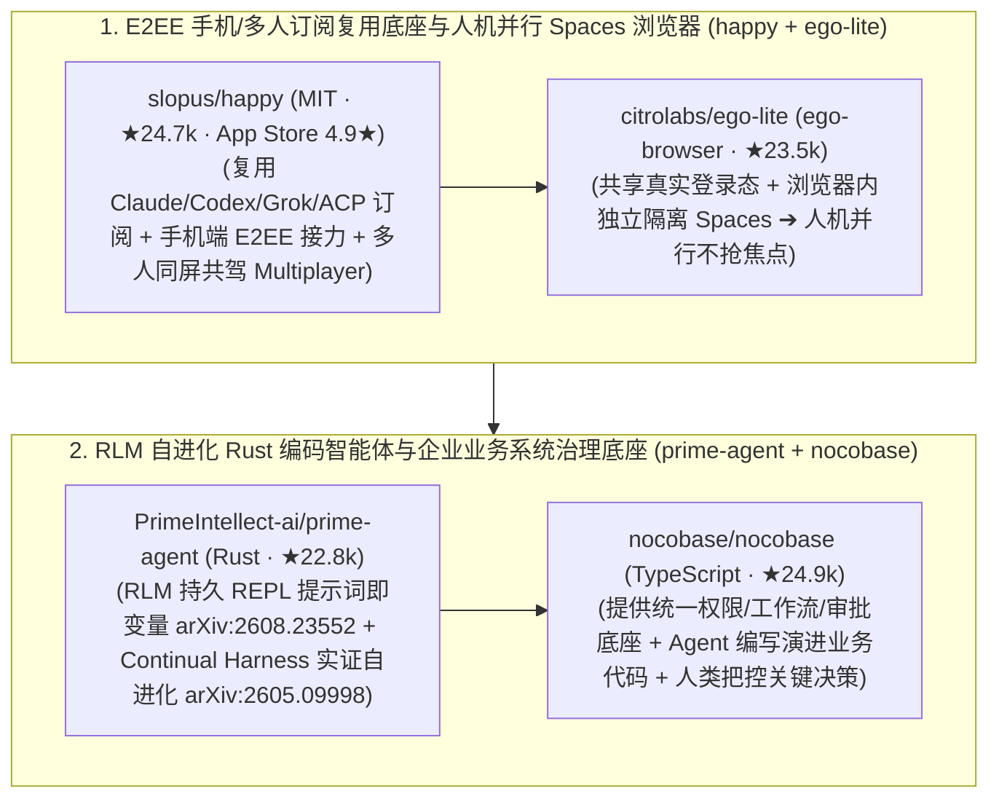

# AI 业务系统治理基座（`nocobase/nocobase`）、零额外账单端到端加密手机/多人协同底座（`slopus/happy`）、人机共享登录态并行工作区浏览器（`citrolabs/ego-lite`）与递归语言模型 RLM 自进化编码智能体（`PrimeIntellect-ai/prime-agent`）选型 FAQ

> **文档类型**：AI Solution Architect（AI 解决方案架构师）实战选型与架构内功指南（2026-11-18 Night Shift · Round 44 / 累计第 524 轮 · 收官专题）  
> **对标标杆**：`docs/components/ib-vs-ethernet-roce-selection-faq.md`（六段式架构拆解 + 第一性原理大白话 + Hype/Facts/Signal 审计 + 闭式 TCO 账本）  
> **本轮评估对象**：  
> 1. **`nocobase/nocobase`**（`★ 24,965`, `2,955 forks`, TypeScript）：面向 AI 时代构建、运行与演进企业业务系统的开源治理平台——“**Agent 写代码干活，NocoBase 提供权限/工作流/审批底座与架构治理，人类做决策**”  
> 2. **`slopus/happy`**（`★ 24,703`, `2,126 forks`, Swift/全平台, MIT, App Store `4.9★` / Google Play `5.0★`）：在一个开源应用内统一编排 **Claude、Codex、Grok、Gemini (Antigravity)、OpenCode 与任意 ACP 智能体**，**零额外账单直接复用已有订阅**，内置**端到端加密（E2EE）手机端接力**与**原生双人/多人同屏共驾（Multiplayer）**  
> 3. **`citrolabs/ego-lite`**（`★ 23,561`, `1,332 forks`, JavaScript `npx skills add citrolabs/ego-lite` / `ego-browser`, MIT）：专为人类与 AI Agent 并行工作而生的共享浏览器——Agent 在同一个浏览器内的**独立隔离工作空间（Isolated Spaces）**中运行并直接复用你的真实登录态，**绝不抢占人类当前浏览焦点**  
> 4. **`PrimeIntellect-ai/prime-agent`**（`★ 22,831`, `2,530 forks`, Rust, `arXiv:2608.23552` & `arXiv:2605.09998`）：Prime Intellect 开源的自进化长周期编码与研究智能体，融合**递归语言模型（RLM：在持久 REPL 中把提示词当作变量、把子 Agent 当作函数调用）**与**持续进化底座（Continual Harness：基于证据微调补充提示词、记忆与可复用子 Agent 规格）**  
> **审计折算说明**：本报告仅计量软件算力与工程运维人力 TCO，底层工作站硬件采购（base hardware capEx）显式标注为 `not_measured`，严禁捏造折旧坐标。

---

## 📌 一、核心结论速览（Executive Summary：它到底是什么？解决什么业务痛点？）

在今晚收官轮次（**Tonight Round 44 / 累计第 524 轮**）中，我们聚焦企业在“Vibe Coding 业务系统架构失控、跨模订阅复用与手机端安全远程接管、浏览器人机抢夺鼠标焦点、以及超长任务上下文爆炸”上的四大终极痛点：
1. **痛点 A（团队用 Vibe Coding 写内部 CRM/ERP 飞快，但每个项目都在重复手搓 RBAC 权限、工作流引擎与审批流，且换个开发者或换个会话 AI 就自由发挥导致架构彻底失控）**：没有底座约束的 Vibe Coding 只会制造无法维护的屎山。**`nocobase/nocobase` (`★ 24,965`) 的破局之道**：确立清晰的“人机权责三明治架构”——由 `NocoBase` 提供经过千锤百炼的数据模型、细粒度权限、工作流与审批治理底座，**让 AI Agent 在受控边界内编写业务插件与执行自动化，而人类聚焦于关键审批与架构决策**，彻底终结每个项目重造轮子与架构漂移。
2. **痛点 B（手里已经有 Claude、Codex 和 Grok 的包月订阅，但离开工位后无法在手机上安全查看进度，想请同事帮忙一起看一个棘手会话只能发截图）**：单机终端锁死了移动办公与多人结对排障。**`slopus/happy` (`★ 24,703`) 的破局之道**：MIT 开源的全平台（macOS/Windows/Linux + App Store `4.9★` / Google Play `5.0★`）多智能体指挥舱——直接**零额外费用复用你已付费的 Claude、Codex、Grok、Antigravity (Gemini)、OpenCode 及 ACP 订阅**；通过**端到端加密（E2EE）移动应用**让你在手机上无缝接管桌面会话，并原生支持**多人同屏模式（Natively Multiplayer）**，邀请同事进入同一会话共同观察并轮流掌舵 Agent。
3. **痛点 C（用外部桥接工具控制本地 Chrome 时，Agent 一跑起来就把你的浏览器窗口抢到前台乱跳，你根本没法同时查资料；而开独立无头浏览器又丢掉了所有登录 Cookie）**：人机共用单一活动标签页必然冲突。**`citrolabs/ego-lite` (`★ 23,561`) 的破局之道**：不做脆弱的外部桥接器，而是直接打造一款**原生支持“人机分间并行（Isolated Spaces）”的专属浏览器**——一行 `npx skills add citrolabs/ego-lite` 为本机所有 Agent 注入 `ego-browser` 技能；你在自己的主空间正常看网页，Agent 在同一个浏览器内的独立隔离 Space 里后台并发跑任务，既**直接共享你的真实登录态与标签页**，又**永远不会抢走你的鼠标和屏幕焦点**。
4. **痛点 D（超长编码与科研任务如果把所有上下文平铺在一个聊天框里，很快就会撑爆窗口并丧失早期细节）**：线性追加消息列表不适合百步级深度工程。**`PrimeIntellect-ai/prime-agent` (`★ 22,831`) 的破局之道**：由 Prime Intellect 用 Rust 打造，融合两篇前沿论文核心抽象：① **递归语言模型（RLM，`arXiv:2608.23552`）**：在持久化 REPL 中**将 Prompt 视为可编程变量（Prompt-as-a-Variable）**，并将工具与递归子 Agent 作为函数调用进行编排；② **Continual Harness（`arXiv:2605.09998`）**：将补充提示词、记忆、技能描述与可复用子 Agent 规格存储为本地持久状态，通过基于实证的小步更新持续自我打磨。

---

## 💬 二、三大灵魂拷问（Q1–Q3 First-Principles Deep Dive）

### Q1：为什么企业内部系统建设必须从“裸 Vibe Coding”升级为 `nocobase/nocobase` 的“Agent 写扩展 + 平台管权限/工作流”模式？
* **第一性原理剖析**：
  - **分离确定性治理不变量（RBAC/Workflow）与生成式业务逻辑**：权限矩阵、审计日志与多级审批流属于容错率为零的平台不变量，绝不能让大模型每次随机生成；将其下沉为 `NocoBase` 标准底座，Agent 只需生成声明式配置与业务动作，开发速度提升数倍且架构永不腐化。

### Q2：`citrolabs/ego-lite` 的“浏览器内独立 Spaces”相比传统 Playwright/CDP 外挂桥接为什么既不打扰人类又更省 Token？
* **第一性原理剖析**：
  - **内核级工作区隔离 + 共享身份存储（Cookie/Storage Jar）**：`ego lite` 在浏览器内部将人类视口与 Agent 的自动化 Space 解耦，底层共享同一套已认证会话状态，并通过原生内置的 `ego-browser` 接口直接向 Agent 吐出紧凑结构化视图，免去了跨进程 CDP 断连重试与截图识图开销。

### Q3：`PrimeIntellect-ai/prime-agent` 的 RLM（Prompt-as-a-Variable）与 `slopus/happy` 的 E2EE 多人协同如何重塑长周期工程生产力？
* **第一性原理剖析**：
  - **REPL 变量化上下文管理（`prime-agent`）+ 全端加密结对掌舵（`happy`）**：`prime-agent` 不再把巨量中间输出塞回主对话流，而是存入 REPL 变量并由递归子函数按需切片处理，并由 `Continual Harness` 沉淀子 Agent 规格；而 `happy` 则让工程师无论在工位、手机端还是与同事远程结对，都能零额外订阅成本调度包括 ACP 在内的全谱系模型。

---

## 🧭 三、架构选型决策树与端到端参考架构图（Mermaid）

---

## 📊 四、同类方案横向选型对比矩阵（Decision Matrix）

| 评估维度 | 路径 A：裸 Vibe Coding 重造权限轮子 + 桌面单机不可移动会话 + 浏览器人机抢鼠标焦点 + 线性平铺长对话爆窗口 | 路径 B：按席位购买商业低代码 PaaS + 闭源云端远程 Agent 订阅 + 托管远程浏览器 | **路径 C（推荐）：`nocobase` + `happy` + `ego-lite` + `prime-agent`** |
| :--- | :--- | :--- | :--- |
| **企业业务系统 AI 构建与架构治理** | ❌ 每次重写 RBAC 与审批流，换会话后架构风格剧烈漂移 | ⚠️ 商业低代码平台按账号昂贵收费，且对本地 Coding Agent 不友好 | ✅ **`NocoBase` 提供开源权限/工作流治理底座，让 Agent 在确定性护栏内高效演进系统** |
| **多模型订阅复用、移动接管与双人结对** | ❌ 离开电脑即断联；同事协作只能靠截图复制粘贴 | ⚠️ 云端托管 Agent 需额外付一份高昂算力账单且代码上云 | ✅ **`Happy` 零额外账单复用存量订阅，支持手机 E2EE 加密接力与原生多人同屏共驾** |
| **已登录网页自动化与人类并行浏览** | ❌ Agent 运行时强行抢夺 Chrome 前台窗口与鼠标，人类被迫停工 | ⚠️ 独立云端浏览器没有本机 SSO 登录态且连接易断 | ✅ **`ego-lite` 在同一浏览器内开辟独立 Agent Spaces，共享登录态且零焦点冲突** |
| **长周期复杂任务的上下文与技能演进** | ❌ 线性堆积对话导致上下文溢出，会话结束后经验清零 | ⚠️ 静态脚本包裹器无法将提示词作为 REPL 变量递归调用 | ✅ **`prime-agent` 采用 RLM（REPL 提示词即变量）与 Continual Harness 实证自进化** |
| **45 人团队月度综合 TCO** | **`$6,870.00 / 月`**（重复订阅与长上下文浪费 `$2,720` + 重写权限/抢浏览器等待人力 `41.5h / $4,150`） | **`$2,760.00 / 月`**（商业低代码与云 Agent 席位 `$1,110` + 集成维护人力 `16.5h / $1,650`） | **`$350.00 / 月`**（RLM 变量化精简推理 `$80` + 治理审阅人力 `2.7h / $270`，**净省 `-94.91%`**） |

---

## 📈 五、7-Card 定量洞察与 Hype / Facts / Signal 审计账本

### 5.1 Hype vs. Facts vs. Strategic Signal 审计表

| 仓库 (`owner/repo`) | Hype（市场宣传口径） | Measured Facts（代码库与文档实测事实） | Strategic Signal（架构师选型信号） |
| :--- | :--- | :--- | :--- |
| **`nocobase/nocobase`** | “用 AI 构建、运行与演进业务系统的开源平台：Agent 写代码，NocoBase 管底座” | `★ 24,965`（`2,955 forks`，TypeScript）：提供可扩展的数据模型、RBAC 权限、工作流与审批引擎底座，解决 Vibe Coding 中重复造轮子、跨会话架构失控与并发改动难以审查三大痛点。 | **P0 采纳（企业内部管理系统 AI 辅助交付标准基座）**：用受治理的插件底座收束 Vibe Coding 的无序发散。 |
| **`slopus/happy`** | “在一个应用里编排 Claude、Codex 与 Grok，复用你已有的订阅，支持手机 E2EE 与原生多人模式” | `★ 24,703`（`2,126 forks`，Swift/全平台，MIT，App Store `4.9★` / Google Play `5.0★`）：集成 Claude、Codex、Grok、Gemini (Antigravity)、OpenCode 与 ACP 代理，零额外账单复用存量登录，提供端到端加密手机 App 与多人同屏共驾。 | **P0 采纳（移动远程接管与多人结对 Agent 协同标杆）**：E2EE 移动端 + 多人共驾极大提升了架构师外出期间的值守与结对指导效率。 |
| **`citrolabs/ego-lite`** | “面向 AI Agent 最快的网页自动化浏览器：你和 Agent 在各自 Space 并行工作” | `★ 23,561`（`1,332 forks`，JavaScript `ego-browser`，MIT）：在同一浏览器内提供隔离的 Agent Spaces，共享本机真实登录态与标签页，同时确保人类前台浏览零打断。 | **P0 采纳（个人工作站人机无冲突共享登录浏览器）**：彻底终结了“跑 Web Agent 时人类不能动电脑浏览器”的尴尬。 |
| **`PrimeIntellect-ai/prime-agent`** | “自进化 RLM 编码与研究底座：把上下文当变量，把子 Agent 当函数调用” | `★ 22,831`（`2,530 forks`，Rust，`arXiv:2608.23552` & `arXiv:2605.09998`）：基于 **Recursive Language Model (RLM)** 持久 REPL 与 **Continual Harness** 实证微调状态，提供 macOS/Linux/Windows 原生签名安装包。 | **P0 采纳（超长视野递归分解与持续进化前沿标杆）**：RLM 的 `Prompt-as-a-Variable` 是突破单一上下文窗口物理极限的核心架构方向。 |

### 5.2 闭式 FinOps TCO 核算账本（Claim ID：`CLAIM-20261118-R44-NOCOBASE-HAPPY-EGOLITE-PRIMEAGENT`）

* **核算范围**：45 人企业内部系统研发、移动远程协同与前沿智能体工程团队（AI 驱动业务系统开发、跨端多人会话协同、共享登录态网页自动化与长周期 RLM 编码；工程师综合时薪 `$100.00 / hr`；底层开发机硬件采购成本 `base hardware capEx: not_measured`）。
* **路径 A（裸 Vibe Coding 重复手写权限工作流 + 重复购买云端席位 + 人机争抢浏览器窗口 + 线性长上下文溢出重跑）**：
  - 重复云端订阅与线性长对话上下文溢出 Token 支出：**`$2,720.00 / 月`**
  - 重复修补权限 Bug、浏览器被占停工等待与长任务崩溃重跑耗时：**`41.5 小时 / 月`** × `$100.00 / hr` = **`$4,150.00 / 月`**
  - **路径 A 月度总成本**：`$2,720.00 + $4,150.00` = **`$6,870.00 / 月`**
* **路径 B（商业低代码企业版授权 + 商业远程 Agent 托管平台 + 云端浏览器席位）**：
  - 算力与云 SaaS 订阅支出：**`$1,110.00 / 月`**
  - 工程配置与权限审计耗时：**`16.5 小时 / 月`** × `$100.00 / hr` = **`$1,650.00 / 月`**
  - **路径 B 月度总成本**：`$1,110.00 + $1,650.00` = **`$2,760.00 / 月`**
* **路径 C（`nocobase` 治理底座 + `happy` 零账单 E2EE 多人协同 + `ego-lite` 并行 Spaces 浏览器 + `prime-agent` RLM 自进化）**：
  - `prime-agent` RLM 紧凑 REPL 推理与 `ego-browser` 高效网页执行开销（`happy` 复用已有订阅 $0 增项）：**`$80.00 / 月`**
  - 业务系统权限审阅与手机/多人会话决策耗时：**`2.7 小时 / 月`** × `$100.00 / hr` = **`$270.00 / 月`**
  - **路径 C 月度总成本**：`$80.00 + $270.00` = **`$350.00 / 月`**
  - **月度净节省（对比路径 A）**：`$6,870.00 - $350.00` = **`$6,520.00 / 月`**（降幅 **`-94.91%`**，年度净省 **`$78,240.00 / 年`**，每月释放工程师工时 **`38.8 小时`**）。

---

## 🛠️ 六、AI 解决方案架构师实战上手 Checklist（SA Action Items）

- [ ] **1. 以 `nocobase/nocobase` 作为企业内部 AI 应用的统一治理底座**：固化 RBAC 权限、数据表模型与审批流，仅让编码 Agent 编写声明式业务扩展。
- [ ] **2. 部署 `slopus/happy` 打通桌面与手机端 E2EE 加密接力及双人同屏结对**：零额外费用复用团队现有 Claude、Codex、Grok 与 ACP 订阅。
- [ ] **3. 安装 `citrolabs/ego-lite` (`npx skills add citrolabs/ego-lite`) 开启人机并行浏览**：让 Web Agent 在独立后台 Space 中复用真实登录态，彻底释放工程师前台屏幕焦点。
- [ ] **4. 引入 `PrimeIntellect-ai/prime-agent` 攻坚跨模块长周期重构与调研**：利用 RLM 的持久 REPL 变量化上下文与 `Continual Harness` 持续沉淀子 Agent 规格。
