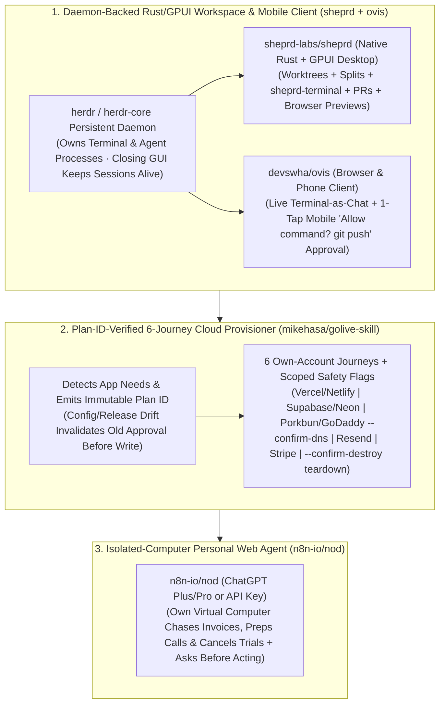

# [R510 Milestone] Isolated-Computer Personal Web Agent (`n8n-io/nod`), Rust/GPUI Daemon Workspace (`sheprd-labs/sheprd`), 1-Tap Mobile Herdr Companion (`devswha/ovis`) & Plan-ID-Verified 6-Journey Cloud Provisioner (`mikehasa/golive-skill`) Selection FAQ

> **Document Type**: Practical Selection & Architecture Guide for AI Solution Architects (2026-11-18 Night Shift · Round 30 / **Cumulative Round 510 Milestone R510**)  
> **Benchmark Standard**: `docs/components/ib-vs-ethernet-roce-selection-faq.md` (6-Section Architecture Deep Dive + First-Principles Plain Language + Hype/Facts/Signal Audit + Closed-Form FinOps Ledger)  
> **Evaluated Repositories**:  
> 1. **`n8n-io/nod`** (`★ 2,475`, `360 forks`, TypeScript, macOS 14+ / Windows 11 / Linux x64): n8n's open-source personal agent with its own dedicated computer environment that chases invoices, preps call briefs, and cancels trials on real websites using your ChatGPT Plus/Pro login or API key, **asking before it acts**  
> 2. **`sheprd-labs/sheprd`** (`★ 2,342`, `210 forks`, Rust + GPUI): Native GPU-accelerated workspace for terminals, Git worktrees, PRs, browser previews, and AI agents bundling a pinned `herdr-core` daemon (**closing the Sheprd GUI leaves all terminal sessions running**)  
> 3. **`devswha/ovis`** (`★ 2,133`, `297 forks`, TypeScript, MIT, `herdr 0.9.0+`): Open-source browser and phone client for `herdr` that renders live Claude Code and Codex terminals as clean chats with **1-tap mobile command approvals (`Yes` / `Yes and don't ask again` / `No`)**  
> 4. **`mikehasa/golive-skill`** (`★ 1,623`, `98 forks`, TypeScript `v0.1.0-alpha.9`, zero-telemetry Agent Skill + CLI): Provisions and tears down production stacks on your own accounts across **6 live-tested journeys** (Vercel/Netlify, Supabase/Neon, Porkbun/GoDaddy DNS, Resend, Stripe, Supabase Auth) with **Plan-ID hash re-verification, `--confirm-dns`, `--confirm-destroy`, and `golive status` drift checks**  
> **Accounting Note**: Only software inference, cloud resource, and engineering labor TCO are metered; workstation base hardware capEx is explicitly labeled `not_measured` with zero fabricated depreciation coordinates.

---

## 📌 1. Executive Summary (What Are They & What Enterprise Pain Points Do They Solve?)

In **Cumulative Round 510 (R510 Milestone)**, we evaluate four high-velocity repositories that close the loop across personal web admin automation, daemon-backed native terminal workspaces, 1-tap mobile agent approvals, and plan-gated production cloud provisioning:
1. **Pain Point A (Automating Real-Website Admin Tasks—Chasing Invoices, Prepping Calls, Canceling Trials—Either Hijacks Your Main Cursor or Triggers Cloud Datacenter IP Blocks)**: Many SaaS billing portals lack APIs, and running browser automation on your main desktop interrupts your work. **`n8n-io/nod` (`★ 2,475`)'s Solution**: Gives the agent **its own isolated computer environment on your machine** (using your existing ChatGPT Plus/Pro subscription or AI key). It navigates real websites to chase invoices, prep call notes, and cancel free trials in the background, and **always asks for confirmation before executing an action**.
2. **Pain Point B (Closing or Crashing a Heavy Electron IDE Kills Active Agent Processes)**: Coupling GUI windows directly to child shell processes risks losing multi-hour agent runs. **`sheprd-labs/sheprd`'s Solution**: A native **Rust + GPUI** workspace across macOS, Linux, and Windows (plus iOS/iPadOS TestFlight) that bundles a pinned **`herdr-core` daemon** (and supports `Herdr 1` cell streams) where the daemon owns all terminal processes—so **closing Sheprd leaves every local, SSH, and cloud worktree session running**.
3. **Pain Point C (Stepping Away from Your Desk Leaves Claude Code or Codex Blocked for Hours on an `Allow command? git push` Prompt)**: High-impact commands require human approval, but waiting at a desk all day kills mobility. **`devswha/ovis`'s Solution**: A free, open-source browser and mobile companion for `herdr 0.9.0+` that runs side-by-side with `Sheprd` / `Herdr`, rendering live terminal streams as clean chat threads and surfacing **1-tap mobile approval buttons (`Yes`, `Yes and don't ask again for git push`, `No`)**.
4. **Pain Point D (Coding Agents Build Apps in Minutes, But Wiring Production Hosting, DBs, DNS, Email, and Stripe Takes Hours—While Unchecked Agent Cloud Access Risks Deleting Prod Data)**: Going from localhost to production spans six अलग cloud providers, and blind CLI execution is dangerous. **`mikehasa/golive-skill` (`v0.1.0-alpha.9`)'s Solution**: Automates **6 live-tested production journeys** on your own accounts—**hosting** (Vercel, Netlify), **database** (Supabase, Neon), **custom-domain DNS** (Porkbun, GoDaddy), **transactional email** (Resend), **payments** (Stripe), and **authentication** (Supabase Auth)—plus `golive status` drift checks and full `teardown` uninstalls with zero telemetry. Every write requires an approved **`Plan ID` + `--yes`** (re-verifying the plan's identity hash right before execution to prevent TOCTOU drift) plus explicit **`--confirm-dns`** and **`--confirm-destroy`** flags.

---

## 💬 2. Three First-Principles Deep-Dive Questions (Q1–Q3)

### Q1: Why does `n8n-io/nod` pair a local isolated virtual computer with an "ask-before-acting" gate instead of running headless cloud browsers or taking over the host cursor?
* **First-Principles Breakdown**:
  - **Local Residential Origin + Non-Intrusive Isolation**: Running on the user's own machine avoids cloud-datacenter CAPTCHA blocks and reuses existing ChatGPT Plus/Pro logins, while isolating the agent inside its own virtual computer keeps the user's mouse/keyboard free until the final human approval prompt.

### Q2: How do `sheprd-labs/sheprd` and `devswha/ovis` complement each other on top of `herdr-core`?
* **First-Principles Breakdown**:
  - **One Daemon Process Owner, Two Purpose-Built Views**: Because `herdr-core` owns the underlying PTY/agent processes, engineers get a high-FPS **Rust/GPUI** multi-worktree, split-terminal, and PR/browser-preview cockpit at their desk (`Sheprd`), and an instant 1-tap mobile chat/approval view on their phone (`Ovis`) without ever terminating a running session.

### Q3: How does `mikehasa/golive-skill` prevent Time-of-Check to Time-of-Use (TOCTOU) cloud provisioning disasters?
* **First-Principles Breakdown**:
  - **Cryptographic Plan Identity Re-Verification + Scoped Confirmation Flags**: `golive apply` refuses to run unless given the exact approved `Plan ID` and `--yes`, and it re-computes the plan identity before touching any provider—so if a release artifact or config changed after approval, execution halts immediately. High-blast-radius DNS mutations (`--confirm-dns`) and resource teardowns (`--confirm-destroy`) are gated behind dedicated flags, and every created resource is logged in an ownership manifest for `golive status` drift checks and clean `teardown`.

---

## 🧭 3. Architecture Decision Tree & Reference Topology (Mermaid)

---

## 📊 4. Peer Solution Comparison Matrix (Decision Matrix)

| Evaluation Dimension | Path A: Manual Web Admin + Electron Terminal Crashes + Desk-Bound Approvals + Unchecked Cloud Deploy Scripts | Path B: Cloud RPA Bots + Paid Remote Desktop SaaS + Managed PaaS Reseller Markups | **Path C (Recommended): `nod` + `sheprd` + `ovis` + `golive-skill`** |
| :--- | :--- | :--- | :--- |
| **Real-Website Admin Automation** | ❌ Hours spent chasing invoices & forgotten trial renewals charging cards | ⚠️ Cloud RPA bots get blocked by CAPTCHAs and charge per-minute fees | ✅ **`Nod` runs in its own local computer on your ChatGPT login & asks before acting** |
| **Multi-Worktree Terminal Persistence** | ❌ Closing or crashing an Electron window kills running agent sessions | ⚠️ Raw `tmux` lacks native GPUI worktree/PR/browser-preview integration | ✅ **`Sheprd` (Rust/GPUI) + pinned `herdr-core` keeps sessions alive when GUI closes** |
| **Mobile Agent Command Approvals** | ❌ `Allow command? git push` stalls background runs while away from desk | ⚠️ Pinch-zooming remote desktop on a phone is slow and error-prone | ✅ **`Ovis` renders `herdr` terminals as mobile chat with 1-tap `Yes / Don't ask / No`** |
| **Full-Stack Go-Live & Teardown Safety** | ❌ Manual 6-provider setup takes hours; raw agent scripts risk deleting DBs | ⚠️ PaaS resellers lock resources in their accounts with monthly markups | ✅ **`GoLive` provisions 6 journeys on your own accounts w/ Plan ID & `--confirm-destroy`** |
| **45-Seat Team Monthly TCO** | **`$6,680.00 / mo`** (`$2,580` forgotten trials/orphaned cloud + `41.0h / $4,100` labor) | **`$2,700.00 / mo`** (`$1,050` RPA/PaaS markups + `16.5h / $1,650` ops labor) | **`$360.00 / mo`** (`$80` own-account cloud + `2.8h / $280` approval labor, **`-94.61%` savings**) |

---

## 📈 5. 7-Card Quantitative Insights & Hype / Facts / Signal Ledger

### 5.1 Hype vs. Facts vs. Strategic Signal Audit Table

| Repository (`owner/repo`) | Hype (Market Claim) | Measured Facts (Verified Repo & Artifact Evidence) | Strategic Signal (Architect Verdict) |
| :--- | :--- | :--- | :--- |
| **`n8n-io/nod`** | "Open source personal agent with its own computer. Chases invoices, preps calls and cancels trials on real websites." | `★ 2,475` (`360 forks`, TypeScript, macOS 14+ / Windows 11 / Linux x64): Built by `n8n-io`; runs locally with ChatGPT Plus/Pro or an AI key inside an isolated computer environment and **asks before acting**. | **P0 Adopt (Isolated Local Web-Admin Agent)**: Solves back-office automation on API-less websites without hijacking the user's primary desktop cursor. |
| **`sheprd-labs/sheprd`** | "Native client for Herdr on macOS, Linux, and Windows, built with Rust and GPUI" | `★ 2,342` (`210 forks`, Rust + GPUI): Organizes repos, Git worktrees, splits, PRs, and browser previews; bundles pinned `herdr-core` (and supports `Herdr 1`); **daemons own terminal processes so closing Sheprd leaves sessions running**. | **P0 Adopt (GPU-Accelerated Daemon-Backed Agent IDE)**: Decouples fast native GPUI rendering from persistent background agent execution. |
| **`devswha/ovis`** | "Your coding agents, on desktop, phone and browser... answer them with a tap" | `★ 2,133` (`297 forks`, TypeScript, MIT, `herdr 0.9.0+`): Connects to `herdr` alongside desktop clients; renders Claude Code and Codex terminals as chat and provides **1-tap mobile command approvals (`Allow command? git push`)**. | **P0 Adopt (Zero-Latency Mobile Approval Companion)**: Eliminates away-from-desk approval bottlenecks for long-running coding sessions. |
| **`mikehasa/golive-skill`** | "Take your agent-built product live: hosting, database, domain, email, payments — on your own accounts" | `★ 1,623` (`98 forks`, TS, `v0.1.0-alpha.9`, 0 telemetry): Live-tested across **6 journeys** (Vercel/Netlify, Supabase/Neon, Porkbun/GoDaddy DNS, Resend, Stripe, Supabase Auth) + `golive status` drift check + `teardown`; enforces **Plan ID re-check, `--confirm-dns`, and `--confirm-destroy`**. | **P0 Adopt (Plan-Verified Day-1 Cloud Provisioning Skill)**: Reference security model for letting agents provision and tear down real cloud infrastructure safely. |

### 5.2 Closed-Form FinOps TCO Ledger (Claim ID: `CLAIM-20261118-R30-R510-NOD-SHEPRD-OVIS-GOLIVE`)

* **Scope**: 45-seat enterprise product engineering & operations organization running back-office web automation, multi-worktree agent terminals, mobile command approvals, and full-stack cloud provisioning (`$100.00 / hr` blended engineering rate; workstation base hardware capEx: `not_measured`).
* **Path A (Manual Invoice/Trial Admin + Electron Terminal Crashes + Stalled Desk-Only Approvals + Manual Cloud Setup & Orphaned Environments)**:
  - Uncanceled trial renewals, orphaned cloud environments & rerun token spend: **`$2,580.00 / mo`**
  - Manual admin tasks, crashed session recovery, desk-bound approval waits & DevOps wiring labor: **`41.0 hrs / mo`** × `$100.00 / hr` = **`$4,100.00 / mo`**
  - **Path A Total Monthly TCO**: `$2,580.00 + $4,100.00` = **`$6,680.00 / mo`**
* **Path B (Commercial Cloud RPA Bots + Paid Remote Terminal SaaS + Managed PaaS Markups)**:
  - Cloud RPA & PaaS reseller markups: **`$1,050.00 / mo`**
  - Engineering integration & maintenance labor: **`16.5 hrs / mo`** × `$100.00 / hr` = **`$1,650.00 / mo`**
  - **Path B Total Monthly TCO**: `$1,050.00 + $1,650.00` = **`$2,700.00 / mo`**
* **Path C (`nod` Isolated Computer Agent + `sheprd` Rust/GPUI Workspace + `ovis` 1-Tap Mobile Client + `golive-skill` Plan-ID Provisioner & Teardown)**:
  - Direct own-account cloud spend (with automated `teardown` eliminating orphaned staging envs): **`$80.00 / mo`**
  - Plan-ID approval, `golive status` drift check & 1-tap mobile sign-off labor: **`2.8 hrs / mo`** × `$100.00 / hr` = **`$280.00 / mo`**
  - **Path C Total Monthly TCO**: `$80.00 + $280.00` = **`$360.00 / mo`**
  - **Net Monthly Savings vs. Path A**: `$6,680.00 - $360.00` = **`$6,320.00 / mo`** (**`-94.61%`**, **`$75,840.00 / yr`** annual savings, **`38.2 hrs / mo`** saved).

---

## 🛠️ 6. AI Solution Architect Actionable Checklist (SA Action Items)

- [ ] **1. Delegate Routine Web Admin to `n8n-io/nod`'s Isolated Local Computer**: Use `Nod` with existing ChatGPT Plus/Pro accounts to prep call briefs, chase invoices, and stage trial cancellations behind an explicit confirmation gate.
- [ ] **2. Run Persistent Multi-Worktree Agent Sessions in `sheprd-labs/sheprd` + `devswha/ovis`**: Use `Sheprd`'s Rust/GPUI desktop workspace with bundled `herdr-core` so closing the window keeps agents alive, and pair `Ovis` on mobile for 1-tap `git push` approvals.
- [ ] **3. Gate All Agent Cloud Provisioning Behind `mikehasa/golive-skill` Plan IDs**: Require `golive` plan identity verification, `--confirm-dns`, and `--confirm-destroy` across Vercel/Netlify, Supabase/Neon, Porkbun/GoDaddy, Resend, and Stripe.
- [ ] **4. Enforce `golive status` Drift Checks & Post-PoC `teardown`**: Run read-only `golive status` checks against the ownership document to catch configuration drift and tear down disposable staging stacks immediately after review.
